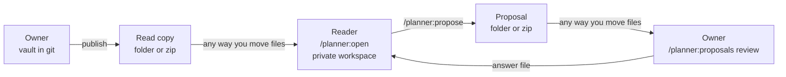

# Planner user guide

Vela (the planner) takes a pile of ideas, documents and meetings and turns them into one planning vault: a folder of Markdown pages for a single initiative. The pages cover goals, apps, contracts, requirements, epics and open questions. Claude runs the sessions that fill the vault, and a checker keeps the pages honest. On a call, you walk through the vault in the explorer, an offline page.

This guide is for people who have never seen Vela. Start by finding your role in the table.

| You are | You have | You do | Go to |
|---|---|---|---|
| Owner | the vault's git repo, and rights to commit | run sessions, decide, publish | [Owners](#owners) |
| Reader | a folder or zip on OneDrive or Teams, no git | read, ask, draft privately, propose | [Readers](#readers) |
| Product owner, sponsor | either, depending on access | decide (git) or propose (no git) | [Roles](#roles-are-decided-by-access) |
| Senior dev | the vault, plus your team's repo | design and plan one app | [Where designs and plans live](#where-team-designs-and-plans-live) |
| QA | usually a reader | read the QA door, ask | [The explorer](#the-explorer) |



Vela doesn't send anything for you. People move the files, by email, Teams or OneDrive.

## 1. Install

You need Python 3.11 or later and PyYAML (`python3 -m pip install pyyaml`). The planner stops with a message if either is missing.

### Claude Code CLI

Add this repo as a marketplace, then install the plugin. Replace the placeholder with where the repo lives (a GitHub `org/repo`, a git URL, or a local folder path).

```
/plugin marketplace add <org>/proj-planner
/plugin install planner@proj-planner
```

The marketplace is called `proj-planner` and holds one plugin, `planner` (`.claude-plugin/marketplace.json`). Skills then appear as `/planner:dump`, `/planner:close`, and so on.

To give teammates the plugin without typing anything, commit this to the team repo as `.claude/settings.json`. Claude Code asks them to trust the repo once, then offers the plugin:

```json
{
  "extraKnownMarketplaces": {
    "proj-planner": { "source": { "source": "github", "repo": "<org>/proj-planner" } }
  },
  "enabledPlugins": { "planner@proj-planner": true }
}
```

This snippet follows Claude Code's settings format, and the repo doesn't store it anywhere, so check it once on a clean machine.

In the CLI, the plugin's `bin/` puts a `planner` command on the PATH that Claude uses. In your own terminal, run it as `python3 <plugin folder>/scripts/planner ...`. `/planner:where` prints the folder.

The older route still works: copy `plugin/` into the vault as `.claude/skills/planner` and start Claude with `bin/claude-planner` (`template/README.md`, steps 2 and 9). With that route, a plain `claude` won't find the skills.

### Claude Cowork

Cowork takes a zip, and it rejects any plugin with a top-level `bin/`, so don't zip the folder by hand. Build the zip from this repo:

```
python3 tools/package_plugin.py --out ~/Desktop/planner-plugin.zip
```

The command prints `claude plugin validate passed` (if `claude` is on your PATH) and `package_plugin: ... written, 176 entries`. It packages what is committed at `HEAD`, not your working tree; add `--ref <commit>` for another commit. Then upload the file.

Every skill works in Cowork: reading, asking, drafting and proposing. The skills call `scripts/planner` rather than `bin/` for this reason.

One thing may not work. The explorer's live "Ask Claude" box needs a `claude` command on the machine's PATH. Without one, the explorer still opens and searches, and when you type a question it offers the question as a prompt to copy. Paste that into Cowork's own chat, or use `/planner:ask <question>` or `/planner:find <words>`, which need no helper.

In Cowork, keep the private workspace inside the working folder, because that is the only place Cowork keeps:

```
/planner:open <published zip> --into planner-workspaces/<initiative-slug>
```

(Claude adds the `--into` for you.) Owners need git, so owners work in the CLI.

## 2. Owners

### Start a vault

Copy `template/` into a new git repo and follow its `README.md` checklist. In short: set `initiative` and `title` in `.planner.yaml`, put your handle where it says `@solution-lead`, then:

```
python3 <plugin>/scripts/planner render     # fill generated blocks
python3 <plugin>/scripts/planner check      # expect: 0 errors
```

A fresh template prints `planner check: 0 errors, 0 warnings in 23 pages.`

### The session order

Each session is one Claude conversation with one job. Open it, work, then close it. Start any of them from the vault folder.


The order is a guide, not a track. Once the strategy is decided, `planner next` suggests requirements before boundary. A grill comes back for each app, and you can skip any stage you already have. Ask it:

```
planner next
planner next: initiative, dump. No app page exists yet, so start with a Dump & Diverge or a Discover. ...
```

`planner status` shows every app's stage and its oldest open unknown.

Only a grill sets an item to `decided`. Every other session writes `inkling`, `assumption` or `fact`. If you want to override a rule, say so. Claude tells you once what the rule protects, does what you asked, and writes an `Override:` line on the item so nobody has to guess later.

The last three sessions are the team's. Once an app is handed off, its senior runs `/planner:design` and then `/planner:breakdown`, and `/planner:tickets` turns the build plan into tickets. `planner next` shows the team's next step as its own line, beside yours.

Handoff happens inside a grill on an app that is ready, and it records the senior's name and date on the app page. Close then writes the handoff manifest, and `planner handoff verify APP-x` later tells you if anything the senior accepted has changed. A senior who disagrees later uses `/planner:challenge`, and you answer on the same branch.

### Tracer first

A tracer is one thin path that runs end to end through every app and contract release one needs. It is built first and kept, so the contracts between the apps get proved before anyone builds a second slice. [How the approach works](explainers/tracer-bullets.html).

In the releases session, release one names it. Two bullets carry it: `**Tracer:**` lists the flows and says the thin version in plain words, and `**Not in the tracer:**` lists what is held back and why. Design then names each app's walking skeleton, its piece of that path with the other apps stubbed at their contracts. Breakdown makes story one of each plan the team's piece of the tracer.

Claude steers you to this, it doesn't force it. If the path isn't ready, say "not ready" and Claude records the reason under `**Not in the tracer:**`, or writes `**Tracer:** none` and your reason. Nothing stops the session.

### Close every session

Say "close" (or "we're done") and the assistant starts the close for you; typing `/planner:close` does the same. Claude marks each capture keep, park or drop by its own defaults, and asks you only the two or three things it can't settle.

Then it writes the kept captures into the pages, renders, checks and commits. After one yes from you, it pushes `session/<id>` and opens a PR. The last step rebuilds the dashboard without `--serve`, commits it if it changed, and tells you:

```
The dashboard is up to date: dashboard.html
```

A failed explorer build never undoes the close, and `/planner:import` and `/planner:open` end the same way.

### Material you already have

`/planner:import <where it lives>` turns existing folders, decks, spreadsheets, code or wiki exports into pages. It registers every source in `sources.md` and shows you an import map before it writes anything. Each line it writes carries its source, and every clash between sources becomes a question with an owner and a date. Large piles go in batches, and you run it again to resume.

### The explorer

```
/planner:explore            # serves it on this machine, opens the browser, search box can ask Claude
```

or `planner explore` for a static `dashboard.html` at the vault root. Nobody else has to build it. The explorer is committed with the vault, so a teammate who pulls the repo opens `dashboard.html`, and a reader on OneDrive opens `dashboard.html` in the published folder (`planner publish` rebuilds it from the published pages). A quiet line at the top says when it was built and from which commit, so an old copy shows its age.

The flags worth knowing, all checked against `planner explore --help`: `--theme console|graphite|daylight|vaporwave`, `--today YYYY-MM-DD` (a vault dated ahead of your clock), `--port`, `--no-open`, `--model haiku|sonnet`.

What you get:
- **What needs you** is the home screen: lit lamps for overdue questions, unreviewed decisions and unsettled items.
- **Five doors** for other readers: Exec, Product, QA, Engineering, Managers.
- **Map, flows, releases, who to ask, why** (the decision log). A flow plays step by step; press `P` to present it full screen.
- **Ask Claude**: type a question and press Enter. Claude reads the vault only (it can't edit), cites page IDs as links, and flags an ID the vault doesn't hold. Each answer shows its model and cost. "Think harder" uses Sonnet.
- **Inside this app** (double-click an app) goes Context, Containers, Components, then **Build plan**: the team's stories in build order, what blocks what, and coverage of the requirements.

The first build writes `.planner/explorer-pins.json`, which fixes each app's place on the map. Commit it, so the team shares one layout. The rest of `.planner/` stays out of git.

### Two voices, and how to set yours

The planner has two voices. The **page voice** is how the pages it writes read: the vault pages, the design docs, the build plans. The **conversation voice** is how a session talks to you: the grill, shape, boundary, close and the rest. Both have sensible defaults, and you can change either.

- **Your own wording for pages.** Run `/planner:voice-seed` and paste two or three passages you wrote. Drafts then follow you instead of the public examples.
- **Your own wording for conversation.** Run `/planner:voice-seed conversation` and paste two or three exchanges you liked, from any session or chat. They are stored word for word. Sessions read them before the first question and talk the way they do.
- **Your own rules.** Write them in `voice/VOICE.md`, in your words, for either voice: "use British spelling", "give me the trade-off in one line, then the question". Both voices read this file first, and your rules win over the defaults. `/planner:voice-seed` can help you start it, writing down only what you tell it.

Nothing is required. With no file and no examples, the defaults apply. If text is your employer's, choose "local only" when voice-seed asks: it stays on your machine and is never committed.

### Where team designs and plans live

Designs and plans live in the vault's own `docs/` folder. A senior runs `/planner:design --app APP-x` and then `/planner:breakdown` from the vault root. (A team that already uses its own `tech-design-grill` and `work-breakdown` skills can keep them; they write the same files.) They write:

```
docs/tech-design/<slug>.md          the design (with vault.app: APP-x in its frontmatter)
docs/adr/  CONTEXT.md
docs/plan/<slug>-breakdown.md       the work breakdown
```

`planner explore` finds them with no flag. `planner check` doesn't read `docs/`. If a design lives in another clone, put `design: <path>` on the app page, or pass `--design APP-x=<path>` (and `--breakdown APP-x=<path>`). The build prints what it found and `no design doc found for ...` when it did not.

### From the build plan to tickets

`/planner:tickets` takes a finished build plan and holds it against the vault one more time: every story traces to a criterion or a requirement, every requirement the app carries has a story, criteria match the vault word for word, blockers point at real stories, and the tracer stories come first. Then it asks what you want: a Markdown list of tickets, a CSV for Jira's import, or, if you already have Jira tools set up (an MCP server or a CLI), whether to use them. It creates nothing in Jira without your yes, and it stops once it has written the file and told you what it found, such as "9 stories, 42 tasks, 3 flagged".

The same check and output work without a session, and no model is involved, so nothing gets invented:

```
planner tickets check
planner tickets write --format csv
```

It reads the single `docs/plan/*-breakdown.md` (or the plan you name) and writes into `docs/work/` (or `--out`). Merged and deferred stories aren't exported; the output lists them as not ticketed. Each story becomes a Story row and each task a Task row, and the CSV turns sizes S, M and L into 2, 5 and 8 points, our mapping, for ordering only. `python3 tools/breakdown_to_tickets.py` still works and runs the same code. The explorer's Build plan level shows the same plan, with a "Copy as Jira CSV" button.

For epics rather than stories: `planner export jira-csv --out epics.csv`.

### Publish a read copy

```
python3 <plugin>/scripts/planner publish --out ~/Desktop/paper-orders.zip
planner publish: wrote paper-orders.zip (47 files) at eebe61f, 0 errors and 0 warnings at publish. Contact: Priya <p@x.com>.
```

`--out` takes a new folder or a path ending in `.zip`. It publishes the last commit, never your working tree, and leaves out `.git`, the voice folders and the plugin copy. Uncommitted pages aren't in the copy, and the copy says so. Readers see your name and email (`--owner-name`, `--owner-contact`, or `owner_contact` in `.planner.yaml`). Put the result on OneDrive or Teams. There's no `/planner:publish` skill; you run this command.

### Review a proposal

```
/planner:proposals review <proposal folder, .zip or changes.patch>
```

Claude runs `planner proposals review`, which applies the change on a branch `proposal/<slug>` in a separate git worktree, so your own checkout doesn't move. It stops and says why if the base commit is missing from your clone or you have uncommitted files.

Then it walks you through each change, pending decisions first, with the reader's reason before the diff. For each one you say accept, reject or edit. Accepting a pending decision records you as the decider and credits the reader. A rejection needs your reason, in your words, because the reader reads it.

At the end Claude writes the answer file beside the proposal (for a zip named `2026-10-11-audit-deadline.zip`, you get `2026-10-11-audit-deadline-answer.md`). You send it. You merge the branch yourself; the tool never pushes or merges.

## 3. Readers

You have no git and don't need it. You work in Claude Code or Cowork with the plugin.

### Open a copy

```
/planner:open <published folder or .zip>
```

Claude asks what name your drafts go under, then runs `planner open`:

```
Opened New initiative at eebe61f, published 2026-10-11 by Priya. Check at publish: 0 errors, 0 warnings.
  Your private copy is ~/PlannerWorkspaces/new-initiative.
planner open: Your copy is the latest published (eebe61f, 2026-10-11).
  Work from that folder: cd ~/PlannerWorkspaces/new-initiative
```

It copies into `~/PlannerWorkspaces/<initiative>/` (or `$PLANNER_WORKSPACES`, or `--into <folder>`) and never writes to the folder you opened from. It refuses a location inside OneDrive or SharePoint, because a synced workspace gets corrupted; pick a local folder with `--into`. Then start Claude in the workspace folder.

### Explore and ask

Open `dashboard.html` in the workspace, or run `/planner:explore`. Your own closes rebuild it, so it shows your drafts. Claude answers two kinds of quick question:

- `/planner:find how does coach talk to brightwater` gives the best places, in seconds.
- `/planner:ask <question>` gives a cited answer, flags what is not decided yet, and says "Not recorded" and who to ask when the vault is silent.

### Draft privately

Any session you run in the workspace (`/planner:dump`, `/planner:grill`, ...) writes to your copy only. Claude tells you once that this is a read copy and nothing is committed or sent. When you close a session, your record is saved, with no commit and no PR.

If you decide something in a grill, Claude writes it as decided, with a line beside it:

```
- **Pending approval:** @sam, 2026-10-18
```

That line means the owner hasn't seen the decision yet. The explorer shows it as a ring with a clock, and `planner check` lists these under warning W327. It's a warning, never an error.

The explorer's "Draft: N pages changed" chip and Drafts view show exactly what you changed against the copy you opened.

### Propose

```
/planner:propose Clearer refund rule
```

Claude lists your changes in groups, pending decisions first, and asks why you made each one. You can skip any; a skipped one reads "no reason given", and Claude never makes one up. Then it asks for a title and for a folder or a zip, and writes:

```
planner propose: wrote .../proposals/2026-10-11-audit-deadline.zip (1 text files patched, 0 binary listed, 0 pending decision(s) first).
  Send that file to Priya (p@x.com). Nothing was sent from here.
```

The proposals folder sits beside your workspace, not in it. Check errors in your copy don't stop a proposal; the owner sees them listed first. The file holds only vault paths and your name. If a line holds your home folder path, Claude shows it and, with your yes, writes `<home>` instead (`--rewrite-home`).

### Send it, get the answer

Send the file any way you send files: email, Teams, OneDrive. The owner reviews it and sends back an answer file that says, for each change, whether it was accepted, rejected (with their reason) or edited. The owner will usually publish a new copy as well, and you open that to continue.

### Open a newer copy

```
/planner:open <the newer copy> --into <your workspace>
```

Claude adds `--into` for you. Your drafts are replayed onto the new pages, and the command prints what happened to each page:

| Result | What it means |
|---|---|
| kept | only you changed the page; your version stays |
| took | only the owner changed it; you get theirs |
| merged | both changed different lines; read it once |
| conflict | the page is now the owner's, and yours sits beside it as `<page>.mine.md` |

Nothing of yours is overwritten. Go through each pair with Claude, copy over the lines you want, and delete the `.mine.md` file. While any conflict is open, you can't propose. Your pre-merge pages are also kept in `.planner/replay-backup/`.

To check without opening, run `planner freshness`. It says "Your copy is the latest published", or "A newer copy was published ... Your drafts are kept", or "I cannot reach the folder you opened this from (OneDrive offline?)". It only reports, and the explorer shows the same message as a banner.

## 4. Roles are decided by access

Your access decides your role, never a title or a config file. `planner role` prints it.

| | Owner | Reader |
|---|---|---|
| Has | the vault's git work tree and can commit | a published copy with `.planner/workspace.json` and no `.git` |
| Decisions | final | marked pending approval until an owner clears them |
| Sessions, ask, find, explore, import | yes | yes, as drafts |
| Close | commit, push, PR | saves the session record only |
| Propose | no (you decide directly) | yes |
| Review proposals | yes | no |
| Handoff, publish, `planner upgrade`, `/planner:challenge` | yes | no |

Readers can't do the last row for three reasons. Handoff stamps the owner's commit, publish writes the owner's copy, and upgrade overwrites the shared conventions file. A challenge needs a branch and a PR, so a reader who disagrees sends a proposal. When Claude refuses, it names the owner ("That is Priya's call. Send a proposal and they decide.").

A product owner with git access is an owner. A sponsor with only OneDrive is a reader. `.planner.yaml` can lower your role to reader but can't raise it. A vault without a remote called `origin` is still an owner, and says nothing can be pushed.

## 5. When something goes wrong

**1. "I cannot find the planner program."** Run `/planner:where` and send the whole output to whoever maintains the plugin. It prints what the host expanded and which paths exist. The skills try the plugin path, then the skill's sibling folder, then `.claude/skills/planner/`, then the path in `.planner/workspace.json`. They don't guess.

**2. `planner` is not a command in my terminal.** The PATH entry exists inside Claude Code only. Use `python3 <plugin folder>/scripts/planner ...`.

**3. "needs Python 3.11 or later" or "needs PyYAML".** Install them. On a Mac where pip refuses with "externally-managed-environment", use a venv: `python3 -m venv ~/.venvs/planner && ~/.venvs/planner/bin/pip install pyyaml`.

**4. Cowork rejects the upload.** It was built by hand, or from a tree with `bin/`. Rebuild with `tools/package_plugin.py`; it excludes `bin/` and checks the layout. If it says `claude not found on PATH: skipped plugin validate`, the zip is still written, only less checked.

**5. `/planner:open` refuses the location.** The folder is inside OneDrive or SharePoint. Pass a local `--into`. If it says the copy changed after it was published, ask the owner for a fresh one. If the copy is older than your workspace, ask for the newest.

**6. Freshness messages.** "Newer copy published": open it (see above). "Cannot reach the folder you opened this from": OneDrive is offline or the folder moved; your copy is fine. Owner: "I could not reach origin; showing local state": you are offline, so do not call the clone up to date. "No remote called origin": nothing to compare.

**7. Check codes you will meet.** Run `planner check`; each line names the page.

| Code | Means | What to do |
|---|---|---|
| E316 | an item is `decided` while an open question blocks it | answer the question, or set the item back; a challenge leaves this red on purpose until answered |
| E105 | a link in `links:` could not be read | fix the link; the explorer leaves it out |
| W327 | decisions pending approval | owners: review them. Readers: expected |
| W324 | decided on the owner's behalf, not yet confirmed | the owner adds `Confirmed by:` or challenges |
| W325 | handed off but the PR number is not recorded | close writes it once the PR exists |
| W329 | a `[[link\|label]]` in a table has a bare `\|` | write `\|` |
| W402 | a generated block is out of date | run `planner render` |
| W705 | an unknown is past its ask-by date | ask the lead; it is their call who to chase |

**8. The explorer says "no design doc found" or its Ask box does nothing.** For the first: the design is not in the vault's `docs/tech-design/`; give the path with `design:` on the app page or `--design APP-x=<path>`. For the second: the box asks only when served (`/planner:explore`) and `claude` is on PATH. A file opened from disk, and Cowork, search only. Paste the offered prompt into a chat.

A last one that bites owners: if `planner role` says reader or none where you expected owner, you are in the wrong folder, or the copy is a published one. Owners work in the git clone.
