# How vela thinks: from a vague idea to actionable work

Someone hands you one sentence, such as "build us a desk helper that tells people what matters each morning." A few months later, several teams need tickets they can build from, and every ticket should still say why it exists. This page explains how vela gets from the first to the second, and why each step is there.

It is written for two readers. If you lead a solution or a team and are deciding whether to trust vela, read the reasoning and sections 11 and 12, which say what holds up and what doesn't. If you're new and learning to use it, read the steps in section 2 and the worked example in section 13. Everything here comes from the repository: the written format (`plugin/template/CONVENTIONS.md`), the session skills, the checks and their tests. Where something hasn't been run in real use, we say so.

A few of vela's words first, each explained again in [section 14](#14-words-used-here). The **vault** is the shared folder of Markdown pages that holds one initiative's plan. A **session** is one conversation with Claude that has one job. A **grill** is a session where vela asks one question at a time until a part of the plan is settled, and it is the only kind of session that can mark something decided. A **slice** is one thin piece of the product built end to end, and the **tracer** is the first slice, built through every app it touches. A **contract** is the agreed interface between two apps.

### How to check a claim in this document

Every claim about how vela behaves is followed by a *Where this is stated and enforced* line. It links to the part of the written format ([`CONVENTIONS.md`][conventions]), the session skill or reference file that states it, the code that enforces it, and the test that pins it. Open the test to see exactly what is held. If a claim has no such line, it is explanation, not a rule, and the surrounding text says whose idea it is.

- A claim like "only a grill decides" is checkable in three places: the format says it, `vela check` reports it (check codes such as E303 are defined in [`rules.py`][rules] and listed in [`schema.py`][schema]), and a test fails if it stops being true. Run `vela check` on any plan to see the codes yourself.
- A claim from outside the repository, such as the limits of working memory or where the tracer-bullet idea comes from, has a bracketed number like [1]. The numbers point to the [Sources](#sources) list at the end. Sources come only from the owner's research notes or from works the repository itself cites. Where the notes record that a source couldn't be opened, the list says so.
- A design choice that is vela's own and has no outside source says so ("vela's own design choice").
- A measured number says when and how it was measured, or it isn't here. Numbers about the demo plan were measured on October 21, 2026, on the `release-0.5` branch at commit `77940a68`.
- The excerpts from the Heron demo plan are word for word, but the demo plan isn't in this repository: it was generated at `/tmp/demo-vault` and its dashboard was built from it on October 21, 2026. The committed worked example is [`examples/unified-booking/`](../examples/unified-booking/). To see the same behavior yourself, run `vela check` and `vela explore` on that one.

The examples come from the demo plan, Heron, a desktop helper for Mac and Windows. One caution about it: its handles read `@sim-lead`, which is the simulator's lead (see section 12). It shows the format at work and its real check output. It isn't evidence from a real initiative.

**In this page**

1. [The problem](#1-the-problem)
2. [The ladder from vague to actionable](#2-the-ladder-from-vague-to-actionable)
3. [Certainty is part of the plan](#3-certainty-is-part-of-the-plan)
4. [Boundaries, contracts and hand-offs](#4-boundaries-contracts-and-hand-offs)
5. [Slices and tracer bullets](#5-slices-and-tracer-bullets)
6. [Traceability, and what the check does and doesn't promise](#6-traceability-and-what-the-check-does-and-doesnt-promise)
7. [Roles](#7-roles)
8. [Working with Claude](#8-working-with-claude)
9. [Why pages read like a colleague explaining across a desk](#9-why-pages-read-like-a-colleague-explaining-across-a-desk)
10. [Not overloading people](#10-not-overloading-people)
11. [Where the plan holds up and where it can't](#11-where-the-plan-holds-up-and-where-it-cant)
12. [Why you can trust it, and where you shouldn't yet](#12-why-you-can-trust-it-and-where-you-shouldnt-yet)
13. [A worked example, end to end](#13-a-worked-example-end-to-end)
14. [Words used here](#14-words-used-here)
15. [Sources](#sources)

---

<a id="1-the-problem"></a>

## 1. The problem

A plan usually goes wrong in the gap between "the idea" and "the first ticket". Five things go wrong there, and they tend to arrive together.

**Vague intent.** "A desk helper that tells you what matters each morning" can mean a calendar briefing, a list of promises you made on client calls, or a reminder service. Each is a different product with different apps behind it. Nobody notices they were picturing different things until someone builds one. In the demo plan the solution lead wrote it down as it happened: "Honestly not sure what morning they were picturing."

**Decisions nobody recorded.** Someone agrees in a meeting that the admin view is its own app. Three weeks later a second team assumes it lives inside the main service. The decision was real. It just left no trace, so it can't be found, questioned or reversed on purpose.

**Guesses passed off as facts.** The solution lead quotes "71 percent of staff missed a follow-up" from memory. By the second page of the plan it's a number everyone cites. The demo plan keeps this honest: the goal says "That's a belief, not a fact, because nobody has read the survey report."

**Apps that don't agree on their edges.** Team A thinks Team B's service answers within a second and never returns an empty answer. Team B thinks "empty" is a normal answer, and that Team A will know what to do with it. Both are reasonable, and the product breaks at the join. The owner's philosophy draft tells this story: one team assumed an account already existed, the answer came back empty, the code read "empty" as "fine", later work built on it, and nobody saw it for a long time, because nobody owned the logic across teams.

**Work that can't be traced to its reason.** Six months in, a developer asks why a story exists. If the answer is "someone said so", nobody can safely change it, drop it, or tell whether it still matters.

Vela is built so each of these fails in the open instead of silently. The rest of this page shows how.

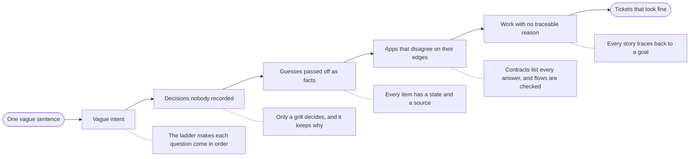

The dashed lines pair each way plans go wrong with the part of vela that answers it.

*Where this is stated.* The failures are the ones the repository's own summary lists: late questions, decisions made in meetings and never written down, open questions with no owner, beliefs treated as facts, work falling between teams, and notes going stale ([PHILOSOPHY.md, "The problem, briefly"][phil]). The empty-answer story is from the owner's philosophy notes, which aren't in the repository. The remedies named in the diagram are stated in [Certainty and sources][c-cert], [Questions and the ledger][c-q], [Fact bullets][c-facts] (the case tables) and [Epics and traceability][c-epic].

### What this page assumes about people

Three beliefs sit under everything else. They are the owner's reasoning, and the design follows them.

1. **Assumptions are made visible, or they become incidents.** Every assumption is written down and checked, or recorded with an owner and a date to resolve it. "Empty" and "missing" are never the same thing, and missing data is never treated as success.
2. **Boundaries carry behavior, not just shape.** A contract between two apps says every way an answer can come back (it worked, it wasn't found, it was empty, it wasn't ready, it timed out), what each means, and what changes afterward. If it isn't written, it isn't agreed.
3. **Someone owns the whole.** When nobody owns the end-to-end design, the logic between teams falls through. In vela the solution lead holds that, and the plan is where it lives.

*Where this is stated.* These three beliefs are the owner's, from the philosophy notes (not in the repository). The repository turns them into rules here: an assumption must carry an owner or a signpost ([ledger rows][c-q]), contracts list every answer ([Fact bullets][c-facts], checked by [`test_cases.py`][t-cases]), and the lead holds the whole while teams hold their apps ([Handoff][c-hand], [PHILOSOPHY.md][phil]).

---

<a id="2-the-ladder-from-vague-to-actionable"></a>

## 2. The ladder from vague to actionable

Vela breaks the journey into rungs. Each rung is one kind of working session with Claude. Each answers one question, writes one kind of thing, and leaves the next question easier to ask. A session is one conversation with one job: open it, work, close it.

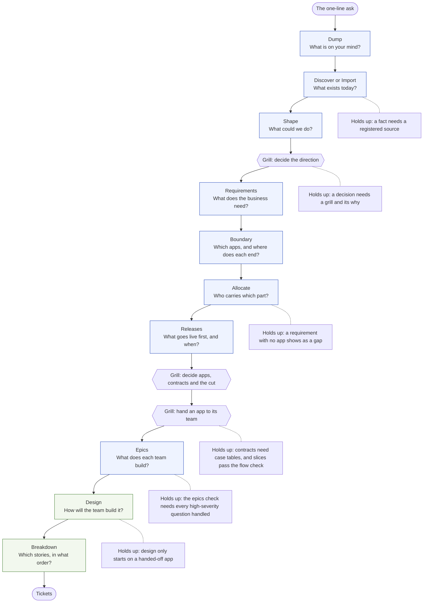

The boxes on the left side of the ladder happen in the plan (the solution lead's shared folder of Markdown pages, called the vault). The green boxes, design and breakdown, are the app team's. The hexagons are grills, the only sessions that can mark anything decided.

Two details in the order are easy to miss.

- **Requirements come before boundary.** The README lists boundary first in its table, but the format says requirements are written once the strategy is decided and before boundary, "so boundary can test each cut against them" (`vela conventions "Requirements and allocation"`). `vela next` suggests them in that order. This page follows the format.
- **A grill isn't one rung.** It is the way anything becomes decided, so it sits between rungs. You run one on the strategy, again on each app and its contracts, and again to hand an app over.

You don't have to follow the order. `vela next` suggests a step from the state of the plan, and you may skip any stage you already have. What the order gives you is a reason for each question coming when it does, which is what the rest of this section covers.

*Where this is stated and enforced.* Stated in [MODES.md][modes] (each session's end and its must and must-not), [START.md][start] and the session skills linked under each rung below; the order of requirements before boundary is in [Requirements and allocation][c-req] and [Releases][c-rel]; the six per-app stages are in [Areas and stages][c-stages]. Enforced by `vela next` and `vela ladder` ([Progress and next step][c-progress]). Pinned by [`test_next_requirements.py`][t-next_requirements], [`test_ladder.py`][t-ladder], [`test_progress.py`][t-progress]. The questions are asked in the order business analysts ask them in practice only loosely: interviews, workshops and brainstorming are standard elicitation techniques [7], and the particular order of rungs is vela's own design choice.

### The rungs, one at a time

For each rung: the question it answers, what it writes, why it comes here, and what stops you skipping it.

#### Dump: "What is on your mind?"

**Question.** What do you know, suspect, fear and wonder about, before anyone organizes it?

**Writes.** Notes only. Every point is captured in the person's own words with their name beside it. Nothing reaches a plan page until the session is closed (see section 8).

**Why first.** Early on, people hold back the risks they think are impolite to raise. Dump asks no one to defend an idea. Claude builds on each one with a "what if" (marked as Claude's, and the far-fetched ones tagged `wild`) and never says an idea won't work. Then it runs a pre-mortem [3]: imagine it's six months on and the initiative has failed. What went wrong? The skill's reason is that this makes people "say the risks they were too polite to raise."

**What stops you skipping it.** Little does, on purpose. A dump is optional. What it protects is that the ideas, worries and unknowns have somewhere to live before the plan starts treating anything as settled. Its "Never" list is strict: it can't write `decided` or `fact`, and it can't edit a page outside the session record.

*Where this is stated and enforced.* Stated in [the dump skill][s-dump] and the Dump row of [MODES.md][modes]. Enforced by the skill's "Never" list, with a hook that guards generated blocks and hand-moved states ([hooks.json][hooks]). Marks are written only at close. Pinned by [`test_apply_marks.py`][t-apply_marks], [`test_hooks.py`][t-hooks], [`test_record_add.py`][t-record_add].

#### Discover and Import: "What exists today?"

**Question.** What is true now, according to documents and people who know?

**Writes.** Facts, each linked to a source registered in `sources.md` (called the Library). Import is the same job for an initiative already under way: it reads documents, code, wikis and tickets, shows an import map, and writes nothing until the lead corrects the map.

**Why here.** You can't design around a system you haven't described. And this is where guesses get sorted from facts. A source is either `exists` (describes what runs today) or `intends` (a plan, deck or roadmap). A line from an `intends` source is an assumption, "however sure it sounds", and so is any sentence about the future. When two sources disagree, vela doesn't pick one. It writes a question naming both.

**What stops you skipping it.** Every fact must cite a source. Claude's general knowledge is never a source. `vela apply` refuses to write a fact from a plan or an unregistered source. Discover asks the lead to confirm each source's kind before it goes on, because, as the skill says, an unconfirmed kind "can turn a plan into a fact."

*Where this is stated and enforced.* Stated in [the discover skill][s-discover], [the import skill][s-import] and [Certainty and sources][c-cert] (what counts as a source, the Library's columns, kinds). Enforced by `vela apply`, which refuses a fact from a plan or an unregistered source, and the source errors E307, E308 and E313 in [rules.py][rules]. Pinned by [`test_apply_marks.py`][t-apply_marks], [`test_library_register.py`][t-library_register], [`test_import_cli.py`][t-import_cli].

#### Shape: "What could we do?"

**Question.** Of two or three real options, which one do you react to?

**Writes.** The option you pick, at `assumption` ("not decided yet"). Each rejected option is recorded with its reason.

**Why here.** Shape gives the lead something concrete to react to (vela's own design choice, stated in the [skill](../plugin/skills/shape/SKILL.md)). It lays out two or three options, never one and never more than three. Each states what it does, costs and rules out, and names the flow that would prove it first. Before showing them, Claude runs a review checkpoint (section 8) asking what would have to be true for each option to work. A lead sees "holds only if the card processor certifies the dock readers" before choosing, and not after.

**What stops you skipping it.** Shape can't decide. It writes at most an assumption. At its end `vela check --gate shape` lists every assumed answer that is still unresolved (code W806), so assumptions get turned into a decision, a requirement or a constraint before Shape closes.

*Where this is stated and enforced.* Stated in [the shape skill][s-shape] and the Shape row of [MODES.md][modes]; the gate is in [Questions and the ledger][c-q]. Enforced by `vela check --gate shape` (W806, in [questions.py][questions-py]). Pinned by [`test_question_gates.py`][t-question_gates], [`test_reviewers.py`][t-reviewers].

#### Grill: "Are we sure enough to decide?"

**Question.** Is this settled, and is it settled for a reason that someone can state?

**Writes.** The item set to `decided`, who decided it, when, and why, in the lead's own words.

**Why it sits here.** A grill is where certainty gets earned (section 3 goes into the reasoning). Claude asks one question at a time and gives a recommended answer with each. It keeps the recommendation under pushback unless given a reason. It uses an edge case, "Suppose it's 8:58, the call starts at nine, and the calendar service doesn't answer. What does the person see?", because the happy path never forces a precise answer. Before anything is written, Claude reads the wording back and waits for an explicit yes. "ok", "next" and silence don't count.

**What stops you skipping it.** `vela check` reports E303 for an item marked decided with no grill behind it. It reports E316 when an item is decided while an open question blocks it. A decision with no recorded reason draws the warning W390. You can still decide past an open question, which is an override (section 8), but the check shows it.

*Where this is stated and enforced.* Stated in [the grill skill][s-grill], [Certainty and sources][c-cert] and [Overrides][c-over]. Enforced by E303, E316, E317 and W390 ([rules.py][rules]), and by `vela decide`, which re-runs the gate before it writes. Pinned by [`test_gates.py`][t-gates], [`test_decide.py`][t-decide], [`test_why.py`][t-why], [`test_override.py`][t-override], [`test_items.py`][t-items], [`test_grill_skill_lines.py`][t-grill_skill_lines].

#### Requirements: "What does the business need?"

**Question.** In the business's own words, what must be true when this is done?

**Writes.** For each capability, functional requirements with acceptance criteria. For example: "A person has a separate switch for meetings, for email and for calendar." They name no app, no screen and no technology, and they're written at `assumption`.

**Why before boundary.** If you cut the apps first, the cut decides what the requirements can say. Requirements written first give the cuts something to be tested against. Boundary can then report, for each cut, which requirements it carries whole, which it splits across apps (each split needs a contract), and which it leaves with no app. When the lead uses two words for one thing ("order" and "booking"), the session asks which one the plan uses and fixes it in the glossary.

**What stops you skipping it.** Boundary says there are no functional requirements and offers requirements first. If the strategy isn't decided, the session says requirements written against it may be written again, and you can go on anyway as an override. In the demo plan the lead did exactly that, and the override line is on the strategy page: "requirements will show us what questions the grill needs to ask anyway."

*Where this is stated and enforced.* Stated in [the requirements skill][s-req] and [Requirements and allocation][c-req]. Enforced by the requirements session's "Never" list (no app named, no `decided`) and, for the cut, `vela boundary cover` ([boundarycover.py][cover-py]). Pinned by [`test_boundary_cover.py`][t-boundary_cover], [`test_next_requirements.py`][t-next_requirements].

#### Boundary: "Which apps, and where does each end?"

**Question.** Into what separate things does this come apart: things someone will stand up, own, release or switch off?

**Writes.** One page per app (a "boundary sheet"): what it does, what it doesn't do, its main parts, the contracts it offers and needs, what happens when something fails, which capabilities it delivers, the journeys it takes part in, and which concerns apply. Each contract gets a case table (section 4).

**Why here.** Claude asks how the product comes apart before offering any cut, because a lead's first word ("one helper") hides separate lifecycles. It then offers two or three cuts, each with what it makes easy and what it makes hard. The demo plan compared four apps, three apps (admin view inside the service), and two (consent inside the service), and recorded why it rejected the others: "the consent record is lost with the service and the identity team's registration review has no seam."

**What stops you skipping it.** An app with only a stub page is sent back to Boundary by `vela next`. Pages are written line by line after a yes, labeled with what each line rests on, and never above `assumption`. `vela ladder` shows how far each app's pages actually reach, and refuses nothing, but it lets you see a stage that the pages don't meet.

*Where this is stated and enforced.* Stated in [the boundary skill][s-boundary], [Fact bullets][c-facts] (the case table), [Frontmatter][c-fm] (the `stub` field) and [Areas and stages][c-stages]. Enforced by `vela next` (a stub goes back to Boundary), `vela ladder` (which reports and refuses nothing) and W380 for a contract with no case table. Pinned by [`test_boundary_cover.py`][t-boundary_cover], [`test_ladder.py`][t-ladder], [`test_cases.py`][t-cases].

#### Allocate: "Who carries which part?"

**Question.** For each requirement, which app does what, and which contract carries what crosses between apps?

**Writes.** A row per requirement on each app's page, with a one-sentence share (40 words or fewer), the contract it goes through, and a state. If dividing a requirement shows two apps must talk in a way no contract covers, allocation proposes that contract at `assumption`.

**Why here.** This is where "work that falls between teams" is caught. A requirement no app carries is called a trace gap. It shows as a gap in the allocation table, and the check warns about it (T7, W505). Under the epics check it becomes an error.

**What stops you skipping it.** The grid of requirement against app shows the blank rows. In the demo plan, which skipped allocation, `vela check` says so, requirement by requirement, and tells you what to run: "Run /vela:allocate CAP-023, or add a row for CAP-023.FR3 to the app page that delivers it."

*Where this is stated and enforced.* Stated in [the allocate skill][s-allocate] and [Requirements and allocation][c-req]. Enforced by E330 to E333, W366 (a share over 40 words) and the trace rule T7, reported as W505 and an error under `--gate epics` ([trace.py][trace-py], [rules.py][rules]). Pinned by [`test_allocation.py`][t-allocation], [`test_trace.py`][t-trace].

#### Releases: "What goes live first, and when?"

**Question.** When does anyone outside the team first see this, who are they, and what has to be true that day?

**Writes.** The slices (section 5), starting with the tracer, and the release milestones that point at them. Each release has a real date, or none. It never has an invented one.

**Why here.** You can't say what is "first" until you know what exists and who carries it. Releases is a release-scope workshop: date first, then must, should and later, requirement by requirement. A requirement can be split across releases by acceptance criterion, so an epic never needs a release of its own.

**What stops you skipping it.** `vela check` warns when a requirement is on no release (W343), when release one has no end-to-end path (W345), and when a path crosses an app that release one delivers nothing of (W347). A release at assumption or decided without a date is an error (E344).

*Where this is stated and enforced.* Stated in [the releases skill][s-releases], [Releases][c-rel] and [Slices][c-slice]. Enforced by W343, W345, W347 and E344 ([rules.py][rules]). Pinned by [`test_releases.py`][t-releases], [`test_tracer.py`][t-tracer], [`test_slices.py`][t-slices], [`test_capture_rules.py`][t-capture_rules].

#### Handoff: "Is an app ready for its team?"

**Question.** What exactly would the team lead be accepting, and what's still unsettled in it?

**Writes.** `handed_off` on the app page, the senior's name and the date, and a record in `handoffs/` of everything accepted, each item with a fingerprint.

**Why here.** The app team's lead takes the boundary as given and designs inside it. Before the handoff, Claude reads back everything that isn't firm: items still at assumption, contracts with no case table, and providers nobody has designed. Handing over anyway is your call, recorded as an override named "handoff checklist". `vela handoff verify` later shows exactly what changed since.

**What stops you skipping it.** The checklist, and the fact that design starts only on a handed-off app.

*Where this is stated and enforced.* Stated in [the grill skill's handoff steps][s-handoff] and [Handoff][c-hand]. Enforced by `vela handoff` and `vela handoff verify`, and W386 to W388. Pinned by [`test_handoff.py`][t-handoff], [`test_handoff_warnings.py`][t-handoff_warnings], [`test_handoff_preview.py`][t-handoff_preview].

#### Epics: "What does each team build?"

**Question.** In what chunks of work, each owned by one team, does the allocated work get built?

**Writes.** Epic pages with acceptance criteria. Each criterion is behavior a tester can see at a contract or flow boundary, and never inside a component. Each carries a line saying which requirement and contract it traces to.

**Why after handoff.** The senior takes the boundary first. The lead then writes and decides the epics against it while the senior designs. Epics take their criteria from the allocated rows, so no behavior is invented in an epic. If a criterion needs behavior no requirement holds, the session stops and sends you back to requirements.

**What stops you skipping it.** `vela check --gate epics` is the stricter check run before epics are called done. It turns trace gaps into errors, and it fails on every high-severity question nobody has handled (E805).

*Where this is stated and enforced.* Stated in [the epics skill][s-epics] and [Epics and traceability][c-epic]. Enforced by `vela check --gate epics`, including E805 for high-severity questions ([questions.py][questions-py]). Pinned by [`test_epics_cli.py`][t-epics_cli], [`test_epic_template.py`][t-epic_template], [`test_trace.py`][t-trace], [`test_question_gates.py`][t-question_gates].

#### Design: "How will the team build it?"

**Question.** Inside the app, which components, which decisions, which risks?

**Writes.** `docs/tech-design/<slug>.md` and decision records, written by the team's lead engineer in the vault's `docs/` folder, ending in a pull request.

**Why here.** The solution lead designs across apps. The team designs inside theirs. Design interviews the lead engineer one question at a time with a recommended answer, starts from the app's piece of the tracer (its "walking skeleton"), and traces every component back to the requirements allocated to it. This is the line the owner's draft draws: "Solution design is mine; app design is theirs."

**What stops you skipping it.** Design checks the app is handed off, runs `vela handoff verify`, and tells the lead before designing against a slice that isn't fully checked or has open findings.

*Where this is stated and enforced.* Stated in [the design skill][s-design] and [TECH-DESIGN-FROM-VAULT.md][tdv] ("Every trace target maps to at least one component. Reject the design if one has no owner"). Enforced by the design session itself. `vela check` doesn't read `docs/` ([Layout][c-layout]). Pinned by [`test_design_skill.py`][t-design_skill], [`test_team_side_skills.py`][t-team_side_skills].

#### Breakdown and Tickets: "Which stories, and what to hand the tracker?"

**Question.** What are the stories and tasks, in what order, and does anything get left out?

**Writes.** `docs/plan/<slug>-breakdown.md`, with stories traced to requirements and design components, tracer stories first, each task sized small, medium or large. Then tickets as a Markdown list, a CSV for Jira's import, or through Jira tools you already have.

**Why here.** The plan is a translation of the shared model into one team's terms, not a new plan. Breakdown builds a coverage table before proposing a cut: every allocated requirement, contract, epic criterion and design component, with the stories that cover it. "An empty cell is work left out." Tickets then hold the plan against the vault once more, and `vela tickets check` reports stories with no trace, requirements with no story, quoted criteria that don't match the vault word for word, and blockers pointing at stories that don't exist.

**What stops you skipping it.** Breakdown won't start on a design that isn't complete or complete-with-gaps. Tickets won't write from a plan that's still moving. It never creates anything in Jira without an explicit yes. If a criterion is wrong, the fix is a challenge back to the vault, never a quiet reword.

*Where this is stated and enforced.* Stated in [the breakdown skill][s-breakdown] and [the tickets skill][s-tickets]. Enforced by `vela tickets check` and `vela tickets write`, which use no model. Pinned by [`test_tickets.py`][t-tickets], [`test_breakdown_to_tickets.py`][t-breakdown_to_tickets], [`test_team_side_skills.py`][t-team_side_skills].

### Why this order, in one paragraph

Each rung reduces what the next has to guess. Requirements without apps can't be bent to fit an app. Apps without contracts leave the joins to chance. Allocation without releases doesn't say what comes first. Epics without allocation invent behavior. Design without a handoff designs against a boundary that may still move. Reading the ladder upside down shows why: a ticket that can't name its epic, a story that can't name its requirement, a requirement that can't name the person whose need it served. That is the "can't be traced to its reason" failure, caught at the rung where it starts.

*Grounding.* This is vela's own design reasoning. It has no outside source, and the proof of it is the checks above that catch each failure at its rung.

---

<a id="3-certainty-is-part-of-the-plan"></a>

## 3. Certainty is part of the plan

Most planning documents state everything in the same flat voice. "The app syncs every hour" might be a measured fact, a belief, a hope, or a decision. A reader can't tell, and neither can the author three months later. In vela, certainty is a field on every item.

| State | Means | Who or what can set it |
|---|---|---|
| `inkling` | a hunch | anyone, in a dump or an import |
| `assumption` | believed, not checked | shape, boundary, requirements, allocate and releases write at this level at most |
| `fact` | has a source | discover or import, with a registered source |
| `decided` | came out of a grill, with the lead's yes | a grill only |
| `unknown` | a question, with an owner, an ask-by date when one was agreed, and a list of what it holds up | any session, through `vela add unknown` |

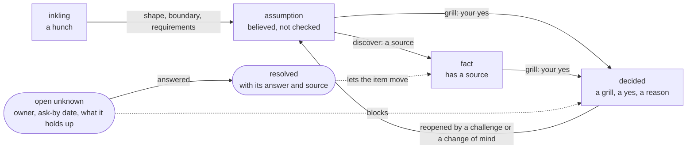

Items move only along the arrows. Nothing goes from `assumption` to `fact` because someone sounded sure. Nothing goes to `decided` without a grill.

*Where this is stated and enforced.* Stated in [Certainty and sources][c-cert] (the five states and who may set each) and the table of what each session may write in [MODES.md][modes]. Enforced by E303, E316 and E317 ([rules.py][rules]), and `vela decide --reopen`, which writes the move from decided back to assumption in the session's Changes table. Pinned by [`test_gates.py`][t-gates], [`test_decide.py`][t-decide], [`test_items.py`][t-items].

### Why each rule exists

**Only a grill decides.** A decision is where responsibility changes hands. If any session could write `decided`, the word would mean "someone in a hurry typed it." A grill has a fixed shape: one question at a time, a recommended answer that's kept under pushback, a read-back, and an explicit yes. That is what makes "decided" mean something a reader can rely on. The rule isn't absolute. You may override it, and the section on overrides below says how. But an override is written on the item, with your handle and reason, so it's a recorded exception and not a quiet one.

**A fact needs a source, and a source has a kind.** Without sources, plans fill up with "everyone knows" statements that nobody can check. With them, every fact carries the document and its date. The Library records each source's kind, owner, date and where it lives. A spec can carry a version, and the Library will show "newer version out" when the owner has been told of one.

**A decision keeps its why.** When a grill decides something, it asks the lead why, once, and writes the answer in the lead's own words beside the decision. A decision with no recorded reason draws a warning. Here is the demo plan's Admin console, decided in a grill:

```
- **Decision:** [[2026-10-19-tracer-slice-first-path]]
- **Why:** Out of hours is a service desk constraint anyway, and they're eight to six with no cover—doesn't change what the console is.
```

Six months later, someone who wasn't there can see what was decided, in which session, and what the person who decided it said.

**An open question has an owner and a date.** A question with no owner is a hope. An unknown needs an owner (the lead who chases it), who is asked, what it holds up, and an ask-by date when one was agreed. Claude proposes the person and the date, with a reason, and waits for the lead's yes. It never picks a date itself: if none is agreed, the entry has no ask-by line and the page says so plainly. Claude never drafts the email or message for you to send, and never offers to. Here is a real one from the demo plan:

```
### UNK-093 Can clients opt in to Heron

Heron summarizes a call only when every participant has opted in, and a client contact isn't Marlowe staff. If clients can't opt in, the first release can't summarize a client call. ...

- **Owner:** @sim-lead
- **Ask:** Legal
- **Opened:** 2026-10-19
- **State:** open
- **Ask by:** 2026-11-02
- **Blocks:** [[CAP-023-opt-in-to-heron-and-take-it-back#CAP-023.FR1 Summarize only fully opted-in calls|Summarize only fully opted-in calls]], [[04b-releases#Release one: February pilot, Client Delivery London|February pilot]]
```

Because it blocks the requirement and the release, neither can be marked decided until it's answered (or the lead overrides the block and says so).

**Disputes are unknowns.** When two sources or two people disagree, vela writes a question naming both and doesn't pick one. The demo plan's tenant note says staff can't install software and everything is pushed from Intune or Jamf. The CIO brief says staff install the helper themselves. Discover recorded both as a single open question.

**State a value once.** The page that owns a number states it. Other pages link to it. Copies drift; links don't.

*Where this is stated and enforced.* Stated in [Certainty and sources][c-cert] (only a grill decides, a fact needs a source, a decision keeps its why, disputes are unknowns, state a value once), [Questions and the ledger][c-q] and the Unknowns section of [MODES.md][modes] (propose an owner and a date, never pick one, never draft the message). Enforced by W390 for a decision with no why, and `vela add unknown`, which won't file a date the lead's words don't back. Pinned by [`test_why.py`][t-why], [`test_apply_add.py`][t-apply_add], [`test_ledger.py`][t-ledger]. The reasons given for each rule are explanation of why the rules are shaped this way. They are vela's own design reasoning.

### Overrides: the owner is never blocked

A rule that can't be broken pushes people into working around the tool, which is worse than breaking the rule in the open. So the person using vela may override any rule. Claude tells them once what the rule protects, does what they asked, and writes an `**Override:**` line on the item with the rule, the person's handle, the date, an end date for a rule that stays true until someone acts, and the reason in their words. `vela check` turns the matching error into a warning that quotes the override. An override that has expired is an error again (E398). If the lead decides on behalf of someone who is absent, that is written as `**Decided by:** @lead, on behalf of @owner`, and the owner can confirm or challenge it later.

The demo plan has one that matters: the Desktop agent was handed to its team before its contracts were decided, because the CISO pack was due November 10 and "the team can't sit idle while the contracts are decided." The override and the on-behalf line are both on the page. So are the seven things the team accepted knowing they weren't settled.

*Where this is stated and enforced.* Stated in [Overrides][c-over] and the "user can override" rule in [START.md][start]. Enforced by E321 and E322 for a malformed override, E398 for an expired one, W323 and W324 ([override.py][override-py]). Pinned by [`test_override.py`][t-override], [`test_override_until.py`][t-override_until].

### How the dashboard shows it

The dashboard's Progress view counts every app's items by state. In the demo plan, as built on October 21, 2026: 2 decided, 0 confirmed, 9 not decided yet, 1 early idea. It also shows what share of the questions have an answer: "open questions answered: 0 of 49". The map colors each app by whether it needs attention.

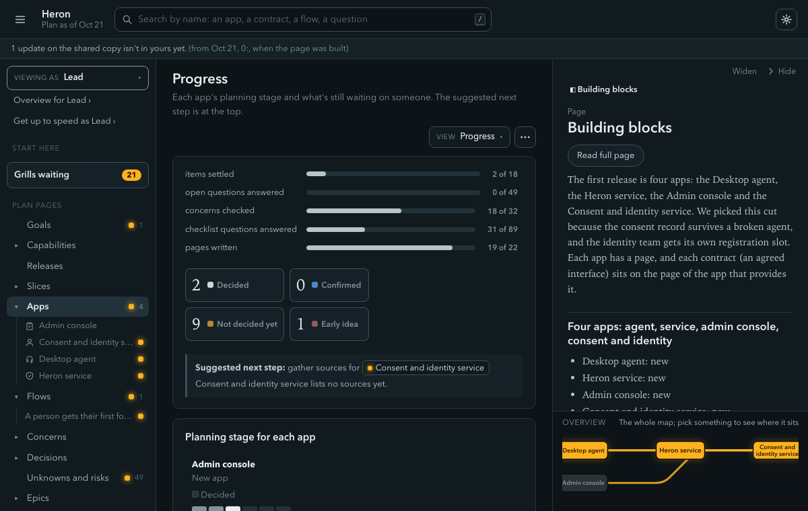

And the question owners are visible too. The "Who to ask" view groups the 49 open questions by the person who holds the answer and shows each one's due date.

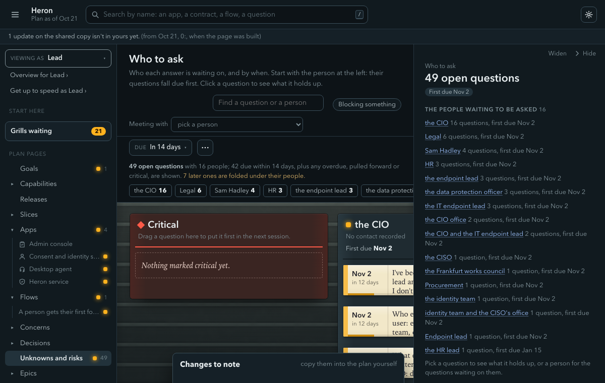

*Where this is stated and enforced.* Stated in [Progress and next step][c-progress] and the dashboard section of the [README][readme]. Enforced by the grid behind `vela status` and the progress-map block. Pinned by [`test_progress.py`][t-progress], [`test_render.py`][t-render], [`test_question_views.py`][t-question_views].

---

<a id="4-boundaries-contracts-and-hand-offs"></a>

## 4. Boundaries, contracts and hand-offs

A plan for several apps is mostly a map of hand-offs. Who sends what to whom, what comes back, and what happens when it doesn't. That's where Section 1's fourth failure lives, so vela treats the joins as first-class items with their own rules.

### A contract is an agreed interface

An app page lists the contracts it offers and the ones it relies on. Each contract has a short name, what crosses (in and out), who consumes it, a change policy, and a case table: every way the provider can answer.

Here is the demo plan's Call items contract, from the Heron service to the Desktop agent:

```
| Case | When | Status | Answer | Emits | Sets |
|---|---|---|---|---|---|
| new_items | | ok | redacted items from calls since the last sync, each with the call's name and date | | |
| nothing_new | | ok | an empty answer, because nothing has come in since the last sync | | |
| call_not_read | | ok | the name and date of a client call that couldn't be read, with no content, so the agent can show it as not checked | | |
| not_signed_in | | error | refused, because there is no valid token | | |
```

Look at the first three rows. "Nothing new" and "a call that couldn't be read" are separate answers from "new items", and the contract says what each one means. A consumer who reads an empty list as "all clear" would be wrong when a call went unread, and the table says so. This is the empty-versus-missing failure from section 1, written down where both teams can see it.

**Why a table instead of a sentence.** A sentence like "returns the call items" leaves out every case that isn't the happy path. The table forces the question "and when it can't?" before anyone builds. A contract with no error case is flagged. Contracts with no case table show up in the handoff's list of what isn't firm.

*Where this is stated and enforced.* Stated in [Fact bullets][c-facts] (the case table, its columns and statuses). Enforced by W380 for a missing or untrustworthy case table, and the handoff list's "not firm" report (W386). Pinned by [`test_cases.py`][t-cases], [`test_handoff_warnings.py`][t-handoff_warnings].

### Flows are journeys across the joins

A flow lists, step by step, who sends what to whom. Steps that cross between apps are written as `Sender → Receiver: what is sent, over which contract`. Here are the first two steps of the demo plan's first flow:

```
1. Consent and identity service → Desktop agent: sends a short-lived token when the agent asks at sign-in, over Sign-in token.
2. Desktop agent → Consent and identity service: sends the person's choice to switch a source on, over Opt-in choice. Nothing is read until Consent and identity has recorded it.
```

The check holds the pair of apps to the contract it names (E350: the sender or receiver isn't a party to that contract). Two apps named with no contract and no pair draw a warning (W374), because "who hands what to whom" isn't recorded.

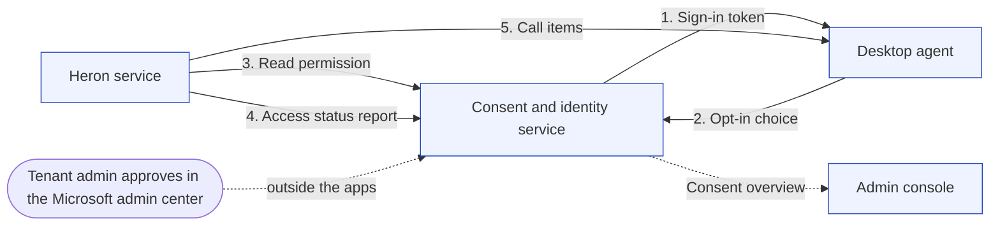

This is the demo plan's hand-off map: the four apps, the five steps of its first flow in order, and the one contract (the consent overview) the admin console relies on. In the dashboard the same thing is a map where you can click any contract or flow to see its path.

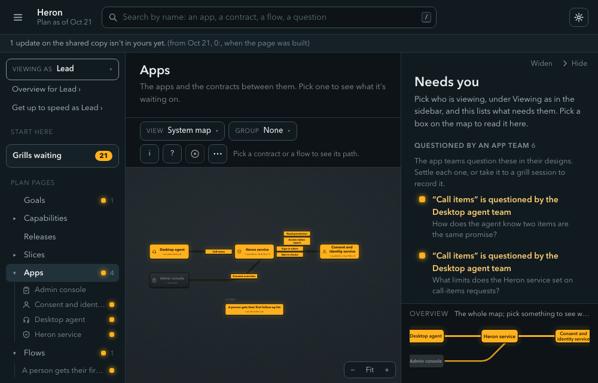

*Where this is stated and enforced.* Stated in [Flow steps][c-fsteps]. Enforced by E350, E351, W351 and W374 ([rules.py][rules]). Pinned by [`test_capture_rules.py`][t-capture_rules], [`test_flow_ends.py`][t-flow_ends].

### The flow check: finding gaps in the plan, not in production

If a flow is drawn as a strict sequence diagram, and its contracts have case tables, `vela check-slice` can prove things about it before anyone builds. Every answer a provider can give is handled. Every event has a consumer. Nothing is left half done. Rules written as invariants hold across every order the steps can happen in. It reads the plan and never the code, and it runs in seconds with no apps running.

It is strict about its input. Any line it can't read makes a slice "not fully checked", and that blocks deciding the slice until the lead overrides it with a reason and an end date. In the demo plan the first slice is exactly there. The handoff record says "SLC-005 A person gets their first follow-up list: not fully checked, checked on Oct 19", because the flow isn't drawn as a strict diagram yet. The tool says what it couldn't check and doesn't pretend otherwise.

*Where this is stated and enforced.* Stated in [Flow check][c-fcheck] and the grill skill's gate step ([grill][s-grill]). Enforced by `vela check-slice` ([flowcheck/][flowcheck-dir]). Pinned by [`test_flowcheck.py`][t-flowcheck], [`test_flowcheck_changed.py`][t-flowcheck_changed].

### Hand-offs between people

The hand-off is also a human one. When an app's contracts and epics are decided, a grill names the senior who takes it, and `vela handoff` writes a record of every item accepted with a fingerprint of its text. The fingerprint ignores generated blocks and the "last verified" lines, so rendering or rereading a page changes nothing. If the senior disagrees later, they use a challenge (section 7). The solution lead answers on the same branch.

The format also says something about what the plan is for. It records decisions and their reasons. It doesn't mirror runtime state. "We switched the slice on, here's who and why" belongs in the plan. "The flag is on right now" belongs to the flag tool, because a stale copy of live state is worse than none.

*Where this is stated and enforced.* Stated in [Handoff][c-hand]. Enforced by `vela handoff verify`, whose fingerprints ignore generated blocks and the `last_verified` lines. Pinned by [`test_handoff.py`][t-handoff]. The remark about what the plan records and what it doesn't is from the owner's philosophy notes (not in the repository).

---

<a id="5-slices-and-tracer-bullets"></a>

## 5. Slices and tracer bullets

Most plans are built one layer at a time. Each team finishes its app, and the apps meet at the end. Nothing works until everything works, and the surprises in the contracts show up when they cost the most to fix.

A **slice** is one thin piece of the product built end to end, from what a user does to what gets stored, so it can ship and be tried on its own. The **tracer** is the first slice: one path that runs through every app and contract it needs, built first and kept. The name comes from Hunt and Thomas's *The Pragmatic Programmer* [4], and the single-system version is Alistair Cockburn's "walking skeleton" [5]. The repository's own explainer is [`docs/explainers/tracer-bullets.html`](explainers/tracer-bullets.html). Putting the tracer first is how vela applies the idea. It's a design choice, not a measured result.

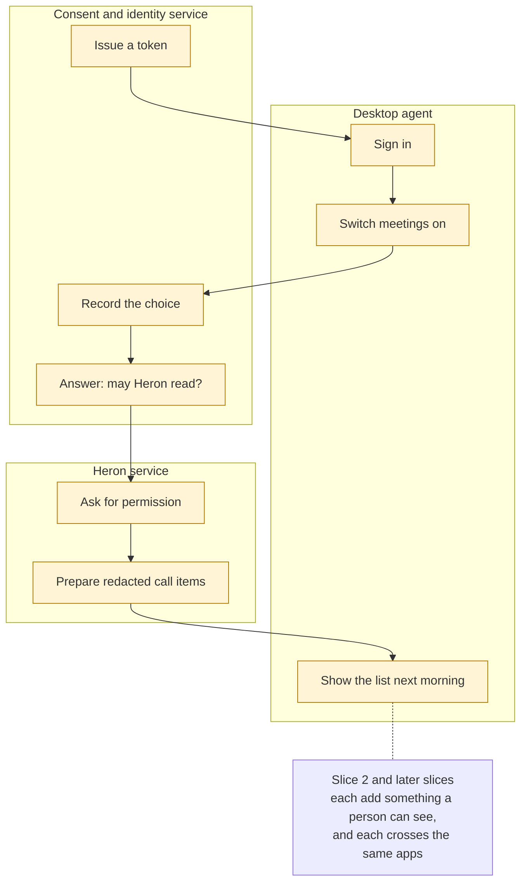

The highlighted path is one slice (the demo plan's tracer, SLC-005). It cuts across three apps and uses each of their contracts once. It does very little, but it runs.

*Where this is stated and enforced.* Stated in [Slices][c-slice], [Releases][c-rel] and the explainer [`tracer-bullets.html`](explainers/tracer-bullets.html). Enforced by W345, W347, W348 and the slice checks ([rules.py][rules]); breakdown flags a story that is only a layer ([breakdown skill][s-breakdown]). Pinned by [`test_slices.py`][t-slices], [`test_tracer.py`][t-tracer], [`test_tracer_skills.py`][t-tracer_skills].

### Why thin and end to end first

**The riskiest joins get proved early.** If the consent check or the call-items contract is wrong, the tracer shows it in the first weeks. A plan built layer by layer would find out when every team is done.

**It gives every team a first story that matters.** The design names the smallest working path through the team's own app that the tracer needs. Breakdown makes story one the team's piece of it. A story that is a layer (a gate, a schema, a screen with nothing behind it) is flagged and folded into the slice that needs it, because nobody could demo it alone.

**Slices are the unit of done, and a release is a milestone.** The format says "Nothing waits for a release; a slice switches on when its journey passes." A slice says which slices it comes after, so the order is a graph and several can be in flight at once. Each slice also says how it ships switched off and what "done" looks like from the person's side.

### What the tracer does and doesn't force

Sometimes a piece isn't ready. Transcripts might wait on a legal ruling. Forcing them in would stall everything. So the plan lets you say so. The slice page has a `## Not in this slice` section, one bullet per piece with its reason. You can also write `**Flows:** none, <reason>` and move on. Nothing stops the session. In the demo plan, the lead kept every release-one requirement whole on the tracer, and the slice records that choice: "Nothing held back: the lead kept every requirement placed on release one whole on this path, apart from the parts release two picks up later."

Vela also warns when the tracer's path passes through an app that release one delivers nothing of (W347). On October 21, 2026, `vela check` gave the demo plan that warning eight times for the tracer, once for each app and contract the slice passes through, because release one delivers no requirement that any of them carries. The tool is pointing at the gap and doesn't hide it.

Each slice's order and status are visible in the dashboard's Slices view, and its flow plays step by step. Press `P` to present it full screen.

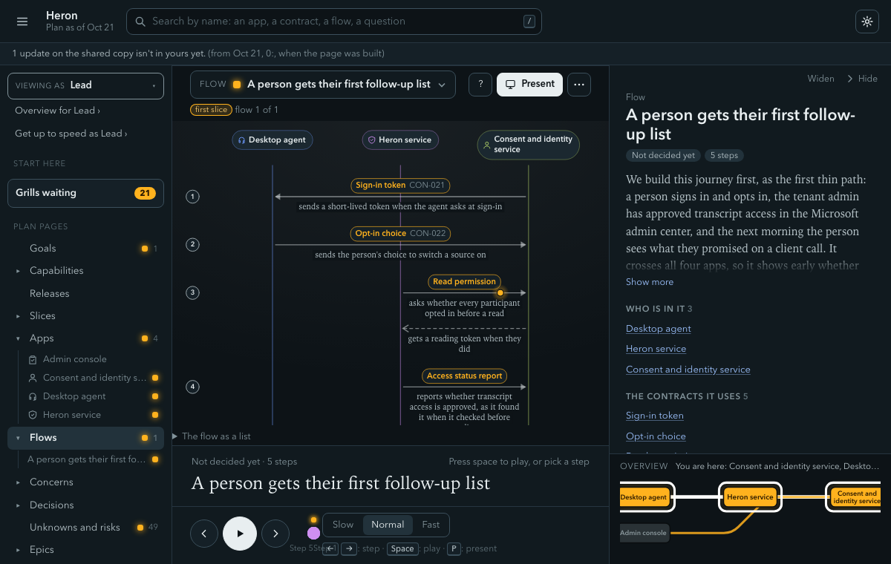

---

<a id="6-traceability-and-what-the-check-does-and-doesnt-promise"></a>

## 6. Traceability, and what the check does and doesn't promise

Traceability means being able to walk from any item to the reason for it and back. Vela's chain runs through seven kinds of thing.

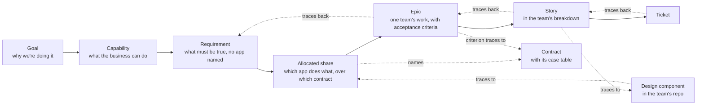

In the Markdown, each link in the chain is written down and checked:

- A goal row carries a `Trace:` line pointing at the capabilities and unknowns it rests on.
- A requirement lives on its capability page as `CAP-023.FR1`, with its acceptance criteria as bullets.
- An allocation row on the app's page names the requirement, the one-sentence share, the contract it goes through, and a state. The format example reads: `accepts the order, rejects fractions and shorting, records the fill | CON-006 | assumption`.
- An epic's criterion ends with a line such as `Trace: CAP-022.FR1, CON-025 · AC1`, naming the requirement and contract, with a stable criterion number.
- A story in the breakdown names the requirements, contracts and epic criteria it covers, and its slice. A ticket is copied from the story.

The dashboard walks the same chain from the top, from a capability down to its requirements, apps, epics and contracts, and it points at the links that are missing.

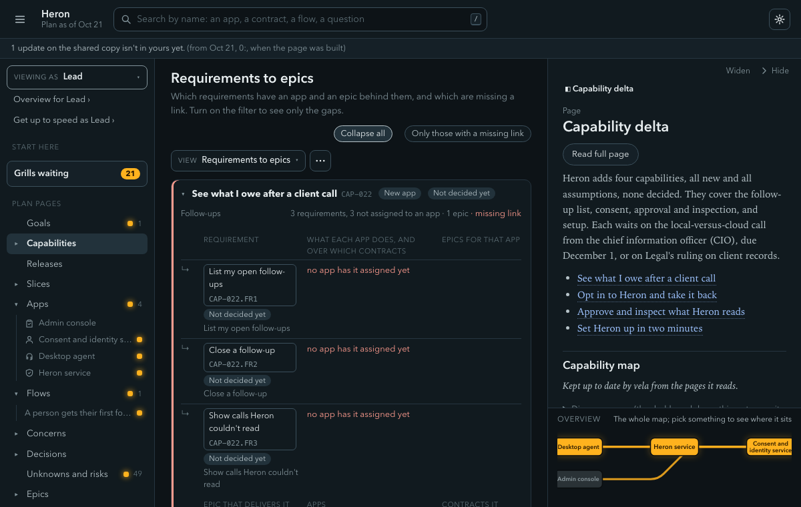

*Where this is stated and enforced.* Stated in [Epics and traceability][c-epic] (the trace rules T1 to T7), [Requirements and allocation][c-req] and [Generated blocks][c-gen]. Enforced by the trace rules in [trace.py][trace-py]. Pinned by [`test_trace.py`][t-trace], [`test_allocation.py`][t-allocation], [`test_trace_blocks.py`][t-trace_blocks].

### What `vela check` guarantees

When `vela check` passes with no errors, a reader can rely on these. They are things a script can see in the pages.

- **Every link resolves.** Each ID and each wiki-link points at something that exists.
- **States are legal and decisions are earned.** A page marked decided links a session that was a grill, or an override says otherwise. A fact has a source. A functional requirement at decided has a grill linked, not a requirements session.
- **The allocation table is honest about itself.** An allocation row names a requirement and a contract that exist. Under the epics check, every requirement at assumption or later has an app that carries it.
- **Questions have owners.** Every row in the question ledger holds the evidence its state needs. An `answered` row names the item and either one registered source or a quote whose words are really on the page it cites (four or more words; case, spacing and curly quotes don't count). A `not-applicable` row can't say "for now" or "later".
- **Overrides are well formed and current.** A malformed one is an error, a standing one past its end date is an error, and a one-typo label like `**Overide:**` is caught so a typo never silently fails to override.
- **Generated blocks are up to date.** The indexes, the allocation table, the "where it stands" summary and the diagrams are rebuilt by `vela render`, and a stale one is a warning.
- **Every diagram parses.** A diagram that mermaid can't read is an error, so a page never ships a blank picture. The judge is mermaid's own parser run in node. When node isn't installed, the check says so in one loud warning and doesn't pass silently.

At the stricter `--gate epics`, three more hold: every capability not unchanged is in some epic, every new or changed contract is delivered by an epic, and every concern cell marked addressed has an epic criterion that does the work.

*Where each is stated and enforced.* Links resolve: E105 ([`test_links.py`][t-links], [`test_frontmatter.py`][t-frontmatter]). States and decisions: E303, E317 ([`test_items.py`][t-items], [`test_override.py`][t-override]). Allocation: E330 to E333 ([`test_allocation.py`][t-allocation]). Ledger evidence: E801 and E802 ([`test_ledger.py`][t-ledger]). Overrides: E321, E322, E398 ([`test_override.py`][t-override], [`test_override_until.py`][t-override_until]). Generated blocks: W402 ([`test_render.py`][t-render]). Diagrams: E604 ([`test_diagram_parse.py`][t-diagram_parse]). The epics gate: T1 to T7 and E805 ([`test_trace.py`][t-trace], [`test_question_gates.py`][t-question_gates]). All the codes are defined in [rules.py][rules] and listed in [schema.py][schema].

### What it doesn't guarantee

Being honest about this matters more than any claim above.

- **It checks structure, not truth.** It can tell that a fact cites SRC-006. It can't tell that SRC-006 says what the fact claims. The one exception is a quote in the question ledger, where the words must really be on the page. Whether a fact is right depends on the person who confirmed it.
- **It can't see a question nobody typed.** The question catalog (29 entries in five areas: finance, data, partners, regulation, operations; counted in [`questions.yaml`](../plugin/catalog/questions.yaml) on October 21, 2026) is owed per subject someone has typed: an app, a contract, an outside party, a stored value. If nobody types "the plan holds customer money", the money questions never fire. A warning (W809) catches some phrases, such as "points" or "license", where the subject was never typed. The README says it plainly: no option claims the questions are complete, "because the catalog finds only what is written into it". The reviewers at each checkpoint exist to catch what the catalog can't, and they can miss too.
- **A plain `vela check` is easy to pass.** On the demo plan, `vela check` reported "0 errors, 54 warnings" and `vela check --gate epics` reported 29 errors (both run on October 21, 2026, with the `release-0.5` code at commit `77940a68`). The 29 are mostly most of them high-severity questions nobody has handled, such as "What customer data does it hold or receive, and on what lawful basis may it use that data?" (Q-DAT-02, for each app). A green plain check means the plan is well formed. It doesn't mean it's finished.
- **It can't tell whether the person really said yes.** The record links each decision to a captured exchange. Where Claude Code's hooks run, a hook logs what the person typed, so `vela record add` can tell their words from the model's and stops on a quote they didn't type. Where hooks don't fire, the line is marked unverified and the lead is asked to confirm it. In both cases it's the command line that refuses. The hooks are earlier feedback, "never the gate".
- **It doesn't read the team's design.** `vela check` skips `docs/`, where designs and plans live. The traces from design to requirement are held by the team's design and breakdown sessions, and by `vela tickets check`. They aren't held by the vault check.
- **The flow check reads the plan, never the code.** It tells you the plan's logic is sound. It says nothing about whether the code follows the plan. And it covers only what's written in the strict form. Anything else is "not fully checked".
- **It doesn't track build progress.** The "where it stands" block says so itself: "each team tracks it in its own tickets, not here."

*Where each is stated.* The catalog finds only what is written into it, and W809 is a partial net ([Questions and the ledger][c-q], [README][readme], [`test_untyped.py`][t-untyped]). Hooks are earlier feedback, and the command line does the refusing ([hooks.json][hooks], [`test_hooks.py`][t-hooks], [`test_said.py`][t-said], [`test_record_add.py`][t-record_add]). `vela check` skips `docs/` ([Layout][c-layout]). The flow check reads the plan only ([Flow check][c-fcheck]). The "where it stands" block says build progress is each team's own ([Generated blocks][c-gen]).

---

<a id="7-roles"></a>

## 7. Roles

Vela has two kinds of people with two different jobs, and one rule that follows from the difference.

**The solution lead** owns the whole: the initiative's boundaries, contracts, flows, behavior at the edges, and slices. In the owner's words, "Solution design is mine; app design is theirs." The lead doesn't talk about the innards of a team's app. The lead runs the sessions in the plan, decides things in grills, and writes the handoff.

**The team lead** (a senior engineer) takes one app. They receive a handoff list: the app page, its runtime page, its contracts, its allocated requirements, its epics, the slices it takes part in and the open questions that block any of them. They design and plan inside the app in their own work, with `/vela:design`, `/vela:breakdown` and `/vela:tickets`.

Neither is asked to read the other's whole world. The solution lead gives the team a richer start (edges, open questions, decisions the design must make), and the team keeps its own thinking. The owner's draft has a sharp line about the failure on each side. AI makes overstepping effortless, so the tool should make the handoff richer, not replace the team's thinking.

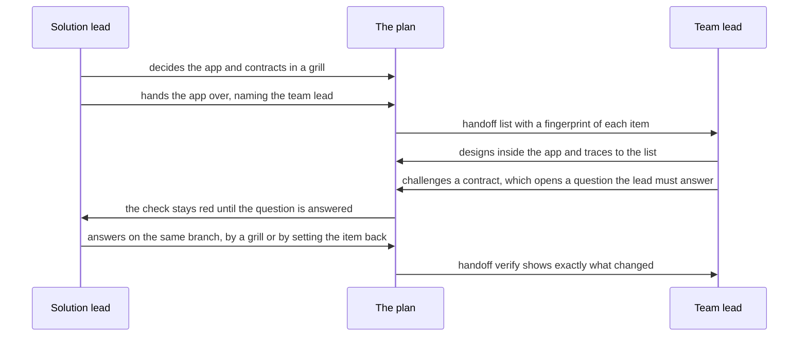

*Where this is stated and enforced.* Stated in [Roles and published copies][c-roles], [Pending approval][c-pend], [Handoff][c-hand] and [PHILOSOPHY.md][phil]. Enforced by `vela role`, which reads access and never a title ([`test_roles.py`][t-roles], [`test_whoami_role.py`][t-whoami_role]). The quotations about the solution lead's job are from the owner's philosophy notes (not in the repository).

### Handoff, challenge and answer

A challenge isn't a complaint filed somewhere. It's a structured disagreement that stays in the plan. `/vela:challenge` quotes the team lead's words, writes one open question they own that blocks the item, and writes a `**Dissent:**` line. It deliberately leaves the item's state and text alone. The check then fails (E316) until the solution lead answers. That's on purpose, because a challenge shouldn't be able to merge while the main branch still says "decided" with an open blocker. The lead answers on the challenge's own branch, either by deciding in a grill or by setting the item back. Close pushes to that branch and comments on the challenge, and doesn't open a second pull request.

The same mechanism covers an owner whose item someone decided on their behalf. They can confirm it with a `Confirmed by:` line or challenge it. Those are the only two answers. A confirmation by the person who decided doesn't count.

*Where this is stated and enforced.* Stated in [the challenge skill][s-challenge], [ANSWER-A-CHALLENGE.md][answer] and [Handoff][c-hand]. Enforced by E316, which stays red until the question is answered, and E322 for a malformed confirmation ([rules.py][rules]). Pinned by [`test_challenge.py`][t-challenge], [`test_answer.py`][t-answer], [`test_override.py`][t-override].

### Owners and grills

Every item has an owner, a handle or a team, and a grill is where the owner says yes in person. If the owner can't be there, the lead can decide on their behalf, and the page says so until they confirm. This keeps decisions attached to people. The dashboard's "Needs you" list shows, per role, up to five things that person has to act on, most urgent first: the questions they were asked, the grills they run that are ready, and the apps just handed to them.

Frequent stepping in by the solution lead is, in the owner's reasoning, "a capacity problem to escalate, not absorb." Heroics hide it from the people who could fix it.

*Where this is stated and enforced.* Stated in [Overrides][c-over] (decided on behalf of, confirmed by) and the "Needs you" list in the [guide][guide]. Enforced by W324 until the owner confirms. Pinned by [`test_override.py`][t-override], [`test_explorer_needs.py`][t-explorer_needs], [`test_needsyou.py`][t-needsyou].

### Two kinds of access, and the readers

Access decides role. An **owner** works in the vault's git clone and can commit. A **reader** works in a published copy with no git (a folder or zip on OneDrive, for example). A reader's decisions are marked pending approval until an owner clears them. A reader who disagrees sends a proposal, which the owner reviews change by change. A reader can't hand off, publish, upgrade or challenge, because each needs the owner's commit, copy or branch. Vela never sends anything. People move the files.

*Where this is stated and enforced.* Stated in [Roles and published copies][c-roles] and [Pending approval][c-pend] (W327). Enforced by each command knowing its role, and `vela propose` and `vela proposals`. Pinned by [`test_roles.py`][t-roles], [`test_pending.py`][t-pending], [`test_proposals.py`][t-proposals].

---

<a id="8-working-with-claude"></a>

## 8. Working with Claude

Claude runs the sessions. The reasoning behind how it behaves is the same as the reasoning behind everything above: put the commitments where they can be seen and checked, and don't rely on good behavior.

*Where this is stated and enforced.* Stated in [START.md][start], [MODES.md][modes], [REVIEW.md][review] and [the close skill][s-close]. Enforced by the commands the skills call (`vela session`, `vela record`, `vela close`, `vela findings merge`). Pinned by [`test_close_stage.py`][t-close_stage], [`test_close_finish.py`][t-close_finish], [`test_close_gate.py`][t-close_gate], [`test_close_pr.py`][t-close_pr], [`test_findings.py`][t-findings], [`test_review_prepare.py`][t-review_prepare], [`test_reviewers.py`][t-reviewers].

### A session, from start to pull request

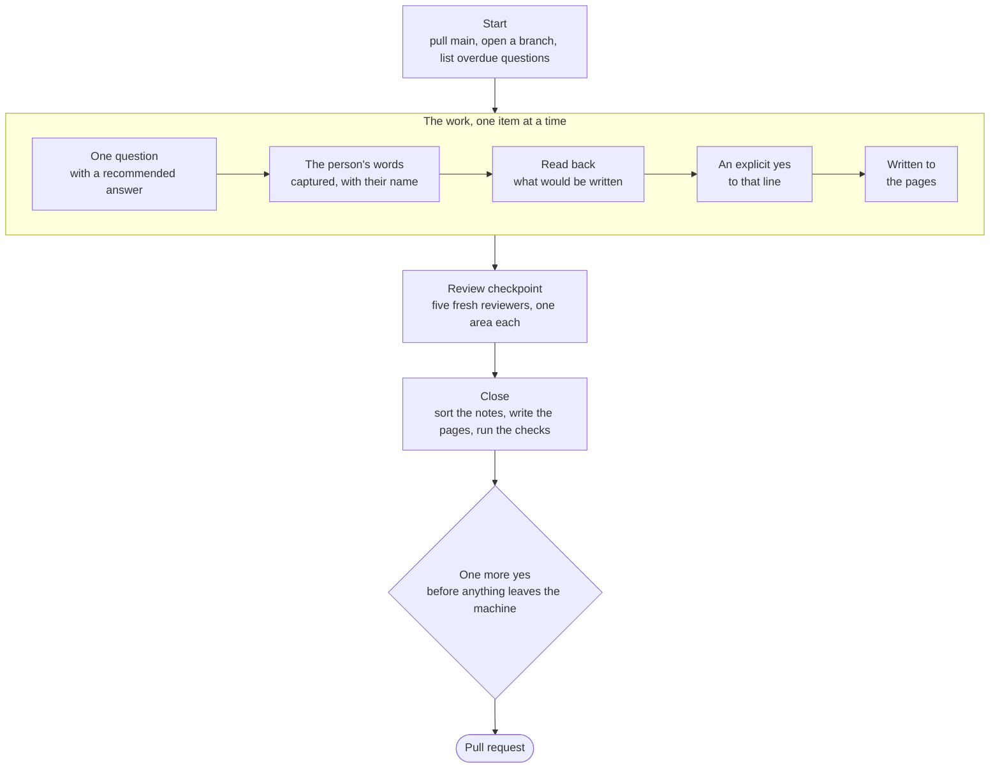

**Sessions.** Each is one conversation with one job, on its own branch. At the start Claude checks the repo is clean, pulls main, lists overdue questions, and suggests a next step from `vela next`. It's a suggestion and never a decision.

**Captures, in the person's own words.** Everything said in a session is saved as a numbered line in the session record, with who said it. A person's words are quoted word for word. Claude's own ideas are labeled as Claude's. When Claude restates what someone said and they accept it, the line is labeled "claude, from" that person. Close lists those lines separately, as "promoted on a nod". Here is a real slice of the demo plan's first dump:

```
- [thought] (solution lead) The staff survey showed 71 percent missed a follow-up they owed in the past month—so that's the real pain we'd be solving. → keep: [[01-goals#Goals|goals]] (inkling) ^c10
- [idea] (claude) What if Heron's first job were only follow-ups owed after client calls, ... → park ^c13
- [unknown] (solution lead) HR should have it. I quoted that 71 percent from memory, not from reading the actual report. → keep: [[11-unknowns-and-risks#UNK-057 Origin of the 71 percent figure|UNK-057]] (open) ^c15
```

The first is the lead's belief, kept at `inkling`. The second is Claude's idea, parked, not kept. The third turns a belief the lead admitted was from memory into an open question. The origin tags are why a reader can tell later whose idea was whose.

**Close, and why it needs the lead's word.** Close files everything: it sorts each capture (keep, park or drop), writes items and unknowns, drafts the prose in the house voice, has a fresh reader review it, renders and checks the plan, and opens the pull request. Claude never starts it unprompted: "close", "we're done", or "switch to requirements" is the word. One more confirmation stays before anything leaves the machine, because sending is the one step that can't be undone from the lead's side. "A bare 'close' is consent to file, not to send."

**Review checkpoints.** At a few set points, five reviewers each read only the written pages, in a fresh context, one area each: money, data, partners, regulation, operations. They get no conversation, and cannot be told what the lead said, so they find what a person who joins the project cold would ask. `vela findings merge` keeps the union, removes duplicates, and drops any finding whose quote isn't really on the page it cites, so a reviewer can't invent evidence. An area that didn't run says "did not run", never "checked, none". The lead sees one ranked list and picks what to take up now, at most three at a time.

*Where this is stated and enforced.* Stated in [START.md][start] ("Captures during the session", "Closing a session") and [the close skill][s-close]. Enforced by `vela record add`, which checks a person's words against what they typed where hooks run, and marks the line unverified where they don't. Pinned by [`test_record_add.py`][t-record_add], [`test_said.py`][t-said], [`test_close_pr.py`][t-close_pr].

### What Claude is never allowed to do

These are written into the sessions, enforced by commands where a command can enforce them, and checked by tests.

| Claude never | What holds it |
|---|---|
| Invents a source | A fact needs a registered source, and Claude's general knowledge is never one. `vela apply` won't write a fact from a plan or an unregistered source. A quote used as evidence must be on the page it cites. |
| Decides without a grill | A decision is filed by `vela decide`, which re-runs the check that holds the decision up, and the check reports E303 and E317 for a decision with no grill. A requirements, shape, boundary, allocate or releases session cannot write `decided`. |
| Writes states by hand | The skills say "when a command can't express what the lead wants, say so and stop; never fall back to writing the page by hand". A hook denies a hand-moved state and an edit inside a generated block. |
| Copies document text into the plan | Discover and import summarize. Requirements, contract and legal terms, numbers and direct quotes are kept word for word as quotes with the source linked, and only on the lead's answer. |
| Drafts a message for you to send | Unknowns have an owner who does the asking. Claude may offer research it does now with a source, and never offers to write the email. |
| Claims a command ran that didn't | "Never report a step as done when it failed." A command line that says "Something went wrong on my side" is Claude's to fix, never to pass on as-is. |
| Writes a line nobody said yes to | A line is written after a yes to that line. "Looks fine" doesn't count. |

Two limits on these. Hooks run only where Claude Code runs them. In Cowork, for example, `/vela:where` tells you whether they do. When they don't, close checks everything itself, and the vault's CI holds every rule. And the rules are defaults: the lead can override any of them, and it gets recorded.

*Where this is stated and enforced.* Stated in [MODES.md][modes] (the must-not column), [START.md][start] and each skill's "Never" list. Enforced by the commands named in the table, plus the hooks that deny staging by hand, hand-moved states and edits inside generated blocks ([hooks.json][hooks]). Pinned by [`test_hooks.py`][t-hooks], [`test_guard.py`][t-guard], [`test_apply_marks.py`][t-apply_marks], [`test_said.py`][t-said].

---

<a id="9-why-pages-read-like-a-colleague-explaining-across-a-desk"></a>

## 9. Why pages read like a colleague explaining across a desk

A plan has to be read by people who weren't in the sessions: a new team lead, an executive, a lawyer with ten minutes. If the pages sound like meeting minutes or a requirements template, those readers stop trusting them or stop reading. So the voice is part of the method.

The default page voice is "a senior colleague explaining the plan across a desk to someone on the team who wasn't in the sessions". That reader knows the company and everyday words, and doesn't know this plan's own names. The consequences are concrete.

- **Introduce the plan's own names the first time.** "Dockside, the bike-share app for the Riverside docks" (the invented example in the skill). Don't gloss everyday words, and don't unpack plain phrases.
- **Short sentences, one point each.** The cause comes before what follows from it. A second addition starts a new sentence. The target numbers are written down: median sentence length 10 to 16 words, three sentences in four at 22 words or fewer, contractions 2 to 6 per 100 words, reading grade 8.5 at most.
- **Say a point's state with its verb, once.** "We're assuming the first release is a pilot." "The transport committee votes on it by December 1." Never tag it on as "That isn't decided." The state is part of the sentence, so it can't drift away from it.
- **Never sound surer than the record.** A number or date needs a source, or the page says "no figure given yet". Something Claude knows itself goes in as "worth checking" or as a question, never as a fact. For an absence, write "not recorded as agreed", never "nobody has..." as fact.
- **For anything open, say who settles it and by when**, in words. The reader's next question gets its answer in the next sentence, but only with a reason someone recorded. With none, "the reason isn't recorded yet".
- **Plain words, never vela's own**, even where the record uses them. "Holds up", not "gates". "A session to test it", not "a grill". This page follows the same rule: vela's terms show up only after they've been explained.

This is the voice of the demo plan's goals page:

> We're assuming the first release is a pilot for the 60 people on Sam Hadley's team, and that it succeeds if they miss fewer follow-ups they owe after client calls. That isn't decided. It holds only if Legal says clients can opt in and a call summary isn't a client record, and a grill will test it once Legal answers.

The state, the condition and the next step are each in a sentence of their own. A reader who wasn't there can act on it.

*Where this is stated and enforced.* Stated in [the house-voice skill][hv], [voice/DEFAULT.md][dvoice] and [CONVERSATION-VOICE.md][cvoice]. Enforced by `vela style`, `vela voicecheck` and the reading-load warnings. Pinned by [`test_voice.py`][t-voice], [`test_conversation_voice.py`][t-conversation_voice], [`test_readload.py`][t-readload], [`test_spelling.py`][t-spelling]. The "colleague across a desk" voice and its target numbers are vela's own design choices (the measures table is in [house-voice][hv]). They aren't findings from outside research.

### Drafted from examples, and the owner's own voice wins

Rules alone drift. So pages are drafted from examples. Before writing a word, the drafter reads every example of that page type in the vault (`vela voice examples`), in a fixed order, so two drafts of one page start from the same context. The public seed examples hold until the owner adds two of their own for a type. After that, the owner's examples win, and `voice/VOICE.md`, in the owner's own words, wins over everything: the defaults, the rules and the examples. `/vela:voice-seed` stores the owner's own passages word for word. Examples that are the employer's stay local and are never committed.

Why it matters: the owner is the one who answers for the plan. If the pages don't sound like them, they won't trust, read or fix them. The tool also harvests only the owner's own later edits, looking through merged pull requests for paragraphs they rewrote, and asks before saving each as an example. A second opinion exists too. `vela voicescore` says whether a paragraph sits inside or outside the owner's own range, as a hint, never a gate.

There are two voices and they are separate. The page voice is how the pages read. The conversation voice is how a session talks to the lead: plain, spoken, short, one question at a time with a view. A read-back "may use the page voice's sentence habits, never its length."

*Where this is stated and enforced.* Stated in [house-voice][hv] ("Load the examples") and [Voice examples][c-voiceex]. Enforced by `vela voice examples` and `vela voice harvest`. Pinned by [`test_voice.py`][t-voice]. That examples work better than rules alone is vela's own design choice.

### What a rewrite is never allowed to lose

A smoother sentence is tempting, and it's where facts get lost. So a rewrite can change words. It can't change what the words point at. `vela voicecheck <before> <after>` compares the two and fails if an ID, number, date, version, link, code span, table cell, frontmatter value or negation was lost, added or moved. Close then keeps the earlier draft. This matters most for negatives: the rules say "use negatives where a person would", because "the agent doesn't send anything off the laptop" turned into a positive claim says something else. Some text is never restyled at all: fact bullets, tables (a contract's case table above all, because its rows are read by the checker), acceptance criteria and their trace lines, decision and dissent lines, generated blocks, and a person's words lifted from a capture.

Merged prose belongs to the people who edited it. When a session changes one fact in a merged paragraph, it changes only that fact. If it must rewrite the paragraph whole, `vela prose replace` first copies the old text byte for byte into the session record, so nobody's edit is lost.

*Where this is stated and enforced.* Stated in [house-voice][hv] ("What is never voiced", "Prose that is already merged"). Enforced by `vela voicecheck` ([voicecheck.py][voicecheck-py]) and `vela prose replace`. Pinned by [`test_voicecheck.py`][t-voicecheck], [`test_prose_replace.py`][t-prose_replace].

### Names, not codes, for the lead

The lead reads names, never codes. In conversation Claude says "the calendar entries" and "the pilot date is a plan, not a fact yet". It doesn't say `CON-003` or `UNK-012` or a check code. The IDs go in the commands, on trace lines and in the files. Where the lead has to act on one, the ID follows the name as a tag. If the lead asks for an ID, Claude gives it. The skills show the contrast:

> Not this: "APP-dock-service provides CON-003 to APP-fleet-console, at assumption; UNK-051 blocks it."
>
> This: "The dock service gives the fleet console its list of broken docks. That's not decided yet, and it waits on one open question: who signs off the repair contract. Ines is chasing it by October 21."

States get words too: just an idea, not decided yet, proposed, decided, confirmed.

*Where this is stated and enforced.* Stated in [START.md][start] ("Plain names and a page a person can hold") and [CONVERSATION-VOICE.md][cvoice], rule 5. Enforced by the `--for-lead` output, which keeps codes out of what the lead hears ([say.py][say-py]). Pinned by [`test_say.py`][t-say], [`test_lead_voice.py`][t-lead_voice].

### American spelling and dates

Spelling is American ("behavior, organization, color, license, canceled"). Dates are written in American order: "October 14" in the current year, "October 14, 2026" in any other year, "Tuesday, February 2, 2027" with a weekday. ISO dates stay in frontmatter, tables of record and IDs, where a machine reads them. The owner can override this in `voice/VOICE.md`, like any other default.

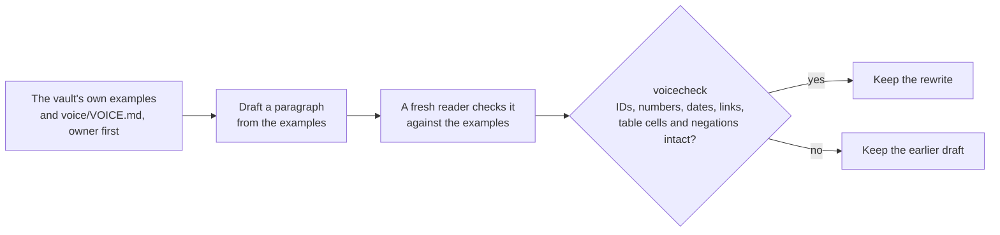

*Where this is stated and enforced.* Stated in [house-voice][hv], rules 12 and 13, and [CONVERSATION-VOICE.md][cvoice]. Enforced by W372, the spelling warning. Pinned by [`test_spelling.py`][t-spelling].

---

<a id="10-not-overloading-people"></a>

## 10. Not overloading people

People can hold only a handful of things in mind at once. The format puts it as "about four to seven things" and cites Cowan [1] and Miller [2], and the house-voice skill builds a rule on it: "Ask the reader to hold only a few new things at once." A tool that asks a busy lead to judge twenty things in one reply gets "ok" to all of them, and "ok" is not a decision. So much of vela's design is about how much it asks at once. The four-to-seven figure is the one the repository states. The research behind it is the two papers in Sources, and how vela sizes pages and replies to it is vela's own design choice.

**Answer first, then about four things.** In conversation, Claude answers the question, then puts about four things to the lead at most, each with a recommendation. A longer list is grouped ("three things hold up the first release") or offered ("there are six more, want them?"). Status is a line, not a list to hold.

**One question at a time, with a recommendation.** Never a list of questions, and never a question without a view. A bare question makes the lead do the thinking and the typing. "I'd write it down as a question for Legal, due the sixth, unless you already know. Fine?" gives them something to react to, and a yes costs them one word. A recommendation is kept under pushback unless the lead gives a reason, which is why a grill is more than a chat.

**Commands stop at about four lines.** Whatever a `--for-lead` command prints reaches the lead in Claude's words. Its lines stop at about four and end with a count such as "Three more, want them?". When the lead says yes, the same command runs again with `--more`. The review checkpoint works the same way: the lead sees at most three questions at a time, once per session, and the rest stay open in the ledger. Nothing is dropped, and no one is buried.

**Readbacks go in groups of about five.** Boundary sheets, criteria, allocation rows and releases are read back in groups, and a yes to a group counts for the lines in it. Silence or "ok" isn't a yes.

**List pages are grouped by what they hold up.** The unknowns page can have dozens of entries. The page format groups them by what they hold up (the first release, a requirement, the security review), about seven to a group. Anything past seven goes under `## Also open (n)`, which the viewer folds. Each line reads the same way: the plain name, who to ask and by when, what it holds up.

**Openings count and point.** A page's first paragraph is two or three short sentences with few links. On a list page, it says how many are open, which few hold the rest up, and the most urgent with its date, then points at the list. "28 questions are open. Five hold up the first release; the most urgent is who owns the dock repair contract, due October 23." The count lives in a generated block, so the sentence never goes stale: "Point at a block or a table, and leave its numbers there."

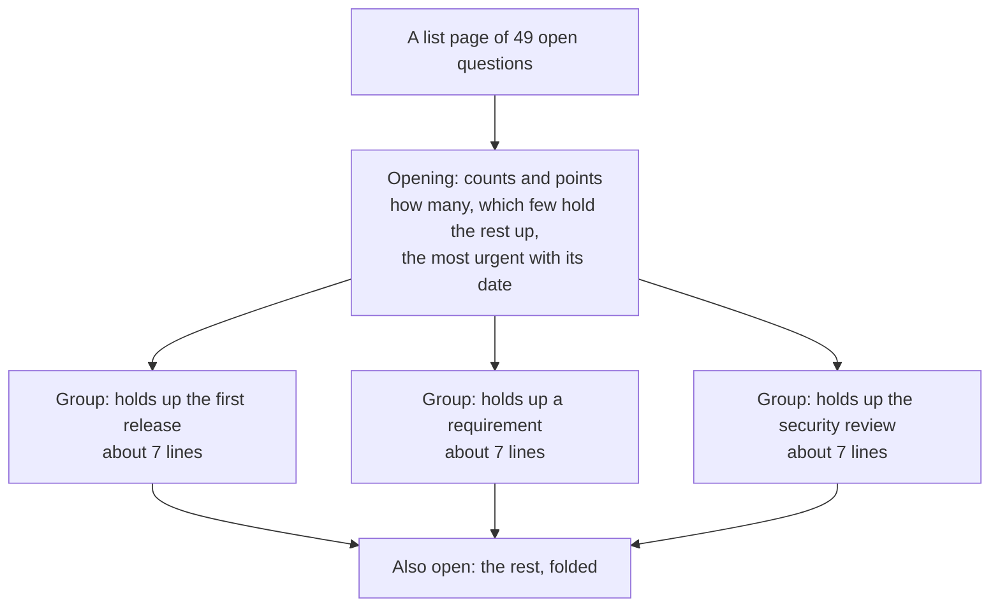

**The dashboard is built for finding things under pressure.** The dashboard is the surface to present from, in a live call, when someone asks "how does the app talk to the billing service?". It is a single offline page. A search box finds a name (an app, a contract, a flow, a question). A flow picker plays any flow step by step, naming each step's apps and contract, and the right-hand panel lists who is in it and which contracts it uses. Every node on every diagram opens the same panel, by click or keyboard, and the test suite fails if one opens empty. The sidebar's "Needs you" list shows what each role has to act on. We haven't measured how many clicks any answer takes, so we make no claim about a number. The design aim is a short walk from a topic to its flow and the connections between apps, with pictures in place of walls of text.

There are two reading surfaces on purpose. `vela view` makes a document you send: every page rendered, stamped with the commit. The dashboard is something you present from. The README says they're "kept apart on purpose".

*Where this is stated and enforced.* Stated in [Pages][c-pages] ("A page fits in a head"), [CONVERSATION-VOICE.md][cvoice] (rules 2 and 7), [START.md][start] ("Relaying a command") and [house-voice][hv] (rule 7). Enforced by `vela check --for-lead`, which says the answer, about four things, then "N more" ([say.py][say-py]); the reading-load warnings; and the folding of `## Also open (n)`. Pinned by [`test_say.py`][t-say], [`test_reading_load.py`][t-reading_load], [`test_readload.py`][t-readload], [`test_explorer_browser.py`][t-explorer_browser]. The limit of about four to seven comes from the working-memory research [1] and [2]. The research notes on keeping a long record usable draw on Shneiderman's "overview first, zoom and filter, then details on demand" [6]. How vela applies them is its own design choice.

---

<a id="11-where-the-plan-holds-up-and-where-it-cant"></a>

## 11. Where the plan holds up and where it can't

A plan that says "everything is fine" is the most dangerous kind. Here is where vela's design is strong, and where it's open about weakness.

**It holds up well against:** decisions nobody wrote down (every decision has a session, a yes and a reason), guesses passed off as facts (every fact has a source with a kind), unowned questions (every open question has an owner), requirements no app carries (trace gaps show in the table and error under the epics check), and drift after handoff (`vela handoff verify` lists exactly which accepted item changed).

**It can't promise:** that the right questions were asked (the catalog and the reviewers are aids and not proofs), that a source says what a fact claims, that the code follows the plan, or that a team's pace matches the dates in the releases page. It says "cannot tell" for the last one. Breakdown says, for each story, whether it fits before the next release date, "or that it cannot tell and why." In the demo plan, the first story's release fit reads "cannot tell for 2027-02-02. Sizes add to about 20 to 37 days for one engineer, and the design names four builders but not how many days each has."

That last example is the principle at work. When the plan doesn't know, it writes "cannot tell" and says why. It doesn't guess.

*Where this is stated and enforced.* Stated in [the breakdown skill][s-breakdown] (each story's release fit, "or that it cannot tell and why") and [the tickets skill][s-tickets]. Enforced by `vela tickets check`. Pinned by [`test_tickets.py`][t-tickets].

---

<a id="12-why-you-can-trust-it-and-where-you-shouldnt-yet"></a>

## 12. Why you can trust it, and where you shouldn't yet

Trust should rest on things you can check yourself. Here are those, and then the things that haven't been proven.

*Where this is stated and enforced.* Stated in [.githooks/gate][gate] and the [README][readme] ("Later", "How the tool is tested" in [PHILOSOPHY.md][phil]).

### What is checked, and where

- **The format is enforced by a program.** `vela check` runs in CI on every pull request and can be a required check, so a broken plan can't merge. It reads every page against the written format in `CONVENTIONS.md`. In the repo's own words, "If a rule here and the check disagree, the check has a bug."
- **The repo has one gate, run by hand, in CI and before a push.** `.githooks/gate` runs the semgrep rules and their tests, a ruff correctness scan, a check that the format file is in sync everywhere it is copied, `vela check` on the template and on the worked example, and the pytest suite. Counted on October 21, 2026, with `ls` and `grep` and no test run: 231 `tests/test_*.py` files holding 3,202 `def test_` functions, which is a count of tests and not a statement that they pass on your machine. Run the gate to find out. Its full mode scopes the slow browser and simulator tests to what changed and prints every skip and why.
- **Docs are held to the same standard.** Every diagram in a Markdown page under `docs/` has to parse with the pinned mermaid, and the test fails if one doesn't. The guide has a further test that fails when `GUIDE.html` is out of date with `GUIDE.md` ([`test_final_wave.py`](../tests/test_final_wave.py)). `METHOD.html` has no such test, so re-render it with `python3 docs/render_doc.py docs/METHOD.md` after any edit.
- **Rules have tests that fail on drift.** Close, the voice rules, the conversation voice, the stricter epics check, the flow check and the dashboard all have their own tests. The dashboard's self-test clicks every node of every diagram and fails on an empty panel.

*Where this is stated and enforced.* Stated in [.githooks/gate][gate] (its header lists each mode and stage) and [CONVENTIONS.md][conventions]'s opening. Enforced by the gate and the continuous-integration workflow `vela-check.yml` in the plugin's template. Pinned by [`test_diagram_parse.py`][t-diagram_parse], [`test_final_wave.py`][t-final_wave], [`test_explorer_browser.py`][t-explorer_browser].

### How vela tests itself, without fooling itself

Skills are prompts, and prompts are hard to test, because a prompt that has quietly learned the test looks great and helps no one. The repo's answer is a session simulator, `tests/sim/`. A simulated solution lead, played by another model, runs real multi-turn sessions in a scratch vault. The lead has a hidden brief: facts it knows, wrong beliefs it holds, and gaps it hasn't noticed, with scripted news and outsiders arriving partway through. A scorecard says which gaps the session surfaced first, which wrong beliefs it challenged, and which decisions got an explicit yes. It also flags lapses, such as a drafted email or an invented action. Each run can include a plain Claude Code arm with no plugin, for comparison.

The risk is teaching to the test. If a skill learns a persona's names or keywords, it scores better and real leads see no change. The repo guards against that in four ways.

1. **Dev and holdout personas.** Each persona says `split: dev` or `split: holdout`, and one that says neither is treated as a holdout. Skills are tuned against the dev personas using generic failure descriptions only ("when the lead said they weren't sure, the session filed an owner or a due date instead of proposing one and asking"). Those never name a key item, quote a turn or name a persona's people or products.
2. **Holdouts are sealed.** Holdout results print scores only. Per-item results appear only with an explicit `--reveal`.
3. **The plugin is scanned for leaks.** `tests/test_sim_seal.py` builds a term list from every persona (names, made-up organizations, keywords, and every six-word run of brief text) and fails if one appears under `plugin/`. The list of accepted leaks "only shrinks".
4. **A change counts only when the keep rule says so.** Both dev personas must improve beyond the spread, neither holdout may get worse, and no voice measure may get worse beyond its spread.

The verdict is recall and precision, and nothing else. **Recall** is the share of the persona's key the run reached. **Precision** is how much of what the run wrote can be trusted: a sample of items from the final vault, each judged against the evidence. "Recall up with precision down is never a GO: more written, less of it true, is the Paper Tiger this verdict exists to catch." The design notes in [`PHILOSOPHY.md`](PHILOSOPHY.md) say that these runs "found most of the gaps fixed so far", such as no session ever writing app pages, and answered questions never being closed. That is a statement without run dates, counts or scores, and this page hasn't re-measured it. We make no claim about how many runs there were or how large the gains were.

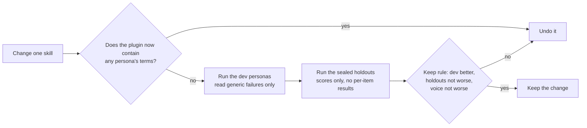

Be careful what this does and doesn't show. The judge is itself a model, so every score cites a turn, and the transcripts are the primary output. The simulator "can't say whether it's faster than plain Markdown for the user. Only real sessions under the kill rule can." And paid simulator runs are started by hand.

*Where this is stated and enforced.* Stated in [tests/sim/README.md][simreadme] ("Iterating without teaching to the test", "Probes and the iteration loop", "The verdict comes from recall and precision"). Enforced by the seal and the plugin scan. Pinned by [`test_sim_seal.py`][t-sim_seal], [`test_sim_precision.py`][t-sim_precision], [`test_sim_compare.py`][t-sim_compare].

### What hasn't been proven, and what to watch

These are stated in the repository's own README and design notes. We haven't added to the list or smoothed it over.

- **No finished real initiative is on record.** Nothing in the sources we read records a real initiative planned end to end with vela. The Heron demo plan comes from the simulator. The README's own kill rule is the honest test: "if it isn't faster than plain Markdown after five sessions, cut back to the conventions, `check` and the viewer."
- **No comparison with plain Claude Code yet** has been recorded in the design notes. That comparison is what would show vela's real value. The simulator can run a baseline arm, but a recorded result isn't in what we read.
- **Not yet run against a real GitHub repo:** the weekly health issue, close's owner-only harvest (it reads merged pull requests with `gh`), answering a challenge (it comments on the challenge pull request), and close's merge of a moved `main`. "Each is tested on local git repos only." The weekly workflow "has not been tested live yet".
- **Vault mode for the owner's own grills** (`requirements-grill` and `tech-design-grill` integrations) hasn't been applied to anyone's `~/.claude` yet.
- **Cowork:** two things haven't been checked there, whether plugin hooks run and whether only the working folder keeps files between sessions. `/vela:where` answers both on a given machine.
- **Open design questions** the design notes list: how many questions to raise before they bury the lead, what "complete" should mean when a design has gaps the team accepted, and whether the tool should draft the pages or mainly interview you. Today it drafts and you review.
- **The question catalog is small and generic** (29 entries), and it finds only what has been written into it.

A reasonable way to adopt it is the one the README already suggests: run a few real sessions on a small initiative, keep the kill rule in mind, and watch the first real run of each of the items above.

*Where this is stated and enforced.* Stated in [README][readme] ("Later", "What is still open" in [PHILOSOPHY.md][phil]) and [the guide][guide] (Cowork). Enforced by a test that keeps the README honest about what hasn't run against GitHub. Pinned by [`test_final_wave.py`][t-final_wave].

---

<a id="13-a-worked-example-end-to-end"></a>

## 13. A worked example, end to end

This is the Heron demo plan, step by step, with real excerpts. Heron is a desktop helper for the 4,200-person company Marlowe. The plan was made by the session simulator, so treat it as a demonstration of the format. The excerpts below are word for word, and every number in this section was read from the demo plan or its dashboard on October 21, 2026. We've shortened some with "...".

*Where this is from.* The excerpts are from the Heron demo plan (see "How to check a claim" at the top). Each rule they show is the one linked in the section it illustrates.

### The ask

> The CIO wants "a desk helper for Mac and Windows that sets up in two minutes, quietly watches your meetings, email and documents, and tells you what matters each morning".

That's the only input. Everything after it is the ladder.

### Dump: get it out of your head

The first session, "Dump & Diverge: desk helper start", filed the lead's thoughts, worries and unknowns in the lead's own words, and Claude's what-ifs, parked:

```
- [worry] (solution lead) I've been made solution lead and it's a blank page. I don't know where to start. → keep: [[11-unknowns-and-risks#UNK-052 Where to start as solution lead|UNK-052]] (open) ^c02
- [idea] (claude) What if the morning briefing came first and alone, built from just the calendar, before any email or documents are watched? ... → park ^c04
- [unknown] (solution lead) The CIO just gave me the one-liner and nothing since. Honestly not sure what morning they were picturing. → keep: [[11-unknowns-and-risks#UNK-055 Which morning the CIO pictured|UNK-055]] (open) ^c08
```

The vague intent is now a recorded unknown with an owner. Nothing was decided.

### Discover: what exists, and who disagrees

The next session read the tenant note, the CIO brief, the CISO position and the product one-pager. Each went into the Library with a kind:

```
| SRC-006 | Microsoft 365 tenant note | IT endpoint lead | 2026-10-02 | exists | document | ... | local only |
| SRC-007 | CIO brief on Heron | CIO | 2026-09-30 | intends | document | ... | local only |
```

Lines from the tenant note (`exists`) became facts. Lines from the CIO brief (`intends`) became assumptions. And where they disagreed, Discover didn't pick a side:

```
- [unknown] (claude) The CIO brief says staff install the helper themselves, while the tenant note says staff cannot install software and everything is pushed from Intune or Jamf. Two sources disagree; the CIO and the IT endpoint lead are asked. → keep: [[11-unknowns-and-risks#UNK-086 Staff self-install against pushed software|UNK-086]] (open) ^c06
```

This is "guesses passed off as facts" being caught at the door.

### Shape and the first grill: a direction

Shape offered options and recorded the choice, with the ones it rejected and why:

> **Options considered:** Follow-ups owed after client calls (picked); morning calendar briefing on the laptop: rejected, Sam's team would only use Heron if it works on client calls; briefing by invitation: rejected, people who have to hand things over by hand won't, so it is dead.

The strategy page is still at `inkling`, and says so: "We haven't decided this." The lead then chose to write requirements against it anyway, which is an override, recorded on the page:

> **Override:** "If 04-solution-strategy.md is not decided, say so: requirements written against it may be written again." by @sim-lead on 2026-10-19: Go on—requirements will show us what questions the grill needs to ask anyway. Flag what's blocked on the CIO and Legal calls, though, so we don't mistake provisional for locked in.

The rule was named, the person chose, the reason is on the page. Nothing is hidden.

### Requirements: what the business needs, naming no app

From the capability page "Opt in to Heron and take it back":

```
### CAP-023.FR1 Summarize only fully opted-in calls

Heron summarizes a call only when every participant on it has opted in to Heron. The Teams recording banner covers Teams recording, not Heron summarizing, so it doesn't count as consent. Whether a client contact on a call can opt in, and so whether any client call can be summarized, is open.

- **State:** assumption
- **Source:** [[2026-10-19-capabilities-heron-changes#^c10]]

- Heron summarizes a call only when every participant on it has opted in to Heron.
  - Trace: UNK-093
- A call with even one participant who hasn't opted in gets no summary.
- The Teams recording banner does not count as a participant's opt-in to Heron.
```

No app, no screen, no technology. Its first criterion traces to the open question about clients, so the plan shows what this requirement depends on.

### Boundary: apps, and the joins between them

The cut was four apps, with the rejected two- and three-app cuts recorded with reasons (see section 2). The Desktop agent's page opens with what it is and what it doesn't do:

> The Desktop agent runs on each person's laptop and ships through Intune on a fixed slot. It gets a token at sign-in, sends the person's opt-in choices, and asks the Heron service for call items on startup and sync. It ranks them on the device, so done items never leave it. It doesn't read calls, keep the consent record or approve transcript access.

And the Call items contract, with its four answers, is the table in section 4. The first journey is drawn as a flow, FLO-001, in five steps across the apps.

### Allocate, and an honest gap

The format for a share is one row per requirement on the app's page, under `## Requirements allocated`. This demo plan didn't get that far, so the check says so for each requirement, with the command to run:

```
capabilities/CAP-023-opt-in-to-heron-and-take-it-back.md:45: W505 Delete data from a switched-off source (CAP-023.FR3) is not decided yet, but no app has taken it on (no Requirements allocated row), so no team owns it. Fix: Run /vela:allocate CAP-023, or add a row for CAP-023.FR3 to the app page that delivers it.
```

### Releases and the tracer

Release one, the February pilot, is dated, points at the tracer, and says in its Note column what waits:

```
## Release one: February pilot, Client Delivery London

- **Target:** 2027-02-02
- **State:** assumption
- **Slices:** SLC-005

| Delivers | Criteria | Note |
|---|---|---|
| ... CAP-022.FR2 Close a follow-up | AC1, AC2, AC3 | AC4 and AC5 in release two, no date yet |
| ... CAP-023.FR3 Delete data from a switched-off source | all | AC1 waits on the CIO's local-versus-cloud call of December 1 |
```

The tracer slice (SLC-005) crosses the Desktop agent, the Heron service and the Consent and identity service. Its page says what "done" looks like: "a pilot user signs in, switches meetings on, the tenant admin has approved transcript access, and the next morning the user sees what they promised on a client call." Its state is "not planned yet", and `vela next` says what's missing: "draw its flows, write their case tables and run the flow check on it until it passes (or each finding has an exception with an end date), then plan it in a grill."

### A grill: the Admin console is decided

This is the one app the demo plan decided. In "Grill: tracer slice first path", Claude read back what the Admin console is, and the lead answered, said yes, and said why:

```
- [thought] (@sim-lead) Out of hours is a service desk constraint anyway, and they're eight to six with no cover—doesn't change what the console is. → keep: [[admin-console-building-blocks#Admin console|APP-admin-console]] (decided) ^c02
- [thought] (@sim-lead) Yes. → keep: [[admin-console-building-blocks#Admin console|APP-admin-console]] (decided) ^c03
- [thought] (claude) Lead decided with Q-DAT-02@APP-admin-console and Q-OPS-01@APP-admin-console still open (W807). → park ^c05
- [thought] (@sim-lead) Hold it. The services aren't named and the flow isn't drawn → drop: The lead's hold on the Desktop agent; ... ^c06
```

The session's change table records the move:

```
| ID | From | To | Source |
|---|---|---|---|
| APP-admin-console | assumption | decided | [[2026-10-19-tracer-slice-first-path#^c03]] |
```

Three things to notice. The lead held the Desktop agent back and Claude didn't push it through. The lead decided the Admin console while two catalog questions about it were still open, and the session recorded that fact as "W807". And a decision record (short records of one decision and its alternatives are Nygard's idea [8]) captured the alternatives, as ADR-0003: "Three apps, with the admin view inside the Heron service: The works council's view and the reading service would ship and fail together."

### Handoff: giving an app to a team

The Desktop agent was handed to its lead before its contracts were decided, as a recorded override, with the lead deciding on the owner's behalf. The handoff record lists what the team accepted, including what isn't settled:

```
## Not settled at handoff

The app's team accepts it knowing these are still open:

- Desktop agent (APP-desktop-agent) is not decided yet: nobody has said yes to it.
- Sign-in token (CON-021) is not decided yet: nobody has said yes to it.
- Desktop agent calls Call items (CON-025) on Heron service, but no team has taken Heron service or designed it yet, so there is no design behind those calls to build against.
```

The team knows exactly what it's building on. If a decision changes, `vela handoff verify` says so. The record also flags that its own commit isn't in this copy of the repository (W388), which is true of a demo plan carried to another machine.

### Epics and the stricter check

The epic "A person's first follow-up list" has criteria a tester could read over the phone, each with a trace line:

```
### A person sees every promise they made

Each morning a person sees every promise they made on a client call that they haven't marked done or dropped. A person never sees a promise that a client or a colleague made on the same call.

- Trace: CAP-022.FR1, CON-025  ·  AC1
```

It also says honestly what is open: "Still open: no requirement is allocated to an app yet, so it has no checks." Then the stricter check refuses to call the epics finished:

```
11-unknowns-and-risks.md:620: E805 A high-priority question hasn't been dealt with yet (it has no row in the question ledger), so the epics can't be called finished: What customer data does it hold or receive, and on what lawful basis may it use that data? (Q-DAT-02@APP-desktop-agent) Fix: Answer it, rule it out with a reason, or log it as an open question with an owner, or as an assumption. To finish the epics anyway, record an exception under the Question ledger heading: - **Override:** E805 by @handle on YYYY-MM-DD until YYYY-MM-DD: <why>.
```

A plain `vela check` on the same plan says "0 errors, 54 warnings". The stricter check says 29 errors. Both are true, and they answer different questions.

### Design, breakdown and tickets: inside the app

The team's design is `complete-with-gaps`. It lists what it deferred and why, with each guess named as a guess: "the 15-second limit is a guess and may feel broken on a managed network; the team lead wants real latency measured against the endpoints before the January ship, and the limit is a setting until then". Its gaps carry who acknowledged them and when to revisit.

The breakdown puts the tracer first. Story S-01 is marked `Tracer: yes`, traces to `CAP-022.FR1@APP-desktop-agent, CON-021, CON-022, CON-025, EPC-036.AC1 ...`, and names its slice. Three stories rest on the design alone, and the plan says so in a gap: "S-06, S-07 and S-08 rest on the design alone: no requirement in the vault says when they are done." The ticket for S-01 says "Release fit: cannot tell for 2027-02-02", with its reason.

### What a reader sees

At any point the lead can open the dashboard and see where the plan stands. The map shows the four apps and their contracts, and the flow plays step by step. The Progress view says 2 of 18 items settled and 0 of 49 questions answered, and "Who to ask" lists who holds each answer. The plan doesn't claim to be further along than it is. That is the whole point.

---

<a id="14-words-used-here"></a>

## 14. Words used here

| Word | Means |
|---|---|
| Vault, or the plan | The folder of Markdown pages for one initiative, kept in git, in a fixed layout |
| Session | One conversation with Claude that has one job, run on its own branch |
| Capture | One numbered line in the session record, in the person's own words, with who said it |
| Grill | A session where vela asks one question at a time until a part of the plan is settled. The only session that marks anything decided |
| Item | Anything with a state: a goal, a requirement, an app, a contract, a flow, an epic |
| Certainty states | `inkling`, `assumption`, `fact`, `decided`; and `unknown` for a question with an owner |
| Library | `sources.md`: every document, spec and link the plan rests on, with its kind (`exists`, `intends`, `repo`) |
| Capability | Something the business can do after the change, such as "see what I owe after a client call" |
| Requirement | One thing the business needs, in the business's words, with acceptance criteria, naming no app |
| Contract | The agreed interface between two apps, with a table of every answer the provider can give |
| Flow | A journey across apps, step by step, naming each hand-over and the contract it uses |
| Slice, tracer | A slice is one thin piece of product built end to end. The tracer is the first slice, through every app it touches |
| Allocation | Dividing each requirement among the apps and contracts that carry it |
| Epic | One team's chunk of work, with acceptance criteria a tester can see at a contract or flow boundary |
| Handoff | Giving an app to its team lead, with a record of exactly what they accepted |
| Challenge | A team lead's recorded disagreement, kept as an open question for the solution lead |
| Override | A rule set aside on purpose, written on the item with who, when and why |
| Review checkpoint | Five fresh reviewers, one area each, reading only the written pages |
| Question ledger | The table on the unknowns page recording how each owed question ended |
| Check, gate | `vela check` reads the plan against the format. A stricter run, such as `--gate epics`, is held before a stage is called done |

For the commands, see the [README](../README.md#the-vela-cli). For a task-by-task guide to installing and running vela, see the [user guide](GUIDE.md). For the short version of this page, see [How Vela works](PHILOSOPHY.md).

## Sources

<a id="sources"></a>

Every outside claim in this page has a number here. The references come from two places only: the owner's research notes (kept outside the repository and not copied into it) and works that the repository itself cites. Each entry says which, and what the notes record about how the source was read. Nothing here was added from memory. Where the notes say a source couldn't be opened, that is stated, and the page uses it only for the claim the notes support.

1. Cowan, N. (2001). "The magical number 4 in short-term memory: A reconsideration of mental storage capacity." *Behavioral and Brain Sciences*. <https://www.cambridge.org/core/journals/behavioral-and-brain-sciences/article/magical-number-4-in-shortterm-memory-a-reconsideration-of-mental-storage-capacity/44023F1147D4A1D44BDC0AD226838496>. Cited by the repository ([`CONVENTIONS.md`](../plugin/template/CONVENTIONS.md#pages), "A page fits in a head") and listed, with a PDF copy, in the research notes on working memory (opened there). Used here for: people hold only a handful of things in mind at once.
2. Miller, G. A. (1956). "The magical number seven, plus or minus two." *Psychological Review*. <https://psychclassics.yorku.ca/Miller/>. Cited by the repository in the same place as [1] and opened in the research notes. Used here for the "four to seven" range the format states.
3. Klein, G. (2007). "Performing a Project Premortem." *Harvard Business Review* 85(9). Named in the research notes on session design. The notes record that the article was paywalled and not read. Used here only to name the premortem technique and its origin, which is the dump skill's pre-mortem.
4. Hunt, A. and Thomas, D. (1999). *The Pragmatic Programmer*, "Tracer Bullets" (Topic 12 in the 20th anniversary edition). <https://www.oreilly.com/library/view/the-pragmatic-programmer/9780135956977/f_0030.xhtml>. Cited by the repository ([`tracer-bullets.html`](explainers/tracer-bullets.html)) and listed in the research notes on tracer slices. The notes record that the page returned an access error to their fetcher, so they worked from search excerpts. Used here for where the tracer-bullet idea comes from.
5. Cockburn, A. (2004). *Crystal Clear*, "Walking Skeleton." Cited in the research notes on the tracer plan. The repository's explainer attributes the name "walking skeleton" to Cockburn. The notes record that Cockburn's own walking-skeleton page could not be reached. Used here only for the attribution.
6. Shneiderman, B. (1996). "The Eyes Have It." University of Maryland repository, <https://drum.lib.umd.edu/handle/1903/5784>. Listed in the research notes on dependencies and flows, which quote it as "Overview first, zoom and filter, then details-on-demand", and in the notes on working memory. Used here for the overview-first, details-one-click-away shape of the dashboard and of list pages.
7. International Institute of Business Analysis. *A Guide to the Business Analysis Body of Knowledge (BABOK Guide)*, version 3, chapter 10 (techniques including interviews, workshops and brainstorming). Named in the research notes on session design. Used here only for the statement that these are standard elicitation techniques. The notes didn't give a web address, and one IIBA page they tried needed a login.
8. Nygard, M. (2011). "Documenting Architecture Decisions." Cognitect blog, November 15, 2011. <https://cognitect.com/blog/2011/11/15/documenting-architecture-decisions>. Listed in the research notes on planning practice and in those on session design. Used here for the idea of short records of one decision and its alternatives.

### What has no outside source

These parts of the method are vela's own design choices. We looked and found no source we could cite, so we don't claim one: the order of the rungs, requirements before boundary, a grill as the only way to decide, the voice (colleague across a desk, its target numbers, drafting from examples), the "about four things" limit on a reply as applied (the research in [1] and [2] supports the limit on how much people hold, but not this particular design), the slice and release model as vela writes it, and the sealed-simulation method. The simulator's "recall and precision" use is its own scoring design, described in [`tests/sim/README.md`](../tests/sim/README.md).

---

[answer]: ../plugin/references/ANSWER-A-CHALLENGE.md
[c-cert]: ../plugin/template/CONVENTIONS.md#certainty-and-sources
[c-epic]: ../plugin/template/CONVENTIONS.md#epics-and-traceability
[c-facts]: ../plugin/template/CONVENTIONS.md#fact-bullets
[c-fcheck]: ../plugin/template/CONVENTIONS.md#flow-check
[c-fm]: ../plugin/template/CONVENTIONS.md#frontmatter
[c-fsteps]: ../plugin/template/CONVENTIONS.md#flow-steps
[c-gen]: ../plugin/template/CONVENTIONS.md#generated-blocks
[c-hand]: ../plugin/template/CONVENTIONS.md#handoff
[c-layout]: ../plugin/template/CONVENTIONS.md#layout
[c-over]: ../plugin/template/CONVENTIONS.md#overrides
[c-pages]: ../plugin/template/CONVENTIONS.md#pages
[c-pend]: ../plugin/template/CONVENTIONS.md#pending-approval
[c-progress]: ../plugin/template/CONVENTIONS.md#progress-and-next-step
[c-q]: ../plugin/template/CONVENTIONS.md#questions-and-the-ledger
[c-rel]: ../plugin/template/CONVENTIONS.md#releases
[c-req]: ../plugin/template/CONVENTIONS.md#requirements-and-allocation
[c-roles]: ../plugin/template/CONVENTIONS.md#roles-and-published-copies
[c-slice]: ../plugin/template/CONVENTIONS.md#slices
[c-stages]: ../plugin/template/CONVENTIONS.md#areas-and-stages
[c-voiceex]: ../plugin/template/CONVENTIONS.md#voice-examples
[conventions]: ../plugin/template/CONVENTIONS.md
[cover-py]: ../plugin/lib/vela/boundarycover.py
[cvoice]: ../plugin/references/CONVERSATION-VOICE.md
[dvoice]: ../plugin/template/voice/DEFAULT.md
[flowcheck-dir]: ../plugin/lib/vela/flowcheck/
[gate]: ../.githooks/gate
[guide]: GUIDE.md
[hooks]: ../plugin/hooks/hooks.json
[hv]: ../plugin/skills/house-voice/SKILL.md
[modes]: ../plugin/references/MODES.md
[override-py]: ../plugin/lib/vela/override.py
[phil]: PHILOSOPHY.md
[questions-py]: ../plugin/lib/vela/questions.py
[readme]: ../README.md
[review]: ../plugin/references/REVIEW.md
[rules]: ../plugin/lib/vela/rules.py
[s-allocate]: ../plugin/skills/allocate/SKILL.md
[s-boundary]: ../plugin/skills/boundary/SKILL.md
[s-breakdown]: ../plugin/skills/breakdown/SKILL.md
[s-challenge]: ../plugin/skills/challenge/SKILL.md
[s-close]: ../plugin/skills/close/SKILL.md
[s-design]: ../plugin/skills/design/SKILL.md
[s-discover]: ../plugin/skills/discover/SKILL.md
[s-dump]: ../plugin/skills/dump/SKILL.md
[s-epics]: ../plugin/skills/epics/SKILL.md
[s-grill]: ../plugin/skills/grill/SKILL.md
[s-handoff]: ../plugin/skills/grill/HANDOFF.md
[s-import]: ../plugin/skills/import/SKILL.md
[s-releases]: ../plugin/skills/releases/SKILL.md
[s-req]: ../plugin/skills/requirements/SKILL.md
[s-shape]: ../plugin/skills/shape/SKILL.md
[s-tickets]: ../plugin/skills/tickets/SKILL.md
[say-py]: ../plugin/lib/vela/say.py
[schema]: ../plugin/lib/vela/schema.py
[simreadme]: ../tests/sim/README.md
[start]: ../plugin/references/START.md
[t-allocation]: ../tests/test_allocation.py
[t-answer]: ../tests/test_answer.py
[t-cases]: ../tests/test_cases.py
[t-challenge]: ../tests/test_challenge.py
[t-decide]: ../tests/test_decide.py
[t-findings]: ../tests/test_findings.py
[t-flowcheck]: ../tests/test_flowcheck.py
[t-frontmatter]: ../tests/test_frontmatter.py
[t-gates]: ../tests/test_gates.py
[t-guard]: ../tests/test_guard.py
[t-handoff]: ../tests/test_handoff.py
[t-hooks]: ../tests/test_hooks.py
[t-items]: ../tests/test_items.py
[t-ladder]: ../tests/test_ladder.py
[t-ledger]: ../tests/test_ledger.py
[t-links]: ../tests/test_links.py
[t-needsyou]: ../tests/test_needsyou.py
[t-override]: ../tests/test_override.py
[t-pending]: ../tests/test_pending.py
[t-progress]: ../tests/test_progress.py
[t-proposals]: ../tests/test_proposals.py
[t-readload]: ../tests/test_readload.py
[t-releases]: ../tests/test_releases.py
[t-render]: ../tests/test_render.py
[t-reviewers]: ../tests/test_reviewers.py
[t-roles]: ../tests/test_roles.py
[t-said]: ../tests/test_said.py
[t-say]: ../tests/test_say.py
[t-slices]: ../tests/test_slices.py
[t-spelling]: ../tests/test_spelling.py
[t-tickets]: ../tests/test_tickets.py
[t-trace]: ../tests/test_trace.py
[t-tracer]: ../tests/test_tracer.py
[t-untyped]: ../tests/test_untyped.py
[t-voice]: ../tests/test_voice.py
[t-voicecheck]: ../tests/test_voicecheck.py
[t-why]: ../tests/test_why.py
[tdv]: ../plugin/references/TECH-DESIGN-FROM-VAULT.md
[trace-py]: ../plugin/lib/vela/trace.py
[voicecheck-py]: ../plugin/lib/vela/voicecheck.py
[1]: #sources
[2]: #sources
[3]: #sources
[4]: #sources
[5]: #sources
[6]: #sources
[7]: #sources
[8]: #sources
