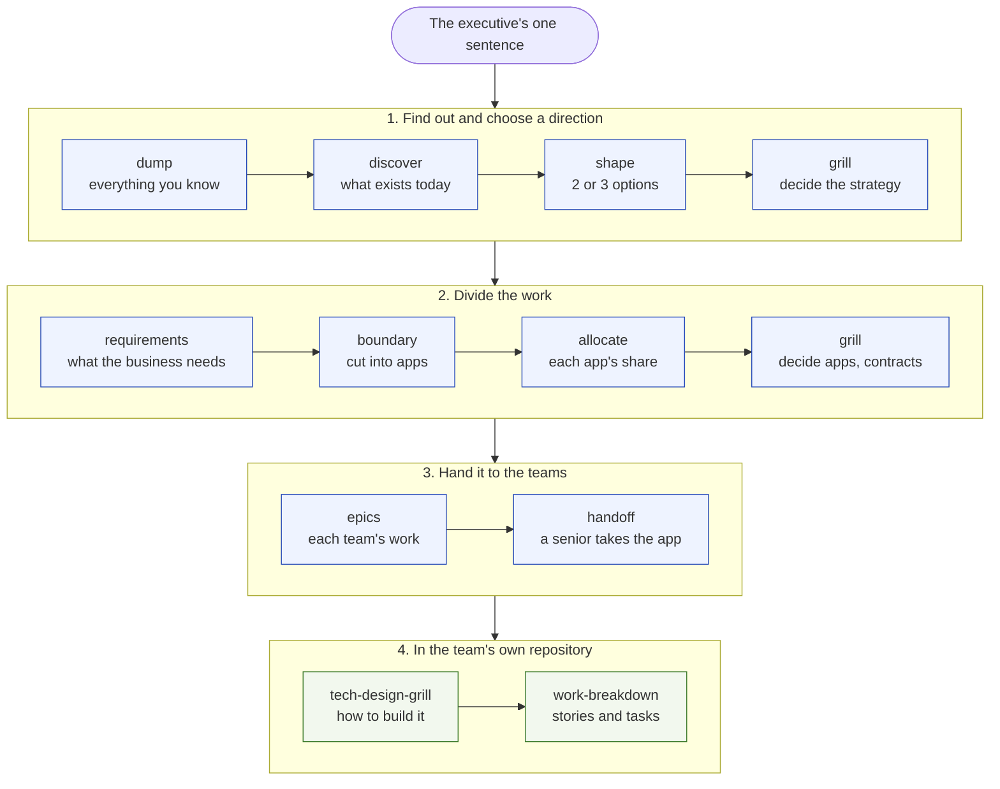
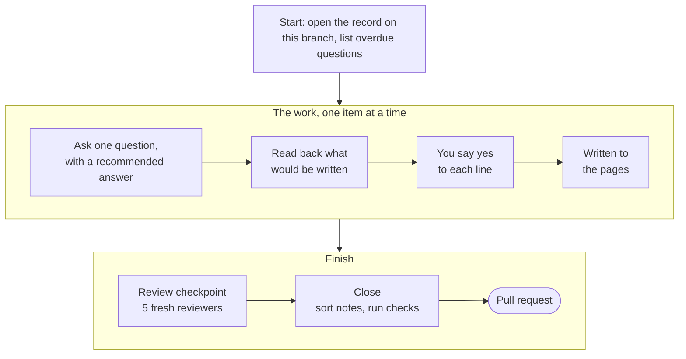
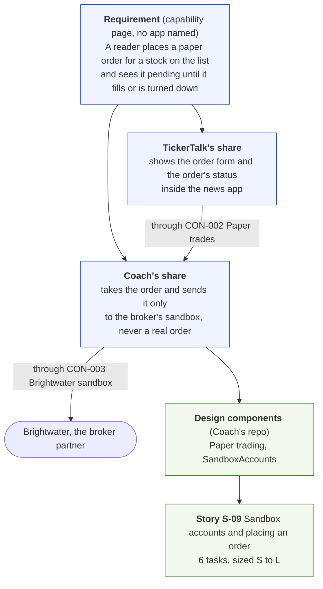
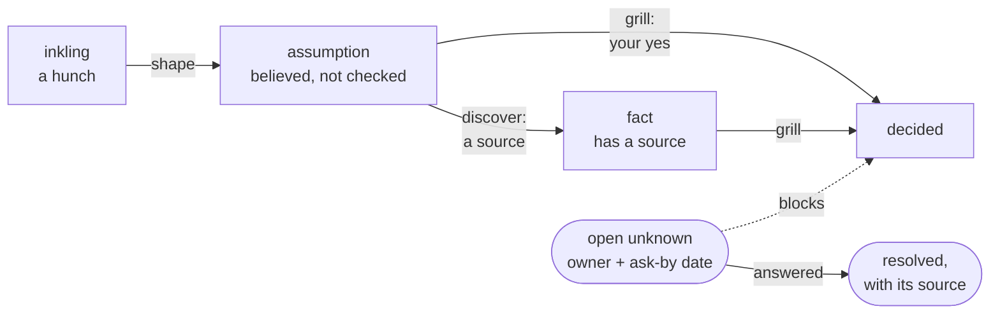

# How Vela works, and how to use it

## The problem, briefly

A large initiative arrives as one vague sentence, and a solution lead has to turn it into work that teams can build. The usual failures are predictable:

- the legal, money and partner questions are asked too late;
- decisions are made in meetings and never written down;
- open questions have no owner;
- beliefs are treated as facts;
- work falls between teams;
- notes go stale.

Vela is a structured way to do that planning so those failures don't happen silently.

## What you get

- **A vault:** a git repository of Markdown pages, one per part of the plan, in a fixed layout. It is started by `vela new` from the plugin's `template/`. Changes reach `main` only through pull requests, so every decision is reviewed and kept in history.
- **The vela plugin for Claude Code:** session commands such as `/vela:discover` and `/vela:grill`, plus focused reviewer agents.
- **The `vela` command-line tool,** which ships inside the plugin. It checks the vault against its rules, fills in the generated sections, and reports progress. It runs in CI on every pull request.

You run sessions from inside the vault. Each session works on its own branch, writes to the pages, runs the checks, and ends by opening a pull request.

## The steps, in order

The whole journey, from the executive's sentence to a team's build plan:

Stages 1 to 3 happen in the vault, run by the solution lead. Stage 4 is the app's senior, in their own repository. If the senior disagrees with something they were handed, `/vela:challenge` sends it back to the vault as an open question for the lead.

| # | Command | When | What you do | What it writes |
|---|---|---|---|---|
| 1 | `/vela:dump` | at the very start | say everything you know and fear, unfiltered | notes only; nothing is promoted to a page until close |
| 2 | `/vela:discover` | when you have documents, or need to know what exists | rank the sources; confirm what Claude read, line by line | facts on the pages, each linked to its source; each source registered in `sources.md` |
| 3 | `/vela:shape` | when you roughly know what you want | react to 2 or 3 options | the option you pick, at `assumption`, with the rejected ones and why |
| 4 | `/vela:grill` | to decide something | answer one question at a time, then say yes to the final wording | the item marked `decided`, with who decided it and when |
| 5 | `/vela:requirements` | once the strategy is decided | confirm each business requirement and its acceptance criteria | requirements on the capability pages, naming no app |
| 6 | `/vela:boundary` | once the direction is decided | pick how to cut the work into apps; confirm each app's sheet | app pages: what each does and doesn't do, its parts, its contracts, how it fails, its journeys |
| 7 | `/vela:allocate` | once the apps exist | confirm each app's share of each requirement | each app's share, and which contract carries what crosses between apps |
| 8 | `/vela:grill` | to decide the apps, contracts and shares | as in step 4 | the app pages and contracts marked `decided` |
| 9 | `/vela:epics` | once an app's contracts are decided | pick how to cut each team's work; say yes to each acceptance criterion | epic pages, one owning team each |
| 10 | `/vela:grill` handing an app over | when the app's team is ready to take it | name the senior; confirm what they take | `handed_off` on the app page, and a record of exactly what they accepted |
| — | `/vela:close` | at the end of **every** session | confirm what each note becomes | the notes sorted into the pages, ledger rows, the opening prose rewritten, the checks run, the pull request opened |

Then, in the app team's own repository:

| Command | What it writes |
|---|---|
| `tech-design-grill` | the technical design for one app, traced to the requirements allocated to it, plus decision records |
| `work-breakdown` | stories traced to those requirements and to the design's components, with sized tasks and the order to build in |

You don't have to follow the order strictly. `vela next` suggests the next step from the state of the vault, and every rule can be overridden (see below).

## What a session looks like

Every session follows the same pattern.

1. **Start.** Claude checks the repository is clean, lists overdue questions, shows `vela next`'s suggestion, and opens a session record on the branch you are on.
2. **The work.** It asks one question at a time, each with a recommended answer. When it writes something, it first reads it back as a numbered list. Nothing is written without your explicit yes to that line: "looks fine" doesn't count. What you say is kept as notes in the session record, each with who said it.
3. **A review checkpoint,** once per session at a set point. Five reviewers each read only the written pages, in a fresh context, one area each: money, data, partners, regulation, and operations. Code merges what they find and drops any finding that misquotes a page. You see one ranked list and choose what to take up. New questions are only raised about what this session changed, and questions about something already decided are only raised if they're serious.
4. **Close.** You confirm what each note becomes: a fact, an open question, a risk, or discarded. Claude writes those into the pages, rewrites the opening paragraph of each page it changed, runs the checks, fixes what they report, and opens the pull request.

**Things Claude won't do:**
- decide anything outside a grill;
- turn something into a fact without a source;
- copy document text into the vault;
- draft emails or messages for you to send;
- act as if it ran a command it didn't run.

When it's blocked, it says so once, offers you a way forward, and stops.

## How one requirement flows down

Requirements come in two levels in the vault, then a third in the team's repository. This is one requirement from the trading-coach test project, all the way down. The contracts, components and story are what that run produced. Its requirement and shares are written the way `/vela:allocate` now writes them, because that run came before allocate existed.

Every link in that chain is checked. In the vault, `vela check` reports a requirement no app carries and a share that names a contract that doesn't exist. In the team's repository, `tech-design-grill` won't finish while an allocated requirement has no component, and `work-breakdown` won't finish while one has no story.

## The documents

| Page | Holds |
|---|---|
| `01-goals.md` | the goals and how each is measured; a generated "where it stands" summary |
| `02-constraints.md` | what the initiative can't change, and where each constraint comes from |
| `03-context-and-scope.md` | what exists today, the outside parties, and value held for customers |
| `04-solution-strategy.md` | the chosen direction and the options rejected |
| `04a-capability-delta.md`, `capabilities/` | the business capabilities that change, their requirements, and the allocation table |
| `05-building-blocks/` | one page per app: what it does and doesn't do, its parts, its contracts, its share of each requirement |
| `06-runtime/` | each app's failure behavior, and the journeys through the apps |
| `08-concerns/` | security, data, cost, operations and so on, with one cell per app |
| `09-decisions/` | a record for each decision that shapes the design |
| `11-unknowns-and-risks.md` | every open question, with its owner and ask-by date; the risks; the question ledger |
| `12-glossary.md` | terms a newcomer wouldn't know |
| `13-epics/` | the work, cut by team, with acceptance criteria |
| `sources.md`, `sessions/` | every source cited; the record of every session |

Each page opens with a paragraph or two saying what is true now. How it got there (decisions, overrides, options considered) sits under `## History` at the bottom. `vela view` builds a single-file HTML viewer of the whole vault, with history and details folded.

## How sure is each thing

Every item has a state:

- **inkling:** a hunch;
- **assumption:** believed, not checked;
- **fact:** has a source;
- **decided:** came out of a grill with your yes.

Open questions are **unknowns**. Each has an owner, an ask-by date, and the items it blocks. A blocked item can't be decided until the unknown is answered.

**Overrides.** You may break any rule, for example deciding past an open question, or on an absent owner's behalf. The tool records an `**Override:**` line with your handle, the date and your reason, and `check` shows it as a warning, not an error. An owner you decided for can later confirm with a `**Confirmed by:**` line, or reopen it with `/vela:challenge`.

## Questions nobody thought to ask

Two mechanisms make sure the important questions come up:

- **A question catalog** in `plugin/catalog/questions.yaml`. It holds about 30 questions, each tied to a kind of thing in the vault. When you record that the initiative holds money for customers, the catalog owes "who carries that balance on the books?". When an app holds customer data, it owes "on what legal basis?".
- **The reviewers** at each checkpoint, which raise questions the catalog doesn't cover.

Every owed or raised question ends up in the question ledger on `11-unknowns-and-risks.md`, with how it was settled: answered with a source, a stated belief, an open unknown, or not applicable with a reason. `vela questions --digest` shows the open ones, ranked.

## The checks and commands

| Command | Use |
|---|---|
| `vela check` | every rule: links, states, sources, owners, overrides, the ledger, the allocation table. Errors block the pull request in CI |
| `vela check --gate epics` | the stricter check before epics count as done: every requirement allocated, every high-severity question settled |
| `vela render` | fills the generated sections: indexes, diagrams, the allocation table, "where it stands" |
| `vela status` / `next` | each app's stage and what to do next; ends with a completeness score |
| `vela ladder` | the stage each app's pages actually reach, and what the next stage needs |
| `vela style <pages>` | where a page still reads as a list or a log, not a document; close runs it |
| `vela questions` | the owed and open questions, by area or subject |
| `vela handoff <APP>` / `handoff verify` | writes the record of what a team accepted; later, shows what changed since |
| `vela view` | the HTML viewer of the vault |
| `vela upgrade` | updates the vault's `CONVENTIONS.md` when the plugin changes |

## Handing work to teams

When an app's contracts and epics are decided, a handoff grill names the senior who takes it. Close writes `handoffs/APP-<name>.md`. It lists every item the team accepted (the app page, its runtime page, its contracts, its epics, and the open questions that block it), each with a fingerprint. `vela handoff verify` shows exactly what changed since. If the senior disagrees with something, `/vela:challenge` records the disagreement as an open question they own, and the solution lead answers it.

The team then designs in its own repository. Its input is the app's page, its contracts, its share of each requirement, its epics and its concern cells. The design traces every component to that input, and the work breakdown traces every story to it.

## How the tool is tested

`tests/sim/` runs whole projects with a simulated lead, played by another model:
- The lead knows some facts, believes some wrong things, and is unaware of planted problems such as a contract clause or a regulation.
- Scripted replies from other people arrive partway through the run.
- A scorecard shows which planted problems were found, which beliefs were challenged, and which decisions got an explicit yes. It also flags lapses: drafted emails, invented actions, or leaked brief IDs.
- Probes rerun one session from a saved vault, so a single skill can be tested for a few dollars.

These runs found most of the gaps fixed so far, such as no session ever writing app pages, and answered questions never being closed.

## What is still open

- **Thorough versus overwhelming.** How many questions to raise before they bury the lead.
- **What "complete" means.** A design marked complete with known gaps the team has accepted is not the same as one with no gaps.
- **Whether the tool should draft the pages or mainly interview you.** Today it drafts and you review.
- **No comparison with plain Claude Code yet.** The tool hasn't been run against Claude Code without Vela, which is the comparison that would show its real value.
