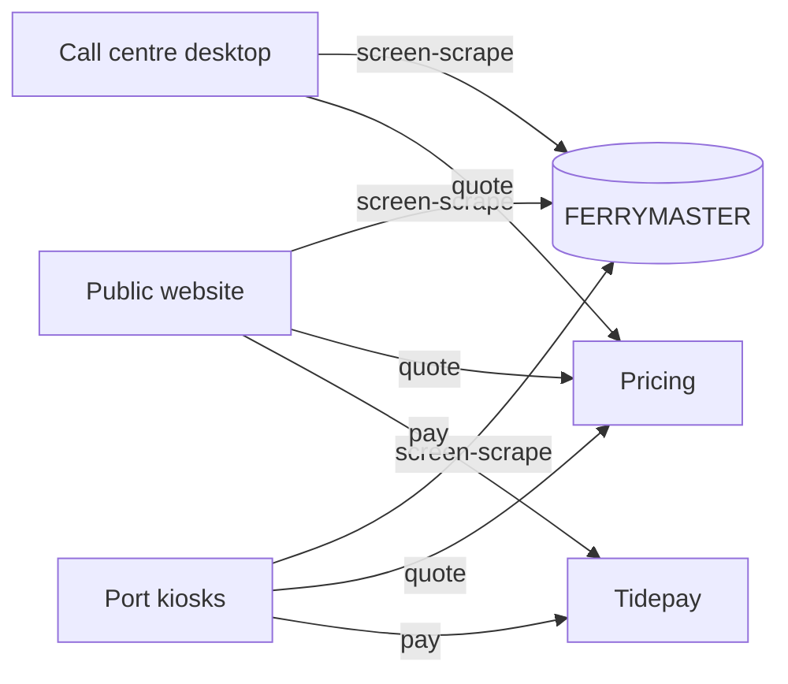
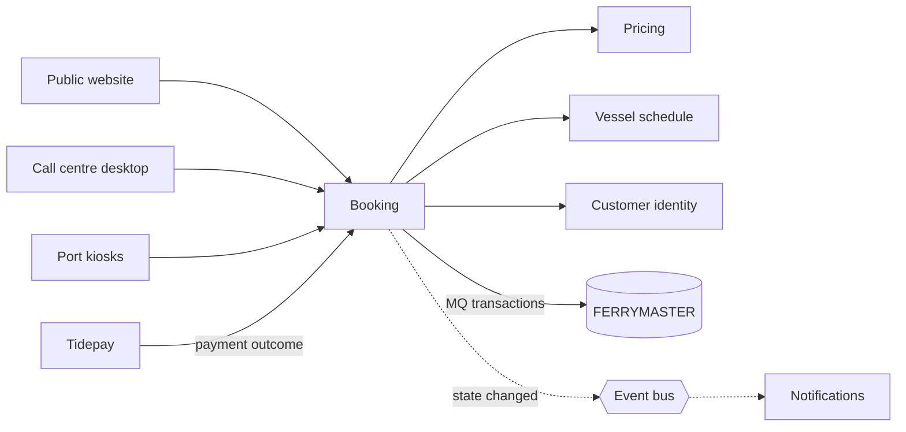

# Context & scope

- **Decision:** [[2026-08-12-goals-and-data]]

Systems only. Anything inside a box belongs to that app's own pages under [[05-building-blocks|Building blocks]].

## Today

Three channels, three adapters, three opinions about what a booking's state is. Each channel also calls Pricing on its own.

## After

The channels stop knowing FERRYMASTER exists. Booking is the only thing that writes bookings to the ledger, and it tells everyone else what changed through the event bus.

## In scope

Each app page says what changes and which team owns it.

- [[booking-building-blocks|Booking]] · [[booking-runtime|runtime]]
- [[pricing-building-blocks|Pricing]] · [[pricing-runtime|runtime]]
- [[ferrymaster-building-blocks|FERRYMASTER]] · [[ferrymaster-runtime|runtime]]
- [[website-building-blocks|Public website]] · [[website-runtime|runtime]]
- [[call-centre-building-blocks|Call centre desktop]] · [[call-centre-runtime|runtime]]
- [[kiosks-building-blocks|Port kiosks]] · [[kiosks-runtime|runtime]]
- [[notifications-building-blocks|Notifications]] · [[notifications-runtime|runtime]]
- [[vessel-schedule-building-blocks|Vessel schedule]]
- [[customer-identity-building-blocks|Customer identity]]

External: Tidepay (payment provider) and the Harbourline event bus (Platform).

## Out of scope

- **Retiring FERRYMASTER.** That is INI-005 Mainframe Exit. This initiative makes it easier by putting a single door in front of the ledger.
- **The data warehouse feed, the finance reconciliation job and the loyalty scheme.** They keep reading FERRYMASTER directly. Whether finance should read Booking's events instead is [[11-unknowns-and-risks#UNK-006 Finance on Booking events|UNK-006]], deferred to INI-005.
- **Changing how customers search for crossings.** Find a crossing stays as it is.
