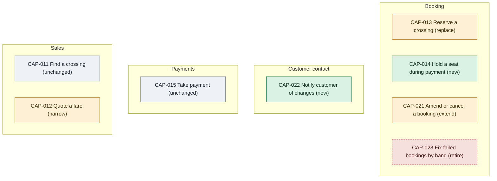

# Capability delta

- **Decision:** [[2026-08-12-goals-and-data]]

Every capability this initiative changes, which software provides it before and after, and where the work lands. Anything not listed is unchanged.

Each capability page holds the change, what provides it today and after, its flows and its epics.

<!-- generated:capability-map sha=0503da3c: do not edit, run vela render -->
_Kept up to date by vela from the pages it reads._

Key: green: new in this initiative · amber: changed by this initiative · gray: stays as it is · red, dashed: retired by this initiative.
<!-- /generated:capability-map -->

- [[CAP-013-reserve-a-crossing|Reserve a crossing]]
- [[CAP-014-hold-a-seat|Hold a seat during payment]]
- [[CAP-021-amend-or-cancel|Amend or cancel a booking]]
- [[CAP-022-notify-customer|Notify customer of changes]]
- [[CAP-012-quote-a-fare|Quote a fare]]
- [[CAP-023-fix-failed-bookings|Fix failed bookings by hand]]

## Notes on the trickier rows

**Hold a seat during payment.** Ten minutes came from Tidepay's own session timeout, which is nine. A hold that outlives the payment page by a minute covers slow webhooks without blocking the seat for long. It was an assumption until the Grill on 2026-08-12, when the Head of Contact Center confirmed that ten minutes matches what agents already do by hand.

**Fix failed bookings by hand.** Retiring a capability is a promise that nobody will need it. Booking makes that promise by retrying the ledger write and keeping the hold, so the failure the call center used to clean up can no longer reach a customer. If it does, it shows up in the hold expiry rate on [[concern-observability|Observability]] long before anyone phones.

**Reserve a crossing.** INI-004 Loyalty Revamp also touches this capability, because points are earned at reservation. Loyalty Revamp will consume Booking's state-changed event rather than adding a fourth caller.

## Capabilities checked and left alone

[[CAP-011-find-a-crossing|Find a crossing]] and [[CAP-015-take-payment|Take payment]] are in the flows but don't change. Take payment now reports its outcome to Booking instead of to each channel; Tidepay itself is untouched.

## Allocation

What each app carries of each functional requirement.

<!-- generated:allocation sha=8c6debdc: do not edit, run vela render -->
_Kept up to date by vela from the pages it reads._

**Who does what:** no requirement is firm enough to split between the apps yet.
<!-- /generated:allocation -->
