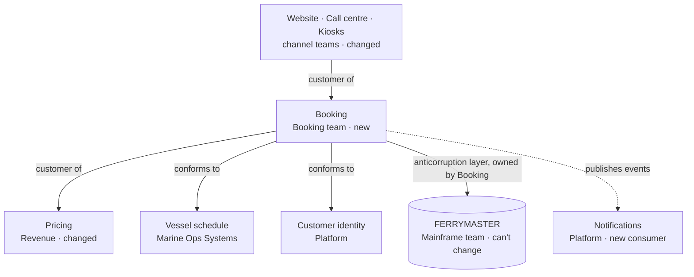

# Building blocks

Each application in scope has two pages: its building blocks and contracts (§5), and its runtime (§6). New and changed apps go one level in and show their main containers, co-designed with that app's senior. Components are never described here; they belong to each team's tech design.

## Who owns what, and how they relate

Each line is a contract, and each contract lives on the provider's page.

<!-- generated: do not edit -->
| App | Change | Owner | Contracts it provides | Containers shown | Pages |
|---|---|---|---|---|---|
| Booking | new | Booking team | CON-001, CON-002 (and receives CON-007 from Tidepay) | 4, all confirmed by senior | [[booking-building-blocks\|§5]] · [[booking-runtime\|§6]] |
| Pricing | changed | Revenue | CON-003 | 2, unchanged | [[pricing-building-blocks\|§5]] · [[pricing-runtime\|§6]] |
| FERRYMASTER | integrated | Mainframe team | CON-006 | black box | [[ferrymaster-building-blocks\|§5]] · [[ferrymaster-runtime\|§6]] |
| Public website | changed | Digital | none | 2 (1 retired) | [[website-building-blocks\|§5]] · [[website-runtime\|§6]] |
| Call centre desktop | changed | Contact Centre Systems | none | 3 (2 retired) | [[call-centre-building-blocks\|§5]] · [[call-centre-runtime\|§6]] |
| Port kiosks | changed | Port Systems | none | 2 (1 retired) | [[kiosks-building-blocks\|§5]] · [[kiosks-runtime\|§6]] |
| Notifications | changed | Platform | none | 2 (1 new) | [[notifications-building-blocks\|§5]] · [[notifications-runtime\|§6]] |
| Vessel schedule | unchanged | Marine Ops Systems | CON-004 | black box | [[vessel-schedule-building-blocks\|§5]] · [[vessel-schedule-runtime\|§6]] |
| Customer identity | unchanged | Platform | CON-005 | black box | [[customer-identity-building-blocks\|§5]] · [[customer-identity-runtime\|§6]] |
<!-- /generated -->

## All contracts

<!-- generated: do not edit -->
| Contract | Provider | Consumers | State |
|---|---|---|---|
| [[booking-building-blocks#CON-001 Booking API\|CON-001 Booking API]] | Booking | Website, Call centre, Kiosks | decided |
| [[booking-building-blocks#CON-002 Booking state changed\|CON-002 Booking state changed]] | Booking | Notifications | decided |
| [[pricing-building-blocks#CON-003 Quote a fare\|CON-003 Quote a fare]] | Pricing | Booking | decided |
| [[vessel-schedule-building-blocks#CON-004 Capacity check\|CON-004 Capacity check]] | Vessel schedule | Booking | decided |
| [[customer-identity-building-blocks#CON-005 Customer lookup\|CON-005 Customer lookup]] | Customer identity | Booking | decided |
| [[ferrymaster-building-blocks#CON-006 Ledger transactions\|CON-006 Ledger transactions]] | FERRYMASTER | Booking | decided |
| [[booking-building-blocks#CON-007 Tidepay payment outcome\|CON-007 Payment outcome]] | Tidepay (external) | Booking | decided |
<!-- /generated -->
