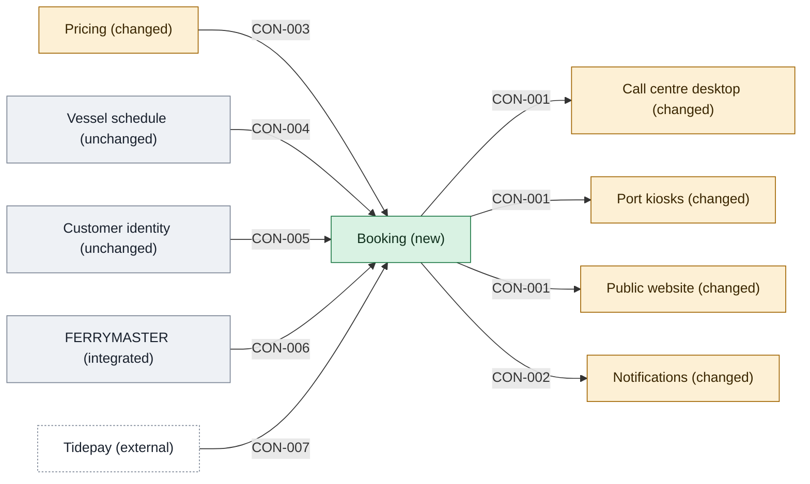

# Building blocks

Each application in scope has two pages: its building blocks and contracts (§5), and its runtime (§6). New and changed apps go one level in and show their main containers, co-designed with that app's senior. Components are never described here; they belong to each team's tech design.

## Who owns what, and how they relate

<!-- generated:context-map sha=3b5200eb: do not edit, run planner render -->

Key: green: new in this initiative · amber: changed by this initiative · grey: stays as it is · white, dashed: outside the initiative (a party or provider) · an arrow is a contract, labelled with its ID.
<!-- /generated:context-map -->

Each arrow is a contract, drawn from its provider to each consumer. Each contract lives on the provider's page.

How the apps relate, by contract:

- The Booking API: the website, the call centre desktop and the kiosks are customers of Booking.
- The Booking state changed event: Booking publishes events that Notifications reads.
- The fare quote: Booking is a customer of Pricing.
- The capacity check and the customer lookup: Booking conforms to the vessel schedule and to customer identity.
- The ledger transactions: Booking puts an anticorruption layer in front of FERRYMASTER, and Booking owns that layer.
- The Tidepay payment outcome: Tidepay sends payment outcomes to Booking.

## Apps

- [[booking-building-blocks|Booking]] · [[booking-runtime|runtime]]
- [[pricing-building-blocks|Pricing]] · [[pricing-runtime|runtime]]
- [[ferrymaster-building-blocks|FERRYMASTER]] · [[ferrymaster-runtime|runtime]]
- [[website-building-blocks|Public website]] · [[website-runtime|runtime]]
- [[call-centre-building-blocks|Call centre desktop]] · [[call-centre-runtime|runtime]]
- [[kiosks-building-blocks|Port kiosks]] · [[kiosks-runtime|runtime]]
- [[notifications-building-blocks|Notifications]] · [[notifications-runtime|runtime]]
- [[vessel-schedule-building-blocks|Vessel schedule]]
- [[customer-identity-building-blocks|Customer identity]]

## All contracts

- [[booking-building-blocks#CON-001 Booking API|CON-001 Booking API]]
- [[booking-building-blocks#CON-002 Booking state changed|CON-002 Booking state changed]]
- [[pricing-building-blocks#CON-003 Quote a fare|CON-003 Quote a fare]]
- [[vessel-schedule-building-blocks#CON-004 Capacity check|CON-004 Capacity check]]
- [[customer-identity-building-blocks#CON-005 Customer lookup|CON-005 Customer lookup]]
- [[ferrymaster-building-blocks#CON-006 Ledger transactions|CON-006 Ledger transactions]]
- [[booking-building-blocks#CON-007 Tidepay payment outcome|CON-007 Tidepay payment outcome]]
