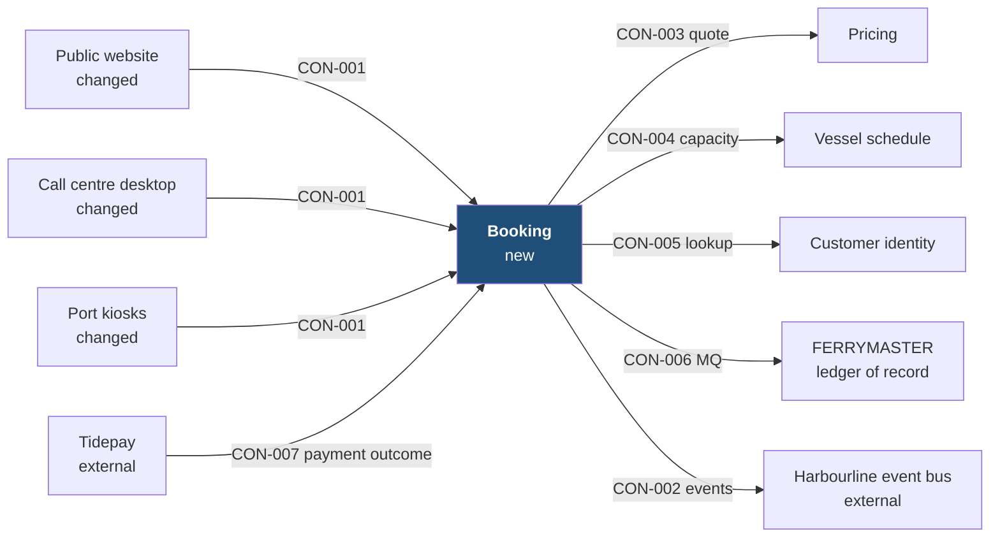

[[README|Harbourline]] / [[05-building-blocks|05 Building blocks]] / Booking

# Booking

- **Decision:** [[2026-09-09-booking-containers]]

Booking decides whether a booking is held, confirmed, amended or cancelled. Every channel asks Booking, so the website, the call centre and the kiosks give the same answer about a booking's state. Booking is the only application that talks to FERRYMASTER about bookings, and it does so through FERRYMASTER's existing MQ transactions. It keeps a seat held while the customer pays and publishes every state change to the event bus.

Booking does not own fares, capacity, customer records, card payments or the ledger. Pricing, Vessel schedule, Customer identity, Tidepay and FERRYMASTER keep those jobs ([[ADR-0002-ferrymaster-ledger-of-record|ADR-0002]]).

| Change in INI-002 | Owner team |
|---|---|
| New ([[ADR-0001-one-booking-context\|ADR-0001]]) | Booking team (new) |

## Inside Booking: main containers

All four were confirmed by the Booking senior.

| Container | Job | Contracts served or used | Proposed by | State |
|---|---|---|---|---|
| Booking API | Takes hold, confirm, amend, cancel and get from every channel. Receives Tidepay's payment outcome. | Serves CON-001, CON-007. Uses CON-003, CON-004, CON-005. | solution lead | confirmed |
| Hold store | Keeps unpaid holds for 10 minutes, then lets them expire. | none | solution lead | confirmed |
| Ledger adapter | The only writer to FERRYMASTER. Sends BKHOLD, BKCONF, BKAMND and BKCANC over MQ. Retries a failed write and keeps the hold. | Uses CON-006 | Booking senior | confirmed |
| Event publisher | Publishes Booking state changed to the event bus, as CST-4 requires. | Serves CON-002 | Platform lead | confirmed |

Components inside these containers belong to the Booking team's tech design.

## Contracts this app provides

### CON-001 Booking API

- **Crosses the boundary:** hold (crossing, passengers, vehicle, customer ID) returns a booking reference, a price and the hold expiry. Confirm takes the booking reference and the Tidepay payment reference. Amend, cancel and get work on the booking reference. No card data crosses.
- **Consumers:** [[website-building-blocks|Public website]], [[call-centre-building-blocks|Call centre desktop]], [[kiosks-building-blocks|Port kiosks]]. All calls go through the Platform gateway with service tokens; kiosks use device certificates.
- **Change policy:** versioned. Each version is kept at least 6 months because kiosks update twice a year ([[ADR-0003-versioned-booking-api|ADR-0003]]).
- **Change:** new
- **Tested by:** each channel runs consumer-driven contract tests in its own pipeline. Booking runs provider verification against all three, for every live version, in its pipeline. Both sides run on every build, and a failure blocks the Booking release.
- **State:** decided
- **Decision:** [[2026-08-26-kiosks-and-rollout]]

### CON-002 Booking state changed

- **Crosses the boundary:** one event per state change: booking reference, new state, previous state, customer ID, crossing and trace ID. No card data.
- **Consumers:** [[notifications-building-blocks|Notifications]]. Finance may read it later ([[11-unknowns-and-risks#UNK-006 Finance on Booking events|UNK-006]]).
- **Change policy:** additive changes only.
- **Change:** new
- **Tested by:** schema check and the additive-only rule in Booking's pipeline. Notifications runs a consumer test. Both run on every build, and a failure blocks the Booking release and the Notifications release.
- **State:** decided
- **Decision:** [[2026-11-03-events]]

## Contract kept here for an external provider

Tidepay is external and has no page in this vault, so its contract with Booking lives here.

### CON-007 Tidepay payment outcome

- **Crosses the boundary:** a webhook from Tidepay to the Booking API with the payment reference, the booking reference, the amount and the result. Customers enter card details on Tidepay's hosted payment page, so card data never reaches Booking and PCI scope stays the same (CST-2).
- **Provider:** Tidepay (external)
- **Consumers:** [[booking-building-blocks|Booking]], at the Booking API.
- **Change policy:** Tidepay's published API, versioned by Tidepay.
- **Change:** new consumers
- **Tested by:** the Tidepay sandbox in Booking's pipeline, on every Booking build. A failure blocks the Booking release. Tidepay tests its own side.
- **State:** fact
- **Source:** SRC-05

## Contracts this app consumes

<!-- generated:contracts-consumed sha=8e343386: do not edit, run planner render -->
| Contract | Provider | Change policy | State |
|---|---|---|---|
| [[pricing-building-blocks#CON-003 Quote a fare\|CON-003 Quote a fare]] | [[pricing-building-blocks\|Pricing]] | the existing API, unchanged. Only the list of callers narrows. | decided |
| [[vessel-schedule-building-blocks#CON-004 Capacity check\|CON-004 Capacity check]] | [[vessel-schedule-building-blocks\|Vessel schedule]] | the existing read API, no change. | fact |
| [[customer-identity-building-blocks#CON-005 Customer lookup\|CON-005 Customer lookup]] | [[customer-identity-building-blocks\|Customer identity]] | the existing read API, no change. | fact |
| [[ferrymaster-building-blocks#CON-006 Ledger transactions\|CON-006 Ledger transactions]] | [[ferrymaster-building-blocks\|FERRYMASTER]] | FERRYMASTER cannot change. The mainframe team announces any MQ change 8 weeks ahead. | fact |
| [[booking-building-blocks#CON-007 Tidepay payment outcome\|CON-007 Tidepay payment outcome]] | Tidepay (external) | Tidepay's published API, versioned by Tidepay. | fact |
<!-- /generated:contracts-consumed -->

## Concerns

This app's cell on each concern is in the [[08-concerns|concern matrix]]. The concern pages say what each cell means.

## Epics

<!-- generated:epics-for-app sha=8099f089: do not edit, run planner render -->
| Epic | Owner | State |
|---|---|---|
| [[EPC-031-holds-and-confirms\|EPC-031 Booking holds and confirms crossings]] | @harbourline/booking-team | decided |
| [[EPC-032-ledger-adapter\|EPC-032 Ledger adapter on FERRYMASTER's MQ transactions]] | @harbourline/booking-team | decided |
| [[EPC-033-website-to-booking\|EPC-033 Website moves to Booking]] | @harbourline/digital-team | decided |
| [[EPC-034-call-centre-to-booking\|EPC-034 Call centre moves to Booking]] | @harbourline/contact-centre-systems | decided |
| [[EPC-035-kiosks-to-booking\|EPC-035 Kiosks move to Booking in the March image]] | @harbourline/port-systems | decided |
| [[EPC-036-amend-cancel-online\|EPC-036 Amend and cancel online]] | @harbourline/booking-team @harbourline/digital-team | decided |
| [[EPC-037-events-and-notifications\|EPC-037 Booking events and customer notifications]] | @harbourline/booking-team @harbourline/platform-team | decided |
| [[EPC-038-pricing-serves-booking\|EPC-038 Pricing serves Booking only]] | @harbourline/revenue-team | decided |
| [[EPC-039-run-booking\|EPC-039 Run Booking: on-call, runbooks, dashboards]] | @harbourline/booking-team | decided |
<!-- /generated:epics-for-app -->

Next: [[booking-runtime|Booking runtime]]
