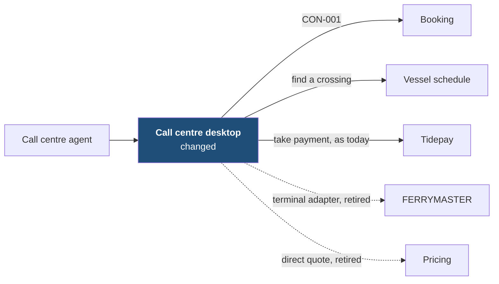
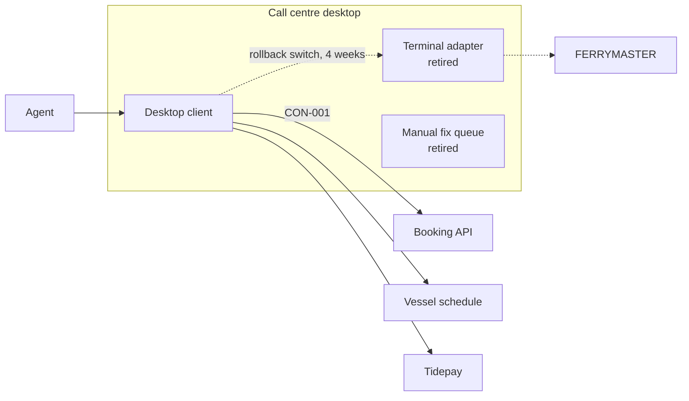

[[README|Harbourline]] / [[05-building-blocks|05 Building blocks]] / Call centre desktop

# Call centre desktop

- **Decision:** [[2026-07-28-solution-strategy]]

The call centre desktop is what agents use to book, amend and cancel crossings for customers who phone. Today it reaches FERRYMASTER through a terminal adapter, and agents spend the morning fixing bookings that were paid for on the website but never confirmed. After this initiative the desktop asks Booking for every booking action, and that morning queue goes away.

The desktop no longer decides whether a booking is confirmed and no longer caches FERRYMASTER replies.

| Change in INI-002 | Owner team |
|---|---|
| Changed: Booking API client and new amend and cancel screens. Terminal adapter and manual fix queue retired. | Contact Centre Systems team |

## Inside Call centre desktop: main containers

| Container | Job | Contracts served or used | Proposed by | State |
|---|---|---|---|---|
| Desktop client | Agent screens. Calls the Booking API for hold, confirm, amend, cancel and get. New amend and cancel screens. | Uses CON-001 | Contact Centre Systems senior | confirmed |
| Terminal adapter | Drove FERRYMASTER's terminal screens. Kept behind a switch for 4 weeks after the March 2027 cutover, then removed. | none | existing | retired |
| Manual fix queue | Listed paid but unconfirmed website bookings for next-morning fixes. Booking now retries and keeps the hold, so nothing lands here. | none | existing | retired |

Components inside these containers belong to the Contact Centre Systems team's tech design.

## Contracts this app provides

None. The desktop only consumes.

## Contracts this app consumes

<!-- generated: do not edit -->
| Contract | Provider | Change policy | State |
|---|---|---|---|
| [[booking-building-blocks#CON-001 Booking API\|CON-001 Booking API]] | Booking | Versioned; each version kept at least 6 months | decided |
<!-- /generated -->

## Concerns this team carries

- [[concern-testing|Testing]]: the desktop's consumer-driven contract tests for CON-001 run in its own pipeline.
- [[concern-rollout|Rollout]]: the call centre cuts over second, in March 2027. Rollback is flipping its switch back to the terminal adapter during the 4 weeks before removal.

## Epics

<!-- generated: do not edit -->
- [[EPC-034-call-centre-to-booking|EPC-034 Call centre moves to Booking]] (HB-104)
<!-- /generated -->

Next: [[call-centre-runtime|Call centre desktop runtime]]
