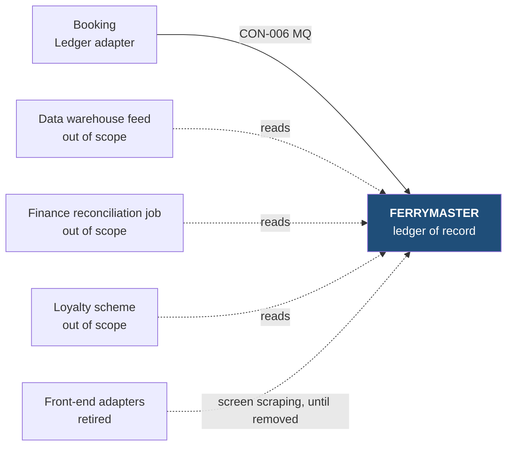

[[README|Harbourline]] / [[05-building-blocks|05 Building blocks]] / FERRYMASTER

# FERRYMASTER

FERRYMASTER is the 1990s mainframe that holds Harbourline's booking ledger. It stays the ledger of record ([[ADR-0002-ferrymaster-ledger-of-record|ADR-0002]]). Booking writes to it through four MQ transactions the mainframe team already exposes for the finance job ([[ADR-0004-mq-not-screen-scraping|ADR-0004]]).

FERRYMASTER is not responsible for holds during payment or for telling channels a booking's state. Booking does both.

| Change in INI-002 | Owner team |
|---|---|
| Integrated, unchanged. The vendor contract ends in 2028 and the code cannot change (C1). | Mainframe team (2 people) |

FERRYMASTER is a black box on this page. Nobody in this initiative changes it, and only two people understand its COBOL, so we describe the transactions it exposes and stop there.

## Contracts this app provides

### CON-006 Ledger transactions

- **Crosses the boundary:** four MQ transactions. BKHOLD reserves a seat, BKCONF confirms a paid booking, BKAMND changes a booking, BKCANC cancels one or releases an expired hold. Each reply carries the ledger reference or a return code. The full field mapping is documented with this contract, which is how R-01 is mitigated.
- **Consumers:** Booking's Ledger adapter only.
- **Change policy:** FERRYMASTER cannot change. The mainframe team announces any MQ change 8 weeks ahead.
- **Tested by:** Booking runs a ledger simulator in its contract tests, because the FERRYMASTER test region refreshes only once a year. One weekly end-to-end run goes against the test region. The mainframe team does not run tests of its own for this contract.
- **State:** decided

## Contracts this app consumes

<!-- generated: do not edit -->
| Contract | Provider | Change policy | State |
|---|---|---|---|
| none | | | |
<!-- /generated -->

## Concerns this team carries

- [[concern-cost|Cost]]: the mainframe team lead checked that Booking's MQ use fits the existing MIPS budget (C5).
- [[concern-testing|Testing]]: keeps the test region available for the weekly end-to-end run.

The mainframe team gives 2 days a week from January to March 2027 ([[11-unknowns-and-risks#UNK-003|UNK-003]]) and pairs with the Booking team in that time.

## Epics

<!-- generated: do not edit -->
- [[EPC-032-ledger-adapter|EPC-032 Ledger adapter on FERRYMASTER's MQ transactions]] (HB-102), mainframe team in support
<!-- /generated -->

Next: [[ferrymaster-runtime|FERRYMASTER runtime]]
