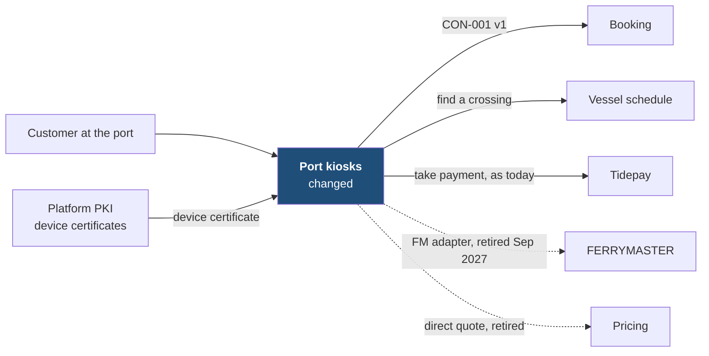
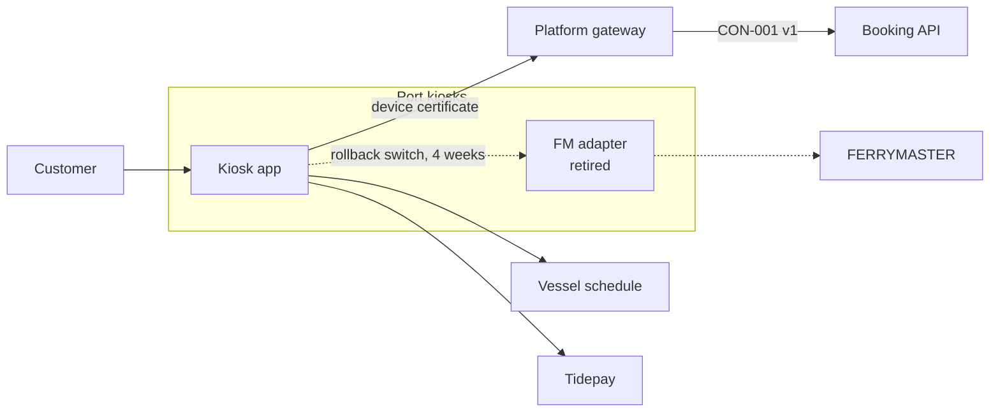

[[README|Harbourline]] / [[05-building-blocks|05 Building blocks]] / Port kiosks

# Port kiosks

Port kiosks let customers at the terminal buy a crossing and check a booking without queueing. They run a locked-down image that changes twice a year, in March and September (C3). After this initiative the kiosk app asks Booking for every booking action.

Kiosks no longer decide whether a booking is confirmed and no longer cache FERRYMASTER replies.

| Change in INI-002 | Owner team |
|---|---|
| Changed: Booking API v1 client ships in the March 2027 image. The FM adapter is removed in the September 2027 image. | Port Systems team |

## Inside Port kiosks: main containers

| Container | Job | Contracts served or used | Proposed by | State |
|---|---|---|---|---|
| Kiosk app | Search, hold, pay, confirm and get. Calls Booking API v1 with the kiosk's device certificate. | Uses CON-001 v1 | Port Systems senior | decided |
| FM adapter | Talked to FERRYMASTER directly. Switched off 4 weeks after the March 2027 cutover; the code leaves with the September 2027 image. | none | existing | retired |

Components inside these containers belong to the Port Systems team's tech design.

## Contracts this app provides

None. The kiosks only consume.

## Contracts this app consumes

<!-- generated: do not edit -->
| Contract | Provider | Change policy | State |
|---|---|---|---|
| [[booking-building-blocks#CON-001\|CON-001 Booking API]] | Booking | Versioned; each version kept at least 6 months | decided |
<!-- /generated -->

Version 1 must stay available until at least the September 2027 image, and longer if that image slips (R-02, [[ADR-0003-versioned-booking-api|ADR-0003]]).

## Concerns this team carries

- [[concern-security|Security]]: kiosks authenticate with device certificates from Platform's existing PKI, because there is no user to log in ([[11-unknowns-and-risks#UNK-004|UNK-004]]).
- [[concern-rollout|Rollout]]: kiosks cut over with the March 2027 image. If that image slips, kiosks keep the FM adapter until the next one.
- [[concern-testing|Testing]]: the kiosk app's consumer-driven contract tests for CON-001 v1 run in the image build.

## Epics

<!-- generated: do not edit -->
- [[EPC-035-kiosks-to-booking|EPC-035 Kiosks move to Booking in the March image]] (HB-105)
<!-- /generated -->

Next: [[kiosks-runtime|Port kiosks runtime]]
