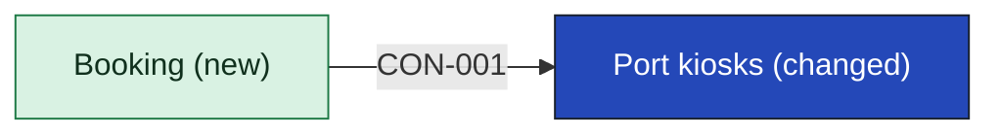
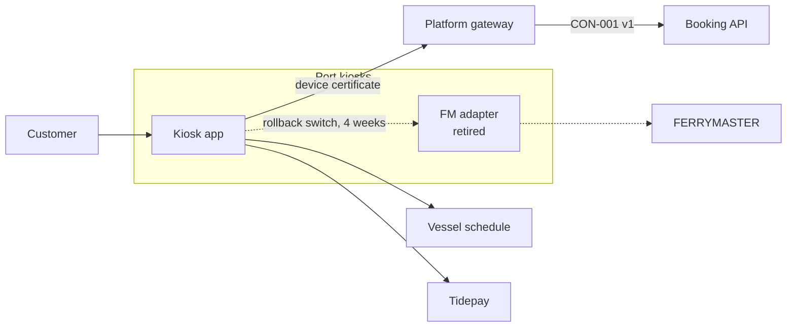

[[README|Harbourline]] / [[05-building-blocks|05 Building blocks]] / Port kiosks

# Port kiosks

- **Decision:** [[2026-07-28-solution-strategy]]

Port kiosks let customers at the terminal buy a crossing and check a booking without queueing. They run a locked-down image that changes twice a year, in March and September (CST-3). After this initiative the kiosk app asks Booking for every booking action.

Kiosks no longer decide whether a booking is confirmed and no longer cache FERRYMASTER replies.

| Change in INI-002 | Owner team |
|---|---|
| Changed: Booking API v1 client ships in the March 2027 image. The FM adapter is removed in the September 2027 image. | Port Systems team |

<!-- generated:app-context sha=f0b55cab: do not edit, run planner render -->

<!-- /generated:app-context -->

## Inside Port kiosks: main containers

| Container | Job | Contracts served or used | Proposed by | State |
|---|---|---|---|---|
| Kiosk app | Search, hold, pay, confirm and get. Calls Booking API v1 with the kiosk's device certificate. | Uses CON-001 v1 | Port Systems senior | confirmed |
| FM adapter | Talked to FERRYMASTER directly. Switched off 4 weeks after the March 2027 cutover; the code leaves with the September 2027 image. | none | existing | retired |

Components inside these containers belong to the Port Systems team's tech design.

## Contracts this app provides

None. The kiosks only consume.

## Contracts this app consumes

<!-- generated:contracts-consumed sha=730b0a4e: do not edit, run planner render -->
| Contract | Provider | Change policy | State |
|---|---|---|---|
| [[booking-building-blocks#CON-001 Booking API\|CON-001 Booking API]] | [[booking-building-blocks\|Booking]] | versioned. Each version is kept at least 6 months because kiosks update twice a year ([[ADR-0003-versioned-booking-api\|ADR-0003]]). | decided |
<!-- /generated:contracts-consumed -->

Version 1 must stay available until at least the September 2027 image, and longer if that image slips (R-02, [[ADR-0003-versioned-booking-api|ADR-0003]]).

## Concerns

This app's cell on each concern is in the [[08-concerns|concern matrix]]. The concern pages say what each cell means.

## Epics

<!-- generated:epics-for-app sha=a7b528a3: do not edit, run planner render -->
| Epic | Owner | State |
|---|---|---|
| [[EPC-035-kiosks-to-booking\|EPC-035 Kiosks move to Booking in the March image]] | @harbourline/port-systems | decided |
<!-- /generated:epics-for-app -->

Next: [[kiosks-runtime|Port kiosks runtime]]
