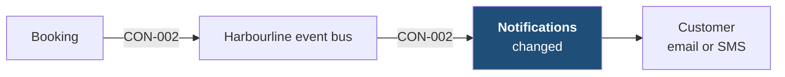
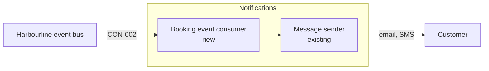

[[README|Harbourline]] / [[05-building-blocks|05 Building blocks]] / Notifications

# Notifications

- **Decision:** [[2026-07-28-solution-strategy]]

Notifications tells customers when their booking changes, by email or SMS. Today only the website sends booking emails. After this initiative Notifications reads every Booking state change from the event bus, so a booking made or changed in any channel produces the same message.

Notifications does not decide a booking's state. It reports what Booking published.

| Change in INI-002 | Owner team |
|---|---|
| Changed: a new Booking event consumer. The existing email and SMS sender is reused. | Platform team |

## Inside Notifications: main containers

| Container | Job | Contracts served or used | Proposed by | State |
|---|---|---|---|---|
| Booking event consumer | Reads Booking state changed, picks email or SMS, and hands the message to the sender. | Uses CON-002 | Platform lead | confirmed |
| Message sender | Sends email and SMS. Looks up the customer's address and mobile number from the customer ID, as it does for website emails today. | none | existing | unchanged |

Components inside these containers belong to the Platform team's tech design.

## Contracts this app provides

None. Notifications only consumes.

## Contracts this app consumes

<!-- generated:contracts-consumed sha=7099072d: do not edit, run planner render -->
| Contract | Provider | Change policy | State |
|---|---|---|---|
| [[booking-building-blocks#CON-002 Booking state changed\|CON-002 Booking state changed]] | [[booking-building-blocks\|Booking]] | additive changes only. | decided |
<!-- /generated:contracts-consumed -->

## Concerns

This app's cell on each concern is in the [[08-concerns|concern matrix]]. The concern pages say what each cell means.

## Epics

<!-- generated:epics-for-app sha=135a68d0: do not edit, run planner render -->
| Epic | Owner | State |
|---|---|---|
| [[EPC-037-events-and-notifications\|EPC-037 Booking events and customer notifications]] | @harbourline/booking-team @harbourline/platform-team | decided |
<!-- /generated:epics-for-app -->

Next: [[notifications-runtime|Notifications runtime]]
