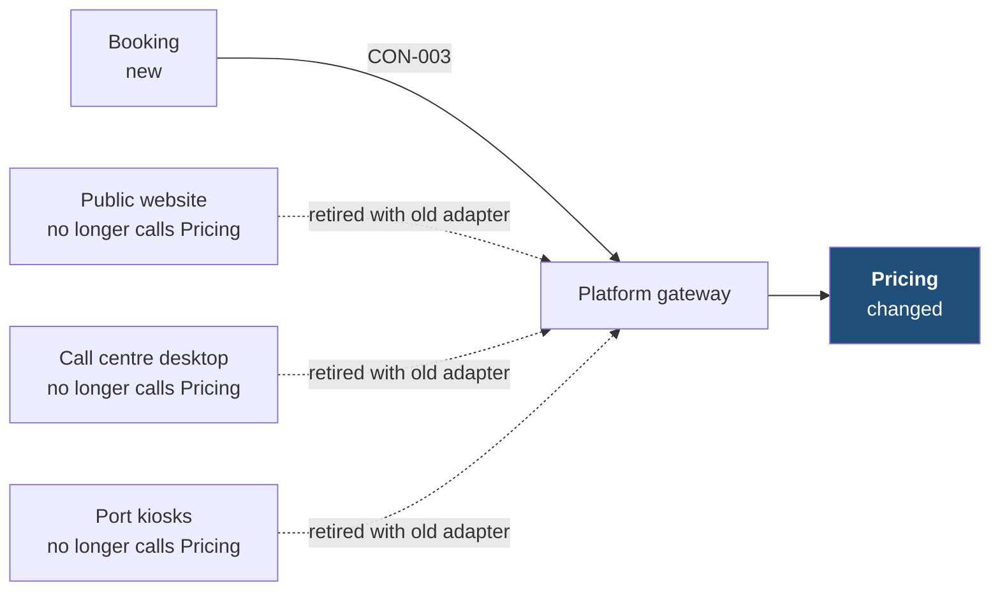
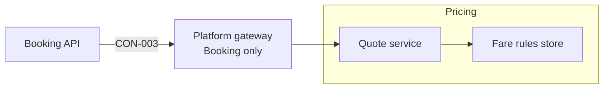

[[README|Harbourline]] / [[05-building-blocks|05 Building blocks]] / Pricing

# Pricing

Pricing quotes a fare for a crossing, given the date, the passengers and the vehicle. It holds the fare rules the Revenue team sets. Its job does not change in this initiative.

Pricing does not hold seats or know whether a booking is confirmed. Booking does that.

| Change in INI-002 | Owner team |
|---|---|
| Changed: callers narrowed from the three front ends to Booking only | Revenue team |

## Inside Pricing: main containers

Neither container changes. The only change is at the Platform gateway, which now lets Booking alone reach the Quote service.

| Container | Job | Contracts served or used | Proposed by | State |
|---|---|---|---|---|
| Quote service | Returns a fare for a crossing and a passenger and vehicle mix. | Serves CON-003 | existing (Revenue team) | unchanged |
| Fare rules store | Holds the fare rules the Revenue team maintains. | none | existing (Revenue team) | unchanged |

Components inside these containers belong to the Revenue team's tech design.

## Contracts this app provides

### CON-003 Quote a fare

- **Crosses the boundary:** crossing, date, passengers and vehicle in; a fare out. Booking asks for a new quote when a customer amends.
- **Consumers:** Booking only. Each front end loses access at the gateway when its old adapter is removed, 4 weeks after its cutover. Until then the rollback switch still needs the direct call. Kiosks lose access with the September 2027 image.
- **Change policy:** the existing API, unchanged. Only the list of callers narrows.
- **Tested by:** Booking runs a contract test on its side. Pricing runs provider verification in its pipeline.
- **State:** decided

## Contracts this app consumes

<!-- generated: do not edit -->
| Contract | Provider | Change policy | State |
|---|---|---|---|
| none | | | |
<!-- /generated -->

## Concerns this team carries

- [[concern-testing|Testing]]: provider verification for CON-003 in Pricing's pipeline.
- [[concern-security|Security]]: the gateway rule that limits the Quote service to Booking, set up with the Platform lead.

## Epics

<!-- generated: do not edit -->
- [[EPC-038-pricing-serves-booking|EPC-038 Pricing serves Booking only]] (HB-108)
<!-- /generated -->

Next: [[pricing-runtime|Pricing runtime]]
