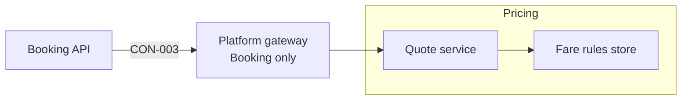

[[README|Harborline]] / [[05-building-blocks|05 Building blocks]] / Pricing

# Pricing

- **Decision:** [[2026-07-28-solution-strategy]]

Pricing quotes a fare for a crossing, given the date, the passengers and the vehicle. It holds the fare rules the Revenue team sets. Its job does not change in this initiative.

Pricing does not hold seats or know if a booking is confirmed. Booking does that.

| Change in INI-002 | Owner team |
|---|---|
| Changed: callers narrowed from the three front ends to Booking only | Revenue team |

<!-- generated:app-context sha=203d1f99: do not edit, run vela render -->

Key: dark blue: the app this page is about · green: new in this initiative · an arrow is a contract (an agreed interface), labeled with its name, pointing from the side that provides it to the app that uses it.
<!-- /generated:app-context -->

## Inside Pricing: main containers

Neither container changes. The only change is at the Platform gateway, which now lets Booking alone reach the Quote service.

| Container | Job | Contracts served or used | Proposed by | State |
|---|---|---|---|---|
| Quote service | Returns a fare for a crossing and a passenger and vehicle mix. | Serves CON-003 | existing (Revenue team) | unchanged |
| Fare rules store | Holds the fare rules the Revenue team maintains. | none | existing (Revenue team) | unchanged |

## Contracts this app provides

### CON-003 Quote a fare

- **Crosses the boundary:** crossing, date, passengers and vehicle in; a fare out. Booking asks for a new quote when a customer amends.
- **Consumers:** [[booking-building-blocks|Booking]] only. Each front end loses access at the gateway when its old adapter is removed, 4 weeks after its cutover. Until then the rollback switch still needs the direct call. Kiosks lose access with the September 2027 image.
- **Change policy:** the existing API, unchanged. Only the list of callers narrows.
- **Change:** changed
- **Tested by:** Booking runs a contract test on its side. Pricing runs provider verification in its pipeline. Both run on every build, and a failure blocks the Pricing release.
- **State:** decided
- **Decision:** [[2026-07-28-solution-strategy]]
- **Override:** GATE-5 by @hl-solution-lead on 2026-07-28: the Revenue team was in its fare review that week, and the strategy could not wait for it. The contract's API does not change, only its list of callers.
- **Decided by:** @hl-solution-lead, on behalf of @harborline/revenue-team
- **Confirmed by:** @hl-pricing-senior on 2026-08-12

| Case | When | Status | Answer | Emits | Sets |
|---|---|---|---|---|---|
| fare | | ok | a fare for the crossing, date, passengers and vehicle | | |
| caller_retired | | error | the gateway rejects a call from a front end whose old adapter has been removed | | |

## Contracts this app consumes

<!-- generated:contracts-consumed sha=140bedbf: do not edit, run vela render -->
none
<!-- /generated:contracts-consumed -->

## Epics

<!-- generated:epics-for-app sha=d2445171: do not edit, run vela render -->
| Epic | Owner | State |
|---|---|---|
| [[EPC-038-pricing-serves-booking\|EPC-038 Pricing serves Booking only]] | @harborline/revenue-team | decided |
<!-- /generated:epics-for-app -->

Next: [[pricing-runtime|Pricing runtime]]
