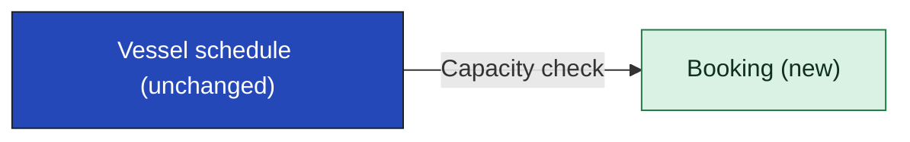

[[README|Harborline]] / [[05-building-blocks|05 Building blocks]] / Vessel schedule

# Vessel schedule

Vessel schedule knows which sailings run and how much passenger and vehicle space each one has left. The front ends use it to find a crossing, and Booking uses it to check capacity before a hold.

Vessel schedule does not hold seats. Booking holds them and FERRYMASTER records them.

| Change in INI-002 | Owner team |
|---|---|
| Unchanged. Booking becomes a new caller of the existing read API. | Marine Ops Systems team |

<!-- generated:app-context sha=eddd6089: do not edit, run vela render -->
_Kept up to date by vela from the pages it reads._

Key: dark blue: the app this page is about · green: new in this initiative · an arrow is a contract (an agreed interface), labeled with its name, pointing from the side that provides it to the app that uses it.
<!-- /generated:app-context -->

Vessel schedule is a black box on this page. Nothing inside it changes, so its containers belong to the Marine Ops Systems team's own documentation.

## Contracts this app provides

### CON-004 Capacity check

- **Crosses the boundary:** a sailing in; remaining passenger and vehicle capacity out.
- **Consumers:** [[booking-building-blocks|Booking]]
- **Change policy:** the existing read API, no change.
- **Change:** new consumers
- **Tested by:** Booking runs a contract test on its side. Marine Ops Systems adds no test, because the API does not change and Booking's test fails first if it does. Booking's test runs on every Booking build, and a failure blocks the Booking release.
- **State:** fact
- **Source:** SRC-06

| Case | When | Status | Answer | Emits | Sets |
|---|---|---|---|---|---|
| capacity | | ok | remaining passenger and vehicle capacity for the sailing | | |
