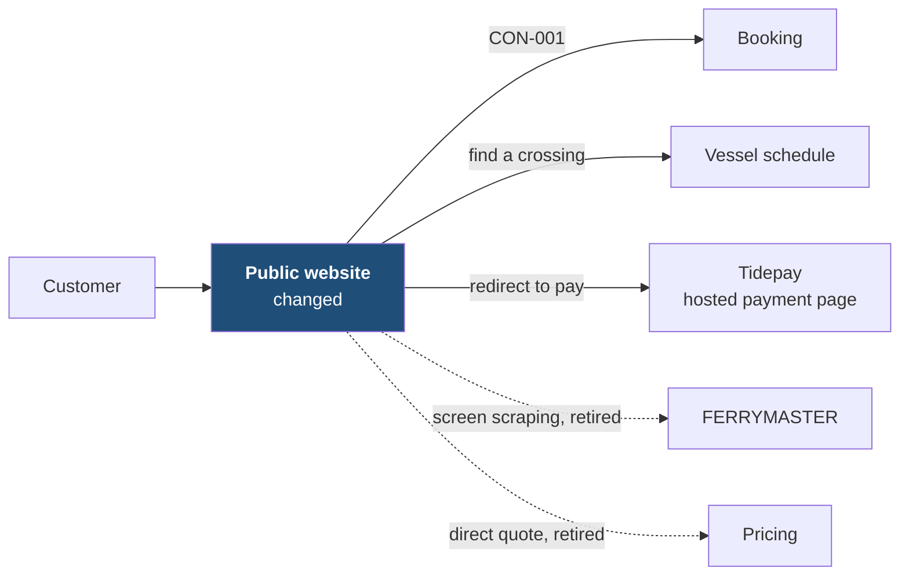
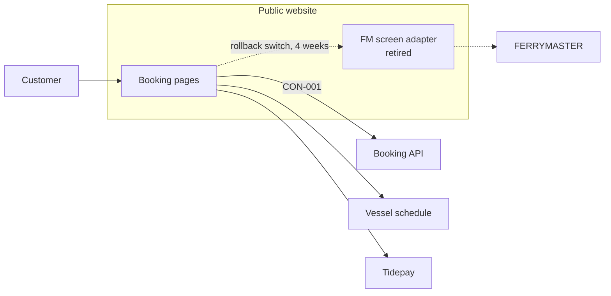

[[README|Harbourline]] / [[05-building-blocks|05 Building blocks]] / Public website

# Public website

- **Decision:** [[2026-07-28-solution-strategy]]

The public website is where most customers find a crossing, book it and pay for it. After this initiative it also lets them amend and cancel without phoning, which is goal G3. It asks Booking for every booking action and shows whatever state Booking returns.

The website no longer decides whether a booking is confirmed and no longer talks to FERRYMASTER.

| Change in INI-002 | Owner team |
|---|---|
| Changed: calls the Booking API. The FM screen adapter is retired. | Digital team |

## Inside Public website: main containers

| Container | Job | Contracts served or used | Proposed by | State |
|---|---|---|---|---|
| Booking pages | Search, hold, pay, confirm, and the new amend and cancel pages. Calls the Booking API for every booking action. | Uses CON-001 | Digital senior | confirmed |
| FM screen adapter | Scraped FERRYMASTER screens to book. Kept behind a switch for 4 weeks after the February 2027 cutover, then removed. | none | existing | retired |

Components inside these containers belong to the Digital team's tech design.

## Contracts this app provides

None. The website only consumes.

## Contracts this app consumes

<!-- generated: do not edit -->
| Contract | Provider | Change policy | State |
|---|---|---|---|
| [[booking-building-blocks#CON-001 Booking API\|CON-001 Booking API]] | Booking | Versioned; each version kept at least 6 months | decided |
<!-- /generated -->

## Concerns this team carries

- [[concern-testing|Testing]]: the website's consumer-driven contract tests for CON-001 run in its own pipeline.
- [[concern-rollout|Rollout]]: the website cuts over first, in February 2027. Rollback is flipping its switch back to the FM screen adapter during the 4 weeks before removal.

## Epics

<!-- generated: do not edit -->
- [[EPC-033-website-to-booking|EPC-033 Website moves to Booking]] (HB-103)
- [[EPC-036-amend-cancel-online|EPC-036 Amend and cancel online]] (HB-106)
<!-- /generated -->

Next: [[website-runtime|Public website runtime]]
