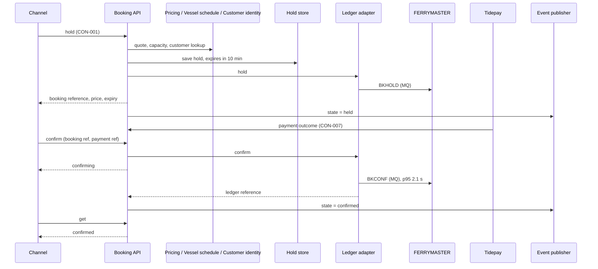

[[README|Harborline]] / [[06-flows|06 Flows]] / [[booking-building-blocks|Booking]] / Runtime

# Booking runtime

- **Decision:** [[2026-09-02-hold-pay-confirm]]

Booking takes part in all three flows.

| Flow | Booking's part |
|---|---|
| [[FLO-001-hold-pay-confirm\|FLO-001]] | Quotes, checks capacity, looks up the customer, holds the seat for 10 minutes, writes BKHOLD. Confirms with BKCONF once Tidepay reports a successful payment. |
| [[FLO-002-amend-or-cancel\|FLO-002]] | Finds the booking, checks the change is allowed, re-quotes an amendment through Pricing, writes BKAMND or BKCANC. |
| [[FLO-003-notify-on-change\|FLO-003]] | Publishes Booking state changed after every transition. Booking's part ends at the event bus. |

The diagram shows the hold, pay, confirm flow. Pricing, Vessel schedule and Customer identity share one lane to stay within eight participants; Booking calls them one after another.

## Numbers

| What | Value |
|---|---|
| Hold lifetime | 10 minutes |
| Ledger write latency p95 | 2.1 s, measured ([[11-unknowns-and-risks#UNK-001 Ledger write latency\|UNK-001]]) |
| Booking API version lifetime | at least 6 months per version |
| Notice of an MQ change | 8 weeks, from the mainframe team |

## When a dependency is slow or down

- **FERRYMASTER slow or down after payment.** The Ledger adapter keeps the hold and retries BKCONF. The hold does not expire once payment has succeeded. The customer sees "confirming". If retries keep failing, on-call follows the ledger-write runbook. Nobody fixes it by hand the next morning, which is why the fix-failed-bookings capability retires.
- **FERRYMASTER down before payment.** If BKHOLD fails, Booking refuses the hold with an explicit "unavailable" error. The channel never sends the customer to payment for a seat the ledger has not seen.
- **Pricing, Vessel schedule or Customer identity down.** Booking refuses the hold and says which dependency failed. It does not guess a fare or assume capacity.
- **Hold store down.** Booking refuses new holds. On-call follows the hold-store outage runbook.
- **Hold expires unpaid.** After 10 minutes the Ledger adapter sends BKCANC to release the seat and Booking publishes state = canceled.
- **Event bus down.** The state change still completes. The Event publisher keeps the events and publishes them in order when the bus returns, so notifications arrive late and none are lost.
- **Slow channel.** Each channel polls get with the booking reference. The trace ID from the channel follows the request to the Ledger adapter, so a slow confirm shows which stage took the time.
