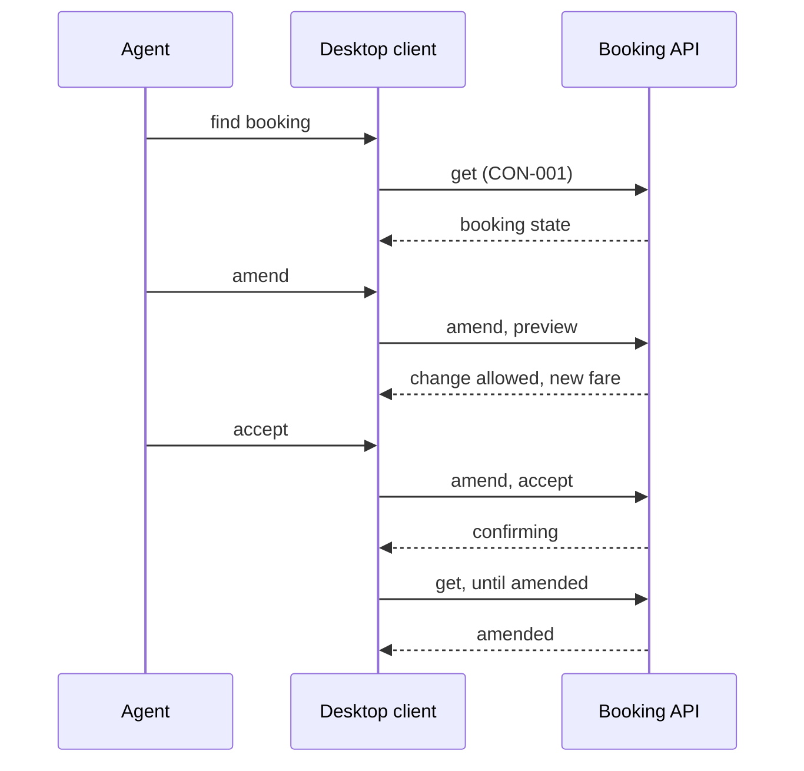

[[README|Harborline]] / [[06-flows|06 Flows]] / [[call-center-building-blocks|Call center desktop]] / Runtime

# Call center desktop runtime

- **Decision:** [[2026-09-16-testing-and-amend]]

| Flow | Desktop's part |
|---|---|
| [[FLO-001-hold-pay-confirm\|FLO-001]] | The agent finds a crossing, the desktop asks Booking for a hold, the agent takes payment through Tidepay, and the desktop asks Booking to confirm. |
| [[FLO-002-amend-or-cancel\|FLO-002]] | The agent finds the booking by reference. Booking says whether the change is allowed and re-quotes an amendment. The desktop shows the result. |

The desktop has no part in [[FLO-003-notify-on-change|Notify on change]]. Customers get the same email or SMS whichever channel made the change.

The diagram shows the amend or cancel flow because the amend and cancel screens are the new part. The hold, pay, confirm flow follows the same calls as the website, with Tidepay taking payment as it does today.

## When a dependency is slow or down

- **Ledger write slow.** The desktop shows "confirming" and the agent can end the call. The customer's notification follows when Booking completes the write. There is no manual fix queue to fall back to.
- **Booking down.** The desktop says booking is unavailable and the agent cannot hold or amend. It does not switch to the terminal adapter on its own. During the 4 weeks after cutover, a person can flip the switch back.
