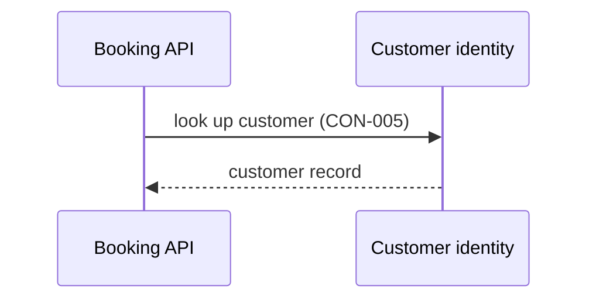

[[README|Harbourline]] / [[06-flows|06 Flows]] / [[customer-identity-building-blocks|Customer identity]] / Runtime

# Customer identity runtime

Customer identity is unchanged. In [[FLO-001-hold-pay-confirm|FLO-001]] it answers Booking's lookup before a hold. It has no part in FLO-002 or FLO-003.

If Customer identity is down, Booking refuses the hold and tells the channel why.
