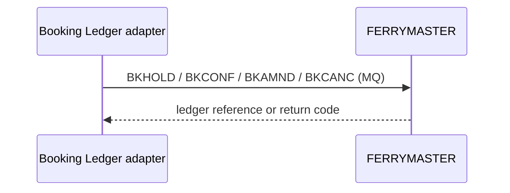

[[README|Harbourline]] / [[06-flows|06 Flows]] / [[ferrymaster-building-blocks|FERRYMASTER]] / Runtime

# FERRYMASTER runtime

FERRYMASTER does what it did before. It now receives its booking writes from one place.

| Flow | FERRYMASTER's part |
|---|---|
| [[FLO-001-hold-pay-confirm\|FLO-001]] | Records BKHOLD when Booking holds a seat, BKCONF when payment succeeds, BKCANC when a hold expires unpaid. |
| [[FLO-002-amend-or-cancel\|FLO-002]] | Records BKAMND or BKCANC. |

FERRYMASTER has no part in [[FLO-003-notify-on-change|FLO-003]].

Ledger write latency p95 is 2.1 s, measured ([[11-unknowns-and-risks#UNK-001 Ledger write latency|UNK-001]]).

## When it is slow or down

FERRYMASTER does nothing different. Booking absorbs the failure: the Ledger adapter keeps the hold and retries, and the customer sees "confirming". See [[booking-runtime|Booking runtime]].
