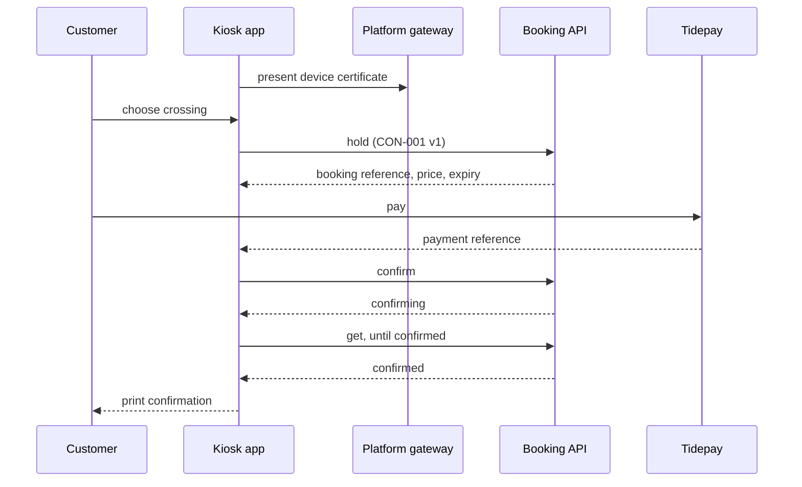

[[README|Harbourline]] / [[06-flows|06 Flows]] / [[kiosks-building-blocks|Port kiosks]] / Runtime

# Port kiosks runtime

- **Decision:** [[2026-08-26-kiosks-and-rollout]]

| Flow | Kiosk's part |
|---|---|
| [[FLO-001-hold-pay-confirm\|FLO-001]] | Finds the crossing, asks Booking for a hold, takes payment through Tidepay, asks Booking to confirm and shows the state it returns. |
| [[FLO-002-amend-or-cancel\|FLO-002]] | The kiosk shows a booking's state through get. Amend and cancel are not in the March 2027 image; customers use the website or the call centre. |

Kiosks have no part in [[FLO-003-notify-on-change|FLO-003]].

## Numbers

The customer has 10 minutes to pay before the hold expires. The ledger write behind "confirming" has a p95 of 2.1 s. The kiosk calls v1 of the Booking API. Each version is kept at least 6 months.

## When a dependency is slow or down

- **Ledger write slow.** The kiosk shows "confirming" and keeps polling get. The customer has paid and Booking keeps the hold.
- **Booking down.** The kiosk says booking is unavailable and takes no payment. It does not switch to the FM adapter on its own.
- **Device certificate rejected.** The gateway refuses every call from that kiosk. The kiosk shows it is out of service, and the rejection appears in the per-channel error rate.
