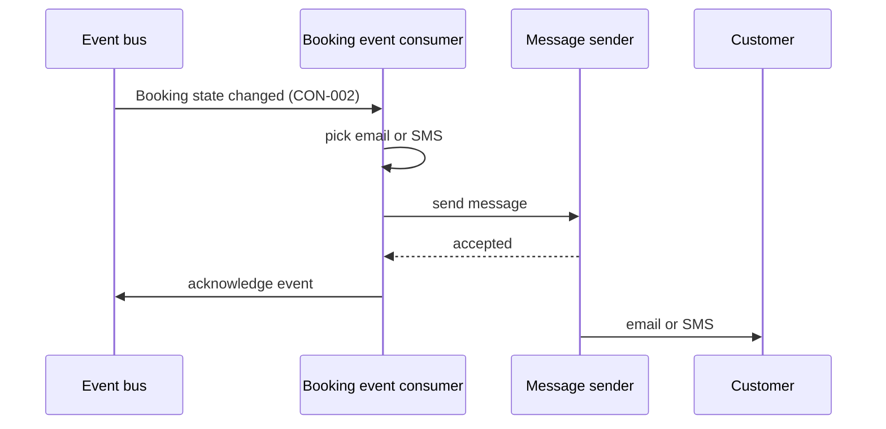

[[README|Harbourline]] / [[06-flows|06 Flows]] / [[notifications-building-blocks|Notifications]] / Runtime

# Notifications runtime

- **Decision:** [[2026-11-03-events]]

| Flow | Notifications' part |
|---|---|
| [[FLO-001-hold-pay-confirm\|FLO-001]] | Sends the confirmation once Booking publishes state = confirmed. |
| [[FLO-002-amend-or-cancel\|FLO-002]] | Sends the amendment or cancellation notice. |
| [[FLO-003-notify-on-change\|FLO-003]] | Reads the event, decides the channel, sends the message. |

The event bus has been production-ready since 2026-11-01 ([[11-unknowns-and-risks#UNK-005|UNK-005]]).

## When a dependency is slow or down

- **Event bus down.** Booking's Event publisher keeps the events and publishes them when the bus returns. Messages arrive late and none are lost.
- **Message sender down.** The consumer does not acknowledge the event, so the bus delivers it again. A booking reference and new state that have already been sent are skipped, so the customer gets one message.
- **Event the consumer cannot read.** CON-002 only changes additively, so a new field is ignored. An event that fails the schema is parked on a dead-letter queue with its booking reference and trace ID, and on-call is alerted.
