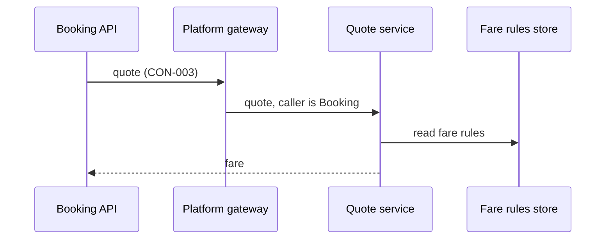

[[README|Harbourline]] / [[06-flows|06 Flows]] / [[pricing-building-blocks|Pricing]] / Runtime

# Pricing runtime

- **Decision:** [[2026-09-02-hold-pay-confirm]]

Pricing answers the same question it always has. The difference is that only Booking asks it.

| Flow | Pricing's part |
|---|---|
| [[FLO-001-hold-pay-confirm\|FLO-001]] | Quotes the fare before Booking places a hold. |
| [[FLO-002-amend-or-cancel\|FLO-002]] | Re-quotes the fare when a customer amends. Cancellations do not call Pricing. |

Pricing has no part in [[FLO-003-notify-on-change|Notify on change]].

## When something is slow or down

- **Pricing down.** Booking refuses the hold or the amendment and tells the channel why. Booking does not cache fares, so no customer is sold a stale price.
- **A front end calls Pricing after its old adapter is removed.** The gateway rejects the call and the front end's error rate shows it. It means some code path still uses the retired adapter.
