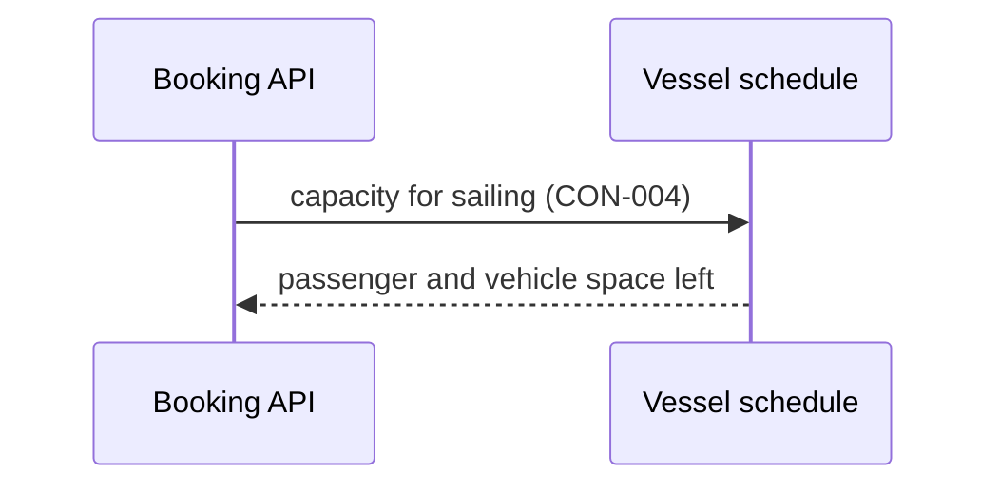

[[README|Harbourline]] / [[06-flows|06 Flows]] / [[vessel-schedule-building-blocks|Vessel schedule]] / Runtime

# Vessel schedule runtime

Vessel schedule is unchanged. In [[FLO-001-hold-pay-confirm|FLO-001]] it answers the front ends' search for a crossing, as today, and Booking's capacity check before a hold. It has no part in FLO-002 or FLO-003.

If Vessel schedule is down, Booking refuses the hold and tells the channel why. Booking does not assume there is space.
