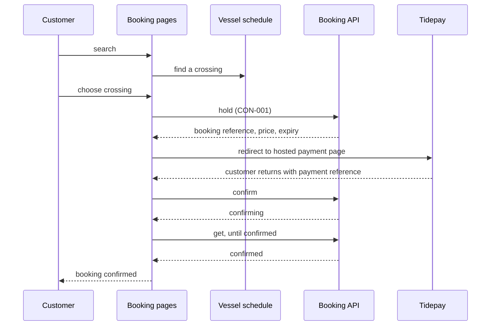

[[README|Harborline]] / [[06-flows|06 Flows]] / [[website-building-blocks|Public website]] / Runtime

# Public website runtime

- **Decision:** [[2026-09-16-testing-and-amend]]

| Flow | Website's part |
|---|---|
| [[FLO-001-hold-pay-confirm\|FLO-001]] | Finds the crossing, asks Booking for a hold, sends the customer to Tidepay's hosted page, then asks Booking to confirm and shows the state it returns. |
| [[FLO-002-amend-or-cancel\|FLO-002]] | New. The customer finds their booking and amends or cancels it online. Booking says whether the change is allowed and what it costs. |

The website has no part in [[FLO-003-notify-on-change|Notify on change]]. It stops sending its own booking emails, because Notifications sends them from Booking events.

## Numbers

The customer has 10 minutes to pay before the hold expires. The ledger write behind "confirming" has a p95 of 2.1 s.

## When a dependency is slow or down

- **Ledger write slow.** The page shows "confirming" and keeps polling get. The customer has already paid and Booking keeps the hold, so the page does not report a failure while Booking is still retrying. The confirmation email arrives when the ledger write completes.
- **Booking down.** The website says booking is unavailable and takes no payment. It does not fall back to the FERRYMASTER screen adapter on its own. Only a person flipping the switch moves traffic back, and only during the 4 weeks before the adapter is removed.
- **Tidepay down.** The customer cannot pay, and the hold expires after 10 minutes.
