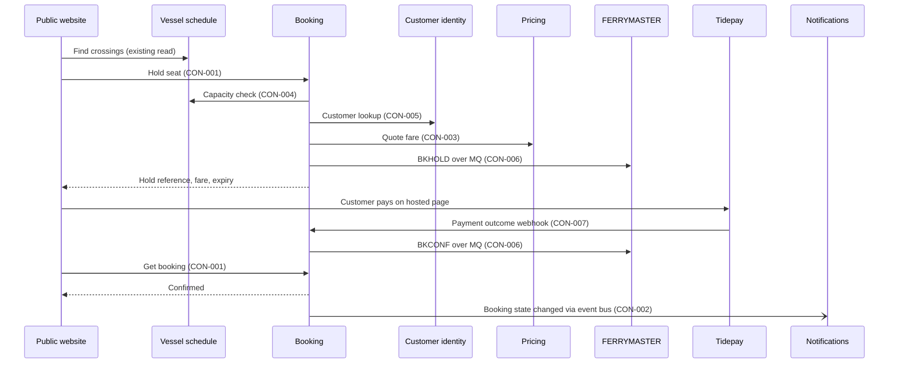

# FLO-001 Hold, pay, confirm

- **Decision:** [[2026-09-02-hold-pay-confirm]]

## Steps

1. [[CAP-011-find-a-crossing|Find a crossing]]. The channel reads sailings from Vessel schedule, as it does today.
2. [[CAP-014-hold-a-seat|Hold a seat]]. Booking checks capacity, looks up the customer, gets the fare through [[CAP-012-quote-a-fare|Quote a fare]] and writes BKHOLD to FERRYMASTER. The hold lasts 10 minutes.
3. [[CAP-015-take-payment|Take payment]]. The channel sends the customer to Tidepay's hosted payment page. Tidepay reports the outcome to Booking.
4. [[CAP-013-reserve-a-crossing|Confirm booking]]. Booking writes BKCONF to FERRYMASTER and marks the booking confirmed once the ledger accepts it.
5. [[CAP-022-notify-customer|Notify customer]]. Booking publishes the state change and Notifications sends the confirmation ([[FLO-003-notify-on-change|Notify on change]]).

The diagram shows the website. The call centre desktop and the kiosk app follow the same sequence; only the channel changes.

## What the customer sees

The customer picks a sailing and sees the fare with a 10-minute timer. They pay on Tidepay's page and come back to a "confirming" screen. Ledger writes take 2.1 s at p95, so most customers see "confirmed" within a few seconds. The email or SMS follows. Every channel shows the same state, because every channel asks Booking.

## Failure behaviour

| What fails | What happens | What the customer sees |
|---|---|---|
| No capacity on the sailing | Booking refuses the hold. Nothing is written to the ledger. | "Sold out" and the next sailings |
| Pricing, Vessel schedule or Customer identity does not answer | Booking refuses the hold with an explicit error naming the failed step. It never guesses a fare or capacity. | "We can't hold this sailing right now, try again". Nothing is charged. |
| BKHOLD write fails | Ledger adapter retries. If the write still fails, Booking refuses the hold with an explicit error. The channel never gets a hold reference the ledger has not accepted. | "Holding your seat", then "try again". Nothing is charged. |
| Payment declined or abandoned | The hold expires after 10 minutes. Booking releases it with BKCANC and publishes `expired`. | The timer runs out and the seat is released |
| Tidepay webhook arrives twice | Booking treats repeats of one payment ID as one outcome. | Nothing |
| BKCONF write fails after payment | Booking records "paid, confirming" and keeps the hold past 10 minutes. Ledger adapter retries. If retries run out, Booking alerts on-call, who follow the ledger-write failure runbook. Nobody fixes it the next morning by hand. | "Confirming", then the confirmation message when the write lands |
| Event bus unavailable | The booking is still confirmed. Event publisher keeps the events and publishes them in order once the bus is back. | The message arrives late |

## Contracts used

| Step | Contracts |
|---|---|
| 1 Find a crossing | Existing Vessel schedule read by the channel. No INI-002 contract. |
| 2 Hold a seat | [[booking-building-blocks#CON-001 Booking API\|CON-001 Booking API]] (hold), [[vessel-schedule-building-blocks#CON-004 Capacity check\|CON-004]], [[customer-identity-building-blocks#CON-005 Customer lookup\|CON-005]], [[pricing-building-blocks#CON-003 Quote a fare\|CON-003]], [[ferrymaster-building-blocks#CON-006 Ledger transactions\|CON-006]] (BKHOLD) |
| 3 Take payment | [[booking-building-blocks#CON-007 Tidepay payment outcome\|CON-007 Payment outcome]] |
| 4 Confirm booking | [[ferrymaster-building-blocks#CON-006 Ledger transactions\|CON-006]] (BKCONF), [[booking-building-blocks#CON-001 Booking API\|CON-001 Booking API]] (get) |
| 5 Notify customer | [[booking-building-blocks#CON-002 Booking state changed\|CON-002 Booking state changed]] |

## Tested end to end

Yes. The QA lead owns the suite. It runs the website and call centre desktop paths on every Booking release candidate in staging, against the ledger simulator and the Tidepay sandbox. It runs once a week against the FERRYMASTER test region. The Port Systems senior runs the kiosk path on a test kiosk before the March 2027 image is signed off. See [[concern-testing|Testing]].

Delivered by:

- [[EPC-031-holds-and-confirms|Booking holds and confirms crossings]]
- [[EPC-032-ledger-adapter|Ledger adapter on FERRYMASTER's MQ transactions]]
- [[EPC-033-website-to-booking|Website moves to Booking]]
- [[EPC-034-call-centre-to-booking|Call centre moves to Booking]]
- [[EPC-035-kiosks-to-booking|Kiosks move to Booking in the March image]]
- [[EPC-037-events-and-notifications|Booking events and customer notifications]]
- [[EPC-038-pricing-serves-booking|Pricing serves Booking only]]
