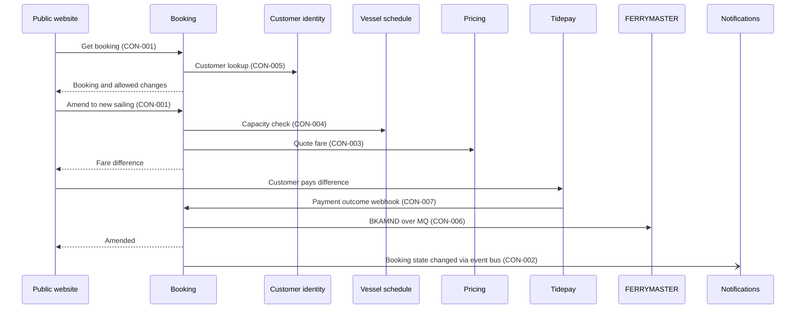

# FLO-002 Amend or cancel

- **Decision:** [[2026-09-16-testing-and-amend]]

## Steps

1. [[CAP-021-amend-or-cancel|Find booking]]. The channel asks Booking for the booking by reference. Booking looks up the customer to check the booking is theirs.
2. [[CAP-021-amend-or-cancel|Check change allowed]]. Booking checks the booking is confirmed and the sailing has not left. For an amend it checks capacity on the new sailing.
3. [[CAP-012-quote-a-fare|Re-quote]] (amend only). Booking gets the new fare from Pricing. If it is higher, the customer pays the difference through [[CAP-015-take-payment|Take payment]], as in [[FLO-001-hold-pay-confirm|FLO-001]] step 3.
4. [[CAP-021-amend-or-cancel|Write to ledger]]. Booking writes BKAMND or BKCANC to FERRYMASTER. The booking changes state only when the ledger accepts the write.
5. [[CAP-022-notify-customer|Notify customer]]. Booking publishes the state change and Notifications tells the customer ([[FLO-003-notify-on-change|FLO-003]]).

The diagram shows an amend from the website with a higher fare. A cancel skips the capacity check, quote and payment. The call centre desktop follows the same sequence. Only the website and the call centre desktop run this flow. Kiosks show booking state through CON-001 get and do not amend or cancel in the March 2027 image.

## What the customer sees

Today a customer who wants to change a crossing phones the call centre, and an agent retypes it on a mainframe screen. After INI-002 the customer opens the booking on the website, picks a new sailing, sees the price difference and pays it. A cancel is one button. Call centre agents use the same operations from new screens in the desktop client, so an agent and the website always show the same booking. Refunds are unchanged by INI-002 and stay with Tidepay.

## Failure behaviour

| What fails | What happens | What the customer sees |
|---|---|---|
| Booking not found or not this customer's | Booking refuses. It does not say which. | "We can't find that booking" |
| Sailing has left, or booking not confirmed | Booking refuses the change. | The reason, and the call centre number |
| No capacity on the new sailing | Booking refuses the amend. The original booking stays. | Other sailings |
| Pricing does not answer | Booking refuses the amend. It never guesses a fare. | "We can't price this right now, try again" |
| BKAMND or BKCANC write fails | The booking keeps its old state, because FERRYMASTER is the ledger of record. Ledger adapter retries. If retries run out, Booking alerts on-call. | "Change pending", then the message when the write lands |
| Event bus unavailable | The change stands. Event publisher keeps the events and publishes them in order once the bus is back. | The message arrives late |

## Contracts used

<!-- generated: do not edit -->
| Step | Contracts |
|---|---|
| 1 Find booking | [[booking-building-blocks#CON-001 Booking API\|CON-001 Booking API]] (get), [[customer-identity-building-blocks#CON-005 Customer lookup\|CON-005]] |
| 2 Check change allowed | [[booking-building-blocks#CON-001 Booking API\|CON-001 Booking API]] (amend, cancel), [[vessel-schedule-building-blocks#CON-004 Capacity check\|CON-004]] |
| 3 Re-quote | [[pricing-building-blocks#CON-003 Quote a fare\|CON-003]], [[booking-building-blocks#CON-007 Tidepay payment outcome\|CON-007 Payment outcome]] |
| 4 Write to ledger | [[ferrymaster-building-blocks#CON-006 Ledger transactions\|CON-006]] (BKAMND, BKCANC) |
| 5 Notify customer | [[booking-building-blocks#CON-002 Booking state changed\|CON-002 Booking state changed]] |
<!-- /generated -->

## Tested end to end

Yes. The QA lead owns the suite. It covers amend with a higher fare, amend with a lower fare, and cancel, from the website and the call centre desktop. It runs on every Booking release candidate in staging against the ledger simulator and the Tidepay sandbox, and once a week against the FERRYMASTER test region. See [[concern-testing|Testing]].

Delivered by [[EPC-036-amend-cancel-online|EPC-036]], [[EPC-034-call-centre-to-booking|EPC-034]], [[EPC-032-ledger-adapter|EPC-032]], [[EPC-037-events-and-notifications|EPC-037]] and [[EPC-038-pricing-serves-booking|EPC-038]]. This flow carries goal G3 in [[01-goals|Goals]].
