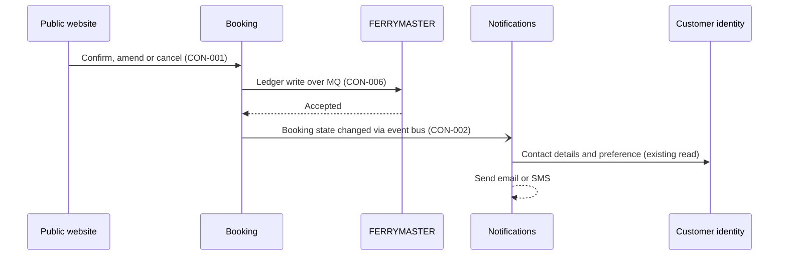

# FLO-003 Notify on change

- **Decision:** [[2026-11-03-events]]

## Steps

1. [[CAP-022-notify-customer|Booking state changes]]. A booking is confirmed, amended, canceled or expires, after FERRYMASTER has accepted the write.
2. [[CAP-022-notify-customer|Event published]]. Booking's Event publisher puts "Booking state changed" on the Harborline event bus. The event carries the booking reference, the new state and the customer ID. It carries no contact details.
3. [[CAP-022-notify-customer|Notifications decides channel]]. The Booking event consumer looks up the customer's contact details and preference in Customer identity and picks email or SMS.
4. [[CAP-022-notify-customer|Message sent]]. The existing Message sender sends it.

Any channel can trigger step 1. The diagram shows the website.

## What the customer sees

One message for each change, in the channel they chose, whichever front end made the change. Today only the website sends emails, so a booking made at a kiosk or by phone gets nothing. With Booking, every confirmed, amended, canceled or expired booking produces a message.

## Failure behavior

| What fails | What happens | What the customer sees |
|---|---|---|
| Event bus unavailable | Booking state is already correct. Event publisher keeps the events and publishes them in order once the bus is back. | The message arrives late |
| Notifications down | Events wait on the bus and are consumed when Notifications returns. | The message arrives late |
| Same event delivered twice | The consumer ignores an event it has already sent a message for, keyed by booking reference and state. | One message |
| No contact details in Customer identity | The consumer logs the booking reference and counts it as unsendable. It does not retry forever and does not drop it quietly. | No message |
| Message sender fails | Existing sender retry and alerting, unchanged by INI-002. | The message arrives late or not at all |

## Contracts used

| Step | Contracts |
|---|---|
| 1 Booking state changes | [[booking-building-blocks#CON-001 Booking API\|CON-001 Booking API]], [[ferrymaster-building-blocks#CON-006 Ledger transactions\|CON-006]] |
| 2 Event published | [[booking-building-blocks#CON-002 Booking state changed\|CON-002 Booking state changed]] |
| 3 Notifications decides channel | Existing Customer identity read by Notifications. No INI-002 contract. |
| 4 Message sent | Internal to Notifications |

## Tested by contract tests only

No end-to-end test. Booking's pipeline checks every change to the Booking state changed event against the schema and the additive-only rule. The Platform team's consumer test in Notifications runs against the published schema. The hold-pay-confirm and amend-or-cancel suites check that the event is published; they stop there. A real end-to-end run would need live email and SMS delivery and would fail for reasons that have nothing to do with Booking. See [[concern-testing|Testing]].

Delivered by [[EPC-037-events-and-notifications|Booking events and customer notifications]]. Depends on the event bus being production-ready ([[11-unknowns-and-risks#UNK-005 Event bus readiness|Event bus readiness]], resolved).
