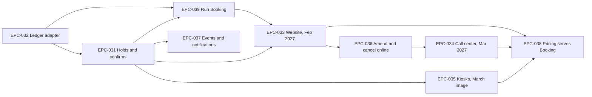

# Epics

Nine epics deliver Unified Booking. Each one names its owning team. The solution lead wrote every epic down to its acceptance criteria; the teams write the stories after their own tech design sessions.

Booking's own epics come first because every channel cutover needs a working Booking API and ledger writes. The channels then move in the order the rollout concern sets: website in February 2027, call center in March 2027, kiosks with the March 2027 image. Pricing closes the gateway to other callers last, once no front end calls it directly.

- [[EPC-031-holds-and-confirms|Booking holds and confirms crossings]] Booking holds and confirms crossings
- [[EPC-032-ledger-adapter|Ledger adapter on FERRYMASTER's MQ transactions]] Booking writes bookings to the ledger through the existing message queue (MQ).
- [[EPC-033-website-to-booking|Website moves to Booking]] Website moves to Booking
- [[EPC-034-call-center-to-booking|Call center moves to Booking]] Call center moves to Booking
- [[EPC-035-kiosks-to-booking|Kiosks move to Booking in the March image]] Kiosks move to Booking in the March image
- [[EPC-036-amend-cancel-online|Amend and cancel online]] Amend and cancel online
- [[EPC-037-events-and-notifications|Booking events and customer notifications]] Booking events and customer notifications
- [[EPC-038-pricing-serves-booking|Pricing serves Booking only]] Pricing serves Booking only
- [[EPC-039-run-booking|Run Booking: on-call, runbooks, dashboards]] Run Booking: on-call, runbooks, dashboards

## Traceability

<!-- generated:traceability sha=2cb4dcdb: do not edit, run planner render -->
**Traceability:** no gaps. 57 checks pass.
<!-- /generated:traceability -->

## Sequencing

