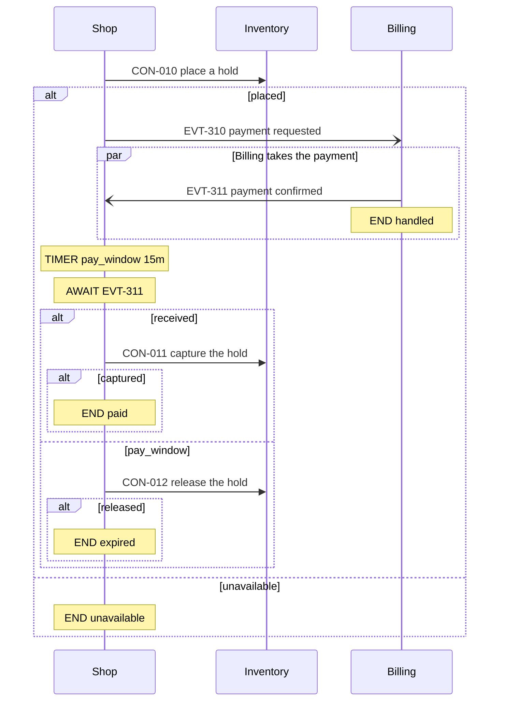

# Conventions

This file is the vault's one written format. Every page follows it, and `vela check` enforces the parts a script can see. If a rule here and the check disagree, the check has a bug. Search this file for any field, label or code to find the rule behind it.

## Layout

One vault holds one initiative. Pages are numbered by arc42 section.

| Path | What it holds |
|---|---|
| `README.md` | Home page: layout, reading paths, setup checklist |
| `CLAUDE.md` | How Claude answers questions from this vault. A person writes it. |
| `.vela.yaml` | `initiative` (`INI-nnn`), `title`, `stale_after_days` (default 60), and optionally `link_templates` (see Links out of the vault), `designs` (see Team design docs), `owner_contact` (who a published copy's readers write to), `roles` (who holds which role, see Onboarding), `grills` (who runs a grill and who is asked to join, see Grills waiting) and `role: reader` (see Roles and published copies), and `records_split` (the date `vela records split` moved the session records to private notes; receipts that link a stub dated earlier are exempt from the words rule) |
| `01-goals.md` | Goals table, and the `where-it-stands` and `progress-map` blocks |
| `02-constraints.md` | Constraints table, `CST-n` |
| `03-context-and-scope.md` | Systems today and after; apps in and out of scope |
| `04-solution-strategy.md`, `04a-capability-delta.md` | The core move; links to every capability that changes |
| `04b-releases.md` | One section per release, listing the functional requirements it delivers and, as a dated milestone, the slices it points at |
| `slices/` | `SLC-nnn-<slug>.md` per slice: one journey proven end to end, the unit of done (see Slices) |
| `05-building-blocks/` | Index with the `context-map` block, then `<app>-building-blocks.md` per app, with its contracts |
| `06-runtime/` | `06-flows.md`, `flows/FLO-nnn-<slug>.md`, `apps/<app>-runtime.md` |
| `08-concerns/` | `08-concerns.md` with the `concern-matrix` block, then `concern-<name>.md` |
| `09-decisions/` | Index, then `ADR-nnnn-<slug>.md` |
| `11-unknowns-and-risks.md` | Every unknown and risk, the `unknowns-index` block, and the question ledger with its `undisposed-questions` block |
| `12-glossary.md` | Terms |
| `13-epics/` | Index, then `EPC-nnn-<slug>.md` |
| `capabilities/` | `CAP-nnn-<slug>.md` per capability touched |
| `ONBOARDING.md` | Optional. The lead's tuning of the onboarding path, one section per role (see Onboarding). Not a vault page: `vela check` does not read it. |
| `sources.md` | The Library: the source register, `SRC-nn` |
| `sessions/` | One stub per session, `YYYY-MM-DD-<topic>.md`: a header with no one's words in it. The notes are in `sessions/private/`, which stays on the lead's machine and is never committed. See Sessions |
| `voice/VOICE.md` | Optional. The owner's own rules for either voice (pages, conversation), in their own words. Committed. Never a source. |
| `voice/DEFAULT.md` | The default page voice, written out for the owner to read. Ships with the template; edit `voice/VOICE.md` instead, which wins over it. Never a source. |
| `voice/examples/` | House-voice passages and conversation exchanges. Never a source. Committed. |
| `voice/local/` | The owner's passages that stay on one machine, same format as `voice/examples/`. Gitignored, never committed. `voice/corpus/` is gitignored too. |
| `docs/` | The team's design and plan for a handed-off app, written by the user's `tech-design-grill` and `work-breakdown` skills when run from the vault root: `docs/tech-design/<slug>.md`, `docs/plan/<slug>-breakdown.md`, `docs/adr/`. Not vault pages: `vela check` does not read them, and `publish`, `open` and `propose` carry them like any other file. `CONTEXT.md` at the vault root is the design's glossary, also not a page. |
| `handoffs/` | `<APP-id>.md` per handed-off app: the manifest `vela handoff` writes. Never edited by hand. |
| `.inbox/` | Documents dropped for Discover. Gitignored, never parsed. |
| `dashboard.html` | The explorer page `vela explore` builds (and `/vela:close`, `open` and `import` rebuild), one offline file at the vault root. Committed, so a colleague who pulls the repo or opens the OneDrive folder just opens it; it says at the top when it was built and from which commit. Generated, never edited by hand and never parsed: `vela check`, `search` and `capture` ignore it. `vela publish` rebuilds it from the published pages. |
| `.vela/` | The tool's own files, never parsed. A person's own onboarding path and the page built from it sit in `.vela/onboard/` (see Onboarding). Gitignored except `explorer-pins.json`, which is committed so a team shares one map layout: the explorer's fixed layout, `{node ID: [column, row]}`, written on the first build and added to when an app or party appears; delete it to lay the map out afresh. A reader's workspace (`workspace.json`, `baseline/`, `replay-backup/`) and `findings/` review scratch stay ignored. The template's `.gitignore` says `.vela/*` then `!.vela/explorer-pins.json`; a plain `.vela/` line cannot be undone for one file inside it. |

`vela check` reads every `.md` file except `CLAUDE.md`, `CONVENTIONS.md`, `CONTEXT.md`, `ONBOARDING.md`, anything under `voice/`, `handoffs/` or `docs/`, and anything under a folder whose name starts with a dot.

## Areas and stages

An area is an app whose `change` is `new` or `changed`, or one of `initiative`, `capabilities`, `concern-<name>` and `epics`. Only apps move through stages. The initiative is at Frame while no app has a stage. Frame is never typed.

`stage` sits on the app's building-blocks page and means "in this stage now". It is typed by hand. `vela ladder` shows, for each app on the ladder, the latest stage whose entry list its pages already meet, with every stage below it, and what the next stage still needs; `vela status` adds `pages reach <stage>` when that is later than the typed stage. Neither changes the stage. The `where-it-stands` block shows counts beside it, so a stage the counts contradict is easy to see. Apps whose `change` is `integrated`, `unchanged` or `retired` sit outside the ladder and take no `stage`.

The ladder checklist. Before typing a stage, check its entry list:

| Stage | Enter when |
|---|---|
| `baseline` | The app is named as in scope. Nothing else. |
| `target` | The app page cites at least one source that is not a dump. |
| `boundaries` | Every flow that names the app is at `assumption` or higher. |
| `contracts` | The app page is `decided`: what it does and what it does not do. Its containers table exists. |
| `handoff` | Every contract it provides is `decided`, or `fact` when unchanged. Every contract it consumes is `decided` or `fact`. Its runtime page says how it behaves on failure. No open unknown blocks one of its contracts. |
| `epics` | It has no `unexamined` cell. Every container is `confirmed`, `unchanged` or `retired`. |

## Frontmatter

Every page starts with a YAML block. Quote any value that holds a colon or starts with `@`.

| `type` | Required fields | Optional fields | `state` values |
|---|---|---|---|
| `index` | `id`, `type`, `title`, `authored` | `initiative`, `arc42`, `c4`, `owner`, `sources` | none |
| `initiative-section` | `id`, `type`, `title`, `state`, `owner`, `authored` | `initiative`, `arc42`, `c4`, `sources` | `inkling`, `assumption`, `fact`, `decided` |
| `app-building-blocks` | as above, plus `change` | `stage`, `stub`, `initiative`, `arc42`, `c4`, `sources`, `handed_off`, `handed_off_pr`, `domain`, `icon`, `design` | `inkling`, `assumption`, `fact`, `decided` |
| `app-runtime` | `id`, `type`, `title`, `state`, `owner`, `authored` | `initiative`, `arc42`, `sources` | `inkling`, `assumption`, `fact`, `decided` |
| `flow` | `id`, `type`, `title`, `state`, `owner`, `authored` | `initiative`, `arc42`, `sources`, `capabilities` | `inkling`, `assumption`, `fact`, `decided` |
| `concern` | `id`, `type`, `title`, `owner`, `authored` | `initiative`, `arc42`, `sources` | none: the cells hold the states |
| `decision` | `id`, `type`, `title`, `state`, `owner`, `authored` | `initiative`, `arc42`, `sources` | `proposed`, `decided`, `superseded`, `rejected` |
| `epic` | as above, plus `apps`, `delivers` | `consumes`, `flows`, `depends_on`, `initiative`, `sources` | `draft`, `decided`, `reopened` |
| `capability` | as above, plus `origin`, `change` | `sources`, `domain` | `inkling`, `assumption`, `decided` |
| `session` | `id`, `type`, `date`, `modes`, `status` | `title`, `summary`, `branch`, `start_commit`, `captures_sha256`, `ready`, `challenges`, `harvest_declined`, `title_override` | none: `status` is `open` or `closed` |
| `sources` | `id`, `type`, `title`, `authored` | `owner` | none |
| `entity` | `id`, `type`, `title`, `app`, `shared`, `initial`, `final` | `owner`, `sources` | none: `initial` and `final` name its states. See Flow check. |
| `slice` | `id`, `type`, `title`, `authored` | `initiative`, `sources` | none: its `**Status:**` bullet says where it stands. See Slices. |

Every type except `session` may also carry `last_verified`, `verified_by` and `links`. A page an import wrote also carries `source-wording` (see Certainty and sources).

Field values:

- `authored`: `authored` (people wrote it), `generated` (only blocks), `mixed` (both).
- `owner`: a GitHub handle or team, `"@handle"` or `"@org/team"`. Several owners are separated by spaces, as in CODEOWNERS. Close uses it to request reviews and to mention owners.
- `initiative`: if present, it must equal `.vela.yaml`.
- `c4`: `landscape`, `context` or `container`. `arc42`: the section, for example `"§5"`.
- `sources`: a list. Use `SRC-nn` IDs for documents. Free text, such as a session name, is allowed as a summary.
- `change` on an app page: `new`, `changed`, `integrated`, `unchanged` or `retired`.
- `stage`: `baseline`, `target`, `boundaries`, `contracts`, `handoff`, `epics`. Required when `change` is `new` or `changed`, absent otherwise.
- `last_verified`: the date someone last reread the page against its sources, `YYYY-MM-DD`. `verified_by`: that person's handle, `"@handle"`. Set both together. A page without them is never judged stale.
- `handed_off`: set once a senior takes the app. Form: `"<name>, <date>"`. `handed_off_pr`: the pull request that hands it over, `pending` until the PR exists, then its number (`41`); W325 warns until the number is written. A `handed_off_pr` with no `handed_off` is E105.
- `stub`: `boundary` on an app page `vela add app-stub` wrote and nobody has read back yet. `vela next` sends such a page (with no containers table) to Boundary. Boundary removes the field when the lead has said yes to the page. State lives in this field, never in a sentence on the page, so rewriting the prose cannot lose it.
- `change` on a capability page: `new`, `extend`, `replace`, `narrow`, `retire` or `unchanged`. `origin`: `proposed` or `imported`. Proposed capabilities keep their IDs and are mapped to an official map later, never renamed.
- `domain` on a capability page: a short name for the business area it belongs to, such as `Booking`. The `capability-map` block groups capabilities by it. A capability with no `domain` is drawn under "No domain".
- `capabilities` on a flow page: a list of `CAP-` IDs, the capability or capabilities the journey serves, the first one primary. The explorer's flow picker groups a long list of flows by the primary one; without the field it guesses from the capabilities the steps link and says so. The capability views read the same field: the first capability depends on the others the flow lists (see How capabilities depend on each other). Leave it out while the initiative has no capability pages. W358 warns when a flow has none and capability pages exist; E359 fails an ID that is not a capability page.
- Epic lists, all of IDs: `apps` (the `APP-` pages it touches), `delivers` (what it builds or changes: capabilities, contracts on the provider side, goals), `consumes` (contracts it builds a client for), `flows`, `depends_on` (other epics). A contract relied on unchanged goes in neither `delivers` nor `consumes`.
- `modes` on a session: a list of `dump`, `discover`, `shape`, `boundary`, `allocate`, `releases`, `grill`, `requirements`, `epics`, `challenge`, `answer`. A `challenge` session is a senior's challenge after handoff, written by `/vela:challenge`. An `answer` session is the solution lead's answer to one, opened by START on the challenge's own branch. Like every mode but `grill`, neither can decide: an answer that decides adds `grill` to its `modes`. A session also records `branch` (the branch it runs on, whichever one the lead was on) and `start_commit` (the commit it began at, so a second session on the same branch owes only its own paragraphs); both are optional. A session also lists, in its frontmatter, `ready` (the IDs of items the lead said yes to in a session that cannot decide, until a grill decides them), `challenges` (the ID a `challenge` session was opened on) and `harvest_declined` (the voice-harvest paragraphs the lead declined, each as `PR <number> <page> <12-character hash>`); all three are optional and are kept in step with the record by vela, not edited by hand. `captures_sha256` holds one fingerprint per part of the session's private notes (`pending` while a part is open), and `summary` is optional because the one-line summary lives in the private notes file, not in the committed record.

## IDs

IDs are never reused or renumbered. A file's basename is frozen once anything links to it. Basenames are unique across the vault, ignoring case.

| Kind | Pattern | Where it lives | File name |
|---|---|---|---|
| Initiative | `INI-001` | `.vela.yaml` | |
| App | `APP-booking` | app page `id` | `booking-building-blocks.md` |
| Runtime page | `RUN-booking` | runtime page `id` | `booking-runtime.md` |
| Capability, flow, epic, slice | `CAP-013`, `FLO-001`, `EPC-031`, `SLC-001` | page `id` | starts with the ID, then `-<slug>` |
| Decision | `ADR-0001` | page `id` | starts with the ID, then `-<slug>` |
| Concern | `concern-testing` | page `id` | the ID |
| Session | `2026-08-12-goals-and-data` | page `id` | the ID. Add `-2` on a same-day clash. |
| Contract, unknown, risk, functional requirement | `CON-001`, `UNK-001`, `R-01`, `CAP-001.FR1` | `### <ID> <short name>` heading | |
| Party, stored value | `PTY-01`, `SV-01` | `### <ID> <short name>` heading on `03-context-and-scope.md` | |
| Goal, constraint, source | `G1`, `CST-1`, `SRC-01` | first column of their table | |
| Other pages | lower-case slug, for example `goals` | page `id` | |

## Certainty and sources

Every item has a state. `inkling` is a hunch. `assumption` is believed but not checked. `fact` has a source. `decided` came out of a Grill. `unknown` is a question with an owner, and a list of what it blocks when it blocks anything.

- **Only a Grill decides,** unless the user overrides it (see Overrides). A `decided` page carries a page-level `- **Decision:**` bullet, and a `decided` contract or functional requirement carries one under its heading. The bullet is a receipt: it names the session, the capture where the yes was given, and who said it, as in `[[2026-10-22-booking-api]] c07, @maria: "Yes, one booking API for the web and the kiosks."`. The linked session's `modes` must include `grill`, or an `**Override:**` on the item names `grill`, and then the bullet is the bare link. The words after the colon are there only when a person may be quoted (see Whose words go on a page). Goal rows take their decision from the Goals page's bullet.
- **A decision a document states** is the one exception. When a registered source records a decision ("approved by the CTO on March 3") and the lead says yes to it in an import, it is `decided` with a receipt that ends in `as SRC-nn states`, such as `[[2026-10-22-booking-api]] c07, @maria, as SRC-04 states`, which `vela decide --stated-in SRC-nn` writes. The lead's yes is on the session's Changes row, as for any decision. What the lead isn't sure of stays an `assumption`, with the document noted.
- **A decision keeps its why.** When a Grill sets an item to `decided`, it asks the lead why in one question, and writes the answer in the lead's own words as `- **Why:** <the lead's words>` beside the `**Decision:**` bullet: under the item's heading, or under its `#### <ID>` in `## History`, or directly under `## History` for a page. A decision that shapes the whole design (the strategy, an app, a flow) also gets a decision record stub for close to fill. `vela check` warns W390 on a decided item with no Why; it is a warning, never an error, and a decision record is exempt because it is the reasoning. A page and the rows it decides (goals, allocation, releases) share one page-level Why.
- **A requirements session cannot decide.** It writes at most `assumption`.
- **A fact needs a source.** A `fact` page lists `sources`. A `fact` contract or functional requirement carries `- **Source:** SRC-nn`. A goal row at `fact` needs its page to list `sources`.
- **What counts as a source.** A document describing what exists gives a fact. A document stating intent gives an assumption. A person's first-hand knowledge gives a fact. Claude's general knowledge is never a source.
- **Sources live in the register, the Library.** `sources.md` has one row per document, spec, design or link: `ID | Title | Owner | Date | Kind | Type | Relates to | Version | Stored | Location`. `Kind` is `exists`, `intends` or `repo`. A `repo` source is a code repository read at a commit, with Location `<url>@<sha>`. `Type` is `spec`, `design`, `document`, `wiki`, `tracker` or `link`; empty reads as `document`, so a register written with six columns (no Type, Relates to, Version or Stored) still reads. `Relates to` is item IDs of any kind (an app, capability, contract, party, unknown, release), space-separated, each of which must exist (E308), or empty. `Version` is for specs; write `v1.0 (latest v1.1)` when the owner has been told a newer one is out, and the Library shows "newer version out" (vela never opens links, so the newer version is told, not fetched). A version on any other type warns W307. `Stored` is a file kept in the vault, `library/specs/`, `library/designs/` or `library/documents/` (E307 if the path is anything else, E313 if the file is missing). `Location` keeps its meaning: a URL, `<url>@<sha>`, `first-hand: <handle>`, or `local only`. A row needs at least one of Stored or Location (E309). A file is kept in `library/<type>/` only with the owner's yes in the session (`vela library add`); raw material stays in `.inbox/`, which is never committed, and nothing else in a document is copied into the vault except as an import keeps it below.
- **An import keeps a document's own words where they carry weight.** Requirements, contract and legal terms, numbers and direct quotes go in word for word, as a quote (`> "..."`) with its source linked. Whether the page's own sentences are written in the house voice is the lead's answer to one question the import asks. Each page records it in `source-wording`: `keep` (every word as the documents have it, the default until the lead answers), `split` (quotes kept, the explaining sentences voiced) or `voice`. A `split` or `voice` page links the capture of the lead's answer in `source-wording-yes: "[[<session>]] c12"`; E361 is a page voiced without it. Close never redrafts a `keep` page, and `vela voicecheck` holds its kept lines exactly.
- **Nothing is left for a Grill in prose.** A matter a session leaves for a Grill, or says is decided later, is an open unknown with an owner, and the page links it. Close writes the unknown when a capture or a sentence defers; `vela check` warns W389 on page prose that says it is left for a Grill, or decided later, and links no open unknown in the same paragraph. Session records, History and generated blocks are not read, and nor is the unknowns page, where the question lives.
- **Disputes are unknowns.** When two sources or two people disagree, write an unknown naming both. Do not pick one.
- **State a value once.** The item that owns a value states it. Every other page links to it.

## Fact bullets

A fact bullet is a list line `- **Label:** value`, one label per line. Unknown labels are prose. A `- Trace:` line under a criterion is not a fact bullet; see Pages. Bullets under a `### <ID> <name>` heading belong to that item. Bullets elsewhere belong to the page.

Page level: `**Decision:**` (a receipt: `[[<session>]] c07, @who`, naming the deciding Grill, the capture of the yes and who gave it, with `: "<their words>"` after it only when that person may be quoted), `**Dissent:**` (`@who, <date>`, with `: "<their words>"` and `(see [[<session>]])` only when that person gave their own yes to being quoted; a Dissent without words says who disagreed and when, and the reason is on the challenge's unknown) and `**Options considered:**` (what a Shape weighed: `<picked option> (picked); <option>: rejected, <reason>; ...`). `**Override:**`, `**Decided by:**` and `**Confirmed by:**` may go on any page or under any item heading; see Overrides. So may `**Pending approval:**`; see Pending approval.

Contract, under `### CON-nnn <name>` on the provider's building-blocks page:

| Label | Rule |
|---|---|
| `**Crosses the boundary:**` | Required. What goes in and out. |
| `**Consumers:**` | Required. Links to each consumer's building-blocks page, or `none`. Notes may follow the links. |
| `**Change policy:**` | Required. |
| `**Change:**` | Required. `new`, `changed`, `new consumers` or `unchanged`. |
| `**State:**` | Required. `inkling`, `assumption`, `fact` or `decided`. |
| `**Tested by:**` | Required once `decided`. Who tests it from each side. |
| `**Source:**` | Required when `fact`. |
| `**Decision:**` | Required when `decided`. |
| `**Why:**` | Written when `decided`: the lead's own reasons, in their words. See Certainty and sources. |
| `**Provider:**` | Only for an external provider with no page. The contract then lives on the consumer's page. |
| `**Dissent:**` | Optional. |
| `**Options considered:**` | Optional. What a Shape weighed, in the page-level form. |
| `**Links:**` | Optional. Where the contract is written down outside the vault, such as its API spec. See Links out of the vault. |
| `**Auth:**` | Optional, but a stub needs it. How a caller proves who it is, in a few words. |
| `**Can time out:**` | Optional. `yes` or `no`: whether a caller can be left waiting with no answer. The flow check needs it on every contract a slice calls. |
| `**Retries:**` | Optional. How many times a caller tries again, and after which answers: `2 after timeout, unavailable`, or `none`. Which answers are retried is part of it, because retrying a refusal is a bug. |
| `**Idempotent:**` | Optional. `yes` or `no`: whether asking twice does what asking once does. With `yes`, the flow check applies a retried call's changes once. |
| `**Delivery:**`, `**Order:**` | Only on a contract an outside party calls into the vault, such as a webhook. The flow check treats the call like an event, so it needs an event's delivery and order. See Flow check. |
| `**Override:**`, `**Decided by:**`, `**Confirmed by:**` | Optional. See Overrides. |
| `**Pending approval:**` | Optional. A reader's decision awaiting the owner. See Pending approval. |

A contract also carries a **case table** under its fact bullets: one row for every way the provider can answer. It is what a flow check, a stub and a boundary test read, so it replaces prose for checking: the `**Crosses the boundary:**` sentence says what goes across, and the table says what happens, including when it goes wrong. Header, exactly:

`| Case | When | Status | Answer | Emits | Sets |`

- **Case** is a snake_case key, unique within the contract (`in_stock`, `out_of_stock`).
- **When** is blank, or a condition in a small fixed form: `<field> is <value>`, `<field> is not <value>` or `<field> in [a, b]`, joined by `and`.
- **Status** is a three-digit code such as `409`, or `ok` or `error` for a contract that is not HTTP. A status of 400 or more, or `error`, is an error case.
- **Answer** is what the provider says back, in a sentence.
- **Emits** is blank or event IDs (`EVT-003`) the provider publishes when it answers this way. Each must be a `### EVT-nnn <name>` heading somewhere in the vault.
- **Sets** is blank or state changes the provider makes, `<entity>: <from>→<to>` or `<entity>: <state>`, separated by `;`. A change that depends on where the entity starts lists one move per starting state: `stock: one→zero, zero→minus_one`. Each entity must be a `### ENT-nnn <name>` heading somewhere in the vault, named by its ID or its name.

A worked example, with the bullets that go beside it:

```
- **Auth:** service token through the gateway
- **Can time out:** yes
- **Retries:** 2 after timeout

| Case | When | Status | Answer | Emits | Sets |
|---|---|---|---|---|---|
| reserved | stock is available | 201 | the item is held; the reply carries a reservation reference | EVT-004 | order: new→held |
| out_of_stock | stock is not available | 409 | refused, and the reply says the item is out of stock | | |
| unknown_item | | 404 | refused, because the item ID is not one the provider knows | | |
```

Leave a column blank rather than drop it. Timeouts and giving up after the retries are not rows: `**Can time out:**` and `**Retries:**` say them once, and the checker adds those cases itself. A contract that is `decided` has an error case, because a contract that says nothing about failure has not been decided. A grill does not decide a contract without its case table.

Functional requirement, under `### CAP-nnn.FRn <what it does>` on the capability page. It carries `**State:**` (`inkling`, `assumption`, `fact` or `decided`) and is checked like a contract. `decided` needs `**Decision:**` linking a Grill session, `fact` needs `**Source:**`, and an open unknown that lists it in `**Blocks:**` stops it being `decided`.

Unknown, under `### UNK-nnn <short name>` on `11-unknowns-and-risks.md`:

| Label | Rule |
|---|---|
| `**Question:**` | Required. The heading stays a short name, so rewording the question breaks no link. |
| `**Owner:**` | Required. Starts with a handle: `@hl-platform-lead (Platform lead)`. |
| `**Ask:**` | Optional. Who holds the answer, when that is not the owner: a handle such as `@privacy-lead`, or a role in words such as `outside counsel`. The owner answers for the question; the person to ask answers it. Views of who to ask group by this, then by the owner. |
| `**State:**` | Required. `open` or `resolved`. |
| `**Blocks:**` | Optional. Links to what it blocks. Left out when it blocks nothing: a missing line means nothing is held up, and a line of words alone is E302. |
| `**Ask by:**` | Optional. `YYYY-MM-DD`, a date the lead gave or said yes to; vela never picks one. Left out when no date is set, and then nothing about the question is due or overdue. Past this date the check warns. |
| `**Outcome:**`, `**Resolved in:**` | Required once `resolved`. |
| `**Opened:**`, `**Notes:**` | Optional. |

When an unknown is resolved, every page that mentions it must stop calling it open. `vela check` reports W334 for a sentence that links a resolved unknown with wording such as "still open", "not decided", "waiting on" or "pending", outside `## History` and generated blocks. A link label that only repeats the question's heading is its name, not a claim, so "[[…#UNK-001 Ledger write latency|ledger write latency]]" names the question and claims nothing about it. Close rewrites these sentences, using `vela query refs <ID>` to find them.

An item an open unknown lists in `**Blocks:**` cannot be `decided`. Resolve the unknown first.

Risk, under `### R-nn <name>`: `**Owner:**` and `**State:**` are required. State is `open`, `mitigated`, `accepted` or `closed`. `**Mitigation:**` is optional.

Party, under `### PTY-nn <name>`: an outside organization the initiative works with or answers to. Stored value, under `### SV-nn <name>`: points, credits, balances, vouchers or deposits held for customers. Both live on `03-context-and-scope.md`, parties under `## Outside parties` and stored value under `## Value held for customers`. The question catalog fires on them, so a missing bullet is E808: the questions it should raise would never be owed. A relationship outside the list is E105. A heading that starts `PTY` or `SV` but is not `### PTY-nn` or `### SV-nn` (wrong level, one digit, lower case, a colon after the ID) is E810, so a typo never hides a subject. A party or stored value defined on any other page still loads and warns W811: `03-context-and-scope.md` is its home.

Parties and stored value carry no `**State:**`. A stored value's `**Owner:**` is free text, not a handle. The check only tests that each required fact is not empty; the catalog's questions test what it says.

| Item | Label | Rule |
|---|---|---|
| Party | `**Relationship:**` | Required. `partner`, `supplier`, `regulator` or `customer group`, in any case. |
| Party | `**Agreements:**` | Required. The agreements it is party to, with their `SRC-nn` where one is registered, or `none known`. |
| Party | `**Links:**` | Optional. Its API spec, docs or portal. See Links out of the vault. |
| Stored value | `**Holder:**` | Required. The app or party that holds the balances: a link to its page or heading, or its name. |
| Stored value | `**Owner:**` | Required. Who carries the balances as money owed to customers, such as a finance team, or `not known yet` with a link to the unknown that asks. |

## Overrides

The person using the skills may override any rule in them: a grill gate, "only a Grill decides", a blocking open unknown, an absent owner, or any other skill rule. The lead may decide on others' behalf. An override is never refused and never hidden. It is written on the item it sets a rule aside for, where reviewers, `vela check`, `/vela:ask` and the progress views all read it.

```
- **Override:** <rule>, <rule> by @handle on YYYY-MM-DD until YYYY-MM-DD: <reason>
- **Decided by:** @handle, on behalf of @owner
- **Confirmed by:** @owner on YYYY-MM-DD
```

- **Override.** One or more rules, separated by `, `, then ` by `, the handle of the person who chose to override, ` on `, the date, ` until ` and the last day it covers when the rule is standing (see below), `: ` and the reason, in the lead's own words. Several `**Override:**` bullets may sit on one item. A rule is one of these names, spelled exactly:

  | Rule | Sets aside | Turns this error into this warning |
  |---|---|---|
  | `GATE-1`, `GATE-2`, `GATE-3`, `GATE-5` | that grill gate | none: the check cannot see these gates, so the bullet is the record |
  | `GATE-4` | an open unknown blocks the item | E316 to W316 |
  | `grill` | "only a Grill decides" | E303 to W303, and E317 to W317 |
  | `E303`, `E304`, `E316`, `E317`, `E318` | that check rule alone | E303 to W303, E304 to W304, E316 to W316, E317 to W317, E318 to W318 |
  | `E805` | the epics gate's rule that high-severity questions are disposed | E805 to W805 |
  | `"<the rule's words>"`, in double quotes | a skill rule with no name above, for example `"Shape offers 2 or 3 options"` | none |

- **Until.** Rules come in two kinds, because they end differently. A **standing** rule guards a condition that stays true until someone acts: `GATE-4`, `grill`, `E303`, `E304`, `E316`, `E317`, `E318`, `E805`, `"case table"` and the flow check's findings. Its override says the day it ends, `until YYYY-MM-DD`, because one with no end would cover the rule long after the reason for it stopped holding. An **event** rule was met or not at the moment of deciding: `GATE-1`, `GATE-2`, `GATE-3`, `GATE-5` and any other quoted rule. Its override has nothing to end and writes no `until`. When the lead has not said a date, the skill offers one, the next release `**Target:**` the item feeds, else 30 days from today, and writes it only once the lead agrees. A flow-check override keeps its end inside the quotes, `"F8 CON-020 declined until 2026-10-01"` (see Flow check). An override written before end dates, with no `until`, still reads and still covers.
- **Where it sits.** Under an item's heading, or under `#### <ID>` in the page's `## History`, it covers that contract or functional requirement. At page level, which is directly under `## History`, it covers the page and its goal rows, not the items under its headings. A rule that belongs to no item, such as how a session ran, goes at page level in the session's notes. An override of `E805` goes at page level under `## Question ledger` on `11-unknowns-and-risks.md`, and covers every E805 there; each one still prints, as W805.
- **Decided by.** When someone other than the item's owner decided it: the decider's handle, `, on behalf of ` and the owner's handle or handles. Deciding on the owner's behalf is how a Grill passes GATE-5 with the owner absent, and it goes with `**Override:** GATE-5`. A bare handle, `- **Decided by:** @owner`, is the owner's own decision: it is what accepting a reader's proposal writes, and it needs no confirmation.
- **Confirmed by.** The owner adds it later: their handle, ` on ` and the date. A team owner is confirmed by one of its people. A confirmation by the person who decided does not count.
- **An owner who disagrees** with a decision made on their behalf raises `/vela:challenge` on the item, as a senior does after handoff. Confirming and challenging are the only two answers.

`vela check` reads them this way:

- A well-formed override that names the rule an error enforces turns that error into its warning, and the warning quotes the override. Nothing else changes: the warning stays until the rule is met or the bullet goes.
- A malformed override is E321: no rule, an unknown rule name, no handle, no date, a date that is not real, an `until` that is not a real date or comes before the date it was written, or no reason. A malformed `**Decided by:**` or `**Confirmed by:**` is E322. So is a label one typo away from one of the three, such as `**Overide:**`. A typo never silently fails to override.
- W323: an override names a rule the check can test, and the item does not break it, so the override sets nothing aside. A rule only a gate tests, such as `E805`, is judged only when that gate runs, so a plain check never calls its override idle.
- W324: an item carries `**Decided by:** ... on behalf of @owner` and no `**Confirmed by:**`, until the owner confirms.
- E398: a standing override is past its `until`. It covers nothing, so the error it named prints as an error again. Fix the cause and delete the bullet, or renew it with a new `until` and why it moved.

## Pending approval

A reader is someone working from a published copy with no git access (see Roles and published copies). They may record a decision or an override, but it is not settled until an owner has seen it, so every item they decide or override carries a marker. An owner's decision never does.

```
- **Pending approval:** @handle, YYYY-MM-DD
```

The bullet goes where `**Override:**` goes: under the item's heading, or under `#### <ID>` in `## History`; at page level it covers the page. The item keeps its state, `decided`. A bullet, not frontmatter, because decisions sit on contracts and functional requirements, many to a page, and frontmatter holds one value per page.

- W327: one warning for the whole vault, `N items pending approval`, then each item with the handle and date. It is never an error, so a reader's copy stays green. On an owner's `main` it means a review skipped one.
- A malformed `**Pending approval:**` (no handle, or a date that is not real) is E322, as is a label one typo away from it. The marker is the only thing telling an owner a decision is a reader's, so a typo must not hide it.
- The owner clears it in review. Accept: remove the marker, record `**Decided by:** @owner`, and add a credit line to History. Reject: revert the change. Edit: commit the owner's version, remove the marker, same credit.

## Roles and published copies

Authority comes from access, not title and not config. An **owner** works inside the vault's git work tree and can commit. A **reader** has a published copy: no `.git`, a `.vela/workspace.json`. `vela role` prints which you are. `.vela.yaml` may say `role: reader` to downgrade an owner who wants to browse safely; `role: owner` is ignored with a warning, because the file ships in published copies and honoring it would let a reader promote themselves.

`vela publish --out <folder|.zip>` writes a read copy of the committed files at HEAD, never the working tree. It leaves out `.git`, generated `.vela/` output (the committed `explorer-pins.json` stays in, so a reader's map matches the owner's), `voice/local/` and the vendored plugin copy, and adds `.vela/published.json`: the initiative, title, full and short commit, date, whether the vault had uncommitted changes (`dirty`), the owner's contact (`owner_contact` in `.vela.yaml`, else `git config`), the `vela check` counts, and a `tree_hash` of the contents. A dirty vault is never refused; the stamp says so. A zip has one top folder, forward-slash names and fixed timestamps, so the same input gives the same zip. A reader cannot publish. A published copy can also be opened from a GitHub link, which runs the same publish steps on what was committed there and stamps the copy "from GitHub <repository>".

`vela freshness [--json]` says whether anything has changed, and never updates anything. An owner's clone runs `git fetch` (8 seconds, `--timeout` to change) and reports commits behind and ahead of upstream and uncommitted files; offline is said plainly and local state is shown. A reader's workspace compares its baseline stamp with the stamp at the folder or zip it was opened from; an unreachable source is said plainly, and is not a failure.

## Grills waiting

The dashboard's **Grills waiting** view lists what a Grill could decide now, in three groups: **You already said yes** (a session that could not decide kept your yes under `## Ready to decide`), **Ready to decide** (`vela check --gate grill` passes) and **One thing away** (the gate names exactly one missing thing, with who owes it and by when). An item more than one thing away is not listed. It is computed in `vela/grills.py` from those same three sources, so the view and the gate cannot disagree.

**Who runs a grill.** The item's own owner, unless someone sets the grill's owner. People **asked to join** see the grill under their own filter. Both are kept in `.vela.yaml`, keyed by the item's ID, and set only with the command, never by hand:

```yaml
grills:
  "CON-022":
    owner: "@agent-lead"
    join: ["@sam-hadley"]
```

`vela grill owner <ID> [--owner <handle>] [--join <handle> ...]` writes it. `--join` lists everyone asked and replaces the earlier list; `--owner` alone keeps the list and `--join` alone keeps the owner. `vela grill owner <ID> --clear` puts the grill back with the item's owner. The ID may be an item (`CON-022`), a requirement (`CAP-022.FR1`) or a page (`EPC-036`, `goals`). Handles are GitHub handles. The command checks the ID and every handle, writes the file whole, and runs no git; commit it with the plan. A reader copy refuses. An entry the dashboard cannot read (a bad handle, a stray key) is left out and named, never guessed.

**Who "Mine" means.** The view follows the person in "Viewing as": the handle a page was built for, else the people the lead recorded under the role chosen in `roles:`. The view's own "Viewing as" menu can name another person. With nobody, it shows everyone's grills.

## Onboarding

Someone joins a plan already under way. `/vela:onboard` and the dashboard's "Get up to speed" door get them ready for a useful first conversation with the people who will hand them work. They never assign work, and they never quiz. Everyone gets the same five parts in the same order: **Goal**, **Approach**, **Where things stand**, **Where you fit** and **Who to talk to**. After them come three to five role specifics, chosen by role (lead, exec, product, qa, eng, mgr) and by the project's stage. Every sentence a part says is worked out from the plan as it is now: a name, a count, a date, or a page's own opening words. A part the plan is silent on says "Not recorded yet" and who to ask, and stays on the path.

**Stage** is one value for the whole project and is never typed. It is `delivery` once any app is handed off or any slice is `building` or further along; else `design` once any app has reached `boundaries` or later, or the plan has a flow or a contract; else `discovery`. A role's parts still show each app's own state.

The role specifics, by their names:

| Part | What it holds |
|---|---|
| Open questions | What nobody has answered, who can, and by when |
| Needs you | What the plan is waiting on its lead for, most urgent first |
| Risks | What could go wrong, and what is being done |
| Dates | Release targets and slice journey dates |
| Decisions waiting | Choices proposed but not settled |
| Capabilities | What the product has to be able to do |
| Journeys | The flows, step by step |
| Slices | Each slice and where it stands |
| Apps | The apps being built or changed |
| Contracts | What the apps promise each other |
| Acceptance criteria | How each epic is done |
| Failure behavior | What each app does when something it depends on fails |
| Handoff | What each app's team was handed, and what changed since |
| Progress | How far each app has got |
| Who is blocking what | Open questions grouped by who can answer them |

**The lead's page.** `ONBOARDING.md` at the vault root is optional; with none, everyone gets the standard path. It has one `## <Role>` section per role, named Lead, Exec, Product, QA, Engineering or Managers, and under each any of four bullets:

```markdown
## Engineering
- Stress: Contracts, Journeys
- Play down: Open questions
- Hide: Handoff
- Note: Read the contract for the pilot first.
```

`Stress` moves a role specific to the front of its path, `Play down` to the back, `Hide` leaves it out, and `Note` is shown to that role as the lead's own words. Names are the ones in the table above. The five parts can't be stressed, played down or hidden. A name that is no part, a part that is not one of the role's, a second note (the first is used), a second section for the same role (the first is used), a line that names no module, a code in the note and a heading that names no role are all reported, by `vela onboard check` and by every `vela explore`, and everything else on the page still applies. A hidden part is a default: a newcomer can ask for it and gets it, and it is recorded as brought back on their path.

**Who is who.** Each person has one of the dashboard's six roles: `lead`, `exec`, `product`, `qa`, `eng` or `mgr`. They say it once, like their handle, with `vela whoami --role <role>` (kept in `.vela/role`, and changed the same way), and `/vela:onboard` asks for it when it is not set. The lead may also record roles for others in `.vela.yaml`, which wins over what a person chose, because the lead knows who holds which seat:

```yaml
roles:
  "@ana": eng
  "@bo": mgr
```

The plan has no people page, so this is where it lives. The dashboard takes a reader's role from, in order: the lead's record for the handle the page was built for, that person's own choice, then the role door a reader of the shared copy picked. It sets the default onboarding role and which items count as the reader's own. A role that is not one of the six is reported and left out.

**A person's own path** is what their own Claude sets up with `/vela:onboard`: part names in an order, a depth (`gist`, `normal` or `everything`) and whether they want diagrams. It holds choices and no text, so it cannot say anything the plan doesn't. It is kept in `.vela/onboard/<handle>.json` under their handle (`vela whoami`), and the page built from it in `.vela/onboard/<handle>.html`, because the shared `dashboard.html` is committed and carries only the standard path. Neither file is committed or published. Progress through a path is kept in the browser, per person and role.

## Fact tables

A fact table is recognized by its first header cells.

| Table | Header | Rules |
|---|---|---|
| Goals | `ID \| Goal \| Measure \| State` | ID `G1`; State `inkling`, `assumption`, `fact`, `decided` |
| Constraints | `ID \| Constraint \| ...` | ID `CST-1` |
| Sources | `ID \| Title \| Owner \| Date \| Kind \| Type \| Relates to \| Version \| Stored \| Location` | ID `SRC-01`; Kind `exists`, `intends`, `repo`; Type `spec`, `design`, `document`, `wiki`, `tracker`, `link` |
| Containers | `Container \| Job \| ... \| State` | State `assumption`, `confirmed`, `unchanged`, `retired` |
| Concern cells | `App \| State \| ...` | See below |
| Session changes | `ID \| From \| To \| Source` | One row per item a session changed |
| Question ledger | `Copy \| State \| Evidence \| By \| Date` | Only on `11-unknowns-and-risks.md`; see Questions and the ledger |

## Concern cells and waivers

Each concern page holds one cell per app in a table headed `App | State | ...`. The App column links the app's building-blocks page. State is one of:

- `addressed`: this initiative decided something for the app under this concern.
- `unchanged`: the app's existing practice holds. Unchanged apps default to this.
- `n/a`: the concern does not touch the app. The next column says why.
- `unknown`: an open unknown must be answered first. The row links it.
- `unexamined`: nobody has looked. An app with no row counts as `unexamined (no row)`.

**Who writes a cell.** `unchanged`, `n/a` (with why) and `unknown` (linking its open unknown) state what is so, not a choice, so any mode writes them on the lead's yes, and close writes them from a capture that says so. A cell whose unknown is resolved moves on in the same session: to `unchanged` or `n/a` if the answer says nothing changes, or it waits for a Grill. Only `addressed` is a decision, and only a Grill writes it. A Grill takes a cell to its agenda when the lead states what the initiative does for the app under the concern: that statement is the cell's preferred option, and a cell with no real choice needs no rejected options.

A waiver records that an `addressed` cell needs no epic work. The cell text starts `no work (@handle, review YYYY-MM-DD): <reason>`.

## Questions and the ledger

Code decides which questions the vault owes. The skills decide only how to ask them, and the ledger records how each one ended.

**The catalog.** `catalog/questions.yaml` in the plugin ships with the plugin and carries a `version`. Each entry has an `id` such as `Q-FIN-01`, a focus `area`, a `scope`, a `trigger`, the `question`, a `why` (the regulation, practice or simulation miss that earned it a place) and a `severity`, `high` or `normal`. `blocks` lists the kinds of unit an open copy holds up: `app`, `contract`, `requirement`, `capability`, `decision` and `epic`. An initiative-scope entry may say which subject a yes `creates`, `party` or `stored-value`, and list the words that suggest that subject in `mentions`. Each mention is a group of forms such as `license/licenses`, and `mention_why` gives each group its reason. `mention_except` lists phrases such as `credit card*` that use the word for something else and are not read as the subject; a `*` ends a word at any suffix. The five focus areas are `FIN` Finance and liabilities, `DAT` Data and lawful basis, `PTN` Partners and contracts, `REG` Regulation and liability and `OPS` Operations and people. They are labels for readers, and they are not the areas of "Areas and stages". The catalog's `kinds` are the kinds of thing every plan needs: `goals`, `people`, `systems`, `data`, `rules`, `dates`, `money`, `risks` and `owners`. Each has a `means`, the focus `areas` whose questions fall under it (every area sits under at least one kind), and `near`, the kinds a talk on it tends to lead to, read both ways. A session's topic map tags what the lead says to them (see Sessions).

**Subjects and copies.** A scope names the kind of subject an entry applies to: `initiative` (the initiative in `.vela.yaml`), `app`, `contract`, `capability`, `party` or `stored-value`. A trigger is `exists`, or conditions joined by ` and `, each `<field>: <value>` or `<field> in [<value>, <value>]`. An app has the fields `change`, `state` and `stage`. A contract has `change`, `state` and `provider`, which is `external` when the contract has a `**Provider:**` bullet and `app` otherwise. A capability has `change`, `state`, `origin` and `domain`, and a party has `relationship`. The initiative and a stored value have none, so their entries use `exists`. Values are compared in lower case, and a missing field never matches. Code reads a trigger; it never runs one.

`vela questions` applies each entry once to each subject of its scope that its trigger matches. Each result is a copy, with the ID `<entry>@<subject>`, for example `Q-DAT-02@APP-booking`. The ID follows the subject's ID, so renaming a file keeps it. A subject that is removed takes its copies with it, and a ledger row for one of them is reported as orphaned, never dropped.

**The ledger.** The record is one table under `## Question ledger` on `11-unknowns-and-risks.md`, headed `| Copy | State | Evidence | By | Date |`, spelled exactly, below the `undisposed-questions` block. Every owed copy and every reviewer question ends in a row.

- **Copy** is a copy ID; a wildcard such as `Q-OPS-01@APP-*`, which answers every copy whose subject starts with the text before the `*` (it must start with the scope's prefix, `APP-`, `CON-`, `CAP-`, `PTY-` or `SV-`); or a reviewer question, `R-<area>-nn` such as `R-FIN-01`.
- **State** is one of the six below. **By** is the handle of whoever recorded or decided it, and **Date** is `YYYY-MM-DD`. Both are required unless the state is `open`.
- **Evidence** is `key: value` pairs separated by `; `. A `;` inside double quotes or a wikilink does not split. The keys are `capture`, `item`, `source`, `answer`, `belief`, `load-bearing`, `signpost`, `unknown`, `reason`, `covers`, and on a reviewer question `question`, `quote` and `severity`.

| State | Valid only with |
|---|---|
| `open` | nothing. It is the default, and it never counts as disposed. |
| `asked` | `capture:`, a link to the capture where it was asked, `[[<session>]] c07` |
| `answered` | `item:`, a link to the item that holds the answer, `answer:`, the answer in one line, and `source:`, which is exactly one `SRC-nn` from `sources.md` (a first-hand row counts) or exactly one quote from a page, `"<the words>" in [[<page>]]` |
| `assumed` | `belief:` what is believed, `load-bearing:` `yes` or `no`, and `signpost:` what would show it failing |
| `unknown` | `unknown:`, an `UNK-nnn` that is still `open` and whose `**Owner:**` starts with a handle. A resolved unknown has an answer, so the row is `answered` |
| `not-applicable` | `reason:` why it does not apply. By says who decided. not-applicable means it does not apply, never not yet: a reason that defers, such as "for now", "depends on", "pending", "later", "TBD", "until we know" or "decide after", is E802. A question that waits on something is `unknown`, with an `UNK-nnn`, or `assumed`. |

A copy's own row wins. Then the wildcard with the longest prefix, then an initiative row. An initiative row answers a lower scope at initiative level: `Q-OPS-03@INI-002` with `covers: capability` answers every `Q-OPS-03` copy for a capability, until one has its own row. Exceptions to a wildcard or an initiative row take their own row. A reviewer question carries `question:` with the question, `quote: "<the words>" in [[<page>]]`, and `severity: high` when it is one; without it, it is `normal`.

A quote, whether a `source:` or a reviewer question's `quote:`, names its page, and `vela check` looks for the words in that page's hand-written text: not its frontmatter, a generated block, an HTML comment, on `11-unknowns-and-risks.md` the ledger section, or in a session's notes the `## Reviews` section. `## Reviews` holds the reviewers' own words and the quotes a merge dropped, so neither can come back as evidence. A session cannot be quoted at all: its notes stay on one machine and nobody else can check the words, so a quote naming a session page is E802. Cite a source instead; a first-hand row in `sources.md` counts. Case, spacing, curly quotes and Markdown emphasis do not count, so the words may be copied as the page shows them. A quote needs at least four words. A quote with no page, a page that is not in the vault, too few words, or words that are not on the page is E802, so a quote is never taken on trust. A `source:` that mixes a quote and an `SRC-nn`, or adds anything else, is E802 too. A key that belongs to another state, such as `reason:` on an `answered` row, is E802. The `answer:` text is free text, and `vela check` does not compare it with the quote or the item.

`vela check` reads the ledger. A malformed row, two rows for one copy, any table directly under `## Question ledger` whose header is not exactly the ledger's, a ledger table that is not under the first `## Question ledger`, or a second `## Question ledger` heading is E801. A row with any error, and any row of a misplaced ledger table, disposes of nothing: `vela questions` shows it as `invalid` and counts the copy as undisposed. A state without the evidence it needs is E802. A row that names an entry the catalog lacks, a subject that does not fit the entry's scope, or a reviewer area the catalog lacks is E803. A row whose subject is gone, or whose subject no longer matches the trigger, is W804: it stays as a record. A wildcard that no copy uses, because each has a row of its own or a longer wildcard, and a wildcard on an initiative entry are W804 too. A row dated after today is W812. A `11-unknowns-and-risks.md` with no `## Question ledger` heading is W813 while any copy is owed, because every answer would have nowhere to be recorded. A copy with no row, or an `open` row, is never a finding in a plain check. The lead sets the pace.

Three gates read it too. Each names a moment, and a skill runs it then:

| Gate | When | What it reports |
|---|---|---|
| `vela check --gate shape` | the end of a Shape | W806 for each row still `assumed`. An assumption clears into a decision, a requirement or a constraint before Shape closes. |
| `vela check --gate grill --item <ID>` | a Grill, once per agenda item | W807 for each copy with no row, or an `open`, `asked` or invalid row, that blocks the item. A warning: the lead may decide anyway. An item no catalog question can block gets one W807 saying so. |
| `vela check --gate epics` | before epics are called complete | E805 for each high-severity copy or reviewer question with no row, or an `open`, `asked` or invalid row. An `asked` question is still waiting for its answer. A gate that passes while `assumed` rows with `load-bearing: yes` dispose of high-severity questions prints one note naming them. |

`--item` repeats, once per agenda item, and goes only with `--gate grill`, which needs at least one. An ID the vault does not hold exits 2.

A question only fires on a subject someone typed. So W809 warns, "possibly an untyped subject", where a fact bullet or a table row says one of the words an existence question lists in `mentions` (points, balances, credits, vouchers or deposits for stored value; a clause or a license for a party), the page neither holds nor links a subject of that kind, and that existence question has no row yet or an `open` one. It warns once per page and question. Prose, session records, `sources.md` (a source's title names a document, not a subject), generated blocks and the ledger are not read for it. Type the subject and link it, or answer the existence question, and the warning goes.


`vela questions` lists every owed copy with its focus area, severity, state, subject, what it blocks while it is open or asked, and the question, then the reviewer questions. `--json` prints the same as data, `--area FIN` keeps one focus area, `--subject APP-booking` one subject, and `--open` lists only the copies with no row, an `open` row, an invalid row or an `asked` row, and the reviewer questions that are open, invalid or asked. An `asked` question is not undisposed, but it still holds the gates, so every list of what is pending shows it, labeled `asked`. Its first line is the coverage: "57 owed, 3 undisposed, against catalog v1", with ", 2 asked" after the undisposed count when any copy or reviewer question is `asked`. It never says complete, because the catalog finds only what is written into it. An unknown `--area` exits 2, and a `--subject` that names no subject exits 1.

`vela questions --digest` is what a session shows the lead. It groups the undisposed and asked copies by entry, so one answer can serve many, adds the open, invalid and asked reviewer questions, and ranks them: high severity that blocks something first, then high severity, then the rest, by entry ID within each. It leaves nothing out. Up to ten lines it prints every line in full. Past ten it prints the consequential lines in full, those of high severity or that block something, then the rest counted by area, one line each, such as `FIN: 6 more (normal). List them: vela questions --open --digest --all --area FIN`, and ends with the command for every line in full. `--all` prints every line in full at any length. A line counted by area is still in `--open`, in `--json` and in the `undisposed-questions` block. `vela questions --stats` counts, for each entry, how its copies ended in this vault and how often they ended `not-applicable`. An entry that nearly always ends `not-applicable` is one to prune or tighten, and that is the user's call. Neither writes anything.

**Focused reviewers.** At a few checkpoints a session runs one read-only reviewer per focus area, each in a fresh context, given the written pages and its area's owed copies and nothing of the conversation. Each returns its findings as JSON, which the session saves as `<folder>/<AREA>.json`, such as `FIN.json`: `{"area": "FIN", "findings": [...]}`, or `{"area": "FIN", "error": "<why>"}` when the reviewer could not finish. Each finding has `finding`, `quote` (words copied from the page), `page`, `copy` (an owed copy ID, or `new` for a question of the reviewer's own), `severity` (`high` or `normal`) and `question`, the question for the lead. `vela findings merge <folder>` keeps the union, removes exact duplicates (the same copy and the same question, ignoring case, spacing and punctuation), and folds near-duplicates from different areas into one finding that lists every area. Two findings are near-duplicates when they address the same copy, or one is `new` and the other `new` or an open reviewer question, and their questions' content words (English function words left out, each word cut to a crude stem) have a Jaccard of 0.6 or more, or of 0.2 or more when both quote the same words on the same page. The merged finding is `high` if any of them was, takes the reviewer question's ID if one addressed it, and each folded finding stays listed under duplicates with its own words. The merge drops each finding whose quote is not in the hand-written text of the page it cites (the same check a ledger row's quote gets, so a quote needs 4 or more words), or that names a copy the vault does not owe, or whose quote shares no content word with its question, its subject's name or the reviewer question it addresses ("the quote does not mention what the finding is about"), with the reason. Given `--changed`, the pages a session changed (`<page>` for all of it, `<page>:40-52+88-90` for those lines), it also drops a `new` finding whose quote is on any other page or line, as "a new question about a page this session did not change": that question was owed when the page was written. With `--changed`, it also drops a `new` finding that quotes a `decided` page, or a decided item's section or `## History` block, unless its severity is `high`, as "a new question about something already decided, and it is not high severity": a Grill closed it, and only a question that would change a decision, a contract, a liability or the lawful use of data reopens it. The quote is read with the heading above it and the bold label of its bullet, because a gap is quoted where its answer belongs. A question with no English function word is not judged for that. It never votes. Its coverage line gives each focus area one of four results: `found N` (with `, M dropped` when some were), `checked, none`, `did not run (<reason>)`, or `skipped (nothing in scope)` for an area named with `--skipped`, which goes with `--areas` and names the areas a checkpoint left out because nothing in them was owed or touched. A skipped area is never read. A reply that is one fenced code block is read without its fence. A missing file, a file that is not JSON, or a reviewer's error is `did not run`, never `checked, none`. It exits 0 when every area ran or was skipped and nothing was dropped or ignored, 1 otherwise, and 2 when the folder does not exist.

## Pages

A page reads as what is true now. Its history sits at the end, folded in the viewer, for whoever wants it.

- **Opening prose.** Every app, runtime, initiative-section, capability, epic, concern and flow page opens, under its title and before its first `##` heading, with a paragraph or two in the house voice: what the thing is, what it does and does not do, and what is still open. It says the current state, not how it got there, in two or three sentences of about 80 words and three links at most. It names threads, not items: the blocks and tables below list the items, and the opening points at them. A state (open, assumed) is said once in a sentence, never added to each clause. Close rewrites it for every page a session changed.
- **Prose, not lists.** Bullets are for the fact bullets `vela check` reads (the labels in the tables of this file) and for lists a reader scans, such as an epic's criteria. Everything else is a paragraph. A bold label nothing reads, such as `- **Spokewell, what it does:**`, is prose dressed up as data: write the sentence. Say who says a thing in the sentence ("the product lead says"), never in a bracket.
- **Every item opens with a sentence.** Under each `### <ID> <name>` heading, before its fact bullets, a sentence or two say what the item is now: what a contract carries and for whom, what an unknown asks and why it matters. The viewer folds the fact bullets under it.
- **Links on the words.** A source is cited as a link on the words that rely on it, `[[sources#SRC-04|the latency measurement]]`, never a bare "(SRC-04)". A link to an item reads as the item's name, `[[11-unknowns-and-risks#UNK-006 Finance on Booking events|whether Finance reads Booking's events]]`, never its number. Prose names things; IDs stay in headings, fact bullets and tables.
- **Plain names.** In prose, headings and acceptance criteria, refer to a thing by its plain name ("the calendar entries", "the prep-note flow"), never by a bare ID. A wikilink's visible label is the name, not the ID. An abbreviation is spelled out at its first use on a page ("the data protection officer (DPO)"), or not used at all. IDs stay where the machine reads them: frontmatter, generated blocks, tables, wikilink targets and headings, and the Trace line below.
- **The Trace line.** What a criterion or bullet traces to goes on its own line under it, not in brackets inside the sentence: `- Trace: CAP-001.FR1, CON-001, FLO-001`. Indent it under its item (three spaces under a numbered criterion, two under a bullet), write the IDs separated by commas, and put the requirement first. It is a plain line, not a fact bullet, and `**Trace:**` is read the same. Vela reads it where it used to read the IDs in the sentence: `vela query refs` finds an ID there, the explorer and the viewer show the line as one folded row of name chips, and `vela style` and close leave it alone. A page written before this keeps its inline "From CAP-001.FR1" and checks as before; rewrite it the next time a session touches it.
- **A page fits in a head.** People hold about four to seven things in mind at once (Cowan 2001; Miller 1956), so a page is sized to that. It opens with a two or three sentence summary: what it says, and what is still open. A list of more than about seven items is grouped under subheadings of about five. An epic with more than about seven acceptance criteria is a signal to split it: the epics session proposes the cut, and the user may keep it whole, which is recorded. A page that is mostly a list (unknowns and risks, concerns, decisions, sources) opens with two or three sentences that count and point, such as "28 questions are open. Five hold up the first release; the most urgent is who owns the dock repair contract, due October 23.", naming about three items at most and never enumerating the list. The items follow as a list grouped by what they hold up, about seven to a group, each line the plain name, who to ask and by when, and what it holds up. What is past seven in a group folds under `## Also open (n)`, which the viewer and the explorer fold.
- **History at the end.** Every `**Decision:**`, `**Override:**`, `**Decided by:**`, `**Confirmed by:**`, `**Pending approval:**`, `**Options considered:**` and `**Dissent:**` bullet goes under `## History`, the page's last `##` section. Page-level ones sit directly under it; an item's sit under `#### <ID>` inside it, which gives them to that item exactly as if they were under its own heading. Wherever a skill or this file says "at page level" or "under the item's heading" for one of these bullets, it means there. A bullet anywhere else still counts, so older pages stay valid.
- `vela style <page>...` lists where a page still reads as a log: a history bullet above `## History`, an ID or a bare source ID in prose or in a list item, or no opening prose. It never calls a `- Trace:` line prose. Close runs it on the pages a session changed. It also lists each word of the lint list, `plugin/references/lint-words.txt`, that a page uses, with its count; the voice reviewer reads the same file, and drafting instructions never name the words.
- **App pages go one level in.** A new or changed app gets a building-blocks page (what it does, what it does not do, the `app-context` block, containers, contracts it provides, the `contracts-consumed` block) and a runtime page (its part in each flow, and how it behaves when something fails, under `## On failure`).
- **Slim pages for unchanged apps.** An `integrated` or `unchanged` app gets one page with its job, why it is a black box, the `app-context` block, and the contracts it provides at `fact`. It has no runtime page; the consumer's runtime page says what happens when it fails.
- **Contracts live on the provider's page.** A contract with an external provider lives on its consumer's page with a `**Provider:**` bullet.
- **Containers, never components.** Each container row says who proposed it and its state.
- **About one screen per section.** Split a page along its `##` headings when it grows.

## Links and headings

- Links are Obsidian wikilinks to a basename: `[[booking-building-blocks|Booking]]`. No paths, no Markdown links between pages.
- An anchor equals the full heading text: `[[booking-building-blocks#CON-001 Booking API|the booking API]]`. A same-page anchor is `[[#UNK-006 Finance on Booking events|whether Finance reads Booking's events]]`. The label is the name; in a table vela reads, such as an allocation row, the ID stays as the label.
- Item headings are `### <ID> <short name>`, at most six words, with none of `# | ^ : % [ ]`.
- Inside a table, escape the pipe: `[[booking-building-blocks\|Booking]]`.
- A link to a capture names the session and the capture: `[[2026-08-12-goals-and-data]] c01`, or `[[2026-08-12-goals-and-data]] 2.c01` for a capture in part 2 (see Sessions). Inside a session's own notes, a capture's block ID is `^c01` and a Changes row links it as `[[2026-08-12-goals-and-data#^c01]]`.
- Links inside code are ignored.

## Diagrams

Mermaid only, as `flowchart` (or `graph`) or `sequenceDiagram`. A flowchart has at most 20 elements, counting each node and each subgraph once. A sequence diagram has at most 8 participants. Draw only the level the page owns: initiative pages draw systems, app pages draw that app's containers and direct neighbors, and nothing draws components.

Four diagrams are generated blocks, drawn from the model: `context-map`, `system-context`, `app-context` and `capability-map`. Nothing in them is drawn by hand. A generated diagram keeps to the same budget. Over it, the diagram draws the app in focus first, then new and changed apps, then the other apps, then external providers, and lists every node it left out in a table under the diagram, with its contracts. The capability map first splits into one diagram per domain. Generated diagrams hold no `%%` directives and no frontmatter. Diagrams with no generator, such as an app's containers or a flow's swimlanes, are drawn by hand.

Every mermaid block on a page and in any Markdown file under `docs/` (the team's designs, plans and tickets) must parse with the mermaid the plugin ships, or it shows as source instead of a drawing. `vela check` runs mermaid's own parser over all of them in one Node.js process and reports each block it rejects as E604, at the line mermaid stopped on. Without Node.js the diagrams are not checked, and check says so once as W604. `vela check-diagrams [file ...]` runs only this check, on the files named. A `;` ends a statement in mermaid, so a message such as `A->>B: stop; cancel` breaks the diagram: write a comma, or `#59;`.

## Sessions

A session is two files with the same name. The stub, `sessions/YYYY-MM-DD-<topic>.md`, is committed and has a header and no body. The notes, `sessions/private/YYYY-MM-DD-<topic>.md`, hold every word that was said and stay on the lead's machine. The plan's `.gitignore` lists `sessions/private/`, `vela records split` adds the line to a plan that lacks it, and `vela check` warns W720 when notes are committed anyway.

**The stub** has `id`, `type`, `date`, `modes`, `status` (`open` or `closed`) and `title` in its frontmatter, with `branch`, `start_commit`, `captures_sha256` and the three lists `ready`, `challenges` and `harvest_declined`. The lists hold item IDs, page names and hashes, never words. The title is the topic, with no one's name in it: `vela session start` checks its words against the handles the plan knows (page and item owners, grill owners and joins in `.vela.yaml`, the lead's `vela whoami` handle and display names, and the people in this machine's notes), matches whole handles and display-name words only, skips team handles, and asks for a reword. The lead may keep the name anyway: saying the same name a second time goes ahead, and the stub records the day as `title_override`.

**The notes** have `part` and `summary` in their frontmatter. The body has `## Captures` and `## Changes`. A session that ran a review checkpoint also has `## Reviews` after `## Captures`: per checkpoint, a `### <n>. <checkpoint>, <date>` heading, a `- **Coverage:**` line copied from `vela findings merge`, a `- **Dropped:**` line, and a table `| Finding | Area | Severity | Copy | Question | Quote |` with one row per kept finding, `F<n>.1` and on. Reviews stay in the notes: a checkpoint commits the stub only. The notes may also hold `## Agenda`, `## Ready to decide` and `## Catalog proposals`, a YAML block of new catalog entries the user approved.

A capture line, inside the notes:

```
- [<tag>] (<origin>) <words> → <mark> ^c<NN>
```

- Tag: `idea`, `thought`, `unknown`, `wild` or `worry`, or `quote-yes` for a person's own yes to being quoted (see Whose words go on a page).
- Origin: a person's name, role or handle, whose words are quoted verbatim; `claude` for Claude's own idea; or `claude, from <name>` for Claude's summary of what someone said.
- Mark, added at close: `keep: [[<page>#<heading>|<ID>]] (<state>)`, `park`, or `drop: <reason>`. Claude's own lines default to `park`. An `unknown` capture is kept or dropped with a reason, never parked.
- The `(<state>)` of a keep is the item's state (`inkling`, `assumption`, `fact` or `decided`); `open` for an unknown; the row's state for a ledger row (`open`, `asked`, `answered`, `assumed`, `unknown` or `not-applicable`); or `subject` for a party or stored value, which carries no state.
- The block ID `^cNN` is the last token on the line and unique in the file.

**Parts.** The machine that opens a session writes part 1. A machine that resumes it, because the lead moved to another computer, finds the stub but not the notes, says so, and claims the next part, one more than the highest in `captures_sha256`; its captures start again at `c01` in its own file. Inside a notes file a capture is always `^cNN`, and a Changes row links it as `[[<session>#^cNN]]`. Everywhere else, in the plan, a ledger row, a source or a pull request, a capture is cited by session and number, `[[<session>]] c07`, with the part in front for any part but the first, `[[<session>]] 2.c07`. When a session's second part closes, `vela close reconfirm` asks the lead once about what the other machine decided ("Still yes?") and points each receipt at the new capture.

**Fingerprints.** `captures_sha256` holds one fingerprint of the exact bytes of each part's notes, `pending` while that part is open. Close fills in this machine's part. `vela records verify <id>` checks that this machine's notes are the ones close fingerprinted. `vela records seal <id>` fills in a part that is still `pending`, and refuses to replace a different fingerprint, because that would hide an edit. A fingerprint shows the file is the one that was committed to; it does not show that anyone really said yes.

**Whose words go on a page.** A line carries a person's words only when that person's own capture says yes to being quoted. The lead's own words are covered by their one read-back at close (`vela close readback`: they keep, reword or cut each line). Anyone else's need their own capture tagged `quote-yes`, taken while they are in the session. A yes the lead relays ("Raj said by email it's fine") is the lead's capture, so it covers nobody else. Without that yes, a receipt names who said yes and nothing more, and a Dissent says who disagreed and when. This covers receipts, Why lines, Dissent and the quotes in a pull request. A receipt for a decision the lead made must carry the lead's words, so the read-back can reword it and never cut it. `vela records show <id> <ref>` prints one of the lead's own captures, to paste into a review thread; it refuses anyone else's and writes nothing.

**Harvest declines.** A voice-harvest paragraph the lead declined is one entry in the stub's `harvest_declined`, `PR <n> <page> <hash>`, where `<hash>` is the first 12 characters of the `shasum` of the paragraph. Close writes it and reads it back, so a declined paragraph is not offered again.

**Moving a plan over.** `vela records split` shows what it would do and changes nothing; `vela records split --apply`, after the lead's yes, does it on a branch of its own. It moves each record's body to the notes as part 1, leaves a stub, rewrites `#^cNN` links as `[[<session>]] cNN`, takes out committed words that fail the words rule (and lists each in the dry run), and writes `records_split: <date>` to `.vela.yaml`. A receipt that links a stub dated before that day is exempt from E315, so old decisions stay as they were. It does not take back old copies: past records stay in git history, in published read copies and in old pull request pages.

**Backup.** The notes live nowhere else. `vela records backup --to <folder or .zip>` copies every session's notes to a place outside the plan, and never overwrites a copy that is already there.

**The topic map.** While a session is open, `vela map` keeps its running topic map in `.vela/map/<session>.json`: what the lead said, each tagged to one of the catalog's `kinds`; the groups named, with where each stands on a topic (`stated`, or the lead's `guess`); and the waiting items, a `gap`, `conflict`, `belief` or `fact` to raise later, each `waiting` until closed as `settled`, `recorded` or `set-aside`. The map is the session's working state, never part of the plan: like the rest of `.vela/` it stays on this machine and a close never stages it. What it settles reaches the plan only as captures in the record. Nobody edits the file by hand; one vela can't read is an error, never an empty map.

**The companions.** `vela companion session` and `vela companion explain` draw what this session decided and what a question about the plan needs, from the notes and the plan. Their files live in `.vela/companion/`: the JSON a mod reads, the Markdown a terminal shows, the HTML Cowork publishes, the page index, the plan digest and what a reader saw last. Like the rest of `.vela/` they stay on this machine and a close never stages them; nobody edits them by hand; one vela can't read is said, never read as empty. A panel only shows: nothing in it sends anything back to Claude.

## Voice examples

House-voice passages live in `voice/examples/<voice type>/`, one per file named `VX-<voice type>-NNN.md`. The voice types are `diagnosis`, `decision` and `how-it-works` for pages, and `conversation` for how sessions talk to the lead. A `conversation` example is an exchange the owner liked, stored word for word under `voice/examples/conversation/` or `voice/local/conversation/`, in the same format. It has no public seed, so the template ships none. `vela check` never reads `voice/`.

`voice/VOICE.md` is optional. It holds the owner's own rules in their own words, under `## Pages` and `## Conversation`. Both voices read it first, so it sits above the plugin's defaults and above the examples where they disagree. With no file and no examples, the defaults apply; `voice/DEFAULT.md` spells out the page voice's. The owner may override any default.

| Field | Rule |
|---|---|
| `id` | `VX-<voice type>-NNN`, the file name |
| `voice_type` | the folder's voice type |
| `source` | `public-seed` (a licensed passage that ships with the template), `owner` (the owner's own writing, added by `/vela:voice-seed`) or `owner-edit` (a drafted paragraph the owner edited, harvested at close) |
| `state` | `active` (house-voice reads it) or `retired` (kept for its attribution, never read) |
| `added` | `YYYY-MM-DD` |
| `author` | who wrote it: a name for `public-seed`, `"@handle"` for `owner` and `owner-edit` |
| `work`, `chapter`, `url`, `license`, `license_url`, `changes` | `public-seed` only: where it comes from and its license |
| `from` | `owner` only: where the passage comes from, in a few words |
| `page`, `harvested_from` | `owner-edit` only: the page, and the full hash of the draft commit the owner edited |

A voice type holds at most 5 `active` examples, counting `voice/examples/` and `voice/local/` together. When a sixth becomes active, one retires: the `public-seed` examples first, then the `owner-edit`, then the `owner`, the oldest `added` first within each. The owner may refuse a retirement. Then nothing new is stored for that type. Once a type has 2 `active` examples with `source: owner` or `owner-edit` in the same folder as a `public-seed` example, counted after the run, that seed retires, so drafts follow the owner. A local example never retires a committed seed, so every clone keeps its seed. An owner's words are stored as written and never rewritten. Nothing is ever deleted.

`voice/local/<voice type>/VX-<voice type>-NNN.md` holds examples in the same format that stay on one machine, for text the owner may not publish. `/vela:voice-seed` writes there when the owner picks local only. House-voice reads both folders for the page types, and sessions read both for `conversation`; on that machine reads local `owner` and `owner-edit` examples ahead of the committed ones.

`vela voicecheck <before> <after>` compares the protected tokens of a text before and after a rewrite. The kinds are `id`, `number` (with its unit and currency symbol), `date`, `version`, `link` (wikilinks, Markdown link URLs and bare URLs), `code`, `cell` (table cells), `frontmatter` (every line, compared exactly) and `negation` (the count of negation words in the prose of each file, outside frontmatter, table rows, code spans, links and URLs: not, no, never, cannot, without, nobody, nothing, none, nor, neither, nowhere, and any word ending in n't. The count is per file, so splitting, merging or moving paragraphs does not change it). `vela voicecheck --range A..B` does the same for every `.md` file two commits changed, and `--range A` compares commit A with the working tree. It exits 1 if a token is missing, added or moved, and names each one with its line, and 2 if it cannot read a file or a commit.

`vela voicescore <file>` is optional. It needs `sentence-transformers` and a one-off `vela voicescore setup`, and the rest of vela never does. It embeds each prose paragraph of a file with the StyleDistance style model and says whether it sits inside or outside the owner's range: how far each active `owner` and `owner-edit` example sits from the others. Below 5 such examples it says the score is unreliable. It uses the public seed only when asked with `--against seed`, and says so. `--rank <a> <b>` orders drafts of one paragraph. It is a hint and never a gate: it always exits 0 when it scored, and 2 when it could not. Its vectors are cached in `.git/vela-voicescore/`, which is never committed.

## Generated blocks

A generated block sits between two markers and is written only by `vela render`:

```
<!-- generated:unknowns-index sha=1f3a9c0e: do not edit, run vela render -->
...
<!-- /generated:unknowns-index -->
```

The `sha` is the first 8 hex digits of SHA-256 over the block's text, with trailing spaces and blank edge lines removed. A text that no longer matches its `sha` was edited by hand. Every block opens with the one line `_Kept up to date by vela from the pages it reads._` (the caption), so a reader sees that the tool keeps it; `vela render` writes it. To add a block, write both markers with `sha=00000000` and nothing between them, then run `vela render`. Blocks hold links and numbers and dates, never ages or prose.

| Block | Page | What it shows |
|---|---|---|
| `where-it-stands` | `01-goals.md` | Apps with their typed stage, and beside it the counts of blocking unknowns, `unexamined` cells and contracts `decided` or `fact`; every open unknown with owner, ask-by and what it blocks; the last session date; once epics exist, "Delivery status: not tracked in this vault" |
| `concern-matrix` | `08-concerns.md` | One row per app, one column per concern, each cell's state |
| `unknowns-index` | `11-unknowns-and-risks.md` | Every unknown and risk with owner, state and ask-by |
| `contracts-consumed` | each app page | Every contract whose `**Consumers:**` links this app |
| `epics-for-app` | each app page | Every epic whose `apps` lists this app, with owner and state |
| `traceability` | `13-epics.md` | Each trace gap in full, and the number of checks that pass |
| `traces-to` | each epic page | The epic's `apps`, `delivers`, `consumes`, `flows` and `depends_on` as links, and the concerns its acceptance criteria mark |
| `delivered-by` | each capability page | Every epic whose `delivers` lists this capability |
| `context-map` | `05-building-blocks.md` | One node per app page and per external `**Provider:**`, and one arrow per contract from its provider to each consumer, labeled with the contract ID. Each app's label and color say its `change`. |
| `system-context` | `03-context-and-scope.md` | The after view: apps in one box, external providers outside it, and the same contract arrows. Retired apps are listed under it, not drawn. |
| `app-context` | each app page | The app and its direct neighbors by contract, provided or consumed |
| `capability-map` | `04a-capability-delta.md` | Every capability in a box per `domain`, labeled and colored by `change` |
| `allocation` | `04a-capability-delta.md` | One row per functional requirement, one column per app that carries any: each cell is that app's share, with the contracts it goes through. A blank row is a requirement nobody owns yet. |
| `undisposed-questions` | `11-unknowns-and-risks.md`, under `## Question ledger` | The coverage line, then every undisposed copy (no row, an `open` row or an invalid row), every `asked` copy, and every open, invalid or asked reviewer question, with its state, focus area, severity, subject and question. It is the to-do list; the rows below it are the record. |
| `progress-map` | `01-goals.md` | One row per app: its stage, how many of its items are at each state, with "(n by override)" after the decided count, the oldest open unknown that blocks it with its Opened date, and its next mode. It is judged as of the last session's date, so it changes only when the vault does. |

A view with no generator is a list of links to where the data lives, never a copy kept by hand.

## Progress and next step

`vela status` ends with a completeness line: five shares (items settled, unknowns resolved, concern cells examined, questions disposed, template pages written) and their mean. It never says done. Before that, it prints one line per app: its stage, how many of its items are at `inkling`, `assumption`, `fact` and `decided`, with "(n by override)" after the decided count when n of them carry an `**Override:**`, the oldest open unknown that blocks it with its age, and its next mode with the reason. An app's items are its building-blocks page, its runtime page and the contracts on its page. `vela next` prints the one app and mode to work on next. Both judge overdue unknowns by `--today YYYY-MM-DD`, or the system date, and say which. The `progress-map` block holds the same grid, judged as of the last session's date.

For each app the first rule that matches picks the mode. `vela next` takes the app whose rule has the lowest number, then the earliest stage, then the lowest app ID, and skips apps whose mode is `none`.

| Rule | Mode | Matches when |
|---|---|---|
| 1 | Probe | an open unknown that blocks the app is past its ask-by date |
| 2 | Boundary | the app page is a Boundary stub: its frontmatter says `stub: boundary` and it has no containers table |
| 2 | Discover | the app page lists no `sources` |
| 3 | Discover | the app is `integrated` or `unchanged`, and one of its items no open unknown blocks is at `inkling` or `assumption`: what exists needs a source to reach `fact` |
| 3 | Shape | one of its items is at `inkling`, or at `assumption` with no `**Options considered:**` |
| 4 | Discover | an item has options recorded, but the app's `stage` is before `target`, so it fails GATE-1 |
| 5 | Grill | an item at `assumption` has options recorded and no open unknown blocks it |
| 6 | Probe | an open unknown blocks one of its items |
| 7 | none, waits | a contract it provides or consumes is not `decided` or `fact` |
| 8 | Epics | the app is `new` or `changed`, and no epic lists it, or one that does is not `decided` |
| 9 | none | nothing is open |

Requirements cut across apps, so two steps are the initiative's, not any app's, and `vela next` names them ahead of every app rule but rule 1: `initiative, allocate CAP-nnn` while a functional requirement at `assumption`, `fact` or `decided` has no row carrying it, and, before the first epic, `initiative, requirements CAP-nnn` while a changing capability has no functional requirements. While no app page exists, `vela next` suggests `initiative, requirements` once `04-solution-strategy.md` is `decided` and no capability has functional requirements, then `initiative, boundary`, and `initiative, dump` before the strategy is decided.

## Keeping the vault fresh

`stale_after_days` in `.vela.yaml` sets how old a check may be before it is stale. The default is 60. Three warnings follow from it, and a fourth checks this file itself. None of them blocks a PR:

- W704: a page's `last_verified` is more than `stale_after_days` before today.
- W716: a `sources.md` row's `Date` is more than `stale_after_days` before today, or is not a date.
- W711: the last session with `status: closed` is more than 30 days before today. A vault with no closed session yet is not judged.
- W326: a goals page whose every goal is further along than the page's own `state`, or a constraints page at `inkling` or `assumption` whose every row cites where it comes from. Close sets the page's state as the warning says.
- W717: this file is not the copy the installed plugin ships. `vela upgrade` replaces it with the plugin's copy; review the change with `git diff CONVENTIONS.md` and commit it.
- W718: `.vela.yaml` still has `title: New initiative`, the title the template ships, and a session has been opened. The title heads the dashboard and every reader's copy. The first session asks the lead for a short name once and writes it, so a fresh vault with no session yet is not warned.
- W719: git tracks a file vela writes for itself under `.vela/` (its flow checker cache, close records, findings), anything but `.vela/explorer-pins.json`. Close never stages one, so each rewrite leaves a change nobody can commit. `git rm --cached` the file and commit that; the file stays on disk. The vault's `.gitignore` lists `.vela/*` and `!.vela/explorer-pins.json`.

A `last_verified`, a source `Date` or the last closed session dated after today is not fresh: W704, W716 or W711 says it is "dated in the future (<date>); check for a typo." `vela health` marks the row the same way.

`vela health` prints the same signals as one Markdown report: stale pages, stale sources, overdue unknowns with their owners @-mentioned, the days since the last closed session, and how many pages were never verified. Nothing runs it on a schedule; run it when you want the picture.

## vela query

`vela query` answers questions about IDs and never writes. Add `--json` for JSON.

- `vela query get <ID>`: the item's page, heading, state, owner, sources, deciding session, dissent, the open unknowns that block it, the wikilink to cite it by, and its overrides: `override` (each `**Override:**` bullet, its rules, handle, date and reason, or `malformed` with the problem), `decided_by` (who decided on whose behalf, and whether it is `confirmed`) and `confirmed_by`.
- `vela query refs <ID>`: every page line that links to the ID, every list in page properties that names it, and every other line that holds the ID as a whole token (`via: mention`). The line that defines the ID is left out.
- `vela query find <words>`: page titles, item headings and goal, constraint and source rows that hold every word, in any case. Put `--` before a word that starts with `-`.
- `vela query search <words>`: plain-word search. It ranks every page and section by how many of the meaningful words it holds and where (title, heading, opening, text), leaves out History, and lists the flows whose steps link each place. A "how" question ranks flows higher. `/vela:find` uses it.
- `vela query status`: the `vela status` grid as data.

An ID the vault does not hold comes back as `not_found` and exits 1. An ID is matched exactly, so `con-001` is not `CON-001`.

## vela check and vela render

Run `vela check` from the vault root. It reads, never writes, and never stops at the first problem. `--today YYYY-MM-DD` sets the date for overdue unknowns; without it the system date is used, and the first line of output says which. Exit code 0 means no errors (warnings may print), 1 means errors, 2 means the tool itself failed.

`vela render` rewrites generated blocks only. It writes nothing if any page fails to parse or any block was edited by hand. `--discard-edits` overwrites hand-edited blocks and prints what it threw away.

The table is generated from the codes `vela check` uses, so it cannot drift from them, and each finding's fix line says how to put it right. `vela upgrade` brings a vault's copy up to date.

<!-- generated:check-codes sha=08956284: do not edit, run vela render -->
| Code | Finding |
|---|---|
| E101 | page has no frontmatter |
| E102 | frontmatter is not a valid YAML mapping |
| E103 | required field missing |
| E104 | unknown page type |
| E105 | value not allowed |
| E106 | not a YYYY-MM-DD date |
| E107 | id does not fit its type or file name |
| E108 | two pages share an id |
| E201 | link to a page that does not exist |
| E202 | link anchor matches no heading |
| E204 | two files share a basename |
| E207 | ID reference resolves to nothing |
| E208 | item ID used by two headings |
| E209 | a fact label is written twice under one heading |
| E210 | two rows claim one ID, or one app on a concern page |
| E301 | concern cell is not valid |
| E302 | unknown or risk is missing a required fact |
| E303 | decided without a Grill decision |
| W303 | decided without a Grill, by override |
| E304 | fact without a source |
| W304 | fact without a source, by override |
| E306 | fact table row is not valid |
| E307 | library row has a type or stored path that is not valid |
| W307 | library row has a version but is not a spec |
| E308 | library row relates to an ID the vault does not have |
| E309 | library row has neither a stored file nor a location |
| E311 | consumers name no app |
| E312 | an OpenAPI or AsyncAPI spec sits in specs/, not library/specs/ |
| E313 | library row names a stored file that is not in the vault |
| E315 | a Decision or Dissent line is not in the receipt form |
| E316 | decided while an open unknown blocks it |
| W316 | decided while an open unknown blocks it, by override |
| E317 | a requirements session cannot decide |
| W317 | decided by a requirements session, by override |
| E318 | decided contract has no Tested by |
| W318 | decided contract has no Tested by, by override |
| E319 | stage does not fit the app's change |
| E320 | contract is missing a required fact |
| E321 | override is malformed |
| E322 | decided-by or confirmed-by is malformed |
| E323 | a History heading names no item on its page |
| W323 | override not needed |
| W324 | decided on the owner's behalf, not yet confirmed |
| W325 | app is handed off but its PR number is not recorded |
| W326 | page is less settled than its rows |
| W327 | reader's decisions pending approval |
| W329 | a table row's link label pipe is not escaped as `\|` |
| E330 | allocation row names no functional requirement |
| E331 | allocation row goes through no such contract |
| E332 | allocation row has no valid state |
| E333 | allocation row is a fact on a page with no sources |
| W334 | prose calls an answered question open |
| E340 | release row names no functional requirement |
| E341 | release row names a criterion the requirement does not have |
| E342 | release has no valid state |
| W343 | no release delivers a functional requirement |
| E344 | release target is not a YYYY-MM-DD date, or an assumption or decided release has none |
| W345 | release one has no Tracer bullet |
| E346 | slice status is not one of the five |
| W347 | the tracer passes through an app or contract release one delivers no share of |
| W348 | a release's Slices names no slice page, or a slice's Milestone names a release that does not list it |
| W349 | an early-idea release has no Target yet |
| E350 | flow step names a sender or receiver its contract does not join |
| E351 | flow step names a sender or receiver that is neither an app in the plan nor a registered outside party |
| W351 | flow step links a contract but names no sender and receiver |
| W352 | app has no domain though other apps in a large initiative do |
| W353 | two domains differ only by case or a trailing s |
| W354 | flow step writes an app as plain text where a link belongs |
| W355 | unknown asks the person who owns it |
| W356 | changing capability has no functional requirements |
| W357 | functional requirement lists no acceptance criteria |
| W358 | flow names no capability though the initiative has capability pages |
| E359 | flow names a capability that is not a capability page |
| W360 | one sentence holds three or more IDs |
| E361 | an imported page is voiced with no answer from the lead on record |
| W361 | an ID in prose, outside a link and not followed by its name |
| W362 | a list of more than nine items with no subheadings |
| W363 | a long page with no opening summary |
| W364 | an epic lists more than nine acceptance criteria |
| W365 | a paragraph over 150 words or 3 links, or an opening over 90 words or 3 links |
| W366 | a table cell over 40 words |
| W367 | a phrase of three or more words repeated across pages |
| W368 | the opening is a line the template wrote |
| W369 | an abbreviation not spelled out on the page |
| W370 | an epic criterion has no AC id on its Trace line, or two share one |
| W371 | two or more openings above the first heading, over 150 words together |
| W372 | a British spelling in the page's own words |
| W373 | a concern page pads what is not looked at: a sentence in an unexamined row's Why cell, or a Strategy section that only says none is set |
| W374 | flow step names two or more apps or parties but not who hands what to whom |
| W380 | contract has no case table |
| W381 | a case table row, or a Can time out, Retries or Idempotent line, cannot be read |
| W382 | two cases of one contract share a key |
| W383 | a case emits an event the vault does not name |
| W384 | a case sets an entity the vault does not name |
| W385 | decided contract has no error case |
| W386 | an app at handoff has an item in its handoff list that is not decided |
| W387 | an app at handoff calls a provider nobody has designed |
| W388 | a handoff manifest pins a commit this repository does not have, or cannot be read |
| W389 | prose leaves a matter for a Grill with no open question linked |
| W390 | decided item records no Why |
| W391 | a drawn slice does not pass the flow check |
| W392 | a slice names no flows |
| W393 | a slice's Flows or After names nothing in the vault |
| E394 | slices come after each other in a circle |
| W395 | a slice at building or later has flow-check findings no override covers |
| W396 | a slice at journey passes or later records no readable Journey line |
| W397 | a slice is at building or later while a slice it comes after has not passed its journey |
| E398 | an override has passed its end date |
| W399 | slices are still named on the releases page, not in slices/ |
| W400 | a slice's journey due date has passed and no Journey line records the run, or the date does not read |
| E401 | generated block was edited by hand |
| W402 | generated block is out of date |
| E403 | generated block not allowed here |
| E404 | generated block markers are broken |
| W405 | a slice page still has a Joins line, which is no longer read: joins come from its flows |
| W406 | two or more slices name no After, or none does: the tracer is the one slice with no After |
| E501 | no epic delivers a capability that changes |
| W501 | no epic delivers a capability that changes |
| E502 | no epic delivers a new or changed contract |
| W502 | no epic delivers a new or changed contract |
| E503 | no epic covers a concern cell with work |
| W503 | no epic covers a concern cell with work |
| E504 | epic delivers nothing |
| W504 | epic delivers nothing |
| E505 | no app carries a functional requirement |
| W505 | no app carries a functional requirement |
| E601 | flowchart over its element budget |
| E602 | sequence diagram over its participant budget |
| E603 | diagram type not supported |
| E604 | diagram does not parse in mermaid, so it does not draw |
| W604 | diagrams not checked: no mermaid parser could run |
| W704 | page not verified within stale_after_days |
| W705 | unknown is past its ask-by date |
| W711 | no session closed in the last 30 days |
| W716 | source row older than stale_after_days |
| W717 | CONVENTIONS.md is not the copy the plugin ships |
| W718 | the initiative's title in .vela.yaml is still the template's placeholder |
| W719 | git tracks one of vela's own working files under .vela/ |
| W720 | a session's private notes are committed |
| E801 | question ledger row is malformed |
| E802 | ledger state lacks the evidence it needs |
| E803 | ledger row names nothing the catalog owes |
| W804 | ledger row is orphaned or no longer owed |
| E805 | high-severity question not disposed at the epics gate |
| W805 | high-severity question not disposed, by override |
| W806 | assumed question not resolved at the end of shape |
| W807 | open question blocks the grilled item |
| E808 | party or stored value is missing a required fact |
| W809 | possibly an untyped subject |
| E810 | heading looks like an item or subject ID but is not one |
| W811 | subject defined off its page |
| W812 | ledger row is dated in the future |
| W813 | ledger page has no question ledger heading |
| E821 | design gap acknowledged by someone whose typed words never name it |
| W821 | design gap acknowledged_by cannot be checked: no said log |
<!-- /generated:check-codes -->

W371 fires on a page that keeps two or more separate openings: two or more prose paragraphs of real words above the first `##` heading whose words together run past 150, the most one body paragraph may hold (W365). A page has one opening. A later session that rewrites it replaces it, so a second opening is a second account of the same page, and the two can disagree. Two paragraphs inside the limit, such as what a page does and what it does not own, are an ordinary opening and are left alone, as are lists, tables and `**Label:**` lines between them. An index and the glossary are exempt: one describes its folder, the other is a paragraph per term. The fix is to keep one opening and move anything the others add under a heading.

Where two lines say the same thing, check refuses to pick one quietly. A frontmatter key written twice is E102, and names the second line. A `**Label:**` written twice under one item heading is E209: the first bullet is the one every rule reads, so the later one would change nothing. Two rows with one goal, constraint or source ID, or two rows for one app on a concern page, are E210: only the first row counts. An empty `---` block is E101, the same as no block. A level-3 heading that starts like an item ID but does not match it (`UNK-12`, `CON-001:` with a colon, `r-1`) is E810, so it cannot drop out of the indexes and gates unseen.

Codes are stable. A retired code is never reused.

## Requirements and allocation

Requirements come in two levels, both in the vault. A capability's functional requirements say what the business needs and name no app: `### CAP-nnn.FRn <short name>` under `## Functional requirements` on its capability page, with a paragraph of what it does, `**State:**`, and its acceptance criteria as bullets, each followed by an indented `- Trace:` line when it cites another item (the line is not a criterion, and AC numbers skip it). `/vela:requirements` writes them at `assumption`, after the strategy is decided and before boundary, so boundary can test each cut against them, and a Grill decides them.

Allocation divides each requirement among the apps and contracts that deliver it. `/vela:allocate`, after boundary and before epics, writes each app page's share in one table under `## Requirements allocated`:

| Requirement | Share | Through | State |
|---|---|---|---|
| `[[CAP-002-unlock-a-bike#CAP-002.FR2 Unlock with the app\|CAP-002.FR2]]` | accepts the order, rejects fractions and shorting, records the fill | CON-006 | assumption |

- **Requirement** links the functional requirement's heading. **Share** says this app's part in the domain's words, in one sentence of 40 words or fewer (W366 warns past that); the requirement's acceptance criteria stay on its own page and are never copied into the cell. **Through** names the contracts that carry the part across to another app, or `—`. **State** is `inkling`, `assumption`, `fact` or `decided`. A `fact` row records a share an app already carries, and needs the page's `sources`, as a goal row at `fact` does. A `decided` row needs the page's `**Decision:**` to link a Grill, as goal rows do; a Grill on the app decides its rows with its page. An `inkling` row carries nothing: only a row at `assumption` or later counts as the requirement's owner.
- A contract's obligation is a row on its provider's table that names it in **Through**. A contract with an outside provider takes the row on its consumer's page.
- When dividing a requirement shows two apps must talk in a way no contract covers, allocation writes that contract at `assumption` on the provider's page with every required bullet, and raises it.

`vela check` reports E330 for a row that names no functional requirement of this vault, E331 for a **Through** that names no contract, E332 for a State outside the four, and E333 for a `fact` row on a page with no sources. A `decided` row answers to the decision rules as `CAP-nnn.FRn@APP-<slug>`: E303 when the page's Decision links no Grill, E317 when it links only a requirements session. T7 is a trace gap: a requirement at `assumption`, `fact` or `decided` that no row at `assumption` or later carries. It warns, and is an error under `--gate epics`. The `allocation` block on `04a-capability-delta.md` shows every requirement against every app.

An app's allocated rows are its team's input. Epics take their acceptance criteria from them, and the team's `tech-design-grill` traces its components to them.

## Releases

`04b-releases.md` holds one `## <release name>` section per release, such as `## Release one: March dock pilot`, in the order they ship. Under the heading, `- **Target:** YYYY-MM-DD` and `- **State:**` (`inkling`, `assumption` or `decided`), then a table of what it delivers:

| Delivers | Criteria | Note |
|---|---|---|
| `[[CAP-002-unlock-a-bike#CAP-002.FR2 Unlock with the app\|CAP-002.FR2]]` | AC1, AC2 | AC3 in release two |

**Criteria** is `all`, or the acceptance criteria this release delivers, numbered in the order they appear under the requirement: AC1 is the first bullet (an indented `- Trace:` line under a bullet is not a bullet of its own). A requirement may be split across releases this way, so an epic never needs a release of its own.

A release is a milestone: a named, dated checkpoint that says which slices should be on by its date. It points at them with `- **Slices:** SLC-001, SLC-002`. Nothing waits for a release; a slice switches on when its journey passes (see Slices).

```
## Release one: February pilot, Eastside docks

- **Target:** 2027-02-02
- **State:** assumption
- **Slices:** SLC-001, SLC-002, SLC-003
```

The thinning itself goes in the Delivers table. Put the criteria a slice needs in the row's Criteria column (`AC1, AC2`) and say in the Note that the rest is in release two.

A vault with no slice pages yet names its slices on this page instead, and is read that way until the first slice page is written. Release one carries the tracer, and later releases name the flows they prove:

```
- **Tracer:** [[FLO-001-join-fernway|FLO-001]], [[FLO-002-unlock-a-bike|FLO-002]], a rider joins and unlocks a bike with the app only
- **Not in the tracer:** Card at the dock (CAP-001.FR1): waits on the card processor's certification of December 4 and the city's permit for dock readers
```

- **`**Tracer:**`** takes one or more flow links, in the order they run, then a comma and the thin version in plain words. If the flow has no page yet, write plain words with no link and draw the flow in a boundary session. To record a deliberate choice of no tracer, write `**Tracer:** none, <reason>`.
- **`**Not in the tracer:**`** is free text, one bullet per piece: what is left out, an optional ID in parentheses (an app, a contract or a requirement) and the reason.
- A later release names the flows it proves with `- **Flows:** [[FLO-003-return-a-bike|FLO-003]], ...`, and comes after the release before it.

`vela check` says once that the vault still names its slices here (W399), so nobody mistakes the old way for slice pages. To move, write `slices/SLC-001-<slug>.md` from the Tracer bullet (its flows, and Not in the tracer as Not in this slice), a page for each later release's Flows, then replace those bullets with `- **Slices:**`. Once slice pages exist, a Tracer or Flows bullet left here is W399 too: the slice pages win.

Nothing else records a release. What the system looks like after each one is worked out from the requirements it delivers: each app that carries a share of one changes, or arrives if it is new, and each contract its share goes through exists. Today is every app whose `change` is not `new`, and every contract whose `**Change:**` is not `new`.

`/vela:releases` writes this page, after allocate and before epics, in a session with mode `releases`. A requirement the user places on no release ("later, no date") stays out of the file; W343 lists it.

`vela check` reports E340 for a row that names no functional requirement of this vault, E341 for a criterion the requirement does not list, E342 for a release with no valid State, and E344 for a Target that is not a real YYYY-MM-DD date. A release at `inkling` may have no Target ("a later release, no date yet"): W349 notes it, and it stays off the timeline until someone gives a date. A release at `assumption` or `decided` with no Target is E344. Once any release exists, W343 warns for a requirement at `assumption`, `fact` or `decided` that no release delivers. If Not in the tracer, or a slice's Not in this slice, lists that requirement, W343 quotes the reason. Without slice pages, W345 warns when release one has no Tracer bullet; any Tracer bullet quiets it, including `none, <reason>` and plain words with no link. W347 warns when a tracer flow passes through an app or contract of this vault that release one delivers no share of; listing that app or contract by ID under Not in the tracer quiets it, an app or contract whose change is `unchanged` already runs and never counts, and neither do outside parties. With slice pages, the same two ask the same of the slices (see Slices). W348 warns when a release's Slices names a slice with no page. A Grill decides a release, as it decides any other item: the release's `**State:**` becomes `decided` and the Grill's `- **Decision:** [[<session id>]]` goes directly under the releases page's `## History`. A release set to `decided` with no such Decision is E303, reported on the release's heading, and an Override on the page clears it like any other.

## Slices

A slice is the unit of done: one journey, proven end to end through every app and contract it needs, and switched on when that journey passes. The tracer is the one slice with no After, usually SLC-001: a thin path through every app and contract it needs, built first and kept, so the first story each team builds is its part of it. Several slices can be in flight at once; each says which slices it comes after, so the order is a graph, not a queue. A slice stands on its own: a release may point at it as a milestone, and nothing waits for the release.

Each slice is a page in `slices/`, `SLC-nnn-<slug>.md`, with `type: slice`. Its facts are bullets under the title:

```
---
id: SLC-002
type: slice
title: The digest reaches a pilot user
authored: authored
---

# The digest reaches a pilot user

The digest flow on its own, after the tracer, from the calendar only. Transcripts wait for their own slice.

- **Status:** building
- **Flows:** [[FLO-002-get-morning-digest|FLO-002]]
- **After:** SLC-001
- **Ships switched off:** a per-user flag, held by the Desk agent team
- **Done when:** the digest journey passes in the shared integration environment, from the pilot user's side
- **Owner:** @lead
- **Milestone:** Release one
- **Journey due:** 2026-11-30

## Not in this slice

- Transcripts (CAP-001.FR1): the digest reads the calendar only until SLC-004

## Overrides

- **Override:** "F1 CON-007 unavailable until 2026-12-01" by @lead on 2026-10-20: Microsoft's outage answer is still unknown; we're asking their support and showing "calendar not reachable" meanwhile

## History

- 2026-10-13: planned by @lead, in [[2026-10-13-digest-grill]]
- 2026-10-20: building. The flow check passed with one override.
```

- **`**Status:**`** is one of `planned`, `building`, `journey passes`, `live but off` or `on`. Leave it out while the slice is being drafted: the dashboard shows it as not planned yet.
- **`**Flows:**`** links the flows the slice proves, in the order they run. `none, <reason>` records a tracer with no flow on purpose.
- **`**After:**`** names the slices it comes after, by ID. The tracer has none, and it is the only slice with none: every other slice comes after the tracer or after a slice that does.
- The joins a slice crosses are not written on its page. They are read from its flows' steps, which name each contract with its sender and receiver (see Flow steps), so they cannot drift from the flows. A join missing from a slice is a step missing from a flow.
- **`**Ships switched off:**`** says how it goes live but off: the flag or switch, and who holds it.
- **`**Done when:**`** is the journey that must pass, said from the side of the person or app that uses it.
- **`**Owner:**`** is the person who moves it on. **`**Milestone:**`** is optional: the release that lists it, by the start of its heading.
- **`**Journey due:**`** is the date, `YYYY-MM-DD`, the team expects the journey to run. It is written when the slice moves to `building`. Once the date has passed with no Journey line, the dashboard puts the slice in What needs you and check warns.
- **`## Not in this slice`** lists what is left out, one bullet each: what, an optional ID in brackets or a link, a colon and why. Naming an app, contract or requirement there answers W343 and W347 for it.
- **`## Overrides`** holds the flow check's overrides for this slice (see Flow check). One here covers that finding in any flow of the slice.
- **`## History`** comes last, as on every page: one dated line for each move, with who moved it.

Where a slice stands, and what moves it on:

| Status | Set when | Who sets it |
|---|---|---|
| `planned` | Its flows have case tables, and the flow check passes or each finding has an override with an end date | the lead, in a Grill |
| `building` | Each team has accepted its app's part at handoff | each team's senior |
| `journey passes` | The journey ran green in the shared environment | the team that ran it, with a Journey line |
| `live but off` | It is deployed with its switch off | the team |
| `on` | Someone decided to switch it on | the business owner, recorded in History with who and when |

`journey passes` is written by hand, because Vela runs nothing: `- **Journey:** passed 2026-11-30 by @desk-senior, [the integration run](https://ci.example/runs/4411)`. Pipelines, flags, stubs, contract tests and journey runs are the teams' tools; the slice page records their results. Vela never switches anything on.

`vela check` reports, for slice pages:

- E346 for a Status that is not one of the five;
- W345 when the tracer (the slice with no After) names no flows, and W392 for any other slice that names none;
- W393 when Flows or After names something the vault does not have;
- E394 when slices come after each other in a circle, so none of them can start;
- W395 when a slice is `building` or later and its flow check has a finding no unexpired override covers, or is not fully checked; check runs the flow check itself, in milliseconds a slice;
- W396 when a slice is `journey passes` or later with no Journey line, or one that does not read;
- W400 when the Journey due date has passed and no Journey line that reads records the run, or when the date is not `YYYY-MM-DD`;
- W405 when a slice page still has a `**Joins:**` line. Joins are no longer written on the page, so the line is not read;
- W406 when two or more slices name no After (the first by ID stands in as the tracer until the others name what they build on), or when every slice names one, so there is no tracer;
- W397 when a slice is `building` or later and a slice it comes after is not yet at `journey passes`. It warns, never blocks: building in parallel is allowed, and the warning says it is a bet;
- E398 for a flow check override past its end date, on a slice page or a flow page;
- W347 when a slice's flows pass through an app or contract that a release listing the slice delivers no share of, unless Not in this slice names it;
- W348 when a slice's Milestone names a release that does not list it.

In this file a slice is always the unit of done, a page in `slices/`. What a senior takes on at handoff is the app's handoff list, and a story's `Slice:` line in a build plan names the slice it builds and its shape (tracer, vertical or layer).

`/vela:releases` writes slice pages, the tracer first, and the release milestones that point at them; the lead decides each cut. A Grill moves a slice to `planned`. Breakdown and tickets group a team's work by slice, and the handoff names the slices an app takes part in. `vela next` suggests the next step for the slice furthest along.

## Flow steps

A flow page lists its journey under `## Steps`, one numbered line per step. A step that crosses between two lanes starts with the sender, an arrow and the receiver, then a colon and the sentence:

```
3. [[rider-app-building-blocks|Rider app]] → [[dock-service-building-blocks|Dock service]]: sends the one-time unlock code, and nothing else, over [[rider-app-building-blocks#CON-005 Dock unlock|Dock unlock]].
```

`->` reads the same as `→`. An outside party is named by its name or by a link to its party page. The pair is the recorded direction: the explorer draws it as stated, and guesses a direction only for a step without one. A step with no hand-over, such as a rider opting in, needs no pair. `vela check` reports E350 when the sender or receiver is not a party the linked contract joins (its provider, an outside **Provider:**, or a consumer), or when both ends are the same, and W351 when a step links a contract and names no pair.

Both ends of a pair are an app in the plan or an outside party the plan knows. `vela check` reports E351 when an end is neither (link the app's page, or add the party with `vela add subject --subject-type PTY`), and W354 when an app is written as plain text where a link belongs (the message gives the link to write). W374 warns when a step names two or more apps or parties but has no pair and links no contract, because who hands what to whom is not recorded. The dashboard draws a recorded pair as an arrow even when the step names no contract, gives an end the plan doesn't know its own dashed lane marked "not in the plan", and draws a step as one app's own action only when it names exactly one lane and no pair.

## How capabilities depend on each other

The dashboard's capability views draw which capability needs which. They read flows and nothing else, because a flow is a journey someone wrote down.

- A flow's primary capability (the first in its `capabilities:` list) depends on every other capability that flow lists. The journey for the first needs the others in place. The contracts that make the dependency are the ones the flow's steps cross, and the flow is named as the reason.
- A step that links another flow (the step repeats that journey) makes the primary capability depend on the other flow's primary capability, through the flow that repeats it.
- Nothing else makes a dependency: not the apps that deliver a capability, not requirements, not allocation. A flow with no `capabilities:` field (or one the explorer only guessed from its steps) makes none, and the view says how many flows are left out so you can add the field.

Two capabilities that each depend on the other are shown as a both-ways pair. The rule is one function, `plugin/lib/vela/explorer/capdeps.py`.

## Flow check

`vela check-slice <slice>` proves a slice's logic before anyone builds it: every answer a provider can give is handled, every event is consumed, nothing is left half done, and the rules written as invariants hold, across every order the steps can happen in. It reads the plan, not the code, and runs in seconds with no apps running. A slice is a slice page's `**Flows:**` (see Slices), or, in a vault with no slice pages yet, release one's `**Tracer:**` flows or a later release's `**Flows:**`. `vela check-slice SLC-002` checks a slice by its ID, `vela check-slice "Release one"` by the start of its name, and `vela check-slice FLO-002` one flow on its own.

`vela check-slice --changed` checks only the slices a change can touch: the working tree against the last commit, untracked files included, or a range (`--changed main..HEAD`, `--since-commit <commit>`). It compares what the check reads before and after, so an edit to a contract's prose touches nothing, and it follows the links the check follows: a contract to the flows that call it, an entity or event to the flows that use it, a flow to its slices, and a slice to the slices after it when its flows now leave different states. Each line names the slice, its result and why it was checked ("Hold dock changed → A rider holds a dock → SLC-001"); a slice the change doesn't reach reuses its last result and says "unchanged since" the date. When it can't tell what changed (no git, a file that doesn't read), it checks every slice and says why. `--all` checks every slice afresh. Each result is recorded in `.vela/flowcheck-cache.json`, which nobody edits and which is rebuilt when it doesn't read. The exit code counts every slice reported, reused ones too. The handoff and the dashboard read the record for each slice's last full check, in plain words: passed, how many findings, not fully checked, or "not checked since" the day of the record when what the check reads has changed since; a slice with no record is not checked. None of them is ever shown as passed.

It reads four things, and never prose:

- each contract's case table and its `**Can time out:**`, `**Retries:**` and `**Idempotent:**` bullets (see Fact bullets), or an OpenAPI spec in `library/specs/<app>.openapi.yaml` whose operations carry `x-vela-id: CON-nnn`, `x-vela-timeout`, `x-vela-retries: {max: 3, retried: [timeout]}` (`max` counts every attempt, the first included) and named examples as cases;
- each event, as a `### EVT-nnn <name>` section on its producer's page, with `- **Delivery:**` (`exactly-once`, `at-least-once` or `may-be-lost`), `- **Order:**` (`any`, `per-producer` or `per:<field>`) and a `| Subscriber | Retries |` table; or an AsyncAPI spec in `library/specs/<app>.asyncapi.yaml` with `x-vela-delivery` and `x-vela-order`;
- each entity, as a page of type `entity` in `entities/`, with its states and the moves between them;
- each flow page's sequence diagram, in the strict form below.

An entity page:

```
---
id: ENT-001
type: entity
title: Hold
app: APP-inventory
shared: false
initial: none
final: [released, captured]
---

# Hold

| From | To | Allowed by |
|---|---|---|
| none | held | CON-010 placed |
| held | captured | CON-011 captured |
| held | released | timer hold_expiry |

- **Invariant:** not (hold=held and payment=refunded)
```

`app` is the APP-id that keeps it. `shared: true` means two journeys can touch the same one, so the check runs two at once. `final` lists the states a journey may leave it in. **Allowed by** names what may make the move: a case (`CON-010 placed`), any case of a contract (`CON-010`), an event's handling (`EVT-003 handled`), an awaited event (`EVT-003 received`), a timer (`timer hold_expiry`), or the flow itself (`FLO-004`) for a step outside any case. An invariant uses `<entity>=<state>`, `not`, `and`, `or`, `implies` and parentheses. An optional table `| State | Means | Not in it |` gives each state in plain words, what it means and what it means not to be in it, such as `| not_kept | the agent says consent wasn't kept | |`. When every state a broken invariant names has its words, the dashboard says the finding in them; otherwise it names the states.

YAML reads `on`, `off`, `yes` and `no` as true or false. Quote a state with one of those names (`initial: "off"`); the check refuses an unquoted one rather than read it wrongly. For the same reason a spec's retried answers go under `retried:`, never `on:`.

The strict sequence diagram is the flow page's first ` ```mermaid ` block that starts `sequenceDiagram`. The check reads only these lines, and any other line makes the slice "not fully checked":

| Line | Means |
|---|---|
| `participant S as Shop` | `S` stands for the app titled Shop. |
| `S->>I: CON-010 place a hold` | Shop calls Inventory's CON-010. The words after the ID read as the step in a trace. |
| `I-->>S: 409 unavailable` | Inventory's answer: inside Inventory's drawn handling it returns the call; as the first line of a branch it labels it. |
| `alt placed` ... `else unavailable, timeout` ... `end` | Branches on the call just before, one per answer. `timeout` and `gave_up` are the answers the check adds from Can time out and Retries. |
| `S-)B: EVT-008 order placed` | Shop publishes the event for Billing. |
| `par Billing takes the payment` ... `end` | Right after an event line, a call from an outside party, or a TIMER: what the receiver does when it arrives, or when the timer fires. |
| `Note over S: SET hold held` | Shop changes an entity's state. |
| `Note over S: END paid` | The journey ends. `END waiting leaves hold=held` says a state left on purpose. |
| `Note over S: AWAIT EVT-311` | Shop waits for an event. Branch with `alt received` and `else <timer name>`. |
| `Note over S: TIMER pay_window 15m` | Shop starts a timer. It fires once; whichever of the timer and the awaited event comes first cancels the other. |
| `Note over I: ANSWERS FROM CONTRACT: held, sold_out` | Inside Inventory's drawn handling: here it answers from its case table, for a choice the drawing cannot show (the request's content). |
| `Note over S: GIVEN booking confirmed` | Before the first step: where an entity starts. |
| `Note over S: ON timeout: END no_note` | Every later call Shop makes in this thread ends this way on a timeout, unless a branch says otherwise. |
| `Note over P: HUMAN The customer pays` | A person's step. It changes nothing. |

A worked example, an order that waits for its payment:



Here the check finds the gap a reviewer would miss: when the timer wins, the hold is released, and the payment confirmation that arrives afterwards has nowhere to go.

A flow page may say what each ending means to the person, so the dashboard ends each branch in a sentence rather than an outcome's name: an optional table `| Outcome | What the person sees |`, one row per END outcome, such as `| told_dock_full | the app tells the rider the dock is full, and nothing is held |`. The check never reads it. An ending with no row is said in the words of the states the journey ends in (the states its END leaves and those set just before it, from the entity pages' `| State | Means | Not in it |` tables), and with neither, by its outcome's name.

A provider whose handling is drawn answers as the drawing says. One that is not drawn answers with any case of its table whose When holds, Sets and Emits included. A timed-out call may still have been answered, so after a timeout the provider either did nothing or applied a case. A drawn provider can also time out part-way through its handling: it stops there, with what it has done so far standing, or it carries on alone and its answer goes nowhere. A party outside the vault always answers from its contract.

Every result says what it rests on, in a `Limit:` line each: a flow touching a shared entity runs two journeys at once, not three (`--journeys 3` tries three, at more cost); a timer is taken to fire in the end, so an order in which it never fires isn't explored; and when the budget runs out, the runs it left unexplored are named.

Findings, each with the step it sits on, a trace in plain words, the owners of the decision, and the IDs on a line of their own:

| Code | Finding |
|---|---|
| F1 | an answer has no branch |
| F2 | a branch or reply names an answer the contract does not have |
| F3 | an event a case publishes has no subscriber (F3w, a warning: only one outside the slice) |
| F4 | a warning: no flow anywhere reaches a case, said once every flow that crosses its contract is drawn |
| F5 | an entity makes a move its table does not allow |
| F6 | can't finish: from some step on, the journey can no longer end, with the step it became stuck at |
| F8 | a journey ends with an entity in a state that is not final |
| F9 | an invariant breaks |
| F10 | a line, ID or property the check cannot read: the slice is not fully checked |
| F11 | the budget ran out (200,000 states or 10 seconds by default; `--max-states`, `--max-seconds`): not fully checked |
| F12 | a warning: a provider answers from its contract while it calls a contract no flow of the slice draws it calling, so what it does with those answers is not checked |
| F13 | a flow starts from a state no flow of this or an earlier slice leaves |

"Not fully checked" is never a pass, and `check-slice` exits 1 for it as for any finding. To accept a finding for now, put an override under the slice page's `## Overrides` (it covers the finding in any flow of that slice), or on the flow page (it covers it wherever the flow is checked), in the Overrides form with a quoted rule naming the code, the contract (or event or entity), the answer and an end date: `- **Override:** "F1 CON-010 unavailable until 2026-12-01" by @lead on 2026-10-13: the refund flow lands next sprint`. Past its date it covers nothing, the finding blocks the slice again, and check reports E398 until the override is renewed or removed. Nothing covers F10 or F11. `vela check` runs each slice that has a drawn flow on a small budget and warns W391 while it does not pass; a slice with nothing drawn yet is left to `check-slice` until it is `building`, when W395 says it is not fully checked. F13's "earlier slice" means a slice it comes after, through After all the way back.

## Domains

An app page may say which domain it belongs to, as `domain: <name>` in its frontmatter, such as `domain: Channels`. Views of the system group apps by it, so a map of twenty apps opens as a handful of domains. Boundary asks for it once, for all the apps of the cut together, offering the domains already in the vault first so spellings converge. An app with no domain is shown under "No domain". `vela check` warns (W352) when some app has a domain and, in an initiative of 6 or more apps, another has none, and (W353) when two domains differ only by case or a trailing s.

An app page may also name the picture views draw for it, as `icon: <word>`, one short lower-case word such as `icon: payments`. Without it a view picks one from the app's title, domain and opening words. Anything else is E105.

## Team design docs

The inside of an app is the team's own tech design, `docs/tech-design/<slug>.md`, and its build plan, `docs/plan/<slug>-breakdown.md`. Both live in the vault: the team runs `tech-design-grill` and `work-breakdown` from the vault root, so they write there. (`tech-design-grill`'s vault mode says it never edits the vault; that means vault pages. Its own `docs/` files are the design's.) `vela explore` draws them under Inside this app and finds them itself, from local files only (it never fetches anything), taking the first of these for each app that `--design APP-x=<path>` did not name:

1. `design: <path>` in the app page's frontmatter, such as `design: ../team-repo/docs/tech-design/booking.md`;
2. `designs: {APP-booking: ../team-repo/docs/tech-design/booking.md}` in `.vela.yaml`, one entry per app;
3. the vault's own `docs/tech-design/*.md`, with no configuration: the doc whose frontmatter `vault: {app: APP-booking}` names the app, else whose `prereqs` name the app's page, else whose file name is the app's slug (`booking.md` for `APP-booking`);
4. the app's `GitHub`, `Code`, `Repo` or `Repository` link in `links:`, when it is a `file://` URL to a clone, such as `GitHub: file:///Users/sam/code/booking`. The doc in that clone's `docs/tech-design/` whose frontmatter `vault.app` names the app is the design (the inside-view format records it as `vault: {app: APP-booking}`). A link to a web address is not read.

The build plan is the `docs/plan/*-breakdown.md` beside the design whose `prereqs` name it (`breakdown:` on the app page or `breakdowns:` in `.vela.yaml` names one directly). A relative path is relative to the vault root, and `~` is the home folder. A path that leads to no file, a clone with no doc naming the app and a doc whose frontmatter cannot be read are warnings in the build report; the app is then shown as not loaded, and the build goes on. `design:` that is not a path is E105. The report also lists every app no design was found for, so an empty Inside view is never a mystery.

## Links out of the vault

A page may say where its work lives outside the vault, as `links:` in its frontmatter: a map of label to URL, such as `links: {Tracker: "https://tracker.example.com/browse/BOOK-12"}` on an epic or `links: {Confluence: "https://wiki.example.com/x/BOOK", GitHub: "https://github.example.com/acme/booking"}` on an app page. A contract or an outside party, which are items rather than pages, holds them in a `**Links:**` bullet of Markdown links: `- **Links:** [API spec](https://docs.example.com/tidepay/openapi.yaml), [Docs](https://docs.example.com/tidepay)`.

When many pages link one tool, `.vela.yaml` may say once where it lives, as `link_templates: {Tracker: "https://tracker.example.com/browse/{key}"}`. A page then writes only the key, `links: {Tracker: BOOK-12}`, and `{key}` is filled from it. A link that is neither an `http`, `https` or `file://` URL nor a key for a label with a template, a `**Links:**` bullet with no Markdown link, or a template with no `{key}`, is E105. Vela reads links and checks their form; it never opens one, so `vela check` stays offline. A `file://` link names a local clone, which `vela explore` reads for a team's design (see Team design docs); views draw no chip for it. Boundary asks where each app's code and wiki live and whether an outside party has an API spec, epics asks for the tracker item, and handoff confirms them; each is the user's to give or skip, and a skip writes nothing. `vela capture` counts how many apps and epics have one.

## Epics and traceability

An epic page holds a summary, the owning team (written as `**Owning team:**` and a handle in the description, a label vela knows), who it is for and what changes, its acceptance criteria, dependencies, rollout notes and what is out of scope. Its trace data is the frontmatter lists; the `traces-to` block shows them as links. Each acceptance criterion describes behavior a tester can see at a contract or flow boundary, never inside a container.

**The epic template.** An epic page reads in this order, so a person who takes only the first screen has the answer:

```
# Note or reason

<Two or three sentences: what the epic does and for whom.>

Still open: <one line, or "nothing".>

**Owning team:** @agent-lead

## Who this is for and what changes

<A paragraph or two: the people who meet the change, and what is different for them.>

## Done when

### A first call still gets a note

A first call with a client still gets a note. It says there is no earlier call and lists who is on the call.

- Trace: CAP-001.FR5, CON-001, FLO-001  ·  AC2  ·  [testing]

## Traces to
...
## Depends on
...
```

Each acceptance criterion is a `###` heading in a short plain phrase, with one or two sentences under it that a tester could read aloud over the phone, and a Trace line. The Trace line has up to three parts divided by a middle dot, in this order: the vault IDs it traces to (requirement first, at least one contract or flow); `AC<n>`, the criterion's stable id; and the concern markers in brackets. `- Trace: CAP-001.FR1, CON-001, FLO-001  ·  AC3  ·  [security] [data]`. Vela reads the parts in any order, with commas, spaces or dots between them. The AC number is written and never counted: `EPC-001.AC3` means the criterion whose Trace line says `AC3`, however many criteria were added, moved or struck since, and a struck criterion keeps its number. Take the next number nobody has used. Two criteria with one number, or a headed criterion with none, draw W370. The concern marker goes on the Trace line, after the AC id, in the template; a marker ending the sentence works as it always has. A criterion whose heading or first sentence starts with `~~` is struck and its markers count for nothing.

More than about seven criteria are grouped: a `###` heading names the group ("Timing of the note") and its criteria drop to `####`. A heading with a deeper heading under it and no Trace line of its own is a group. An epic with more than about seven criteria is a signal to split it (W364 warns past nine, in either shape). The summary and the "Still open" line are the page's opening; W365 holds the opening to about 80 words and three links.

**The first shape still reads.** An epic written before the template has `## Epic acceptance criteria` with numbered criteria, the concern markers ending the sentence (`[testing]`, `[security] [data]`) and a `- Trace:` line indented under each. The AC number is the number as written, `###` subheadings group them, and `vela check`, the trace rules, allocation, releases, the explorer, the ticket export and the design's `EPC-nnn.ACn` targets read it as before. A session that touches such an epic rewrites it to the template; nothing else does.

A concern marker is the concern's name in brackets, `[testing]` for `concern-testing`. One criterion may carry several, `[security] [data]`.

Five trace rules run once the vault holds an epic, and T7 alone runs as soon as it holds an app page, because allocation comes before epics. They are warnings in `vela check` and errors under `vela check --gate epics`, which is run before anyone calls an app's epics complete. The same gate fails on a high-severity question nobody has disposed (E805, under Questions and the ledger). The gate reads the whole vault; `--app APP-x` narrows it to that app and what it carries (its contracts, the capabilities its allocation rows carry, its concern cells, its epics, and the questions about it or the whole initiative), so one team can finish while another is still drafting. T7 belongs to no app and stays with the whole-vault run.

| Rule | Passes when | Codes |
|---|---|---|
| T1 | Every capability whose `change` is not `unchanged` is in some epic's `delivers` | W501, E501 |
| T2 | Every contract whose `**Change:**` is `new` or `changed` is in some epic's `delivers`. A contract with an external `**Provider:**` may be in `consumes` instead. | W502, E502 |
| T4 | Every `addressed` cell is covered: a waiver, or an acceptance criterion with the concern's marker on an epic whose `apps` lists the app. An Ownership cell is covered by any epic whose `apps` lists the app. | W503, E503 |
| T6 | No epic has an empty `delivers` | W504, E504 |
| T7 | Every functional requirement at `assumption`, `fact` or `decided` is carried by at least one app's `## Requirements allocated` table | W505, E505 |

A cell that starts `no work` but does not follow the waiver form covers nothing, and T4 says so.

## Handoff

`handed_off` goes on the app page in the PR the senior approves. Before offering an app, check the boundary list:

- The page says what the app does and what it does not do.
- Every container is `confirmed`, `unchanged` or `retired`, or the app is a black box with a reason.
- Every contract it provides is `decided`, with change policy, `**Tested by:**` and `**Change:**`.
- Every contract it consumes is `decided` or `fact`, or links an open unknown.
- No concern cell for the app is `unexamined`.
- The runtime page says how the app behaves when something fails.
- Every open unknown that blocks the app has an owner, and the lead has said whether it has a date.
- Every contract it provides or consumes has a case table with an error case.

The handoff order is: releases, then handoff in a Grill, then epics for that app (`/vela:epics`) while the senior designs it (`/vela:design`), then the build plan and the tickets. The guide draws the same order.

**What is not firm.** Whatever the list above says, the lead hears what the senior would accept without a yes, in plain words, one line each: every item in the app's handoff list (the app page, its runtime page, its contracts, the functional requirements it carries with their acceptance criteria, its epics with theirs) still at `inkling`, `assumption` or `draft`; every contract it provides or consumes with no case table; and every provider it calls that the initiative builds and nobody has designed yet. A provider counts as designed once it is handed off, records a `design:` page, or has a decided epic. The Grill reads the list back before the handoff, `vela handoff` prints it and writes it into the manifest under `## Not firm at handoff`, `vela next` prints it for an app at the handoff stage or handed off, and `vela check` warns W386 for each unfirm item and W387 for each undesigned provider (a missing case table is W380 already). Handing over anyway is the `"handoff checklist"` override, as below.

Epics come after handoff, not before it. The senior takes the boundary first; the solution lead then writes and decides the app's epics against it (`/vela:epics`), and `vela check --gate epics --app <APP-id>` says when that app's epics are complete. So neither the epics nor the epics gate is a condition of handing over, and one app's handoff never waits on another app's gaps. If the lead hands an app over with items on the list above unmet, that is an override named `"handoff checklist"`, written as the Overrides section says.

In the PR that sets `handed_off`, run `vela handoff <APP-id>`. It writes `handoffs/<APP-id>.md`, the app's handoff list: every ID the senior takes on (the app page, its runtime page, the contracts it provides and consumes, the functional requirements its allocation rows carry, the epics whose `apps` lists it, one row for each slice the app takes part in, and the open unknowns that block any of them; while the vault still names its slices on the releases page, release one's Tracer and Not in the tracer bullets stand in as one entry instead of the slice rows), each with its state and a hash of its text, and the commit it was written at. The hash leaves out generated blocks, the `last_verified`, `verified_by` and `handed_off` lines, and `**Confirmed by:**` bullets, so rendering or rereading a page, or an owner confirming a decision made on their behalf, changes nothing. A slice row's hash also leaves out its Status, Journey, Journey due and History lines, which move as the teams move it, and covers the joins its flows cross, so a join changed in a flow reaches the senior. The hash also ignores trailing whitespace on a line, but a changed blank line or column padding in a table counts as a change. Under `## Flow checks when written` it lists each of those slices with its last full flow check as recorded (see Flow check), so the senior knows how far its logic was proved; no hash reads that list. `vela handoff` writes nothing while `vela check` has errors, and never overwrites a manifest unless given `--replace`. `vela check` warns W388 when a manifest pins a commit this repository does not have.

`vela handoff verify <APP-id>` lists every item changed, added or removed since. A changed slice, the tracer included, is a changed item, so it reaches the senior. It exits 1 when something the senior accepted changed or left the handoff list, and 0 when the only news is an added item.

A senior who disputes a boundary or contract after handoff, or an owner who disputes a decision made on their behalf, raises a challenge: an open unknown with the senior as owner that blocks the item, and a `**Dissent:**` line on it. The item's state and text stay as they are, so the check fails with E316 until the solution lead answers. To reopen an epic, set it to `reopened`. A `reopened` epic counts as not decided until a Grill decides it again. A Grill decides a `reopened` epic as it decides a `draft` one, and its `## Changes` row in the session's notes reads `| EPC-nnn | reopened | decided | [[<session id>#^cNN]] |`. The red check is deliberate: `vela check` fails until the lead answers, so a challenge should not merge while `main` still reads `decided` with an open blocker. The solution lead answers on the challenge branch, by resolving the unknown with a Grill or by setting the item back, and then the check turns green. START's "Answer a challenge" path opens that answer session on the branch, and close pushes to it and comments on the challenge PR instead of opening a second one.
