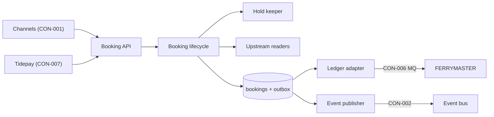
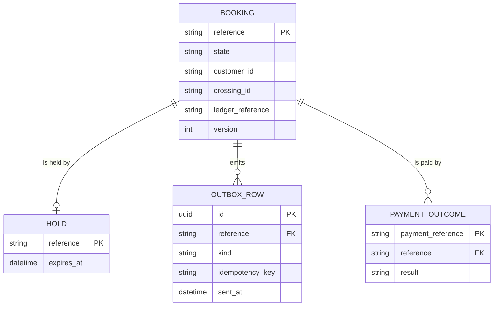
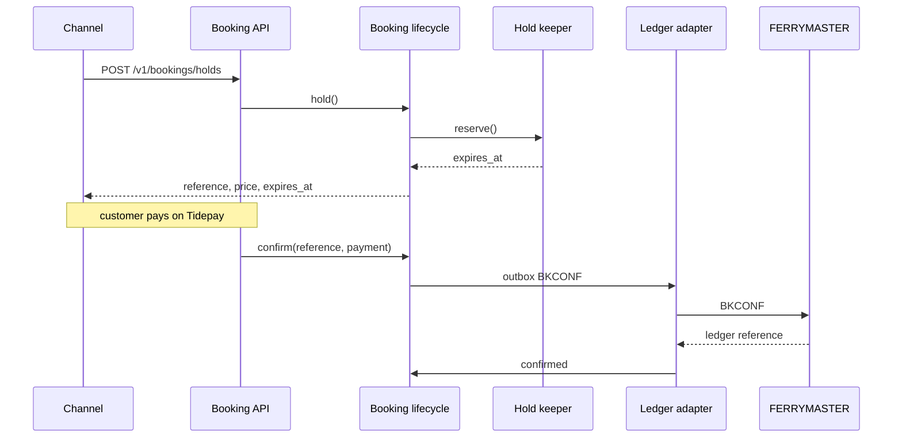
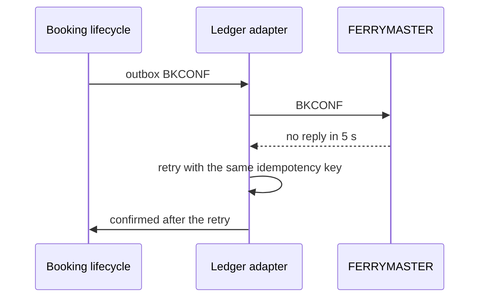
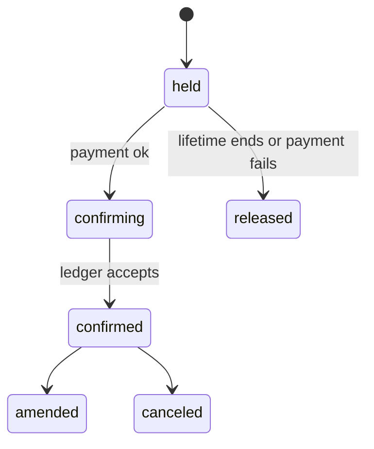

# Tech Design — Booking

## Architecture overview

Booking is one deployable service with four parts the vault already names (Booking API, Hold store, Ledger adapter,
Event publisher) and two more the design adds: Booking lifecycle, which is the only code that changes a booking's
state, and Upstream readers, which wrap the three read contracts Booking consumes. Every state change is written to
Postgres with an outbox row in the same transaction; the Ledger adapter and the Event publisher drain the outbox, so
a confirmed booking can never be published before FERRYMASTER has it (INI-002 APP-booking @ 7d41e0c).

## Context boundaries

**Inside the app:** the Booking API, the booking state machine, holds, the outbox, the MQ ledger adapter and the
state-changed publisher.
**Outside the app:** the channels (website, call center desktop, kiosks), Pricing, Vessel schedule, Customer identity,
Tidepay, FERRYMASTER, the Platform gateway and the event bus.

## Components

### Booking API
- Responsibility: Takes hold, confirm, amend, cancel and get from every channel, and Tidepay's payment outcome.
- Owns: the versioned HTTP surface and its error codes (CON-001, CON-007, EPC-031.AC6, EPC-031.AC7, EPC-035.AC3, EPC-033.AC3, EPC-034.AC5, EPC-035.AC5, CAP-013.FR2@APP-booking, CAP-013.FR3@APP-booking)
- Depends on: Booking lifecycle
- Exposes: CON-001 v1 at /v1/bookings, the CON-007 webhook at /v1/payments/tidepay

### Booking lifecycle
- Responsibility: Decides every change of a booking's state and refuses changes that are not allowed.
- Owns: the booking state machine (CAP-013.FR1@APP-booking, CAP-021.FR1@APP-booking, CAP-021.FR2@APP-booking, CAP-015.FR1@APP-booking, EPC-031.AC2, EPC-031.AC3, EPC-031.AC5, EPC-034.AC2, EPC-034.AC3, EPC-035.AC1, EPC-036.AC1, EPC-036.AC2, EPC-036.AC3, EPC-036.AC4)
- Depends on: Hold keeper, Upstream readers
- Exposes: hold(), confirm(), amend(), cancel(), get() to Booking API

### Hold keeper
- Responsibility: Keeps an unpaid seat held for the hold lifetime and releases it when the lifetime runs out.
- Owns: hold expiry (CAP-014.FR1@APP-booking, CAP-014.FR2@APP-booking, EPC-031.AC1, EPC-031.AC4, EPC-037.AC2)
- Depends on: Upstream readers
- Exposes: reserve(), extend(), release() to Booking lifecycle

### Upstream readers
- Responsibility: Reads fares, capacity and customers through the contracts other teams provide.
- Owns: client timeouts and the circuit breaker for each read (CON-003, CON-004, CON-005, CAP-012.FR1@APP-booking, EPC-038.AC1, EPC-038.AC2)
- Depends on: none
- Exposes: quote(), capacity(), customer() to Booking lifecycle and Hold keeper

### Ledger adapter
- Responsibility: The only writer to FERRYMASTER: turns outbox rows into BKHOLD, BKCONF, BKAMND and BKCANC.
- Owns: the MQ mapping and idempotency keys (CON-006, EPC-032.AC1, EPC-032.AC2, EPC-032.AC3, EPC-032.AC4, EPC-032.AC5, EPC-032.AC6)
- Depends on: Booking lifecycle
- Exposes: none; it reports each write's outcome back to Booking lifecycle

### Event publisher
- Responsibility: Publishes Booking state changed for every committed state change.
- Owns: the CON-002 schema and its additive-only check (CON-002, CAP-022.FR1@APP-booking, EPC-037.AC1, EPC-037.AC4, EPC-037.AC5)
- Depends on: Booking lifecycle
- Exposes: CON-002 on the bus topic booking.state-changed.v1

## Responsibility matrix
| Component | Owns | Reads from | Writes to |
|-----------|------|------------|-----------|
| Booking API | HTTP surface, API versions | Booking lifecycle | none |
| Booking lifecycle | booking state | bookings, Upstream readers | bookings, outbox |
| Hold keeper | holds | holds | holds, outbox |
| Upstream readers | read clients | Pricing, Vessel schedule, Customer identity | none |
| Ledger adapter | MQ mapping | outbox | FERRYMASTER, bookings |
| Event publisher | event schema | outbox | event bus |

## Data model

Postgres holds bookings and the outbox; Redis holds holds, keyed by booking reference with a TTL.

- **Persistence:** Postgres 16 for BOOKING, OUTBOX_ROW and PAYMENT_OUTCOME; Redis 7 for HOLD.
- **Retention:** bookings are kept 7 years for finance, holds only until they expire.

## API contracts

### Booking API public surface
- `POST /v1/bookings/holds` (crossing, passengers, vehicle, customer ID) returns reference, price and expires_at. 409 when the sailing is full (CON-001).
- `POST /v1/bookings/{reference}/confirm` (Tidepay payment reference) returns the state: `confirming` or `confirmed`.
- `POST /v1/bookings/{reference}/amend` and `/cancel` return the new state, or 422 with a reason the channel can show.
- `GET /v1/bookings/{reference}` returns the state every channel shows.
- `POST /v1/payments/tidepay` takes Tidepay's signed webhook (CON-007) and answers 204.

### Booking lifecycle public surface
- `hold(request) -> Booking`, `confirm(reference, payment) -> Booking`, `amend(reference, change) -> Booking`,
  `cancel(reference) -> Booking`, `get(reference) -> Booking`. Raises `NotAllowed(reason)` and `NotFound`.

## Integration points
| System | Direction | Protocol | Auth |
|--------|-----------|----------|------|
| Channels via Platform gateway | in | HTTPS, CON-001 | service token; kiosks device certificate |
| Tidepay | in | HTTPS webhook, CON-007 | signed payload |
| Pricing | out | HTTPS, CON-003 | service token |
| Vessel schedule | out | HTTPS, CON-004 | service token |
| Customer identity | out | HTTPS, CON-005 | service token |
| FERRYMASTER | out | IBM MQ, CON-006 | MQ channel certificate |
| Event bus | out | Kafka, CON-002 | mTLS |

## Key flows

### Hold, pay, confirm (FLO-001)

### Ledger write fails (EPC-031.AC3)

## Supporting diagrams

### Booking states

## Tech stack
| Layer | Choice | Rationale |
|-------|--------|-----------|
| Language | Kotlin on the JVM 21 | the Booking team's language; the MQ client is a Java library |
| HTTP | Ktor | small, and the team runs it elsewhere |
| Store | Postgres 16 | transactional outbox (ADR-0001) |
| Holds | Redis 7 | TTL expiry without a sweeper (ADR-0002) |
| Messaging | IBM MQ client 9.3; Kafka client 3.7 | FERRYMASTER and the event bus |

## NFRs
| Concern | Target | How enforced |
|---------|--------|--------------|
| Get latency | p95 under 200 ms | load test in the pipeline, dashboard alert |
| Ledger write latency | p95 no worse than 2.1 s (EPC-032.AC4) | weekly end-to-end run against the test region |
| Availability | 99.9% monthly for CON-001 | two instances per zone behind the gateway |
| Traceability | one trace ID from CON-001 to CON-006 (EPC-039.AC3) | OpenTelemetry, checked in the end-to-end run |
| Card data | none stored or logged (EPC-031.AC7) | schema review; log scrubber test |

## Constraints register
| ID | Constraint | Source | Impact |
|----|-----------|--------|--------|
| C-01 | FERRYMASTER cannot change before 2028 | vault CST-1 | Ledger adapter adapts to the four MQ transactions |
| C-02 | New apps publish state changes to the event bus | vault CST-4 | Event publisher is required, not optional |
| C-03 | MQ volume within the existing MIPS budget | vault CST-5 | outbox batches writes; no polling FERRYMASTER |

## Risks & mitigations
| ID | Risk | Severity | Mitigation |
|----|------|----------|-----------|
| RK-01 | The outbox backs up while FERRYMASTER is slow and holds expire under a confirming booking | high | Hold keeper extends a hold while its booking is confirming |
| RK-02 | Two people know the MQ mapping | medium | mapping kept with CON-006; Ledger adapter has a simulator |

## ADRs
- [ADR-0001](../adr/0001-booking-transactional-outbox.md) — A transactional outbox for ledger writes and events
- [ADR-0002](../adr/0002-booking-holds-in-redis.md) — Holds live in Redis with a TTL

## Operations
- **Deploy:** container image to the Platform Kubernetes cluster, blue-green per release; the API version path keeps v1 live.
- **Monitor:** per-channel request and error rate, state transitions, outbox depth, p95 ledger write latency, hold expiry rate (EPC-039.AC2, EPC-039.AC4); the share of amendments made online, monthly (EPC-036.AC5).
- **Scale:** horizontal on the API; one Ledger adapter consumer per MQ queue, so writes keep their order.
- **On-call:** Booking engineers on the Platform rota from the website cutover (EPC-039.AC1, EPC-039.AC5).

## Open questions

### OQ-001: Is a hold 10 minutes or 15?
**What we know:** EPC-031.AC1, EPC-037.AC2 and the vault's Hold store container say 10 minutes. CAP-014.FR1's first criterion says 15.
**What would unblock:** the solution lead answers the challenge; the senior raised it with `/vela:challenge CAP-014.FR1`.
**Affects:** Hold keeper, EPC-031.AC1, EPC-037.AC2
challenges: CAP-014.FR1
**Scenario:** a customer on Tidepay's page at minute 12 pays for a seat Booking has already released to another channel.
