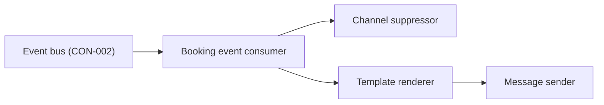
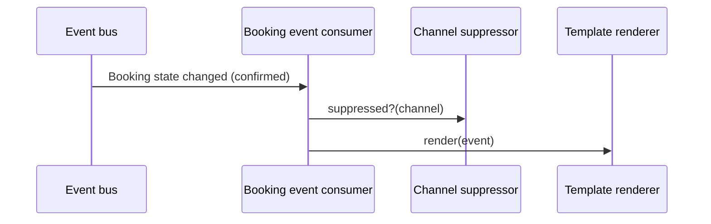

# Tech Design — Notifications

<!-- Deliberately incomplete demo fixture: it exercises design_data.py's problems list. See DESIGN-INSIDE.md. -->

## Architecture overview

Notifications adds a Booking event consumer beside its existing Message sender. The consumer reads Booking state
changed from the bus, decides whether a message is owed and in which channel, renders it and hands it to the
sender (INI-002 APP-notifications @ 7d41e0c). Pausing the consumer leaves events on the bus (INI-002 CON-002 @ 9e02b11).

## Context boundaries

**Inside the app:** the Booking event consumer, the channel suppressor and the template renderer.
**Outside the app:** Booking, the event bus, the existing Message sender and its email and SMS providers.

## Components

### Booking event consumer
- Responsibility: Reads Booking state changed and decides whether the customer is owed a message.
- Owns: the consumer group offset and the "message owed" rule (CON-002, CAP-022.FR1@APP-notifications, EPC-037.AC3, EPC-037.AC7, EPC-037.AC9)
- Depends on: Channel suppressor, Template renderer, Message sender
- Exposes: none

### Channel suppressor
- Responsibility: Stops a message the website already sends, until the website's cutover.
- Owns: the per-channel cutover switches (EPC-037.AC6)
- Depends on: none

### Template renderer
- Responsibility: Renders the email or SMS for a state change.
- Owns: message templates
- Depends on: none
- Exposes: render(event) to Booking event consumer

## Responsibility matrix
| Component | Owns | Reads from | Writes to |
|-----------|------|------------|-----------|
| Booking event consumer | offsets, owed rule | event bus | Message sender |
| Channel suppressor | cutover switches | config | none |

## Data model

No store of its own. The consumer keeps its offset in the bus's consumer group.

## API contracts

### Template renderer public surface
- `render(event) -> Message`; raises `NoTemplate(state)` for a state with no message.

## Key flows

### A confirmed booking

## Supporting diagrams

None.

## Tech stack
| Layer | Choice | Rationale |
|-------|--------|-----------|
| Language | Python 3.12 | the Message sender's language |
| Consumer | confluent-kafka 2.5 | the Platform team's standard client |

## NFRs
| Concern | Target | How enforced |
|---------|--------|--------------|
| Message delay | p95 under 60 s from event to send | consumer lag alert |
| Exactly one message per change | dashboard |

## Constraints register
| ID | Constraint | Source | Impact |
|----|-----------|--------|--------|
| C-01 | CON-002 only grows by adding fields | vault CON-002 change policy | the consumer ignores fields it does not know |

## Risks and mitigations
| ID | Risk | Severity | Mitigation |
|----|------|----------|-----------|
| RK-01 | A replay after a pause sends duplicates | medium | dedupe on booking reference and state |

## ADRs
- [ADR-0001](../adr/0001-notifications-consumer-in-message-sender.md) — The consumer runs inside the Message sender's deployment
- [ADR-0002](../adr/0002-notifications-dedupe-store.md) — A dedupe key per booking state

## Operations
- **Deploy:** with the Message sender, as a second process in the same deployment.
- **Monitor:** consumer lag, messages sent per state, suppressed messages per channel.

## Open questions

### OQ-001: Which channel made the change?
**What we know:** EPC-037.AC6 needs Notifications to stop the website's own emails per channel as each one cuts over; CON-002 carries no channel field.
**What would unblock:** a channel field on CON-002, which is additive.
**Affects:** Channel suppressor, EPC-037.AC6
**Challenges:** CON-002
