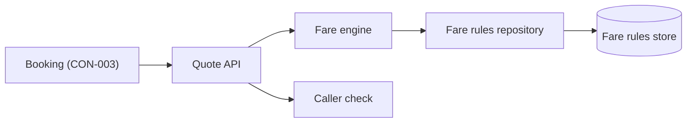
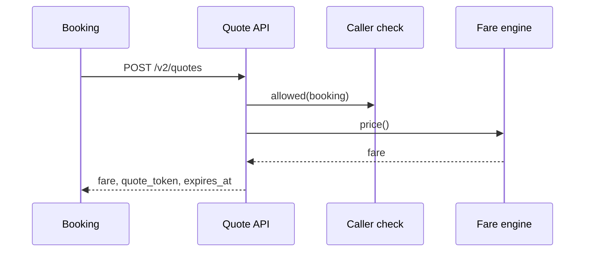

# Tech Design — Pricing

## Architecture overview

Pricing keeps its two containers, the Quote service and the Fare rules store. What changes is inside the Quote
service: a quote now carries a signed quote token with an expiry, so Booking can hold one fare for as long as it
holds the seat, and a caller check refuses anyone but Booking once the restriction is switched on
(INI-002 APP-pricing @ 7d41e0c).

## Context boundaries

**Inside the app:** the Quote API, the fare engine, the fare rules repository and the caller check.
**Outside the app:** Booking (the only consumer after cutover), the Platform gateway, the Revenue team's fare tooling.

## Components

### Quote API
- Responsibility: Answers CON-003 quote requests and returns a fare with a signed quote token.
- Owns: the CON-003 surface and the quote token format (CON-003, CAP-012.FR1@APP-pricing, EPC-038.AC1)
- Depends on: Fare engine, Caller check
- Exposes: CON-003 at /v2/quotes

### Fare engine
- Responsibility: Works out a fare for a crossing, date, passengers and vehicle from the current rules.
- Owns: fare calculation (EPC-038.AC2)
- Depends on: Fare rules repository
- Exposes: price(crossing, date, party) to Quote API

### Fare rules repository
- Responsibility: Reads the fare rules the Revenue team maintains, with a five-minute cache.
- Owns: the cache of fare rules
- Depends on: none
- Exposes: rules_for(route, date) to Fare engine

### Caller check
- Responsibility: Refuses quote requests from any caller but Booking once the restriction flag is on.
- Owns: the allowed-callers list and its switch (EPC-038.AC3, EPC-038.AC4)
- Depends on: none
- Exposes: allowed(caller) to Quote API

## Responsibility matrix
| Component | Owns | Reads from | Writes to |
|-----------|------|------------|-----------|
| Quote API | quote surface, quote tokens | Fare engine, Caller check | none |
| Fare engine | fare calculation | Fare rules repository | none |
| Fare rules repository | rules cache | Fare rules store | none |
| Caller check | allowed callers | gateway caller header | access log |

## Data model

No new store. A quote token is signed, not stored.

- **Quote token:** fare, crossing, date, party hash, expires_at, signature.
- **Fare rule:** route, season, passenger type, vehicle class, amount (existing table, unchanged).
- **Persistence:** the existing Fare rules store (Oracle 19c), read only from the Quote service.

## API contracts

### Quote API public surface
- `POST /v2/quotes` (crossing, date, passengers, vehicle) returns fare, currency, quote_token and expires_at (CON-003).
- `POST /v2/quotes/verify` (quote_token) returns the fare it signed, or 410 when it has expired.
- Errors: 400 for an unknown crossing, 403 from Caller check, 503 when the rules cannot be read.

## Integration points
| System | Direction | Protocol | Auth |
|--------|-----------|----------|------|
| Booking via Platform gateway | in | HTTPS, CON-003 | service token |
| Fare rules store | out | JDBC | database role |

## Key flows

### Booking asks for a quote

## Supporting diagrams

None beyond the overview and the flow.

## Tech stack
| Layer | Choice | Rationale |
|-------|--------|-----------|
| Language | Java 21 | the Quote service's existing code |
| Signing | Ed25519 via the Platform key service | no shared secret with Booking |

## NFRs
| Concern | Target | How enforced |
|---------|--------|--------------|
| Quote latency | p95 under 150 ms | dashboard alert; load test before the restriction goes on |
| Same fare everywhere | Booking's quote equals today's front-end quote (EPC-038.AC2) | replay test against last month's quotes |

## Constraints register
| ID | Constraint | Source | Impact |
|----|-----------|--------|--------|
| C-01 | The CON-003 API does not change, only its callers | vault CON-003 change policy | v2 adds the token as an extra field; v1 stays |

## Risks & mitigations
| ID | Risk | Severity | Mitigation |
|----|------|----------|-----------|
| RK-01 | A rule change during a hold changes the fare | medium | the signed token keeps the quoted fare until it expires |

## ADRs
- [ADR-0001](../adr/0001-pricing-signed-quote-tokens.md) — Quotes are signed tokens, not stored rows

## Operations
- **Deploy:** the existing Quote service pipeline; the caller restriction is a flag, switched after the September 2027 kiosk image.
- **Monitor:** quote rate by caller, refused calls, p95 latency.
- **Scale:** horizontal behind the gateway; the rules cache is per instance.
