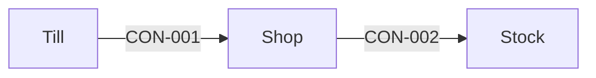

# Shop

- **Decision:** [[2026-01-10-shop-api]]
- **Why:** The till needs one place to ask for a sale.

Shop sells products to the till.

## Contracts this app provides

### CON-001 Sale API

- **Crosses the boundary:** a basket in; a receipt out.
- **Consumers:** [[till-building-blocks|Till]]
- **Change policy:** versioned.
- **Change:** new
- **Tested by:** consumer tests in the till pipeline.
- **State:** decided
- **Decision:** [[2026-01-10-shop-api]]
- **Why:** The till needs one place to ask for a sale.

| Case | When | Status | Answer | Emits | Sets |
|---|---|---|---|---|---|
| sold | | 200 | the receipt | | |
| basket_refused | | 422 | the basket is empty or holds an unknown product | | |

## Contracts this app consumes

<!-- generated:contracts-consumed sha=7c51577f: do not edit, run vela render -->
_Kept up to date by vela from the pages it reads._

| Contract | Provided by | Who can change it, and how | How sure |
|---|---|---|---|
| [[stock-building-blocks#CON-002 Stock level\|Stock level (CON-002)]] | [[stock-building-blocks\|Stock]] | the existing read API, no change. | confirmed |
<!-- /generated:contracts-consumed -->
