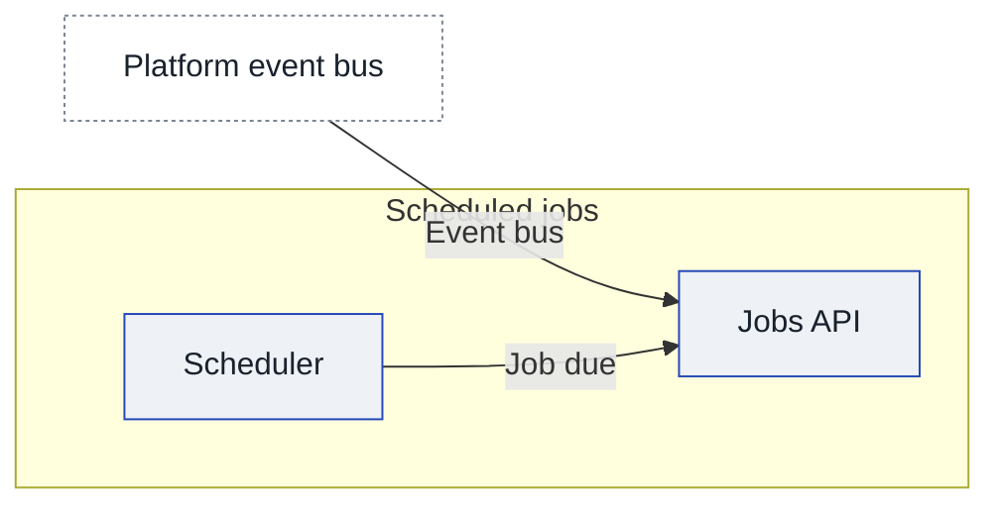

# Context and scope

## Today

## After

<!-- generated:system-context sha=4a287cad: do not edit, run vela render -->
_Kept up to date by vela from the pages it reads._

Key: blue outline: an app in the initiative · white, dashed: outside this initiative (another company or system) · an arrow is a contract (an agreed interface), labeled with its name, pointing from the side that provides it to the app that uses it.
<!-- /generated:system-context -->

## In scope

## Out of scope
