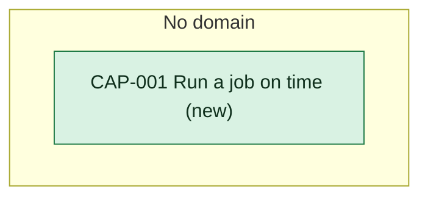

# Capability delta

Every capability this initiative changes. Each capability page holds what provides it today and after.

<!-- generated:capability-map sha=c24f4774: do not edit, run vela render -->
_Kept up to date by vela from the pages it reads._

Key: green: new in this initiative.
<!-- /generated:capability-map -->

## Allocation

What each app carries of each functional requirement.

<!-- generated:allocation sha=8c6debdc: do not edit, run vela render -->
_Kept up to date by vela from the pages it reads._

**Who does what:** no requirement is firm enough to split between the apps yet.
<!-- /generated:allocation -->
