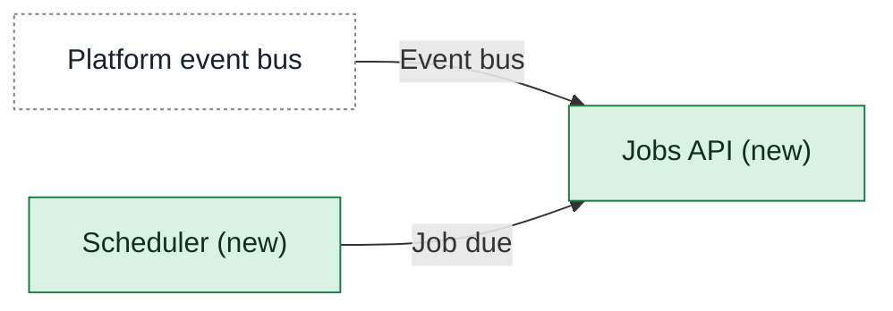

# Building blocks

One page per app: what it does, its main parts, and the contracts (agreed interfaces) it offers other apps. Each contract sits on the page of the app that provides it.

<!-- generated:context-map sha=5b914ac1: do not edit, run vela render -->
_Kept up to date by vela from the pages it reads._

Key: green: new in this initiative · white, dashed: outside this initiative (another company or system) · an arrow is a contract (an agreed interface), labeled with its name, pointing from the side that provides it to the app that uses it.
<!-- /generated:context-map -->
