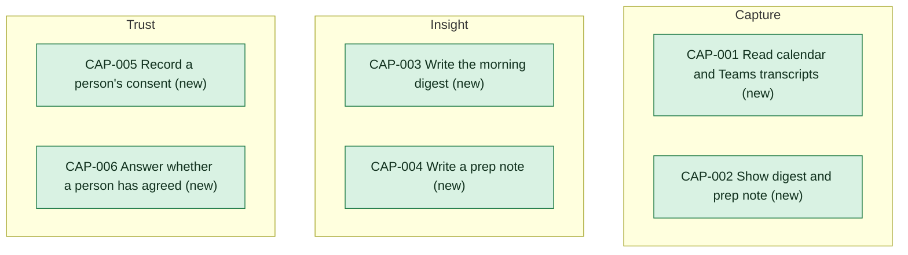

# Capability delta

Every capability this initiative changes. Each capability page holds what provides it today and after.

<!-- generated:capability-map sha=e9305f84: do not edit, run planner render -->

Key: green: new in this initiative.
<!-- /generated:capability-map -->

## Capabilities

- [[CAP-001-read-calendar-and-transcripts|Read calendar and Teams transcripts]]
- [[CAP-002-show-digest-and-prep-note|Show digest and prep note]]
- [[CAP-003-write-morning-digest|Write the morning digest]]
- [[CAP-004-write-prep-note|Write a prep note]]
- [[CAP-005-record-persons-consent|Record a person's consent]]
- [[CAP-006-answer-consent-check|Answer whether a person has agreed]]

## Allocation

<!-- generated:allocation sha=bbc602d4: do not edit, run planner render -->
**Who does what:** 9 requirements are firm enough to split between the apps (assumed or later); none is waiting for an app.

| Requirement | [[consent-and-identity-building-blocks\|Consent and identity]] | [[desktop-agent-building-blocks\|Desktop agent]] | [[summarizer-building-blocks\|Summarizer]] |
|---|---|---|---|
| [[CAP-001-read-calendar-and-transcripts#CAP-001.FR1 Read existing Teams transcripts\|Read existing Teams transcripts (CAP-001.FR1)]] | answers before anything is read whether the person has agreed to transcripts, and answers no once they have withdrawn or when it is down (CON-003) | asks Consent and identity what the person has agreed to before each read, then asks Microsoft for the transcripts of meetings the person was in, which Microsoft returns only where the organizer turned transcripts on and the tenant administrators approved them; works from the calendar entry with no error when none comes back; stops reading once the person withdraws (CON-003, CON-001) | when a meeting arrives with no transcript text, says in the note that it was written from the calendar entry only (CON-002) |
| [[CAP-001-read-calendar-and-transcripts#CAP-001.FR2 Read the person's own calendar entries\|Read the person's own calendar entries (CAP-001.FR2)]] | answers before anything is read whether the person has agreed to calendar entries, separately from transcripts, and answers no before they switch on, after they withdraw, or when it is down (CON-003) | asks Microsoft, once the consent check allows it, for the signed-in person's own calendar entries for the day (title, time and attendees of each) and for no mail or documents; reads the day's entries before it asks the Summarizer for the 7:30 digest (CON-003, CON-001) |  |
| [[CAP-002-show-digest-and-prep-note#CAP-002.FR1 Show the 7:30 digest\|Show the 7:30 digest (CAP-002.FR1)]] | answers no to the consent check once the person has withdrawn, so the agent shows no digest (CON-003) | shows the digest at 7:30, or the first time the person is back at the laptop that morning, marked late with the time it arrived; shows nothing after 12:00 and says this morning's digest was missed; says there is no digest when the Summarizer returns nothing; never shows an old digest as new; after the person withdraws, shows nothing and deletes any digest held for them (CON-003, CON-002) | returns the finished digest or nothing, never a partial one; how long it may take is open as UNK-067 (CON-002) |
| [[CAP-002-show-digest-and-prep-note#CAP-002.FR2 Show a prep note before a meeting\|Show a prep note before a meeting (CAP-002.FR2)]] | answers no to the consent check once the person has withdrawn, so the agent shows no prep note (CON-003) | asks the Summarizer early enough for the note to be ready ten minutes before the meeting, and shows it then, for a meeting on the person's own calendar; shows a note that arrives late until the meeting starts, marked late, and not after; re-reads the calendar entry so a moved meeting takes the new time and a canceled one shows no note; never shows a note twice; shows nothing and says nothing when no note comes; after the person withdraws, shows nothing and deletes any prep note held for them (CON-003, CON-001, CON-002) | returns the finished prep note or nothing, never a partial one; how long before the meeting the agent must ask stays open as UNK-067 (CON-002) |
| [[CAP-003-write-morning-digest#CAP-003.FR1 Write each person's digest\|Write each person's digest (CAP-003.FR1)]] | answers no to the consent check once the person has withdrawn, so the agent sends the Summarizer nothing (CON-003) | sends the Summarizer only the signed-in person's own calendar entries and the transcripts Consent and identity allows, and sends the request even on a day with no meetings; after the person withdraws, sends nothing (CON-003, CON-002) | writes the digest only from the items it is sent; lists the day's meetings with the time and title of each; covers a meeting with no transcript from its calendar entry and says so in the digest; on a day with no meetings accepts the empty day and writes a digest that says there are no meetings today (CON-002) |
| [[CAP-003-write-morning-digest#CAP-003.FR2 Name only people who were there\|Name only people who were there (CAP-003.FR2)]] |  | sends the Summarizer each meeting's attendees and the transcript text where there is one, and names no one itself (CON-002) | names only people the transcript shows took part; names no one on a meeting with no transcript until the data protection officer answers UNK-074, and whether it can be told who accepted is open as UNK-075; strips any remark about mood, tone or performance; returns nothing, not a changed digest, when a digest fails these checks (CON-002) |
| [[CAP-004-write-prep-note#CAP-004.FR1 Write a prep note for one meeting\|Write a prep note for one meeting (CAP-004.FR1)]] | answers no to the consent check once the person has withdrawn, so the agent sends the Summarizer nothing (CON-003) | for a prep note sends the Summarizer only that meeting's calendar entry, with no transcript and no earlier meeting, and asks early enough for the note to be ready ten minutes before the meeting, with the lead time open as UNK-067; after the person withdraws, sends nothing (CON-003, CON-002) | writes the prep note from the one meeting's calendar entry it is sent, covers that meeting only, and says in the note that it was written from the calendar entry only; returns the note or nothing, with the time it may take open as UNK-067 (CON-002) |
| [[CAP-005-record-persons-consent#CAP-005.FR1 Agree to each source separately\|Agree to each source separately (CAP-005.FR1)]] | keeps each source choice with the person, the source and the date; also refuses transcripts without calendar entries; confirms to the agent only once the choice is kept; answers the consent check per source, and no for a person who has not switched on (CON-004, CON-003) | offers calendar entries and Teams transcripts as two separate choices when the person switches Heron on, and takes no transcripts without calendar entries; sends each choice to Consent and identity, and reads nothing and tells the person when a choice is not confirmed as kept; reads a source only when the consent check says the person agreed to that source; sends nothing for a person who has not switched on (CON-004, CON-003) |  |
| [[CAP-005-record-persons-consent#CAP-005.FR2 Stop reading when a withdrawal is not confirmed\|Stop reading when a withdrawal is not confirmed (CAP-005.FR2)]] |  | stops reading for the person at once when Consent and identity has not confirmed their withdrawal, deletes what it holds for them, tells them the withdrawal is not yet recorded and that it is still trying to send it, and keeps trying until it is confirmed (CON-004) |  |
<!-- /generated:allocation -->
