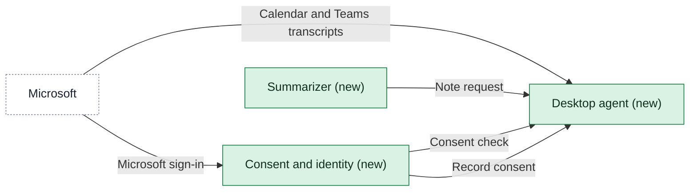

# Building blocks

One page per app in scope, named `<app>-building-blocks.md`. Contracts live on the provider's page.

<!-- generated:context-map sha=a7d25d43: do not edit, run vela render -->
_Kept up to date by vela from the pages it reads._

Key: green: new in this initiative · white, dashed: outside this initiative (another company or system) · an arrow is a contract (an agreed interface), labeled with its name, pointing from the side that provides it to the app that uses it.
<!-- /generated:context-map -->

## Three apps

The first release is cut into three apps, so the text call can move where the summarizing runs without changing the agent's or the consent app's contracts. All three are `assumption`. The [[desktop-agent-building-blocks|Desktop agent]] reads the person's own calendar entries and existing Teams transcripts on the laptop and shows the digest and prep note, and ships through Intune and Jamf in the endpoint lead's 18 January slot. The [[summarizer-building-blocks|Summarizer]] writes the digest and the prep note behind its own contract, on the laptop in the agent's package or in a shared service, as [[11-unknowns-and-risks#UNK-051 Text call|the text call]] settles. [[consent-and-identity-building-blocks|Consent and identity]] keeps who agreed to what, who signed in, and what access the tenant registration grants, so rebuilding the agent loses none of it.

Intune and Jamf packaging stays the endpoint team's existing pipeline, per [[sources#SRC-013|the tenant note]], and Microsoft 365 is an outside party, [[03-context-and-scope#PTY-01 Microsoft|Microsoft]]. Neither is an app.

## History

- **Options considered:** Three apps (picked); Two apps: rejected, it keeps the summarizing inside the agent, so a cloud answer to the text call would pull it out after the agent's contracts are fixed in early January
