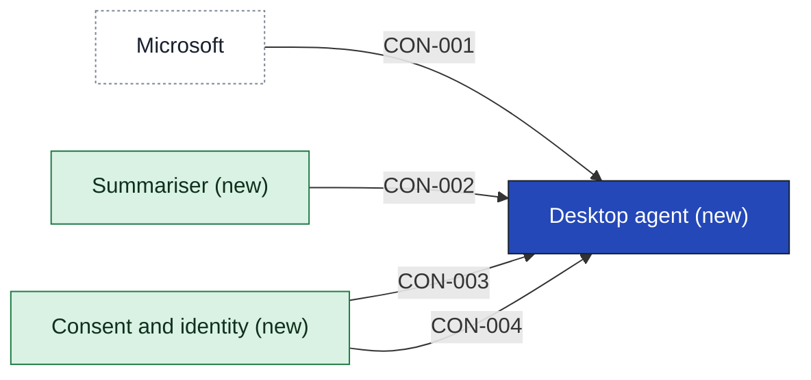

# Desktop agent

The Desktop agent runs on a person's own laptop. It reads that person's calendar entries and the Teams transcripts that already exist, and shows them the 7:30 digest and the prep note ten minutes before a meeting. It sends nothing off the laptop itself. The product owner's one-pager gives [[sources#SRC-012|the 7:30 and ten-minute times]], and it states intent only. Each requirement the agent shares in has its part under Requirements allocated, all still assumptions. Whether the line that it sends nothing off the laptop holds, given that it hands items to the Summariser and to Consent and identity, is left for the Grill on this app.

It does not write the digest or the prep note: the Summariser does. It does not keep who agreed to what or who signed in: Consent and identity does. It does not push itself to laptops: the endpoint team's Intune and Jamf do, and [[sources#SRC-013|a person can only switch it on]]. It reports no adoption by team in this release. Still open: whether Consent and identity must be told what the agent read ([[11-unknowns-and-risks#UNK-066 Consent sees what agent read|the consent question]]), and whether the transcripts are approved ([[11-unknowns-and-risks#UNK-059 Transcripts and admin approval|transcripts and admin approval]]).

The strategy page still says the first release reads mail and documents, and the Shape session said no transcripts. This page follows the solution lead's later answer: calendar entries and existing Teams transcripts only. [[04-solution-strategy|The strategy page]] owns what the first release reads and needs correcting at a Grill.

The agent lead took this app for design on 12 October 2026. The Source reader, the Note view and the Schedule are still assumptions, and so are the contracts the agent uses to reach the Summariser and Consent and identity. Three questions that block the design are open, among them [[11-unknowns-and-risks#UNK-066 Consent sees what agent read|whether Consent and identity must be told what the agent read]], which decides whether the agent provides a contract at all. The agent lead confirms the handoff or challenges it once they have read it back.

- Trace: UNK-066, UNK-069, UNK-071

## Containers

| Container | Job | Contracts served or used | Proposed by | State |
|---|---|---|---|---|
| Source reader | Reads calendar entries and existing Teams transcripts for the signed-in person. | Calendar and Teams transcripts; Consent check | claude | assumption |
| Note view | Shows the digest and the prep note on the laptop. | Note request | claude | assumption |
| Schedule | Starts the 7:30 digest and the prep note ten minutes before each meeting. | none | claude | assumption |

## Contracts this app provides

None in the first release. Whether the agent must report what it read to Consent and identity is open as [[11-unknowns-and-risks#UNK-066 Consent sees what agent read|the consent question]].

## Contracts this app consumes

The agent asks the Summariser for a note over [[summariser-building-blocks#CON-002 Note request|Note request]], and asks Consent and identity whether the person has agreed over [[consent-and-identity-building-blocks#CON-003 Consent check|Consent check]], and tells it when the person switches on or off over [[consent-and-identity-building-blocks#CON-004 Record consent|Record consent]]. The third is below, because Microsoft has no page in the vault.

### CON-001 Calendar and Teams transcripts

The Desktop agent reads the signed-in person's calendar entries and existing Teams transcripts from Microsoft 365. Transcripts exist only where the organiser turned them on and need tenant admin approval, so for most meetings the agent gets the calendar entry only.

- **Provider:** [[03-context-and-scope#PTY-01 Microsoft|Microsoft]]
- **Crosses the boundary:** In: the agent's read request and the person's sign-in. Out: the person's calendar entries and, where they exist and are approved, the Teams transcripts.
- **Consumers:** [[desktop-agent-building-blocks|Desktop agent]]
- **Change policy:** Not recorded. Microsoft runs the interface, and no agreement with Microsoft is registered.
- **Change:** new
- **State:** assumption

## Requirements allocated

| Requirement | Share | Through | State |
|---|---|---|---|
| [[CAP-001-read-calendar-and-transcripts#CAP-001.FR1 Read existing Teams transcripts\|Read existing Teams transcripts]] | asks Consent and identity what the person has agreed to before each read, then asks Microsoft for the transcripts of meetings the person was in, which Microsoft returns only where the organiser turned transcripts on and the tenant administrators approved them; works from the calendar entry with no error when none comes back; stops reading once the person withdraws | CON-003, CON-001 | assumption |
| [[CAP-001-read-calendar-and-transcripts#CAP-001.FR2 Read the person's own calendar entries\|Read the person's own calendar entries]] | asks Microsoft, once the consent check allows it, for the signed-in person's own calendar entries for the day (title, time and attendees of each) and for no mail or documents; reads the day's entries before it asks the Summariser for the 7:30 digest | CON-003, CON-001 | assumption |
| [[CAP-002-show-digest-and-prep-note#CAP-002.FR1 Show the 7:30 digest\|Show the 7:30 digest]] | shows the digest at 7:30, or the first time the person is back at the laptop that morning, marked late with the time it arrived; shows nothing after 12:00 and says this morning's digest was missed; says there is no digest when the Summariser returns nothing; never shows an old digest as new; after the person withdraws, shows nothing and deletes any digest held for them | CON-003, CON-002 | assumption |
| [[CAP-002-show-digest-and-prep-note#CAP-002.FR2 Show a prep note before a meeting\|Show a prep note before a meeting]] | asks the Summariser early enough for the note to be ready ten minutes before the meeting, and shows it then, for a meeting on the person's own calendar; shows a note that arrives late until the meeting starts, marked late, and not after; re-reads the calendar entry so a moved meeting takes the new time and a cancelled one shows no note; never shows a note twice; shows nothing and says nothing when no note comes; after the person withdraws, shows nothing and deletes any prep note held for them | CON-003, CON-001, CON-002 | assumption |
| [[CAP-003-write-morning-digest#CAP-003.FR1 Write each person's digest\|Write each person's digest]] | sends the Summariser only the signed-in person's own calendar entries and the transcripts Consent and identity allows, and sends the request even on a day with no meetings; after the person withdraws, sends nothing | CON-003, CON-002 | assumption |
| [[CAP-003-write-morning-digest#CAP-003.FR2 Name only people who were there\|Name only people who were there]] | sends the Summariser each meeting's attendees and the transcript text where there is one, and names no one itself | CON-002 | assumption |
| [[CAP-004-write-prep-note#CAP-004.FR1 Write a prep note for one meeting\|Write a prep note for one meeting]] | for a prep note sends the Summariser only that meeting's calendar entry, with no transcript and no earlier meeting, and asks early enough for the note to be ready ten minutes before the meeting, with the lead time open as UNK-067; after the person withdraws, sends nothing | CON-003, CON-002 | assumption |
| [[CAP-005-record-persons-consent#CAP-005.FR1 Agree to each source separately\|Agree to each source separately]] | offers calendar entries and Teams transcripts as two separate choices when the person switches Heron on, and takes no transcripts without calendar entries; sends each choice to Consent and identity, and reads nothing and tells the person when a choice is not confirmed as kept; reads a source only when the consent check says the person agreed to that source; sends nothing for a person who has not switched on | CON-004, CON-003 | assumption |
| [[CAP-005-record-persons-consent#CAP-005.FR2 Stop reading when a withdrawal is not confirmed\|Stop reading when a withdrawal is not confirmed]] | stops reading for the person at once when Consent and identity has not confirmed their withdrawal, deletes what it holds for them, tells them the withdrawal is not yet recorded and that it is still trying to send it, and keeps trying until it is confirmed | CON-004 | assumption |

## Capabilities

- [[CAP-001-read-calendar-and-transcripts|Read calendar and Teams transcripts]]
- [[CAP-002-show-digest-and-prep-note|Show digest and prep note]]

## Where it fits

<!-- generated:app-context sha=5b6a48c7: do not edit, run planner render -->

<!-- /generated:app-context -->

<!-- generated:contracts-consumed sha=8ab64157: do not edit, run planner render -->
| Contract | Provider | Change policy | State |
|---|---|---|---|
| [[desktop-agent-building-blocks#CON-001 Calendar and Teams transcripts\|CON-001 Calendar and Teams transcripts]] | [[03-context-and-scope#PTY-01 Microsoft\|Microsoft]] | Not recorded. Microsoft runs the interface, and no agreement with Microsoft is registered. | assumption |
| [[summariser-building-blocks#CON-002 Note request\|CON-002 Note request]] | [[summariser-building-blocks\|Summariser]] | A change is agreed by the product owner and the agent's team before the January package. | assumption |
| [[consent-and-identity-building-blocks#CON-003 Consent check\|CON-003 Consent check]] | [[consent-and-identity-building-blocks\|Consent and identity]] | A change is agreed by the product owner and the agent's team before the January package. | assumption |
| [[consent-and-identity-building-blocks#CON-004 Record consent\|CON-004 Record consent]] | [[consent-and-identity-building-blocks\|Consent and identity]] | A change is agreed by the product owner and the agent's team before the January package. | assumption |
<!-- /generated:contracts-consumed -->

## History

- **Override:** "handoff checks", GATE-5 by @sim-lead on 2026-10-12: CISO pack's 10 November, team can't design while handoff waits. Not met at handoff: app page, containers and consumed contracts not decided; UNK-066, UNK-069, UNK-071 open; epics gate failing
- **Decided by:** @sim-lead, on behalf of @agent-lead
- **Options considered:** Three apps (picked); Two apps: rejected, it keeps the summarising inside the agent, so a cloud answer to the text call would pull it out after the agent's contracts are fixed in early January

#### CON-001

- **Options considered:** Three apps (picked); Two apps: rejected, it keeps the summarising inside the agent, so a cloud answer to the text call would pull it out after the agent's contracts are fixed in early January
