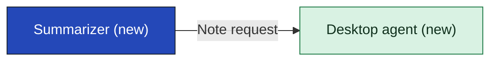

# Summarizer

The Summarizer writes the 7:30 digest and the prep note from the day's calendar entries and existing Teams transcripts that the Desktop agent hands it, and hands the note back. Where it runs depends on the text call: on the laptop in the agent's package, or in a shared service. The contract it offers is the same either way, so the call can land late without reopening the agent's boundary. Its part in each requirement is under Requirements allocated, all still assumptions, and [[11-unknowns-and-risks#UNK-067 How slow is too slow|how long it may take to answer]] is open.

It does not read calendar entries or transcripts, which the Desktop agent does. It shows nothing to the person, and it keeps no consent or sign-in, which Consent and identity does. It does not decide where it runs: [[11-unknowns-and-risks#UNK-051 Text call|the text call]] does. It checks [[sources#SRC-011|the data protection officer's naming rule]] on its own output only. Still open: who builds it, which depends on the text call, and [[11-unknowns-and-risks#UNK-056 On-device model quality|whether an on-device model writes a digest worth reading]].

## Containers

| Container | Job | Contracts served or used | Proposed by | State |
|---|---|---|---|---|
| Note writer | Turns the day's items into a digest or a prep note. | Note request | claude | assumption |
| Naming check | Keeps the digest to people who were in the meeting and leaves out remarks on mood, tone or performance, by validating what the Summarizer writes. | Note request | claude, from solution lead | assumption |
| Model | The language model: on the laptop in the agent's package, or in a shared service, as the text call settles. | none | claude | assumption |

## Contracts this app provides

### CON-002 Note request

The Desktop agent sends the Summarizer one person's items and the kind of note wanted, and gets the finished note back. The contract is the same wherever the model runs; the only difference is whether the items leave the laptop, which the text call settles.

- **Crosses the boundary:** In: one person's day's items (calendar entries and transcript text) and whether it is a digest or a prep note. Out: the finished note, or nothing.
- **Consumers:** [[desktop-agent-building-blocks|Desktop agent]]
- **Change policy:** A change is agreed by the product owner and the agent's team before the January package.
- **Change:** new
- **State:** assumption

## Contracts this app consumes

None from another app in the first release. If the text call goes to cloud, a hosted model vendor would be added; none is recorded and no agreement is registered.

## Requirements allocated

| Requirement | Share | Through | State |
|---|---|---|---|
| [[CAP-001-read-calendar-and-transcripts#CAP-001.FR1 Read existing Teams transcripts\|Read existing Teams transcripts]] | when a meeting arrives with no transcript text, says in the note that it was written from the calendar entry only | CON-002 | assumption |
| [[CAP-002-show-digest-and-prep-note#CAP-002.FR1 Show the 7:30 digest\|Show the 7:30 digest]] | returns the finished digest or nothing, never a partial one; how long it may take is open as UNK-067 | CON-002 | assumption |
| [[CAP-002-show-digest-and-prep-note#CAP-002.FR2 Show a prep note before a meeting\|Show a prep note before a meeting]] | returns the finished prep note or nothing, never a partial one; how long before the meeting the agent must ask stays open as UNK-067 | CON-002 | assumption |
| [[CAP-003-write-morning-digest#CAP-003.FR1 Write each person's digest\|Write each person's digest]] | writes the digest only from the items it is sent; lists the day's meetings with the time and title of each; covers a meeting with no transcript from its calendar entry and says so in the digest; on a day with no meetings accepts the empty day and writes a digest that says there are no meetings today | CON-002 | assumption |
| [[CAP-003-write-morning-digest#CAP-003.FR2 Name only people who were there\|Name only people who were there]] | names only people the transcript shows took part; names no one on a meeting with no transcript until the data protection officer answers UNK-074, and whether it can be told who accepted is open as UNK-075; strips any remark about mood, tone or performance; returns nothing, not a changed digest, when a digest fails these checks | CON-002 | assumption |
| [[CAP-004-write-prep-note#CAP-004.FR1 Write a prep note for one meeting\|Write a prep note for one meeting]] | writes the prep note from the one meeting's calendar entry it is sent, covers that meeting only, and says in the note that it was written from the calendar entry only; returns the note or nothing, with the time it may take open as UNK-067 | CON-002 | assumption |

## Capabilities

- [[CAP-003-write-morning-digest|Write the morning digest]]
- [[CAP-004-write-prep-note|Write a prep note]]

## Where it fits

<!-- generated:app-context sha=762040f4: do not edit, run vela render -->
_Kept up to date by vela from the pages it reads._

Key: dark blue: the app this page is about · green: new in this initiative · an arrow is a contract (an agreed interface), labeled with its name, pointing from the side that provides it to the app that uses it.
<!-- /generated:app-context -->

<!-- generated:contracts-consumed sha=f00bb14c: do not edit, run vela render -->
_Kept up to date by vela from the pages it reads._

This app doesn't use any contract yet.
<!-- /generated:contracts-consumed -->

## History

- **Options considered:** Three apps (picked); Two apps: rejected, it keeps the summarizing inside the agent, so a cloud answer to the text call would pull it out after the agent's contracts are fixed in early January

#### CON-002

- **Options considered:** Three apps (picked); Two apps: rejected, it keeps the summarizing inside the agent, so a cloud answer to the text call would pull it out after the agent's contracts are fixed in early January
