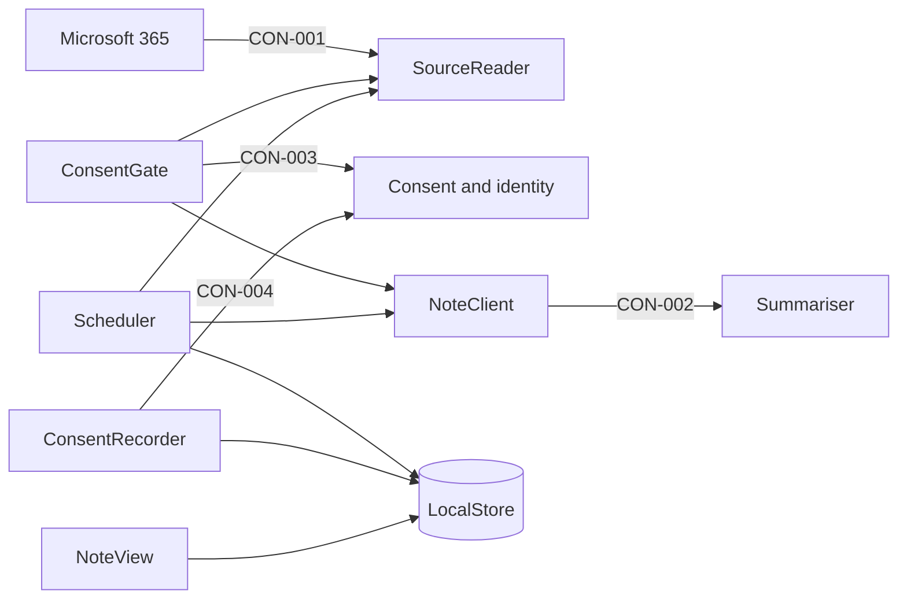
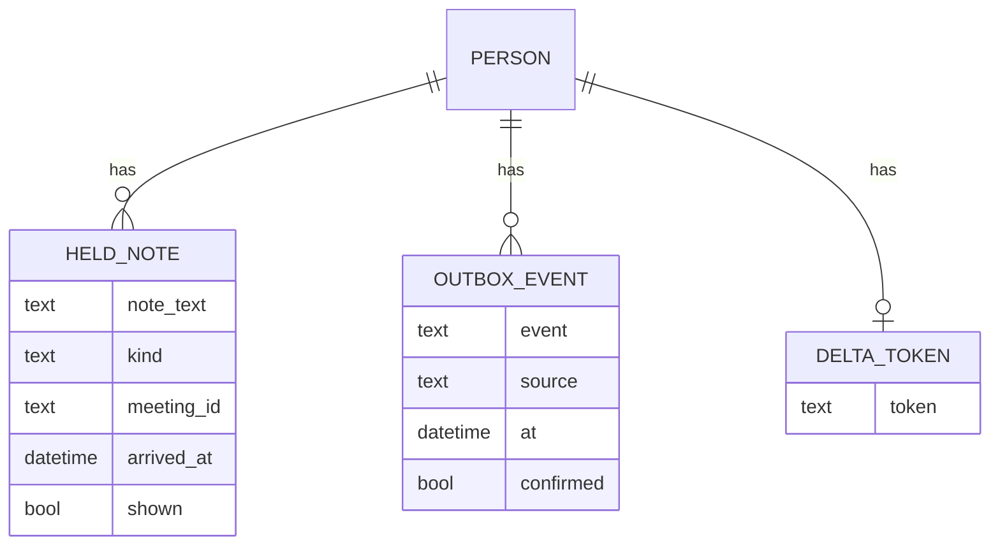
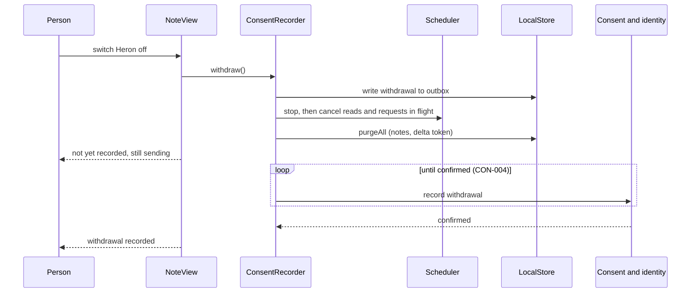

# Tech Design — Desktop agent

## Summary
The Desktop agent runs on each person's laptop in the Client Delivery London pilot. With the person's consent it reads their own calendar entries, asks the Summariser for a 7:30 digest and for a prep note ten minutes before each meeting, and shows them. A withdrawal deletes everything the agent holds for that person, and the agent sends nothing anywhere else.

**Decisions that shape it:**
- One signed Tauri process for Mac and Windows, with a Rust core ([ADR-0001](../adr/0001-desktop-agent-tauri-single-process.md)).
- The consent check is the only door to Microsoft and the Summariser, and every failed or slow call reads nothing and shows nothing (API contracts).
- The Scheduler wakes on events, never on a polling loop (Architecture overview).
- Calendar entries only in the first release: no mail.

**Walking skeleton:** the 7:30 digest, from the consent check through the calendar read to the Note view, with Consent and identity and the Summariser stubbed at their contracts.

**Still open:** the Summariser's owner hasn't said what it keeps, logs and trains on, and the endpoint lead hasn't said whether a bad build can be staged and recalled; both are needed before the January packaging slot. The product owner still has to say whether the Mac is in the first release. Seven more are under Open questions.

## Walking skeleton
The first release's tracer is the 7:30 digest. The design run named no skeleton and the vault records no tracer, so this one was assembled from the design's own Trace rows when the doc was re-shaped, for the senior to confirm.
- **Flow:** A person gets the 7:30 digest (FLO-002), on release one, the 2 February 2027 pilot.
- **Path:** Scheduler → ConsentGate → SourceReader → NoteClient → LocalStore → NoteView
- **Stubbed:** Consent and identity at the consent check (CON-003), and the Summariser at the note request (CON-002), until those teams' pieces land.
- **Carries:** CAP-001.FR2@APP-desktop-agent, CAP-002.FR1@APP-desktop-agent, CAP-003.FR1@APP-desktop-agent, EPC-033.AC1, EPC-033.AC2

## Architecture overview
One signed per-user process on the laptop, built with Tauri: a Rust core owns the local store, the Microsoft Graph pull (CON-001) and the calls to Consent and identity (CON-003, CON-004) and the Summariser (CON-002); the Tauri webview shows the Note view. One codebase ships as a signed Mac pkg (Jamf) and a Windows MSIX (Intune) by the pilot (CST-007, CST-010). The three vault containers (Source reader, Note view, Schedule) are modules inside this one process.

Accepted trade-off (team, 2026-10-12): a critical bug in the core takes down the whole agent. The team judged two Rust engineers enough to catch these. Mitigation to be set under Risks: the agent fails closed, as the runtime page requires (RUN-desktop-agent, On failure).

### Decisions
- Single process, Tauri, Rust core plus webview. Mac and Windows both in the pilot build.
- Scheduler is event-driven with no polling loop. It reads calendar entries at 7:30 and on wake, when it asks for a prep note, and again at ten minutes before the meeting immediately before showing. A delta pass runs every 15 minutes in working hours only. The cadence is one policy object, so tightening it later is a config change. Graph change notifications are not used: they need a public endpoint, so a cloud relay, which crosses the vault's no-send line (UNK-051).
- Reads are calendar entries (CON-001) only; no mailbox read, matching CAP-001.FR2 ("no mail or documents").

### Enforcing the gate inside one process
- The Tauri command allow-list exposes only what NoteView needs: list notes, mark shown, switch on, withdraw. The webview never receives tokens or the store key, and a strict content security policy blocks remote content.
- The store key is bound to the signed app: a Keychain access control on Mac, DPAPI entropy on Windows.
- Stated limit: malware running as the same user can still ask the operating system for the key. Encryption at rest protects a lost disk, not that case. If malware becomes the threat model, the readers must move to a separate process, which reshapes ADR-0001.

## Context boundaries
**Inside the app:** the seven components below, in one Tauri process on each laptop.
**Outside the app:** Microsoft 365 (CON-001, no agreement registered), Consent and identity (CON-003, CON-004), the Summariser (CON-002), and the endpoint team's Intune and Jamf, which push the package. The agent provides no contract in the first release (UNK-066 open).

## Components
Seven components, all in the one process. ConsentGate is the only door to SourceReader and NoteClient, so "reads nothing without consent" holds by structure.

### ConsentGate
- Responsibility: Ask Consent and identity (CON-003) before every read or send, and hand the caller a grant naming the sources allowed.
- Owns: the per-run grant; no grant outlives the run that asked for it. `Grant` is a Rust type only this module can construct, so no other component can fabricate one (review finding 1).
- Depends on: Consent and identity (CON-003).
- Exposes: `grant(person) -> Grant{calendar, transcripts} | None`.
- Container: Source reader

### SourceReader
- Responsibility: Read the signed-in person's calendar entries, and later transcripts, from Microsoft (CON-001), only with a grant.
- Owns: Graph session and the calendar delta token (held in LocalStore).
- Depends on: ConsentGate, Microsoft 365 (CON-001).
- Reads only subject, start, end and attendees from Graph (`$select`); it never requests an entry body or notes (CAP-001.FR2, review finding 6).
- Exposes: `calendarDay(grant, date)`, `calendarEntry(grant, id)`, `transcript(grant, meeting)`.
- Container: Source reader

### NoteClient
- Responsibility: Send the Summariser one person's own items and the kind of note wanted (CON-002), and return the note or nothing.
- Owns: the request shape; names no one itself.
- Depends on: ConsentGate, Summariser (CON-002).
- Exposes: `requestDigest(grant, entries)`, `requestPrep(grant, entry)`.
- Gate: sends to a remote Summariser endpoint only when a machine-level managed setting (an Intune or Jamf configuration profile, default off, not user-writable) says the text call is settled. One build holds both the on-device and the remote path, and CI tests both from the start; the remote path is also tested in a test tenant before the 4 December outcome (CST-003, UNK-051). A profile push after the freeze needs the endpoint lead's agreement that it takes no new packaging slot (OQ-007); if refused, the pilot runs on-device only.
- Container: Source reader

### ConsentRecorder
- Responsibility: Send switch-on, per-source choices and withdrawals to Consent and identity (CON-004) through a durable outbox, retrying until confirmed.
- Owns: the outbox and each choice's confirmed or unconfirmed state.
- Depends on: Consent and identity (CON-004), LocalStore.
- Exposes: `switchOn(choices)`, `withdraw()`, `state()`.
- Container: Source reader

### Scheduler
- Responsibility: Decide when to read and when to ask, and when to show.
- Owns: the timers; the cadence policy.
- Depends on: SourceReader, NoteClient, LocalStore, NoteView.
- Exposes: none outside the process.
- Container: Schedule

### LocalStore
- Responsibility: Hold the notes waiting to show, the shown markers, the outbox and the delta token, and delete everything for a person on withdrawal.
- Owns: all data on disk.
- Depends on: Operating system key store.
- Exposes: `put`, `get`, `markShown`, `purgeAll(person)`.
- Container: Note view

### NoteView
- Responsibility: Show the digest and prep note, marked late or missed where the epics say so.
- Owns: what the person sees; no data of its own.
- Depends on: LocalStore.
- Exposes: the Tauri webview.
- Container: Note view

## Responsibility matrix
| Component | Owns | Reads from | Writes to |
|-----------|------|------------|-----------|
| ConsentGate | per-run grant | Consent and identity (CON-003) | none |
| SourceReader | Graph session | Microsoft (CON-001), LocalStore (delta token) | LocalStore (delta token) |
| NoteClient | note request shape | Summariser (CON-002) | none |
| ConsentRecorder | outbox, confirmed state | LocalStore | Consent and identity (CON-004), LocalStore |
| Scheduler | timers, cadence policy | SourceReader, NoteClient | LocalStore |
| LocalStore | all data on disk | key store | disk |
| NoteView | what the person sees | LocalStore | none |

## Data model

- **Persistence:** SQLite with SQLCipher, key in the operating system's key store (Keychain on Mac, DPAPI on Windows), bound to the signed-in user. HeldNote, OutboxEvent and DeltaToken are on disk. Calendar entries and transcript text are never written to disk: they stay in memory for one request.
- **Retention (review finding 4):** the marker (meeting ID, kind, shown time, no text) is set when a note is first displayed, so it is never pushed twice. The note text stays viewable in NoteView until the person dismisses it or it expires, whichever is first. A digest expires at the end of the local day; a prep note at the meeting start. A digest not shown by 12:00 and a prep note not shown by the meeting start are deleted at those times (EPC-033 AC4, EPC-034 AC3). Superseded or cancelled notes are deleted when found. Markers are deleted after seven days. A sweep on launch and wake deletes anything past its time. There is no archive or history.
- **Withdrawal:** `purgeAll` deletes HeldNote and DeltaToken and keeps the OutboxEvent that records the withdrawal until Consent and identity confirms it (CAP-005.FR2).
- Encryption at rest is the team's decision (2026-10-12). The vault holds no ruling on it; I searched and found none.

## API contracts
Every call fails closed: when it fails or is slow, the agent reads nothing and shows nothing. Timeouts are config placeholders, not vault answers (D-002): Consent check 5 s, Record consent 10 s, Summariser budget set from UNK-067. The retry and recovery rules (review finding 3) are numbered 1 to 5 under the component each belongs to.

### ConsentGate public surface
- `grant(person) -> Grant{calendar, transcripts} | None`
- On failure: CON-003 Consent check down, slow or no answer: reads nothing, shows nothing; never uses a cached yes.
- Rule 2, bounded retry: after a failed Consent check, retry with backoff and jitter (about 1, 2, then 5 minutes) until the deadline: 12:00 for a digest, the meeting start for a prep note. After the deadline, give up and log.

### SourceReader public surface
- `calendarDay(grant, date)`, `calendarEntry(grant, id)`, `transcript(grant, meeting)`
- On failure: CON-001 Microsoft down: no note that morning.
- Rule 4, Graph: honour `Retry-After` on 429 and 5xx. An invalid delta token triggers a full re-read of the day. An expired sign-in or a Conditional Access block shows nothing and is logged; whether the person is told is OQ-005.

### NoteClient public surface
- `requestDigest(grant, entries)`, `requestPrep(grant, entry)`
- On failure: CON-002 Note request slow or nothing back: prep note: shows nothing and says nothing; digest: says there is none that morning; never shows an old note as new.
- Rule 3, late is not abandoned: a Summariser request stays alive to the same deadline, and a result after the target time is shown marked late (EPC-033 AC3, EPC-034 AC3). The Summariser budget from UNK-067 sets when a note counts as late, not when it is dropped. The number is a placeholder (D-002).

### ConsentRecorder public surface
- `switchOn(choices)`, `withdraw()`, `state()`
- On failure: CON-004 Record consent not confirmed: choice counts as not kept; a withdrawal purges at once and retries from the outbox until confirmed.

### Scheduler public surface
- None outside the process.
- Rule 1, catch-up, not timers alone: on launch, wake and network-up the Scheduler computes what is due from the current time and runs it. It is idempotent, so a missed timer costs nothing.
- Rule 5, missed notice: on the first wake after 12:00 with no digest shown that day, say this morning's digest was missed (EPC-033 AC4). The cutoff is the laptop's local time and one config value, so it can change when UNK-073 is answered.

### LocalStore public surface
- `put`, `get`, `markShown`, `purgeAll(person)`

### NoteView public surface
- The Tauri webview, reached only through the command allow-list (see Enforcing the gate inside one process).

## Integration points
| System | Direction | Protocol | Auth |
|--------|-----------|----------|------|
| Microsoft 365 (CON-001) | agent reads | Microsoft Graph over HTTPS | Delegated public-client sign-in as the person through the OS broker; no client secret on the laptop. Scope `Calendars.Read` only for the pilot registration. The transcript scope is added by a later registration change with EPC-035 (team accepts a second review gate, CST-002, CST-008, UNK-059). No `Mail.Read`: CAP-001 says Heron reads no mail and no documents in the first release. |
| Consent and identity (CON-003, CON-004) | agent calls | HTTPS | The person's Entra ID token, validated by Consent and identity through its own CON-005. Never carries meeting text (EPC-032 AC2). |
| Summariser (CON-002) | agent calls | HTTPS or in-process, per the text call (UNK-051) | Token as above. Not recorded in the vault: how the Summariser authenticates callers (OQ-007). The agent requests a separate token with the Summariser as its own audience and never forwards the Consent token. The hop uses TLS and meeting text never goes into logs. |
| Operating system key store | agent reads and writes | Keychain on Mac, DPAPI on Windows | bound to the signed app and the signed-in user |

## Key flows
Withdrawal (FLO-004; EPC-032 AC5, AC6; CAP-005.FR2). Local effect first, network second.

- The outbox write and the purge run in one SQLite transaction, so either both happen or neither. `purgeAll` is idempotent. On every launch, if the outbox holds an unconfirmed withdrawal, the purge is run again before anything else (review finding 2).
- If the store key is unavailable or the database is corrupt, the agent creates a fresh empty store, treats the person as not switched on, and sends a withdrawal for the signed-in person over CON-004 as a safe default. NoteView tells them to switch Heron on again if they still want it. Consent and identity cannot be left holding consent after a lost withdrawal; the cost is re-consent after a profile reset (D-003). The record cannot tell this withdrawal from one the person chose.
- A read or Note request in flight at the purge is cancelled and its result discarded, so nothing is stored after it.
- Switch-on is blocked while a withdrawal is unconfirmed, so the record cannot show on-then-off out of order. The outbox is replayed on launch and the Scheduler stays stopped until the withdrawal is confirmed.
- Alternative if the block proves painful: queue the switch-on behind the withdrawal in the outbox. Revisit with measured confirmation times (D-002).

## Supporting diagrams
None. One process, so the component diagram under Architecture overview and the withdrawal flow carry the whole picture.

## Tech stack
| Layer | Choice | Rationale |
|-------|--------|-----------|
| Shell and view | Tauri webview | ADR-0001 |
| Core | Rust | ADR-0001 |
| Store | SQLite with SQLCipher, key in Keychain or DPAPI | encryption at rest; packaging spike D-001 |
| Microsoft sign-in | OS broker, delegated public client | no secret on the laptop |
| Packaging | signed MSIX (Intune), signed pkg (Jamf) | CST-007, CST-010 |

## NFRs
| Concern | Target | How enforced |
|---------|--------|--------------|
| Idle CPU | at most 5 percent of one core while idle (team, 2026-10-12; not in the vault) | event-driven Scheduler, no polling loop; measured in test |
| Show latency | the agent's own work after a Summariser reply (validate, store, ready to show) within 1 minute; Note view opens in under 2 seconds (team targets, 2026-10-12; not in the vault). Summariser time is outside this target and sits under UNK-067 | measured in test and the pilot (D-002). A miss in the agent's step is a build fix; a slow Summariser shows the note marked late, never dropped (rule 3) |
| Safety on failure | every failed or slow call reads nothing and shows nothing; no cached consent (see API contracts) | ConsentGate is the only door; fail-closed tests per call in CI |
| Data on the laptop | only HeldNote, OutboxEvent, DeltaToken and seven-day logs; no calendar or transcript text on disk | Data model; a test that scans the profile after a run |
| Testing | both Summariser paths, withdrawal at each step, and a lost store key | CI from the start; remote path also in a test tenant before 4 December (CST-003) |
| Observability | a stopped or disabled agent is visible on the tray icon; errors in local logs | Operations: Monitor, Restart; fleet detection is OQ-004 |

## Constraints register
| ID | Constraint | Source | Impact |
|----|-----------|--------|--------|
| CST-002 | New app registration needs CISO review, about six weeks | vault 02-constraints | `Calendars.Read` only in the pilot registration |
| CST-003 | No meeting text leaves a laptop until the 4 December outcome | vault 02-constraints | NoteClient's reach depends on UNK-051 |
| CST-004 | A digest names only people who were in the meeting | vault 02-constraints | the Summariser enforces it; the agent names no one and sends attendees only (CAP-003.FR2) |
| CST-006 | Frankfurt stays out of the pilot | vault 02-constraints | enforced by who receives the package (the endpoint team's pilot group); the agent cannot know a person's office |
| CST-007 | Staff cannot install; Intune and Jamf push | vault 02-constraints | two signed packages |
| CST-008 | Transcripts need organiser setting and admin approval | vault 02-constraints | calendar-only is the usual case |
| CST-010 | 18 January 2027 packaging slot | vault 02-constraints | contracts fixed by early January |

## Risks & mitigations
| ID | Risk | Severity | Mitigation |
|----|------|----------|-----------|
| K-1 | Core bug takes down the whole agent (ADR-0001) | high | fail closed; OS relaunch; outbox replay |
| K-2 | SQLCipher does not build or sign for Intune or Jamf | medium | D-001 spike; AES-GCM fallback |
| K-3 | Consent and identity slow or down, so people cannot re-enable after a withdrawal | medium | visible state; revisit with measured times |
| K-4 | Registration review misses the 18 January slot (UNK-069) | high | none in the design; vault gate |
| K-6 | Same-user malware reads the store key (finding 1) | medium | accepted and stated; Grant type and command allow-list limit the webview; a process split is the later answer |
| K-7 | The Summariser budget (UNK-067, ask by 2026-10-29) is unanswered by the January freeze (CST-010), so rule 3 ships with a placeholder | medium | the number is config; the Summariser lead and product owner answer before the freeze |
| K-8 | Two Rust engineers plus the signing and notarisation turnaround are a key-person risk for the pilot (finding 8) | medium | none in the design; cover is a staffing decision for the agent lead |
| K-9 | The pilot lead sets up no reporting channel, or a problem hits too few people to reach it (finding 9) | medium | none in the design; the pilot lead owns the channel |
| K-5 | Calendar-only notes are the usual case (UNK-072, R-04) | medium | outside the design; product owner |

## ADRs
- [ADR-0001](../adr/0001-desktop-agent-tauri-single-process.md) — Build the Desktop agent as one Tauri process for Mac and Windows

## Operations
- **Deploy:** one Tauri build pipeline gives a signed MSIX (Intune) and a signed, notarised pkg (Jamf), pushed by the endpoint team's existing pipeline in the 18 January 2027 slot (CST-007, CST-010). The person can only switch it on.
- **Monitor:** local logs only, in the user's profile, readable by that user only. They hold errors and component codes with timestamps. Usage events ("shown", "dismissed") are daily counters with no meeting ID, note kind or time of day, so an event cannot point to a meeting (review finding 7). Never meeting titles, attendees or note text. Retention is a rolling seven days, cleared by the same sweep as old markers. Nothing collects them; they leave the laptop only when the person exports a diagnostic, and the export screen shows what it holds. `purgeAll` deletes the logs on withdrawal. All events go through one `EventSink` interface that writes to disk in the pilot. No remote telemetry (see OQ-004). The logs are data Heron keeps on the laptop and belong on the data list (UNK-057).
- **Kill switch (review finding 8):** a second machine-level managed setting, "enabled", pushed by Intune or Jamf like the Summariser gate. When off, the agent reads and shows nothing and keeps retrying any outbox withdrawal. A bad build can be silenced without a new package.
- **Schema (review finding 8):** the store carries a schema version. Migrations only add. The outbox format never changes in a way an older reader cannot parse, and a migration never drops outbox rows. If a binary finds a newer schema than it knows (after a rollback), it reads nothing, shows nothing and does not reset the store; only a lost key or a corrupt database triggers the fresh store and safety withdrawal.
- **Restart (review finding 9):** the Mac launch agent and the Windows MSIX startup task relaunch the process after a crash, with backoff. After three crashes in ten minutes it stops relaunching until the next login and shows one notice ("Heron has stopped. Please tell the help desk."; wording is a design placeholder, not in the vault). It reads nothing while stopped. On a normal restart it replays the outbox and shows nothing until ConsentGate gives a grant. The tray icon shows when the agent is stopped or disabled, so "not running" differs from "no digest today". Fleet-wide detection is not in the design: an aggregate health signal (a count of failures per day, no person or meeting) is one option for OQ-004. For the pilot, people report a missing digest through a channel the pilot lead sets up.
- **Tunables:** every tunable (crash threshold and window, relaunch backoff, Consent retry intervals, delta-pass interval, the 12:00 cutoff, the D-002 timeouts) comes from the machine-level managed profile, with a default compiled into the build and a hard clamp on each, so a profile cannot set an unsafe value. Changing one is a profile push, not a build, subject to the endpoint lead accepting pushes after the freeze (OQ-007, OQ-009). The Summariser gate and the kill switch are separate keys.
- **Scale:** per laptop; no scale axis beyond the idle CPU limit.

## Trace
Vault read at INI-001 @ 051d15a. `planner handoff verify APP-desktop-agent`: 0 changed, 0 added, 0 removed. The vault clone had no changes to planner pages (only untracked `.planner/`).

| Target | Component |
|--------|-----------|
| CAP-001.FR1@APP-desktop-agent | ConsentGate, SourceReader |
| CAP-001.FR2@APP-desktop-agent | ConsentGate, SourceReader |
| CAP-002.FR1@APP-desktop-agent | Scheduler, NoteView, LocalStore |
| CAP-002.FR2@APP-desktop-agent | Scheduler, SourceReader, NoteView, LocalStore |
| CAP-003.FR1@APP-desktop-agent | ConsentGate, NoteClient |
| CAP-003.FR2@APP-desktop-agent | NoteClient |
| CAP-004.FR1@APP-desktop-agent | NoteClient, Scheduler |
| CAP-005.FR1@APP-desktop-agent | ConsentRecorder, ConsentGate, NoteView |
| CAP-005.FR2@APP-desktop-agent | ConsentRecorder, LocalStore |
| CON-001 | SourceReader |
| CON-002 | NoteClient |
| CON-003 | ConsentGate |
| CON-004 | ConsentRecorder |
| EPC-032.AC1 | NoteView, ConsentRecorder |
| EPC-032.AC2 | ConsentRecorder |
| EPC-032.AC3 | ConsentRecorder, NoteView |
| EPC-032.AC4 | ConsentGate, ConsentRecorder |
| EPC-032.AC5 | ConsentRecorder, ConsentGate, Scheduler |
| EPC-032.AC6 | LocalStore, NoteView |
| EPC-033.AC1 | ConsentGate, SourceReader |
| EPC-033.AC2 | Scheduler, NoteClient |
| EPC-033.AC3 | Scheduler, NoteView |
| EPC-033.AC4 | Scheduler, NoteView |
| EPC-033.AC5 | NoteClient, NoteView |
| EPC-034.AC1 | ConsentGate, SourceReader, NoteClient |
| EPC-034.AC2 | Scheduler, NoteClient |
| EPC-034.AC3 | Scheduler, NoteView |
| EPC-034.AC4 | Scheduler, SourceReader, LocalStore |
| EPC-034.AC5 | NoteClient, NoteView |
| EPC-035.AC1 | ConsentGate, SourceReader |
| EPC-035.AC2 | SourceReader |
| EPC-035.AC3 | ConsentGate |
| EPC-035.AC4 | SourceReader, Scheduler |
| EPC-035.AC5 | ConsentGate, Scheduler |

EPC-035 is on no release; its components are built for calendar entries first and the transcript calls stay off until it ships.

## Open questions
### OQ-001: Is the Mac in the first release?
**What we know:** The team has chosen Tauri for one codebase and signed Mac pkg plus Windows MSIX by the pilot. The vault lists UNK-054 (Mac in the first release) as open, owned by the product owner; the CIO brief says Windows only, the tenant note counts about 1,100 Macs.
**What would unblock:** Product owner's answer to UNK-054.
**Affects:** Tech stack, Operations (packaging), Trace for CST-007 and CST-010.
**Challenges:** UNK-054

### OQ-002: How stale may a moved or cancelled meeting be before the prep note follows it?
**What we know:** EPC-034 criterion 4 says a moved meeting's note follows the new time and a cancelled one shows no note, with no time bound. Scenario: a meeting moves from 10:00 to 11:00 at 09:40. The note is ready for 09:50; the display-time re-read at 09:50 catches the move, but a move at 09:49 and a 15-minute delta pass could leave the ask or the early timers wrong.
**What would unblock:** A bound from the product owner. Design proposal: 15 minutes, with the display-time re-read as the backstop so a moved or cancelled meeting is never shown stale.
**Affects:** Scheduler; EPC-034.AC4.
**Challenges:** EPC-034.AC4

### OQ-003: Is mail read in the first release?
**What we know:** The team lead's brief lists `Mail.Read` as a required scope with `Calendars.Read`, and cites a ruling for mail text read on the laptop. The vault says the opposite: CAP-001 "Heron reads no mail and no documents in the first release", CAP-001.FR2 ("for no mail or documents"), EPC-033 AC1. CAP-005.FR1 offers only two sources, calendar entries and transcripts, so there is no consent choice for mail. Mail would also widen the data list (UNK-057), the lawful-basis question (UNK-071) and the works council's review. The design reads calendar entries only, and the pilot registration requests `Calendars.Read` only, until the vault changes.
**What would unblock:** The solution lead records mail as a requirement (a capability, a consent source, a contract change) or confirms it is out. The brief and ruling cited were not in the vault, so I could not read them.
**Affects:** Integration points (scope), ConsentGate, SourceReader, NoteClient, CON-001, CAP-005.FR1.
**Challenges:** CAP-001.FR2

### OQ-004: May the agent send per-user event counts for adoption metrics?
**What we know:** The team lead says the CIO wants adoption metrics (C2) and that K9 opens the door to Datadog; neither is in the vault. The vault says the agent reports no adoption by team in this release (APP-desktop-agent), `concern-data` is unknown for it, UNK-057 asks whether the data list includes the team adoption dashboard, and no vendor or agreement for Datadog is recorded. Scenario: a "prep note shown" event at 09:50 for a named person reveals a meeting at 10:00 that the calendar then identifies; a "withdrew" event is consent data. The design keeps a local-only `EventSink` and sends nothing.
**What would unblock:** A decision by the solution lead and product owner with the DPO and works council, recorded as a contract from the agent to the provider and on the data list; and the CISO's view on the off-laptop send.
**Affects:** Operations (Monitor), EventSink, new contract if approved. An aggregate health signal (failures per day, no person or meeting) is one option to decide with it.
**Challenges:** UNK-057

### OQ-005: Is the person told when Consent and identity is down, or their sign-in has expired?
**What we know:** The runtime page (RUN-desktop-agent, On failure) says that if the Summariser is down or slow the agent "shows nothing that morning and says so", but that if Consent and identity is down the agent "reads nothing and shows no note", with no mention of telling the person. EPC-033 puts this out of scope ("the runtime page holds it, and no requirement does"). Scenario: at 7:30 the Consent check times out, the person sees nothing and gets no reason. The design shows nothing and writes a local log entry. The team lead suggests a generic "your digest couldn't be prepared" covers both failures safely; that wording is not in the vault.
**Second case:** A person's Microsoft sign-in expires, or Conditional Access blocks it, so the agent cannot read. EPC-032 AC3 covers a choice not confirmed at switch-on, not a sign-in that stops working later, so the vault is silent on telling the person to sign in again.
**What would unblock:** The solution lead says whether silence on a Consent outage or an expired sign-in is the intent or a gap to close, and if a gap, owns the wording and which requirement carries it.
**Affects:** ConsentGate, NoteView, EPC-033 (digest), EPC-034 (prep note says nothing by AC5).
**Challenges:** EPC-033

### OQ-006: Does the business want shown digests to be reviewable later?
**What we know:** CAP-002 and EPC-033 ask only that the digest is shown. The vault names no review or history, and nobody is recorded as deciding it. The design keeps note text until the person dismisses it or it expires (end of the local day for a digest), then deletes it, with no archive. An archive would be new retention on the laptop and a change to the data list for the works council and DPO (UNK-057).
**What would unblock:** The product owner says whether the pilot needs review of past digests.
**Affects:** LocalStore, NoteView, data list.
**Challenges:** CAP-002.FR1

### OQ-007: What does the Summariser keep, log and train on, and does withdrawal reach it?
**What we know:** The agent sends calendar entries, and later transcript text, over CON-002. The vault records the shape of the request and no authentication, retention, logging, no-training rule or transport. CON-002 has no deletion call. Scenario: a person withdraws and the agent purges the laptop, but the Summariser still holds their meeting text. CST-003 forbids meeting text leaving a laptop until the 4 December outcome, and the text call is open as UNK-051. The design adds three controls on its own side: an audience-scoped token, TLS with no text in logs, and a gate that refuses a remote Summariser endpoint until a managed setting says the text call is settled.
**What would unblock:** The Summariser's owner and the product owner record in CON-002 who authenticates callers, what is kept, logged and trained on and for how long, and whether withdrawal reaches it, before the January freeze (CST-010). The endpoint lead and CISO also say whether a configuration profile may change the gate after the freeze.
**Affects:** NoteClient, Integration points, CON-002, EPC-033, EPC-034.
**Challenges:** CON-002

### OQ-008: Does the lawful basis cover other attendees in a calendar entry?
**What we know:** UNK-071 asks the DPO for the lawful basis for each source, which is about the person who switched Heron on. A calendar entry also names other attendees, who have not agreed and may be outside the pilot. Scenario: a London pilot user's meeting has a Frankfurt colleague as an invitee; the entry, with that name, goes to the Summariser. Frankfurt stays out of the pilot (CST-006). The design reads only subject, start, end and attendees. Whether the pilot group is set by office or by team is open as UNK-055. If the DPO says attendees outside the pilot may not be sent, the contingency is a local roster filter before sending, which needs a roster source the vault does not record and the answer before the request freezes.
**What would unblock:** The DPO answers for attendees as well as the person, and the pilot lead says how the pilot group is set (UNK-055).
**Affects:** SourceReader, NoteClient, CST-004, CST-006, CAP-003.FR2.
**Challenges:** UNK-071

### OQ-009: Can the endpoint team stage the package in rings and recall a bad build, and who holds the signing keys?
**What we know:** The agent ships through Intune and Jamf in the endpoint lead's one slot on 18 January 2027, and he will not raise an earlier one (CST-010). The vault does not say whether Intune and Jamf stage the pilot group in rings, how a build is pulled or superseded, who holds the signing certificates and Apple notarisation credentials, who renews them, or how WebView2 and macOS updates are tracked after the slot. The pilot is Client Delivery London, so a bad build reaches that group, not the whole firm. Without rings the only rollback is the kill switch, and the agent lead cannot absorb a second build with the team available.
**What would unblock:** The endpoint lead answers on rings and recall, and names the key holders. The agent lead needs a yes on ring support before the freeze.
**Affects:** Operations (Deploy), Tech stack, ADR-0001.
**Challenges:** CST-010

### OQ-010: What does "purged" mean on disk after withdrawal?
**What we know:** `purgeAll` deletes HeldNote and DeltaToken rows and the seven-day logs (Data model: Withdrawal). The design does not say whether deleted note text can remain in SQLite free pages, the journal or the write-ahead log until the file is overwritten or vacuumed. The store is encrypted at rest, but the key is kept after a withdrawal, so remaining text would be readable by the same user. Scenario: a person withdraws, and a later forensic read of the profile, or a support export, finds note text from a digest they had already seen.
**What would unblock:** The team decides whether the store clears deleted content on purge (for example secure delete and a vacuum, or deleting the file and starting a new one) and the DPO says whether "deleted" in the data list needs that. Needed before release one. It is a design question for the team and the DPO, not a vault item, so it challenges nothing in the vault.
**Affects:** LocalStore, Data model (Withdrawal), S-03 in the plan, the data list (UNK-057).
