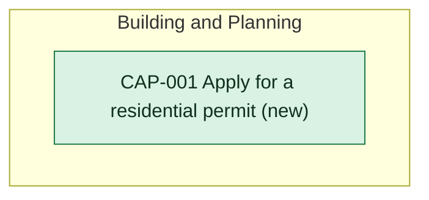

# Capability delta

Every capability this initiative changes. Each capability page holds what provides it today and after.

<!-- generated:capability-map sha=4104f2b5: do not edit, run vela render -->
_Kept up to date by vela from the pages it reads._

Key: green: new in this initiative.
<!-- /generated:capability-map -->
