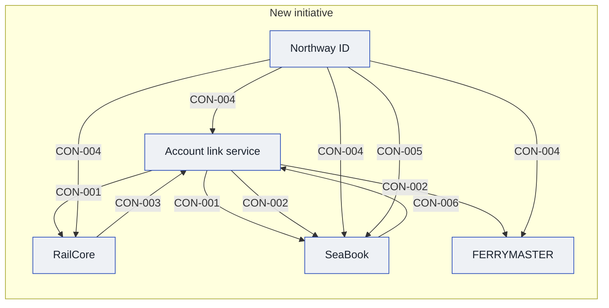

# Context and scope

Each bullet below carries its own state word and source. The page state is the weakest of them, because the rail side and the CIO's wishes come from documents that describe intent.

## Today

### Ferry side today

Harbourline, from its IT operations systems list. Each bullet is a `fact`, source SRC-02.

- **SeaBook** (fact, SRC-02): the web booking engine. It has an availability target of 99.9% from May to September and is on call round the clock.
- **FERRYMASTER** (fact, SRC-02): a mainframe reservation system, and the ledger of record.
- **FERRYMASTER contract notice** (fact, SRC-02): the vendor contract needs 18 months' notice. Its end date is disputed, so it is held in [[11-unknowns-and-risks#UNK-021 FERRYMASTER contract end date|UNK-021]] and not stated here.
- **Halyard CRM** (fact, SRC-02): used by the Kestrel Bay contact centre.
- **Tidepay** (fact, SRC-02): takes card payments for the web, the contact centre and the port kiosks.
- **Tidemiles** (fact, SRC-02): the ferry loyalty scheme, 1 point per pound spent, and 100 points redeem for 1 pound. See [[#SV-01 Tidemiles]].
- **Customer database** (fact, SRC-02): about 1.2 million records. Its owner is to be confirmed after the reorganisation: [[11-unknowns-and-risks#UNK-016 Ferry customer DB owner|UNK-016]].
- **Partner hotel feed** (fact, SRC-02): a nightly file of package bookings goes to about 40 partner hotels. See [[#PTY-01 Partner hotels]].

### Rail side today

Northway Rail, from a target-architecture slide. Each bullet is an `assumption`, source SRC-04, because the slide is a plan and not a record of what runs.

- **RailCore** (assumption, SRC-04): the booking engine, hosted by its vendor. The vendor SLA is 99.5%, and support runs 08:00 to 18:00 on weekdays. See [[#PTY-03 RailCore vendor]].
- **Northway ID** (assumption, SRC-04): the login for every rail customer, and emails are unique.
- **Signal CRM** (assumption, SRC-04): used in the Dunmere contact centre.
- **Northway Plus** (assumption, SRC-04): the rail loyalty scheme, 5 points per pound spent. See [[#SV-02 Northway Plus]].
- **Northway Assist** (assumption, SRC-04): handles assisted travel bookings.
- **Payments** (assumption, SRC-04): through the RailCore gateway today, with a move to Tidepay planned for 2027.

The slide points to a capability map in an appendix that has not been read: [[11-unknowns-and-risks#UNK-023 Rail capability map appendix|UNK-023]].

### What Sarah Chen has said

Sarah Chen, named second-hand as the Data Protection Officer ([[11-unknowns-and-risks#UNK-010 Data Protection Officer|UNK-010]]), from the solution lead's own account of a phone call (SRC-05), which the lead dates Friday 2026-10-07. The calendar shows that date as a Wednesday, and the lead knows it does not add up and asked for it as given. It is recalled, not recorded or written, and she has not said herself that she holds the role. Each bullet records what she said to the lead, not an approval.

- **Household** (fact, SRC-05): she told the lead that one household per shared email, where people link their own accounts, works, and that she needs to see it in the design.
- **Matching** (fact, SRC-05): she asked to be shown how the right person is matched when an email is shared, where consent is collected, and what happens if the match is wrong.
- **Asking families who is who** (fact, SRC-05): she told the lead it is allowed if consent covers it, meaning the family is shown what data is being linked and agrees. She wants that in the design too.
- **Loyalty view** (fact, SRC-05): she wants to see the loyalty view separately, with what data it holds and who sees it, and said it is not the same as the household.
- **Who writes the matching design** (fact, SRC-05): she told the lead that is not her concern, and that whoever builds the design owns it. She did not say who that is: [[11-unknowns-and-risks#UNK-036 Who writes the matching design|UNK-036]].
- **When she reviews** (assumption, SRC-05, SRC-06): she wants the written design two weeks before go-live. With the CIO's live date of 1 June 2027 (SRC-06), that is 18 May 2027. The live date is itself an assumption, so [[11-unknowns-and-risks#UNK-002 Meaning of next summer|UNK-002]] stays open. Whether she signs off or only reviews is [[11-unknowns-and-risks#UNK-041 Review or sign-off before go-live|UNK-041]].

### What the Data Protection Officer has said

The Data Protection Officer's written reply of 2026-10-07 (SRC-07). It is the officer's position on what is lawful, and not a sign-off on any design. Whether the officer is the Sarah Chen above is not settled: [[11-unknowns-and-risks#UNK-010 Data Protection Officer|UNK-010]].

- **Linking at sign-in** (fact, SRC-07): the officer's position is that linking a ferry account and a rail account is lawful when the customer links them at sign-in and consents.
- **Matching without consent** (fact, SRC-07): the officer's position is that matching records across Harbourline and Northway without that consent is not lawful.
- **Households** (fact, SRC-07): the officer's position is that a household needs each adult's own consent.
- **Households in release one** (assumption, SRC-07): the officer asks for households to be kept out of the first release. This clashes with the picked option in [[04-solution-strategy]]: [[11-unknowns-and-risks#UNK-044 Households in release one|UNK-044]].

## After

What the CIO has asked for. Each bullet is an `assumption`, source SRC-01, because the memo states intent.

- **One identity** (assumption, SRC-01): Northway ID becomes the single identity for every group customer by next summer. What that means is open: [[11-unknowns-and-risks#UNK-001 Meaning of the mandate|UNK-001]].
- **One loyalty scheme** (assumption, SRC-01): Tidemiles and Northway Plus are combined. The marketing draft that promises one-for-one points is not recorded here: [[11-unknowns-and-risks#UNK-022 Loyalty points one for one|UNK-022]].

### The CIO's reply of 7 October

Each bullet is an `assumption`, source SRC-06, because the reply states what the CIO means to build.

- **One account** (assumption, SRC-06): one sign-in that links a customer's ferry account and rail account. Whether that is the "single identity" of the memo is open: [[11-unknowns-and-risks#UNK-045 One sign-in or one identity|UNK-045]].
- **Records stay apart** (assumption, SRC-06): customer records are not merged, and each company keeps its own.
- **Shared account service** (assumption, SRC-06): the Northway Platform team owns it. Who owns Northway ID itself is still open: [[11-unknowns-and-risks#UNK-012 Northway ID ownership|UNK-012]].
- **Live date** (assumption, SRC-06): live by 1 June 2027, which is what the CIO means by next summer. [[11-unknowns-and-risks#UNK-002 Meaning of next summer|UNK-002]] stays open until the CIO's office confirms it.

<!-- generated:system-context sha=3cd83795: do not edit, run planner render -->

<!-- /generated:system-context -->

## In scope

- [[ferrymaster-building-blocks|FERRYMASTER]] (changed)
- [[seabook-building-blocks|SeaBook]] (changed)
- [[northway-id-building-blocks|Northway ID]] (changed)
- [[account-link-service-building-blocks|Account link service]] (new)
- [[railcore-building-blocks|RailCore]] (integrated)

## Out of scope

## Outside parties

### PTY-01 Partner hotels

- **Relationship:** partner
- **Agreements:** none known

### PTY-02 FERRYMASTER vendor

- **Relationship:** supplier
- **Agreements:** the FERRYMASTER vendor contract, with 18 months' notice (SRC-02). Its end date is in [[11-unknowns-and-risks#UNK-021 FERRYMASTER contract end date|UNK-021]].

### PTY-03 RailCore vendor

- **Relationship:** supplier
- **Agreements:** a vendor SLA for RailCore (SRC-04, assumption), and no other agreement known.

## Value held for customers

### SV-01 Tidemiles

- **Holder:** not recorded: SRC-02 names Tidemiles as a ferry scheme but not which system keeps the balances
- **Owner:** not known yet: [[11-unknowns-and-risks#UNK-022 Loyalty points one for one|UNK-022]]

### SV-02 Northway Plus

- **Holder:** not recorded: SRC-04 names Northway Plus as a rail scheme but not which system keeps the balances
- **Owner:** not known yet: [[11-unknowns-and-risks#UNK-022 Loyalty points one for one|UNK-022]]
