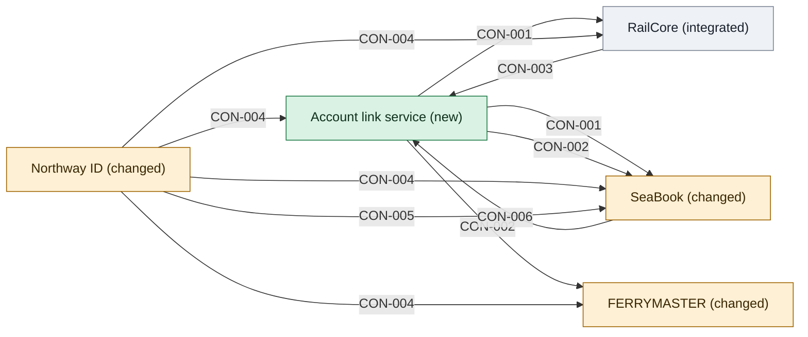

# Building blocks

One page per app in scope, named `<app>-building-blocks.md`. Contracts live on the provider's page.

<!-- generated:context-map sha=c9cea270: do not edit, run planner render -->

<!-- /generated:context-map -->

## Login with a link service

The cut of the decided [[04b-identity-provider#Login owner and offer|login owner and offer]] into apps. It is an assumption until a Grill. The Northway Platform team owning the link step is the lead's pick and rests on the CIO's reply (SRC-06, an assumption); the team's commitment is open: [[11-unknowns-and-risks#UNK-050 Platform team commitment to link service|UNK-050]]. The household and the loyalty view have no owning app in this cut.

| App | Change |
|---|---|
| [[northway-id-building-blocks\|Northway ID]] | changed |
| [[seabook-building-blocks\|SeaBook]] | changed |
| [[ferrymaster-building-blocks\|FERRYMASTER]] | changed |
| RailCore | integrated |
| [[account-link-service-building-blocks\|Account link service]] | new |

- **Options considered:** Login with a link service (picked); Login only, no new app: rejected, it holds the link in two places, leaves the rail-side link with no owner and puts the link step on SeaBook, which Ferry Ops says is frozen (claude's reading, the lead gave no separate reason); Ferry sign-in adapter: rejected, its adapter has no named owner and the link step still has no app (claude's reading, the lead gave no separate reason)
