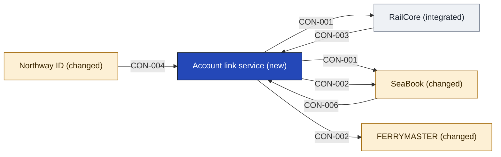

# Account link service

The Account link service lets a person prove who they are and link their own ferry account and rail account, and it keeps those links. Nothing links on an email match: the person does it themselves and agrees to it (SRC-07, the strategy in [[04-solution-strategy]]). The lead's pick is that the Northway Platform team owns the link step, and it rests on the CIO's reply (SRC-06, an assumption). The team has not committed to build and run it: [[11-unknowns-and-risks#UNK-050 Platform team commitment to link service|UNK-050]].

It does not sign anyone in, which Northway ID keeps ([[04b-identity-provider#Login owner and offer|login owner and offer]]). It does not hold the household, which has no app yet and waits on the DPO ([[11-unknowns-and-risks#UNK-044 Households in release one|UNK-044]]). It does not hold the loyalty view. It does not merge or keep customer records, because each company keeps its own (SRC-06). It does not match records without the person's consent (SRC-07).

- **Options considered:** Login with a link service (picked); Login only, no new app: rejected, it holds the link in two places, leaves the rail-side link with no owner and puts the link step on SeaBook, which Ferry Ops says is frozen; Ferry sign-in adapter: rejected, its adapter has no named owner and the link step still has no app

<!-- generated:app-context sha=04095ced: do not edit, run planner render -->

Key: dark blue: the app this page is about · amber: changed by this initiative · gray: stays as it is · an arrow is a contract, labeled with its ID.
<!-- /generated:app-context -->

## Containers

| Container | Job | Contracts served or used | Proposed by | State |
|---|---|---|---|---|
| Link step | Where the person proves who they are and agrees to the link | [[#CON-001 Link a customer\|CON-001]] | claude | assumption |
| Link store | Holds each link between the person key, the ferry customer and the rail account, and the consent given for it | [[#CON-002 Look up linked records\|CON-002]] | claude | assumption |

## Contracts this app provides

### CON-001 Link a customer

- **Crosses the boundary:** in, the person key, the person's proof of who they are and their consent; out, a confirmed link between their ferry account and rail account.
- **Consumers:** [[seabook-building-blocks|SeaBook]], [[railcore-building-blocks|RailCore]]
- **Change policy:** Not decided: the owner sets it with each consumer before build.
- **Change:** new
- **State:** assumption
- **Options considered:** Login with a link service (picked); Login only, no new app: rejected, it holds the link in two places, leaves the rail-side link with no owner and puts the link step on SeaBook, which Ferry Ops says is frozen; Ferry sign-in adapter: rejected, its adapter has no named owner and the link step still has no app

### CON-002 Look up linked records

- **Crosses the boundary:** in, a person key; out, the ferry and rail record references linked to it.
- **Consumers:** [[seabook-building-blocks|SeaBook]], [[ferrymaster-building-blocks|FERRYMASTER]]
- **Change policy:** Not decided: the owner sets it with each consumer before build.
- **Change:** new
- **State:** assumption
- **Options considered:** Login with a link service (picked); Login only, no new app: rejected, it holds the link in two places, leaves the rail-side link with no owner and puts the link step on SeaBook, which Ferry Ops says is frozen; Ferry sign-in adapter: rejected, its adapter has no named owner and the link step still has no app

## Contracts this app consumes

It relies on the person key and sign-in proof from Northway ID: [[northway-id-building-blocks#CON-004 Sign in and person key|CON-004]]. It relies on a ferry customer reference from SeaBook: [[seabook-building-blocks#CON-006 Ferry customer reference|CON-006]], which rests on [[11-unknowns-and-risks#UNK-033 Ferry customer key|UNK-033]]. It relies on a rail account reference from RailCore: [[railcore-building-blocks#CON-003 Rail account reference|CON-003]].

<!-- generated:contracts-consumed sha=3fd719d9: do not edit, run planner render -->
| Contract | Provider | Change policy | State |
|---|---|---|---|
| [[railcore-building-blocks#CON-003 Rail account reference\|CON-003 Rail account reference]] | [[railcore-building-blocks\|RailCore]] | Not decided: RailCore is a vendor product, so any change is the vendor's to agree. | assumption |
| [[northway-id-building-blocks#CON-004 Sign in and person key\|CON-004 Sign in and person key]] | [[northway-id-building-blocks\|Northway ID]] | Not decided: the owner sets it with each consumer before build. | assumption |
| [[seabook-building-blocks#CON-006 Ferry customer reference\|CON-006 Ferry customer reference]] | [[seabook-building-blocks\|SeaBook]] | Not decided: the owner sets it with each consumer before build. | assumption |
<!-- /generated:contracts-consumed -->
