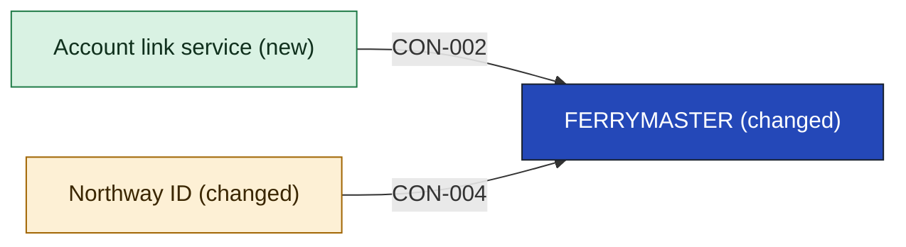

# FERRYMASTER

FERRYMASTER is the mainframe reservation system and the ledger of record (SRC-02). In this cut it also signs in through Northway ID and reads linked records. The decided section depends on it: "It depends on SeaBook and FERRYMASTER being able to sign in through it" ([[04b-identity-provider#The shared login]]). The two people who understand FERRYMASTER are leaving, and who builds and supports its sign-in afterwards is open: [[11-unknowns-and-risks#R-01 FERRYMASTER sign-in after the two leave|R-01]].

It does not own the login or the link. It does not hold the household or the loyalty balances. It does not hold rail customers' records (SRC-06).

- **Options considered:** Login with a link service (picked); Login only, no new app: rejected, it holds the link in two places, leaves the rail-side link with no owner and puts the link step on SeaBook, which Ferry Ops says is frozen; Ferry sign-in adapter: rejected, its adapter has no named owner and the link step still has no app

<!-- generated:app-context sha=a635fdf1: do not edit, run vela render -->

Key: dark blue: the app this page is about · green: new in this initiative · amber: changed by this initiative · an arrow is a contract, labeled with its ID.
<!-- /generated:app-context -->

## Containers

What is inside FERRYMASTER is not recorded: [[11-unknowns-and-risks#UNK-011 How ferry systems relate|UNK-011]]. The one row below is the only part this cut touches. The rest stays as it is.

| Container | Job | Contracts served or used | Proposed by | State |
|---|---|---|---|---|
| Sign-in | Signs in through Northway ID | [[northway-id-building-blocks#CON-004 Sign in and person key\|CON-004]], [[account-link-service-building-blocks#CON-002 Look up linked records\|CON-002]] | claude | assumption |

## Contracts this app provides

None yet. Whether the link needs to read from or write to FERRYMASTER is open: [[11-unknowns-and-risks#UNK-015 Link and FERRYMASTER access|UNK-015]]. No contract is written until it is answered.

## Contracts this app consumes

It relies on [[northway-id-building-blocks#CON-004 Sign in and person key|CON-004]] from Northway ID and [[account-link-service-building-blocks#CON-002 Look up linked records|CON-002]] from the Account link service.

<!-- generated:contracts-consumed sha=633f4ed4: do not edit, run vela render -->
| Contract | Provider | Change policy | State |
|---|---|---|---|
| [[account-link-service-building-blocks#CON-002 Look up linked records\|CON-002 Look up linked records]] | [[account-link-service-building-blocks\|Account link service]] | Not decided: the owner sets it with each consumer before build. | assumption |
| [[northway-id-building-blocks#CON-004 Sign in and person key\|CON-004 Sign in and person key]] | [[northway-id-building-blocks\|Northway ID]] | Not decided: the owner sets it with each consumer before build. | assumption |
<!-- /generated:contracts-consumed -->
