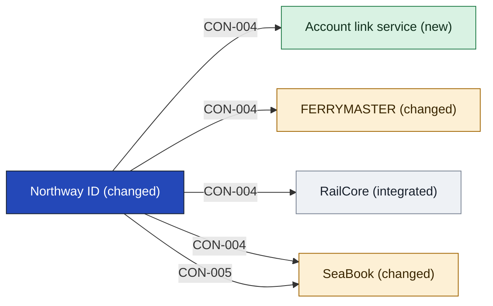

# Northway ID

Northway ID is the shared login. It signs a customer in once, proves who they are, and hands each system one person key: the decided [[04b-identity-provider#Login owner and offer|login owner and offer]]. Rail customers keep the login they have (SRC-04, an assumption). Ferry customers get one, though whether they are meant to is open: [[11-unknowns-and-risks#UNK-031 Ferry customers and Northway ID|UNK-031]]. Who owns Northway ID itself is open: [[11-unknowns-and-risks#UNK-012 Northway ID ownership|UNK-012]].

It does not hold the household, the link or the loyalty view. The link step belongs to the [[account-link-service-building-blocks|Account link service]]. It does not merge or keep customer records, because each company keeps its own (SRC-06).

- **Options considered:** Login with a link service (picked); Login only, no new app: rejected, it holds the link in two places, leaves the rail-side link with no owner and puts the link step on SeaBook, which Ferry Ops says is frozen; Ferry sign-in adapter: rejected, its adapter has no named owner and the link step still has no app

<!-- generated:app-context sha=5faac5f3: do not edit, run planner render -->

Key: dark blue: the app this page is about · green: new in this initiative · amber: changed by this initiative · grey: stays as it is · an arrow is a contract, labelled with its ID.
<!-- /generated:app-context -->

## Containers

| Container | Job | Contracts served or used | Proposed by | State |
|---|---|---|---|---|
| Sign-in | Where the customer proves who they are | [[#CON-004 Sign in and person key\|CON-004]] | claude | assumption |
| Person directory | Holds each customer's login, unique email and person key | [[#CON-004 Sign in and person key\|CON-004]], [[#CON-005 Enrol a ferry customer\|CON-005]] | claude | assumption |

## Contracts this app provides

### CON-004 Sign in and person key

- **Crosses the boundary:** in, the customer's credentials; out, proof of who signed in and their person key.
- **Consumers:** [[seabook-building-blocks|SeaBook]], [[ferrymaster-building-blocks|FERRYMASTER]], [[railcore-building-blocks|RailCore]], [[account-link-service-building-blocks|Account link service]]
- **Change policy:** Not decided: the owner sets it with each consumer before build.
- **Change:** new consumers
- **State:** assumption
- **Options considered:** Login with a link service (picked); Login only, no new app: rejected, it holds the link in two places, leaves the rail-side link with no owner and puts the link step on SeaBook, which Ferry Ops says is frozen; Ferry sign-in adapter: rejected, its adapter has no named owner and the link step still has no app

### CON-005 Enrol a ferry customer

- **Crosses the boundary:** in, a ferry customer's details, with their agreement; out, a new Northway ID and its person key. It rests on [[11-unknowns-and-risks#UNK-037 Northway ID terms for ferry customers|UNK-037]] and UNK-031.
- **Consumers:** [[seabook-building-blocks|SeaBook]]
- **Change policy:** Not decided: the owner sets it with each consumer before build.
- **Change:** new
- **State:** assumption
- **Options considered:** Login with a link service (picked); Login only, no new app: rejected, it holds the link in two places, leaves the rail-side link with no owner and puts the link step on SeaBook, which Ferry Ops says is frozen; Ferry sign-in adapter: rejected, its adapter has no named owner and the link step still has no app

## Contracts this app consumes

None from the other apps in this cut. Sign-in flows one way, into Northway ID.

<!-- generated:contracts-consumed sha=140bedbf: do not edit, run planner render -->
none
<!-- /generated:contracts-consumed -->
