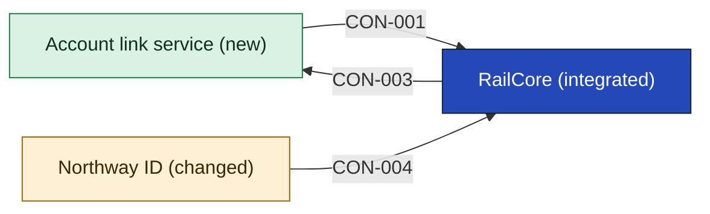

# RailCore

RailCore is the rail booking engine, hosted by its vendor (SRC-04, an assumption). It is a black box here: this initiative changes nothing inside it, and the Account link service only reads a rail account reference from it. Its vendor SLA and support hours are on [[03-context-and-scope#PTY-03 RailCore vendor|PTY-03]].

<!-- generated:app-context sha=66f1d17e: do not edit, run planner render -->

<!-- /generated:app-context -->

## Contracts this app provides

### CON-003 Rail account reference

- **Crosses the boundary:** out, a reference to a rail account for a person. SRC-04 does not describe this contract; it is a proposal the lead agreed to when reading back the Account link service.
- **Consumers:** [[account-link-service-building-blocks|Account link service]]
- **Change policy:** Not decided: RailCore is a vendor product, so any change is the vendor's to agree.
- **Change:** unchanged
- **State:** assumption
